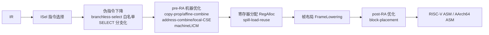
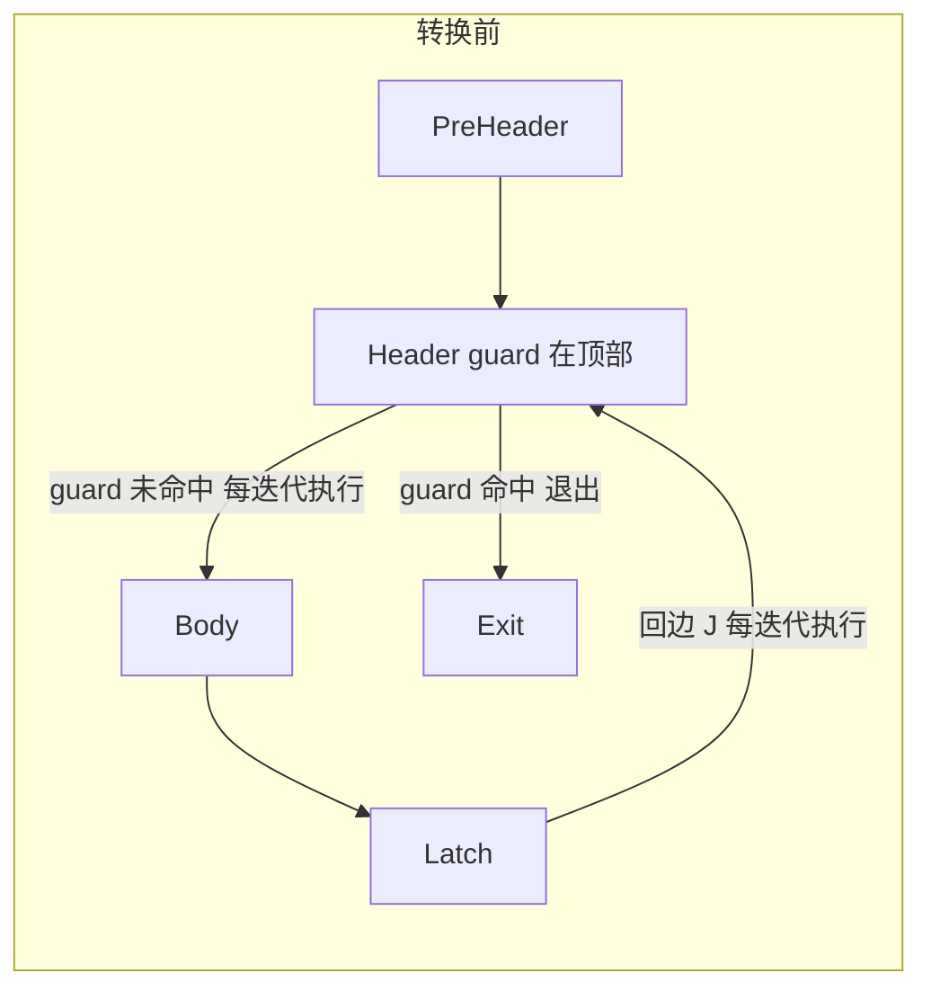
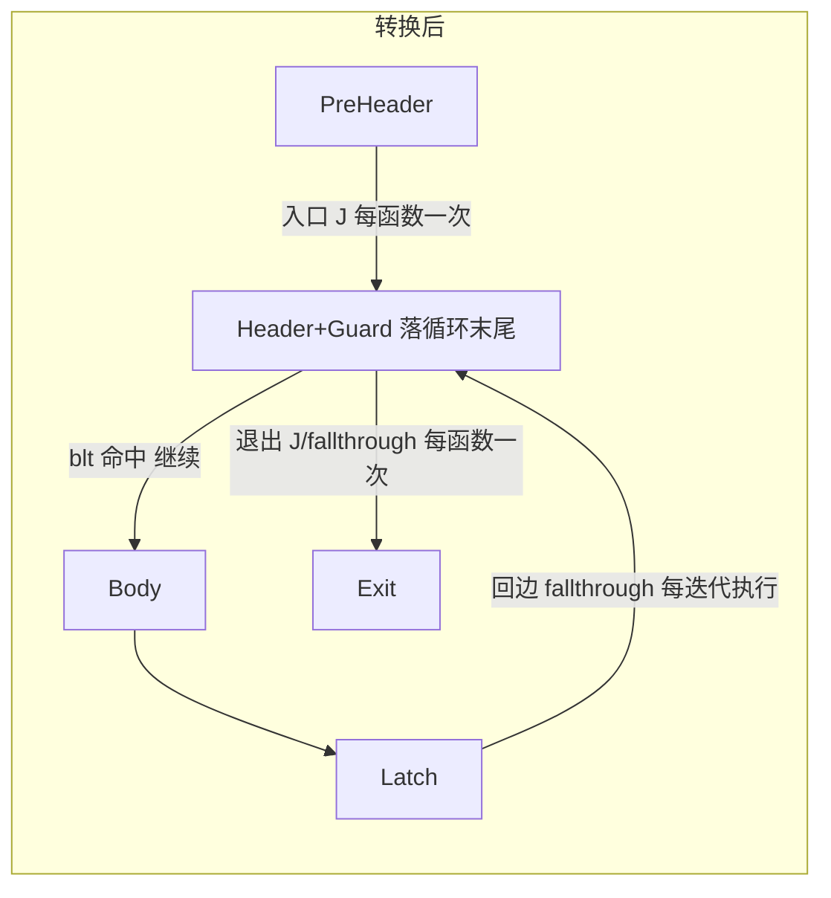

### 后端

**后端流水线总览**：



**各阶段职责**：

1. **ISel 指令选择**：把中端 IR（38 条指令子集）映射为 MIR 与伪指令（SELECT/COPY/PHI），负责调用约定、寻址形态、比较与分支的初始形态——具体策略见「指令选择与Lower策略」；
2. **伪指令下降**：SELECT 展开 / 分支化、EliminatePhiPass、RebuildCFG，把伪指令消除为真实目标指令；
3. **pre-RA 机器优化**：在寄存器分配前消除机器层的冗余，优化有：copy-prop、affine/address-combine、local-CSE 化简地址链与拷贝链，machineLICM 外提循环不变量（最末位处理全部化简产物）等；
4. **寄存器分配 RegAlloc**：虚拟寄存器图着色到物理寄存器，溢出（spill）改写与块级 load 复用；
5. **帧布局 FrameLowering**：确定栈帧尺寸、callee-saved 保存区、局部对象与溢出槽布局；
6. **post-RA 优化**：物理寄存器上安全执行的 peephole 与 BlockPlacement 布局；
7. **汇编输出 AsmPrinter**：MIR → 目标汇编文本（SMULL 宽度语义、尾调用 BR 展开、伪指令最后形态）。


**开关机制**：全部可选机器 pass 由 `BACKEND_DISABLE_PASSES` 环境变量统一控制，开关名归一化匹配（`block-placement-rotate` 与 `block_placement_rotate` 等价），`all` 关闭全部可选 pass。

#### 机器层优化框架

##### 机器分析基础设施

机器层分析与中端 AnalysisPass 对应，由 `MachineFunctionAnalysisManager` 按需缓存、变换 pass 返回 `MachinePreservationStatus`（改 CFG → `none()`、未改 → `all()`）：

- `MachineCFGAnalysis`：块前驱/后继（块下标），循环成员与 preheader 判定的基础；
- `MachineLoopAnalysis`：`depth[]` + `backedges{(latch,header)}`，按 header 合并 latch 还原循环成员
- `MachineLivenessAnalysis`：每块 `uses/defs/liveIn/liveOut`（vreg），用于活跃区间判定；
- `MachineBlockFrequencyAnalysis`
##### 机器变换Pass管线与A/B开关

函数级代码生成流水线 `buildCodegenPipeline` 的完整顺序（`src/{riscv,aarch64}/opt/MachinePassBuilder.cpp`）：

1. **指令选择后**：RebuildCFG → cleanup-cfg；
2. **伪指令下降**：`branchless-select`→ `LowerSelectPass`）→ EliminatePhiPass → cleanup-cfg；
3. **pre-RA 机器优化**（`buildPreRAOptPipeline`）：branch-compare-folding → pre-ra-global-address-reuse → pre-ra-copy-prop → pre-ra-affine-combine → pre-ra-address-combine → pre-ra-local-cse
4. **寄存器分配**（RegAlloc，含 spill-load-reuse 溢出改写）→ FrameLowering；
5. **post-RA 优化**（`buildPostRAOptPipeline`）：post-ra-peephole → RebuildCFG → cleanup-cfg → **block-placement** → RebuildCFG → loop-backedge-bypass（默认关）→ post-ra-list-schedule。


#### 指令选择与Lower策略


##### 调用约定与栈帧

- **RISC-V**：整型参数 a0~a7、浮点参数 fa0~fa7；callee-saved s0~s11 与 ra；栈向下增长，sp 16 字节对齐；
- **AArch64**：整型参数 x0~x7、浮点参数 d0~d7（16 字节对齐规则）；callee-saved x19~x28、x29（fp）、x30（LR）；sp 16 字节对齐；
- **FrameLowering**：确定帧尺寸（局部对象 + 溢出槽 + callee-saved 保存区），callee-saved 在函数序言保存、尾声恢复

##### 比较与分支折叠

- ISel 对 `icmp` 生成 SLT/SLTU 或 EQ/NE 比较序列（RISC-V 上 LE/GE 由 SLT+SEQZ 两条构成，AArch64 由 cmp+scc 构成），后继由分支处理；
- `branch-compare-folding`（`runBranchCompareFolding`，peepholeOpt.cpp）把「比较指令 + 分支」折叠为复合分支：`SLT/XOR/XORI` 结果 + `BEQZ/BNEZ` → `BEQ/BNE/BLT/BGE` 单条指令，消除独立比较指令；

##### 立即数与全局地址物化

- IR 常量是操作数而非指令：ISel 对每个 use 点用一条 `LI`（RISC-V `lui+addi` / AArch64 `movz` ）或 `LA`（RISC-V `auipc+%pcrel_hi/lo` / AArch64 `adrp+add`）
- `pre-ra-global-address-reuse`：把循环内 LA 替换为 entry 处 COPY（循环内每迭代一次少一次）；

##### 访存寻址

- **RISC-V**：大偏移由 `addImmediateToReg` 展开为 ADDI/ADD 链；
- **AArch64**：`AddressIndexFold`（`src/aarch64/opt/AddressIndexFold.cpp`）把 `[base + idx×scale]` 折叠为带移位的索引寻址

##### 算术与除法折叠

- **SMULL/SMADDL**：AArch64 32×32→64 带符号长乘与乘加融合
- **memcpy/memset 对齐**：内联展开按对齐宽度选择拷贝指令，消除未对齐访存    
- **SIGNED_DIV_FOLD**：除数已知的带符号除法折叠为乘加移位序列（RISC-V ）；

##### 条件选值

- **AArch64**：`SelectToCsel`（select-to-csel 可选 pass）把 SELECT 转为 `csel`；条件由 cmp/scc 序列产生；不满足 csel 形状（浮点/长整型条件、复杂条件）时降级分支；
。

#### 机器优化Pass


##### BlockPlacement+LayoutCost


**原理与正确性论证**：

1. 本pass将带无条件 J 回边的 latch 块挪到循环 header 之前。这样调整后，循环回边能够直接落在 fallthrough 路径上，同时把 header 的 guard 条件分支自然放到循环尾部。整个过程不会改变程序执行语义：第一次迭代依然从函数入口先执行 guard 判断，再进入循环体，整体分支走向和原逻辑一致。

2. 循环迭代次数预估仅影响布局的权重，不改变程序逻辑

3. trip count 预估机制用来计算循环 header 两条分支继续循环和 退出循环的执行频率权重，对应权重为 T/(T+1) 和 1/(T+1)。整个预估过程不会修改机器指令。 即使是出现预估偏差，最坏结果也只是布局方案达不到最优，不会生成错误代码影响程序执行正确性。

转换前（guard 在顶部，回边为显式 J）与转换后（guard 落循环末尾、回边 fallthrough）：






**优化前后汇编对比**

```asm
.Lmain.bb33_to_.Lmain.bb13_phi:      # 预头(循环进位拷贝)
    mv a3, zero
    mv t0, zero
.Lmain.bb13:                          # header(guard 在顶部)
    bge a3, a0, .Lmain.bb58           # 每迭代执行:未命中(继续)
.Lmain.bb14:                          # 循环体(latch)
    slli a5, t0, 2
    add a5, a4, a5
    sw zero, 0(a5)
    ...(4 路展开的 store 序列)...
    addiw t0, t0, 4
    addiw a3, a3, 1
    j .Lmain.bb13                     # 每迭代执行:命中的回边 J

; 新
.Lmain.bb33_to_.Lmain.bb13_phi:      # 预头
    mv a3, zero
    mv t0, zero
    j .Lmain.bb13                     # 入口 J(每迭代 0 次,仅进循环一次)
.Lmain.bb14:                          # 循环体(latch)→ 回边 fallthrough
    slli a5, t0, 2
    add a5, a4, a5
    sw zero, 0(a5)
    ...(4 路展开的 store 序列)...
    addiw t0, t0, 4
    addiw a3, a3, 1
.Lmain.bb13:                          # guard 落在循环末尾(检查-执行)
    blt a3, a0, .Lmain.bb14           # 每迭代执行:命中的回边分支
    j .Lmain.bb58                     # 退出 J(每迭代 0 次,仅退出一次)
```


#### MachineLICM机器级循环不变量外提

##### MachineLICM原理与设计
中端已实现完备的 IR 层级 LICM 优化
机器层 MachineLICM处理：
多维数组寻址（如 &a[k][i]）中，存在大量循环不变的基址、偏移计算逻辑这类逻辑在 MIR 阶段展开的 ADDI、ADD 等机器指令链
其他可证安全的循环不变 load 指令，如部分 load 指令的基址链可解析为全局变量或栈槽地址，且循环内不存在别名存储操作。

**优化前后汇编对比**
```asm
; 无 LICM`li t3, 1000`、`mul t3, t0, t3`、`slli t3, t2, 2` 每迭代重算
.Lmain.bb6:
    slli a0, t0, 2
    add t3, t1, a0
    lw t5, 0(t3)
    li t3, 1000
    mul t3, t0, t3
    add t4, s1, t3
    slli t3, t2, 2
    add t4, t4, t3
    addi t3, t1, 1000
    sw t5, 0(t4)
    add t3, t3, a0
    lw t3, 0(t3)
    addiw t2, t2, 2
    addi t1, t1, 2000
    sw t3, 4(t4)
.Lmain.bb5:
    li t3, 250
    blt t2, t3, .Lmain.bb6

; 有 LICM LI/mul 链外提到 preheader，guard 界限 `li t3, 250` 也外提为 a4
.Lmain.bb6:
    add t4, t1, a3
    lw a2, 0(t4)
    add t5, s1, a1
    slli t4, t2, 2
    add t5, t5, t4
    addi t4, t1, 1000
    sw a2, 0(t5)
    add t4, t4, a3
    lw t4, 0(t4)
    addiw t2, t2, 2
    addi t1, t1, 2000
    sw t4, 4(t5)
.Lmain.bb5:
    blt t2, a4, .Lmain.bb6
```


