# 参赛文档

### 代码声明

**一、第三方 IP 借鉴声明**

1. 本项目的 IR 结构设计整体借鉴自LLVM的设计理念和架构组织，但做了本项目特化
2. 一些AnalysisPass和TransformPass借鉴LLVM的算法思想，但做了本项目特化

**二、人工智能辅助工具使用声明**

在本项目开发中，使用了人工智能辅助编程工具，生成的代码范围及使用方式说明如下：

- 本项目的大部分代码使用**Codex**在编辑器中以“编码—提示-补全”模式辅助编写；
- Codex生成某些pass以及中端架构的初版架构，然后由人工原创设计pass算法及实现，然后人工进行审查
- 使用了AI大模型ChatGPT生成该文档中某些图，用来更好的说明一些优化流程
- 人工审阅与修改：所有 AI 生成的代码，均由团队成员逐行审阅，针对项目接口规范、性能要求、安全检查等进行必要的补充、重构与单元测试，确保最终代码质量与一致性。

### 分工合作

- 刘烨嘉一：负责前端以及中端
- 宋科宏：负责RISCV后端和ARM后端

### 总体框架

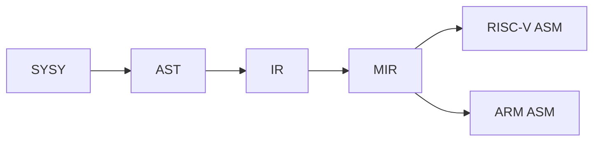

```
Compiler/
├── doc/                              # 竞赛文档
│
├── include/                          # .hpp文件
│   ├── yacc/                         # 词法、语法分析相关文件
│   ├── lib/                          # 编译器前端文件及中端基础结构文件
│   ├── ir/                           # 中端优化框架
│   │   ├── analysis/                 # 中端分析 Pass
│   │   └── opt/                	  # 中端变换与优化 Pass
│   ├── riscv/                        # RISC-V 后端
│   └── aarch64/                      # ARM 后端
│
├── src/                              # .cpp文件
│   ├── yacc/                         # 词法、语法分析相关文件
│   ├── lib/                          # 编译器前端文件及中端基础结构文件
│   ├── ir/                           # 中端优化框架
│   │   ├── analysis/                 # 中端分析 Pass
│   │   └── opt/                      # 中端变换与优化 Pass
│   ├── riscv/                        # RISC-V 后端
│   └── aarch64/                      # ARM 后端
│
├── runtime/                          # SysY 运行时库
├── main.cpp                          # 编译器入口
├── CMakeLists.txt                    # CMake 项目构建配置
└── README.md                         # 项目说明
```

### 前端

#### SysY2022及Runtime分析

> 这一部分是本人在阅读完相关文档的一些总结，目的为了便于后续开发前中端查阅需要

**Sysy2022**

- .sy文件结构：全局变量声明，全局常量声明，函数定义，唯一的main函数定义

- 注释：单行和多行（遇到第一个*/就结束）

- 数值类型：int/float类型和元素为int/float类型且按**行优先存储**的多维数组类型

  隐式类型转换：编译器在需要是可自动转换float/int，不支持程序员 `(int)`、`(float)` 主动指定转换

  > 混合运算时，int先转float，再进行计算
  >
  > float隐式转换成int时，小数部分直接丢弃，float超出int范围，进行转换为未定义行为
  >
  > int隐式转换成float时，转换后值保持不变

- 函数：

  参数为 int/float 时，按值传递

  参数为数组类型时，实际传递的是数组的起始地址，并且**形参第一维的长度必须空缺**。

  ```c
  //示例1：
  //在如下例子传入的就是a[0]，并且实际修改的就是main中的data[0]
  void process(int a[]) {
      a[0] = 100;
  }
  int main() {
      int data[3] = {1, 2, 3};
      process(data);
  }
  //示例2：
  void process(int a[][3]) {
  }
  
  //示例3：支持多维数组降维传递
  //下图传递了data[1]这个[3][4]的二维数组
  void process_matrix(int a[][4]) {
      a[0][0] = 100;
  }
  
  int main() {
      int data[2][3][4];
      process_matrix(data[1]);
      return 0;
  }
  ```

- 数值常量：**忽略所有后缀**

  - 整数常量：

    - 十进制
    - 八进制：以0开头
    - 十六进制：以0x或0X开头

  - 浮点常量：均存在整数+小数/省略整数/省略小数三种形式，**忽略所有后缀**

    - 十进制：

      普通形式：3.14 / .5 / 1.

      十进制指数：

      **注意指数的底数为10**

      ```
      1e3      = 1 × 10³    = 1000
      2.E2     = 2. × 10²  = 200
      .14e-2   = 0.14 × 10⁻² = 0.0014
      ```

    - 十六进制：

      0x 十六进制数字 '.' 十六进制数字 p 十进制指数：

      **注意指数的底数为2**

      ```
      0x1.2p3 = 1.125 × 8 = 9
      	0x1.2 = 1 + 2 × 16⁻¹
          = 1 + 2/16
          = 1.125
      	2³ = 8
      ```

- 一些规则：

  - 常量必须初始化且不能再次赋值
  - 数组每一维定义必须显式给出
  - 未初始化局部变量值不确定
  - 未初始化全局变量/数组初始值为0
  - 初始化全局变量/数组初始值为常量表达式
  - 数组只能逐维赋值，不能整个赋值

- sysy其他未提到的参考C语言即可

**Runtime**

> 由于putf在测试用例中并未出现，所以本人没有实现这一runtime函数在前中端的处理

读取函数：

- int getint()：从**标准输入**读取一个整数，并返回对应的 `int` 值

- float getfloat()：从**标准输入**读取一个浮点数，返回 32 位单精度浮点值

- int getch()：从**标准输入**中读取一个字符（将整数视为字符），并返回该字符的 ASCII 码值

  ```c
  12 34
  |
  |
  '1' → 49
  '2' → 50
  ' ' → 32
  '3' → 51
  '4' → 52
  '\n' → 10    
  ```

- int getarray(int[])：输入一串整数，第 1 个整数代表后续要输入的整数个数，该个数通过返回值返回；后续的整数通过传入的数组参数返回

  ```c
  4 10 20 30 40
  
  int main() {
      int a[10];
      int n = getarray(a);
  }
  
  /*
  n = 4
  a[0] = 10
  a[1] = 20
  a[2] = 30
  a[3] = 40
  */
  ```

- int getfarray(float[])：同上

输出函数：

- void putint(int)：向**标准输出**打印一个整数

- void putfloat(float)：向**标准输出**打印一个单精度浮点数

- void putch(int)：将整数参数解释成 ASCII 码，并输出对应字符

  ```c
  putch(65); -> A
  ```

- void putarray(int, int[])：第 1 个参数表示要输出的整数个数(假设为 N)，后面应该跟上要输出的 N个整数的数组。putarray 在输出时会在整数之间安插空格

  ```c
  示例：int n=2; inta[]={2,3}; putarray(n, a);
  输出：2:2 3
  ```

- void putfarray(int,float[])：同上

计时函数：

> 输出格式：
>
> Timer#编号@开启行号-停止行号: 时-分-秒-微秒
>
> TOTAL: 时-分-秒-微秒
>
> Timer#001@0010-0012: 0H-0M-3S-3860us

- void starttime()
- void stoptime()

**llvm intrinsic  **

在中端还引入了llvm.memcpy / llvm.memset / llvm.memmove，引入主要为了便于优化，在后端生成asm前已经替换掉

```
memcpy：从源地址 src 开始，复制 len 个字节到目标地址 dest。（不允许重叠）
@llvm.memcpy.p0.p0.i32(ptr %dest, ptr %src, i32 %len, i1 %isvolatile)

memmove：从源地址 src 开始，复制 len 个字节到目标地址 dest。（允许重叠）
@llvm.memmove.p0.p0.i32(ptr %dest, ptr %src, i32 %len, i1 %isvolatile)

memset：从目标地址 dest 开始，将连续 len 个字节全部设置为同一个字节值 value。
@llvm.memset.p0.i32(ptr %dest, i8 %value, i32 %len, i1 %isvolatile)
```

#### 词法分析+语法分析

采用业界主流的Flex+Bison工具进行构建，由人工写好.l和.y文件之后通过Flex+Bison自行构建出相关hpp/cpp文件

#### AST

整个 AST 体系以 `BaseAST` 为唯一多态根节点。具体节点直接继承`BaseAST`（表达式链节点经 `BaseExp<T>` 间接继承）

- 编译单元：`CompUnit`
- 声明与定义：`ConstDecl`,`VarDecl`,`ConstDefList`,`VarDefList`,`ConstDef`,`VarDef`
- 函数相关：`FuncDef`, `FuncParam`, `FuncParamList`
- 初始化相关：`InitValList`, `InitVal`
- 语句相关：`Block`, `BlockItemList`, `AssignStmt`, `ExpStmt`, `IfStmt`, `WhileStmt`, `BreakStmt`, `ContinueStmt`, `ReturnStmt`
-  表达式相关：`LVal`, `FuncCall`, `ArrayList`, `FuncRParamList`, `UnaryExp`, `MulExp`, `AddExp`, `RelExp`, `EqExp`, `LAndExp`, `LOrExp`, `ConValue`

##### 相关结构：

1. 编译单元及声明与定义结构：

   ```mermaid
   graph TD
   
   	N1[CompUnit] --> N3[FuncDef]
   	N1[CompUnit] --> N4[ConstDecl]
   	N1[CompUnit] --> N5[VarDecl]
   	N4[ConstDecl] --> N6[ConstDefList]
   	N5[VarDecl] --> N7[VarDefList]
   	N6[ConstDefList] --> N8[ConstDef]
   	N7[VarDefList] --> N9[VarDef]
   	N3[FuncDef] --> N10[FuncParamList]
   	N3[FuncDef] --> N11[Block]
   	N10[FuncParamList] --> N12[FuncParam]
   	N8[ConstDef] --> N13[ident]
   	N8[ConstDef] --> N14[ArrayList]
   	N8[ConstDef] --> N15[InitVal]
   	N9[VarDef] --> N13[ident]
   	N9[VarDef] --> N14[ArrayList]
   	N9[VarDef] --> N15[InitVal]
   	N3[FuncDef] --> N16[ident]
   	N3[FuncDef] --> N17[Type]
   
   	N12[FuncParam] --> N18[Type]
   	N12[FuncParam] --> N19[ident]
   	N12[FuncParam] --> N20[ArrayList]
   	N4[ConstDecl] --> N21[Type]
   	N5[VarDecl] --> N22[Type]
   ```


2. 语句相关结构：

   ```mermaid
   graph TD
   	N1[Block] --> N2[BlockItemList]
       N2[BlockItemList] --> N3[BlockItem（文法分类）]
       N3 --> N19[ConstDecl]
       N3 --> N20[VarDecl]
       N3 --> N4[AssignStmt]
   	N4[AssignStmt] --> N5[LVal]
   	N4[AssignStmt] --> N6[AddExp]
       N3 --> N7[ExpStmt]
   	N7[ExpStmt] --> N8[AddExp]
       N3 --> N9[IfStmt]
   	N9[IfStmt] --> N10[LOrExp]
       N9[IfStmt] --> N11[then/else 分支]
       N3 --> N12[WhileStmt]
   	N12[WhileStmt] --> N13[LOrExp]
       N12[WhileStmt] --> N14[循环体]
       N3 --> N15[BreakStmt]
       N3 --> N16[ContinueStmt]
       N3 --> N17[ReturnStmt]
   	N17[ReturnStmt] --> n18[AddExp]
   
   ```


3. 表达式相关结构：

   ```mermaid
   graph TD
       N1[LOrExp] --> N2[LAndExp]
       N2[LAndExp] --> N3[EqExp]
       N3[EqExp] --> N4[RelExp]
       N4[RelExp] --> N5[AddExp]
       N5[AddExp] --> N6[MulExp]
       N6[MulExp] --> N7[UnaryExp]
       N7[UnaryExp] --> N8[PrimaryExp（文法分类）]
   
       N8 --> N9[LVal]
       N8 --> N10[FuncCall]
       N8 --> N11[ConValue]
       N8 --> N5
   
       N9[LVal] --> N12[ArrayList]
       N10[FuncCall] --> N13[FuncRParamList]
   
       N12[ArrayList] --> N5[AddExp]
       N13[FuncRParamList] --> N5[AddExp]
   ```

#### IR生成

使用Visitor设计模式，将IR生成相关逻辑与AST结构，IR结构解耦，实现了将AST转化为无SSA形式的，兼容LLVM格式的中间代码IR

#### 符号表

基于《编译器设计》一书中对符号表的解析上修改，设计而来

- 功能：主要用于IR生成阶段，便于建立中端Value与前端AST Ident映射的桥梁
  - 变量遮蔽：允许在内层作用域声明与外层同名的变量。在进入新作用域的时候能够及时屏蔽外层同名变量

### 中端

#### IR

> 为方便决赛拓展向量优化，IR提前拓展向量指令

采用与LLVM IR兼容的IR，便于使用LLVM工具链LLI/LLC进行测试

##### 支持指令：为LLVM IR的子集，目前一共38条指令

```
终止与控制流指令：
Ret
Br
Call

内存操作指令：
Alloca(分配局部变量的内存，返回地址指针)
Store
Load
GetElementPtr (GEP)（根据类型和下标计算地址）

二元运算指令：
算术运算: Add, Fadd, Sub, Fsub, Mul, Fmul
Sdiv, Fdiv,Udiv -- Udiv目前仍未使用
Srem, Frem,Urem -- Frem目前仍未使用,Urem中端优化引入
逻辑运算: And, Or, Xor --中端优化时引入（这里是按位运算指令，前端逻辑判断IR生成为基本块级）
移位运算: Shl逻辑左移, Lshr逻辑右移, Ashr算术右移 -- 中端优化引入
比较运算: Icmp, Fcmp
/*
icmp eq    // 整数相等：lhs == rhs
icmp ne    // 整数不等：lhs != rhs
icmp sgt   // 有符号大于：signed(lhs) > signed(rhs)
icmp sge   // 有符号大于等于：signed(lhs) >= signed(rhs)
icmp slt   // 有符号小于：signed(lhs) < signed(rhs)
icmp sle   // 有符号小于等于：signed(lhs) <= signed(rhs)
fcmp oeq   // 有序相等：两者都不是 NaN，并且 lhs == rhs
fcmp une   // 无序不等：至少一个是 NaN，或者 lhs != rhs
fcmp ogt   // 有序大于：两者都不是 NaN，并且 lhs > rhs
fcmp oge   // 有序大于等于：两者都不是 NaN，并且 lhs >= rhs
fcmp olt   // 有序小于：两者都不是 NaN，并且 lhs < rhs
fcmp ole   // 有序小于等于：两者都不是 NaN，并且 lhs <= rhs
无序指的是NaN，只要NaN存在就无法进行比较（除了不等之外）
*/


类型转换指令：
FPTOSI
SITOFP //用于隐式类型转换
Zext零扩展
Sext符号扩展
Trunc整数截断
BitCast将指针解释成另一种类型指针 -- 中端优化引入


静态单赋值 (SSA) 与选择指令：
Phi    -- 中端优化引入
Select -- 中端优化引入

向量运算指令：
extractelement 从固定长度向量中提取一个标量元素
insertelement  把一个标量元素插入到固定长度向量
shufflevector  按照常量mask将两个输入向量进行重排
```

> IR格式：
>
> ret：`ret i32 %result` / `ret void`
>
> br：`br label %destination` / `br i1 %condition, label %true_block, label %false_block`
>
> call：`%result = call i32 @function(i32 %arg1, float %arg2)` / `call void @function(i32 %arg)` / `%result = tail call i32 @function(i32 %arg)`
>
> alloca：`%ptr = alloca i32` / `%array = alloca [10 x i32]`
>
> store：`store i32 %value, i32* %ptr` / `store float %value, float* %ptr`
>
> load：`%value = load i32, i32* %ptr` / `%value = load float, float* %ptr`
>
> getelementptr（GEP）：`%element_ptr = getelementptr inbounds [10 x i32], [10 x i32]* %array, i64 0, i64 3`（**跨过0个数组长度，访问数组中第3号（第四个）元素array[3]**）
>
> add：`%result = add i32 %lhs, %rhs`
>
> fadd：`%result = fadd float %lhs, %rhs`
>
> sub：`%result = sub i32 %lhs, %rhs`
>
> fsub：`%result = fsub float %lhs, %rhs`
>
> mul：`%result = mul i32 %lhs, %rhs`
>
> fmul：`%result = fmul float %lhs, %rhs`
>
> and：`%result = and i32 %lhs, %rhs` / `%result = and i1 %condition1, %condition2`
>
> or：`%result = or i32 %lhs, %rhs` / `%result = or i1 %condition1, %condition2`
>
> xor：`%result = xor i32 %lhs, %rhs` / `%not = xor i1 %condition, true`
>
> icmp：`%result = icmp slt i32 %lhs, %rhs` / `%result = icmp eq i32 %lhs, %rhs`
>
> fcmp：`%result = fcmp olt float %lhs, %rhs` / `%result = fcmp oeq float %lhs, %rhs`
>
> sdiv：`%result = sdiv i32 %lhs, %rhs`
>
> fdiv：`%result = fdiv float %lhs, %rhs`
>
> srem：`%result = srem i32 %lhs, %rhs`
>
> frem：`%result = frem float %lhs, %rhs`
>
> udiv：`%result = udiv i32 %lhs, %rhs`
>
> urem：`%result = urem i32 %lhs, %rhs`
>
> shl：`%result = shl i32 %value, %shift` / `%result = shl i32 %value, 3`
>
> lshr：`%result = lshr i32 %value, %shift` / `%result = lshr i32 %value, 3`
>
> ashr：`%result = ashr i32 %value, %shift` / `%result = ashr i32 %value, 3`
>
> fptosi：`%result = fptosi float %value to i32`
>
> sitofp：`%result = sitofp i32 %value to float`
>
> zext：`%result = zext i1 %value to i32` / `%result = zext i8 %value to i32`
>
> bitcast：`%result = bitcast i32* %ptr to float*`
>
> trunc：`%result = trunc i32 %value to i1` / `%result = trunc i32 %value to i8`
>
> sext：`%result = sext i8 %value to i32` / `%result = sext i1 %value to i32`
>
> phi：`%result = phi i32 [ %value1, %block1 ], [ %value2, %block2 ]`
>
> select：`%result = select i1 %condition, i32 %true_value, i32 %false_value`
>
> extractelement：`%x = extractelement <4 x i32> %v, i32 %index`
>
> insertelement：`%r = insertelement <4 x i32> %v, i32 %x, i32 %index`
>
> shufflevector：`%result = shufflevector <4 x i32> %v1,<4 x i32> %v2,<4 x i32> <i32 0, i32 4, i32 1, i32 5>`

##### Value/User/Use

仿照LLVM进行设计，但是做了精简与本项目的适配

Use--链表结点

设计特点：禁止被拷贝和移动，禁止被继承

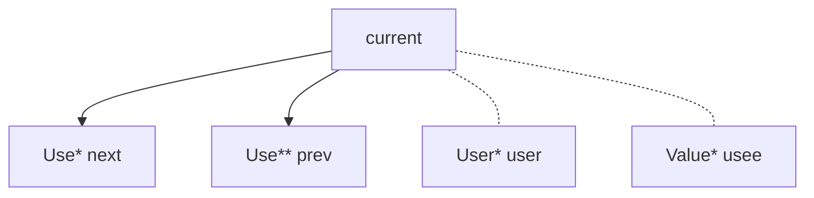


UseList --链表

设计特点：禁止被拷贝和移动，禁止被继承

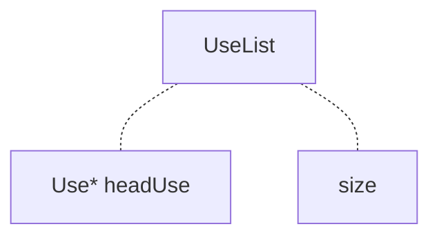

Value

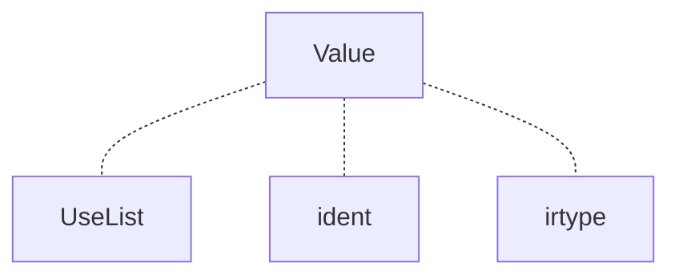

User

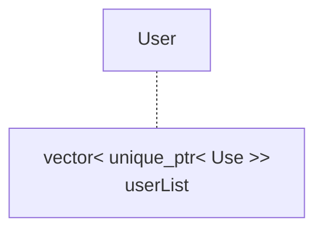

##### TypeSystem类型系统

> 为了便于决赛向量优化，IR类型系统提前支持向量类型

设计模式：采用单例static设计模式，并且使用shared_ptr包装裸指针进行内存管理


- 目的：用来支持IR的强类型语言的特性

- 支持类型：

  ```c++
  enum TypeSystem{
      IR_INT,IR_FLOAT,IR_VOID,IR_POINTER,IR_ARRAY,IR_VECTOR,IR_UNDEF
  };
  ```

  `IR_UNDEF` 仅用于表示前端源类型转换失败，不对应可实例化的 IR 类型

- 结构：

  ```mermaid
  graph TD
  	N1[IRType] -.- N2[TypeSystem Enum]
  	N1[IRType] -.- N3[size]
  	N1[IRType] --> N4[VOIDType]
  	N1[IRType] --> N6[INTType]
  	N1[IRType] --> N10[FLOATType]
  	N1[IRType] --> N14[POINTERType]
  	N14[POINTERType] --> N15[pointerType]
  	N1[IRType] --> N16[ARRAYType]
  	N16[ARRAYType] --> N17[elementType]
  	N1[IRType] --> N18[VECTORType]
  	N18[VECTORType] --> N19[elementType]
  ```

##### CFG

参考LLVM实现，但是对本项目做了精简与适配

采用侵入式链表进行组织

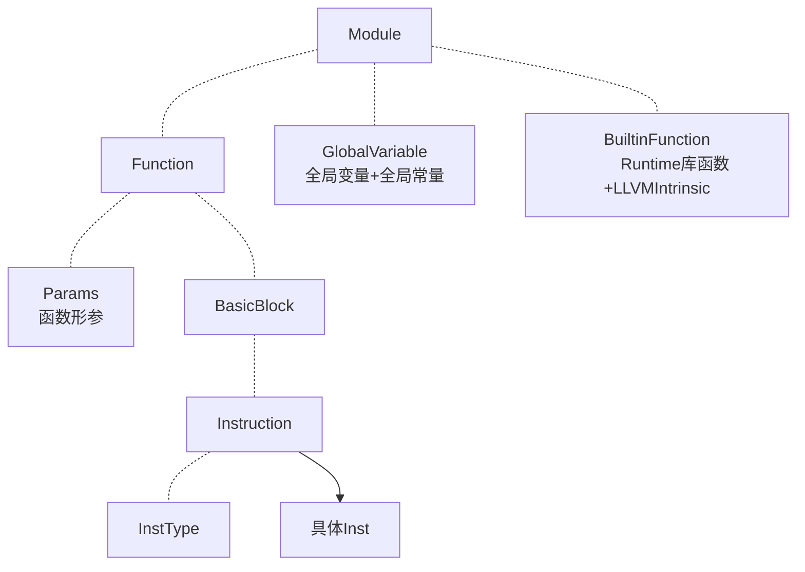

初始化相关

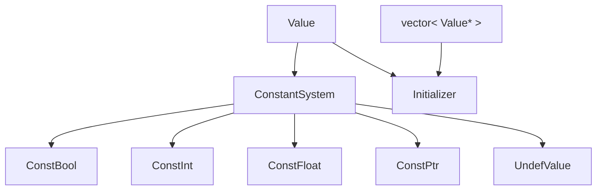

#### PassBuilder

参考LLVM实现，其中做了简化，仅保留AnalysisPass的宏展开注册功能，将Pipeline组织改为硬编码组织

因为Pass比较少，所以这种方式更适合我们的项目形式

- 作用:
  1. 注册AlalysisPass
  2. 组织不同优化层级的优化Pipeline

- Pipeline：

  我们的Pipeline组织如下

  ```

  ```

- 注册AnalysisPass：以Function粒度为例

  ```c++
  void PassBuilder::registerFunctionAnalyses(FunctionAnalysisPassManager &FAM){
      // 1. 定义宏
      #define FUNCTION_ANALYSIS(NAME, CREATE_PASS)\
          FAM.registerPass([&] {return CREATE_PASS;});
      // 2. 引入数据源：将 .def 文件中的内容原封不动地贴在这里
      #include "./FunctionAnalysisPass.def"
      // 3. 销毁宏
      #undef FUNCTION_ANALYSIS
  }
  ```

  .def文件：

  ```c++
  //示例
  FUNCTION_ANALYSIS("DominatorTree", DominantAnalysis())
  FUNCTION_ANALYSIS("BasicAA", BasicAliasAnalysis())
  FUNCTION_ANALYSIS("LoopInfo", LoopAnalysis())
  ```

  在编译期早期阶段就进行了替换：替换后的函数如下：

  ```c++
  void PassBuilder::registerFunctionAnalyses(FunctionAnalysisPassManager &FAM){
      FAM.registerPass([&] {return DominatorTreeAnalysis();});
      FAM.registerPass([&] {return LoopInfoAnalysis();});
      FAM.registerPass([&] {return BasicAliasAnalysis();});
  }
  ```

  好处：

  用来统一管理整个AnalysisPass，增加项目的可扩展性

#### NewPassManager

该PassManager仅管理中端IR层级

参考LLVM实现，同样做了简化与适配

保留并简化CRTP设计模式，基于类型擦除(Type Erasure)的多态设计，AnalysisPass结果缓存

但对于失效机制的实现，摒弃了llvm源代码复杂的迭代器实现和自动失效的机制，采用手动失效的原理实现

参考博客：

[浅析 llvm::Analysis Pass and Manager](https://zhuanlan.zhihu.com/p/696028293)

执行流：

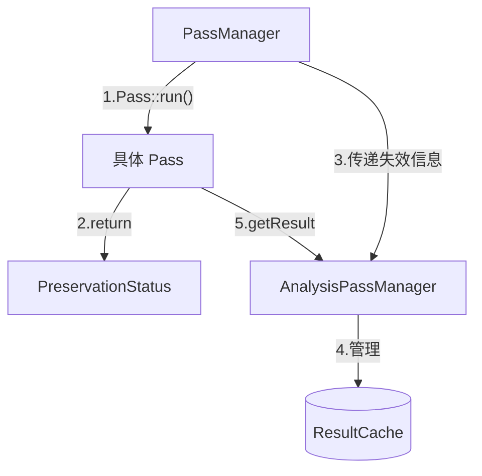

- CRTP解析：

  一个类继承一个以该类自身为模板参数的模板基类（一种将继承和静态多态结合的技术）--用来**高性能实现多态**

  参考博客：[CRTP解析](https://zhuanlan.zhihu.com/p/705630363)

  下图为llvm实现CRTP的相关模板：

  

  优势：

  传统实现多态是需要**继承和虚函数**实现，但是虚函数存在性能开销（会在运行时生成虚函数表），在性能敏感的地方（比如编译器中端优化部分），这么做就会造成性能损失，并且继承和虚函数**在运行期间起作用**，而上面CRTP模式**在编译期间起作用（由于模板的特性，模板类会在编译的时候确定模板参数并进行构建）**

  总结来说就是虚函数在编译的时候创建虚函数表，在运行的时候通过虚函数指针来**动态查找函数地址**->**造成性能损失**，而模板会在编译的时候就确定模板参数，从而在编译的时候就会创建相应的多态函数，在运行的时候**直接进行函数调用**

- TypeErasure类型擦除解析：

  目的：支持将任意类型的Pass类包装成标准Pass对象（而不是必须继承特定的基类），从而方便PassManager进行存储和管理

  具体实现方式：

  其中`Interface`类作为纯虚基类，设计意图为提供给`PassManager`一个统一的类型，方便存储在`vector`之中

  `Wrapper`作为模板类，通过`PassT`接收任意用户提供的具体`Pass`类，通过持有具体Pass的实例，负责该实例的生命周期管理

  `Wrapper`的`run`函数也是简单的调用具体Pass的`run`函数

  ```mermaid
  classDiagram
      %% 转换 Pass 架构
      class PassInterface~IRUnitT, AM_T~ {
          <<interface>>
          +run(IR, AM)* PreservationStatus
      }
      class PassWrapper~IRUnitT, PassT, AM_T~ {
          +PassT Pass
          +run(IR, AM) PreservationStatus
      }
      PassInterface <|-- PassWrapper

      %% 分析 Pass 架构
      class AnalysisPassInterface~IRUnitT~ {
          <<interface>>
          +run(IR, AM)* ResultInterfacePtr
      }
      class AnalysisPassWrapper~IRUnitT, PassT~ {
          +PassT Pass
          +run(IR, AM) ResultInterfacePtr
      }
      AnalysisPassInterface <|-- AnalysisPassWrapper

      %% 分析结果包装
      class AnalysisResultInterface~IRUnitT~ {
          <<interface>>
      }
      class AnalysisResultWrapper~IRUnitT, PassT, ResultT~ {
          +ResultT Result
      }
      AnalysisResultInterface <|-- AnalysisResultWrapper
  ```

  - 优势：

    非侵入性：编写的具体Pass只需要实现一个符合签名的run函数即可

    解耦：PassManager甚至不需要知道有哪些Pass，只需要实现run逻辑即可

    统一存储和管理

- 失效机制：

  在编写具体Pass的时候我们会利用下面所说的“黑白名单”的形式，手动编写是否保留某个AnalysisPass的分析结果

  形如下面这种，即显式分析哪个AnalysisPass的结果仍然有效，哪些已经失效需要重新计算

  ```c++
      PreservationStatus PA;
      PA.discard<DominantAnalysis>();
      PA.discard<LoopAnalysis>();
      return PA;
  ```

- AnalysisPassManager解析：

  - ResultCache缓存机制：采用`PassID（AnalysisPass地址）`和`IR层级（如Function）`作为Key进行存储

  - `getReult`：

    1. 当一个 Pass 请求分析结果时，它首先检查 `ResultCache`
    2. 如果命中，直接返回缓存对象
    3. 如果未命中，则即时运行对应的分析 Pass，并将结果存入缓存供后续使用

  - `invalidate`

    - 作用：`PassManager` 拿到上一步返回的 `PA` 状态后，立即调用此函数触发缓存清理。

    - 细节：
      a. 如果该 Pass 没有破坏任何东西，直接 `return`，终止清理流程，实现提速。
      b. 如果有破坏，则遍历底层的 `ResultCache`，针对每一个属于当前 IR 单元的缓存条目，提取其 `PassID`，并调用此函数询问该分析结果是否幸存

      - 细节：内部检查该 ID 是否在黑名单 `AbandonedIDs` 中，或者是否在白名单 `PreservedIDs` 中

      c.根据内部检查进行释放缓存，或者保留缓存

  - `registerPass`：PassBuilder宏展开函数内层核心实现

    通过`PassID`确定是否已经注册过，如果没有注册才会进行创建实例，换句话说，在main函数一开始就已经注册并创建，但是只有在`run`函数进行调用的时候才会延迟进行计算

- PassManager解析：

  - `run`：

    1. 从 `Passes` 向量中取出一个具体 Pass
    2. 执行 `Pass->run(IR, AM)`，并获取其返回的 `PreservationStatus`
    3. **关键动作**：立即调用 `AM.invalidate(IR, PassPA)` 。这保证了在下一个 Pass 开始之前，缓存中留下的都是完全正确的、未被破坏的分析结果
    4. 最后，将该 Pass 的失效信息合并到总状态中

  - `addPass`：PassBuilder编写pipeline的内层核心逻辑

    接收一个具体的TransformPass，将其类型擦除之后加入到`vector`之中，同理，在运行这个函数的时候具体TransformPass就已经创建实例了，但是只有在`run`的时候才开始进行计算，达到了延迟计算的效果


#### AnalysisPass

##### Dominant Analysis

- 支配树：

  参考文献：

  [支配树构建算法及伪代码](https://zhuanlan.zhihu.com/p/365912693)

  [Semi-NCA论文](https://renatowerneck.wordpress.com/wp-content/uploads/2016/06/gtw06-dominators.pdf)

  应用：

  1. 计算支配边界，构造SSA
  2. 循环不变量提升

  基本概念：

  1. DFS树：

     对CFG控制流图按照**先序遍历（深度优先遍历）**得到的一棵树

     实线：树的边

     虚线：CFG中其他边

     红色数字：DFS序

     红色字母：该节点的**半支配结点(Semi-Dominator)**

     

  2. DFS树中的概念：

     - 树边与非树边

     - 祖先与完全祖先（完全祖先不包括自身）--针对DFS树来说

     - 横跨边：右子树的节点指向左子树的边

       横跨边的**起点永远大于终点编号**，因为DFS树中右子树的编号永远大于左子树的编号

     - 返祖边：子节点到其完全祖先的边

  3. 半支配路径与半支配节点

     - 半支配路径：这条路径中（不包括起点和终点）的**每一个点的编号都大于终点的编号**，则该路径为一条半支配路径

       树边半支配路径：只能包含两个点（起点和终点），因为树边一定编号都小于终点的编号

       非树边半支配路径：路径上**指向终点的边（只要求指向终点的边）**为非树边，还需要保证中间节点的序号也要大于终点

       非树边半支配路径只能是**横跨边或返祖边**

       例子：黄色为树边半支配路径，绿色和紫色为非树边半支配路径

       

     - **半支配节点（sdom）**：在所有以V为终点的半支配路径中，**起点值最小**的那一个

       

  4. 支配节点与支配树

     - 支配结点：在求半支配结点的基础上求**支配节点（idom）**

       1. SLT算法：

          

          情况1：idom(w) = sdom(w)

          

          情况2：idom(w) = idom(u)

          

       2. **Semi-NCA算法：**

          **虽然算法时间复杂度比上面的大，但是实际使用比SLT快很多**

          解读1：从根节点到W的**父结点**这条路径上找到第一个**小于**sdom(W)的结点，这个节点就是W的**idom**

          解读2：

          

          

     - 支配树：由支配节点（**idom**）组成的树

  通过上面的分析，我们可以总结出如下求支配树的步骤

  

- 支配树相关伪代码实现：

  [支配树伪代码](https://blog.csdn.net/dashuniuniu/article/details/103462147)

  1. 计算半支配结点伪代码

     

     要点：逆DFS序进行分析，遍历所有前驱节点，

  2. eval并查集伪代码

     

  3. 计算idom--SemiNCA

     

参考资料：
https://oi-wiki.org/graph/dominator-tree/
https://zhuanlan.zhihu.com/p/655369292
https://zhuanlan.zhihu.com/p/365912693
https://zhuanlan.zhihu.com/p/1955319335347290919

##### BasicAliasAnalysis

采用**即时计算别名分析**实现

即时计算别名分析可以分析简单的含变量索引的数组指针

- 基址对象：

  在sysy之中，指针仅来源于数组作为参数传递，所以我们的指针的基址只能来自**Alloca/Param/GlobalVariable中的数组类型**

  - Alloca：在函数体中定义的局部数组/局部变量
  - Param：函数形参，传入的数组指针
  - Variable::GlobalVariable:全局变量/数组
  - Variable::GlobalConstant：全局常量

- 即时计算别名分析：

  > 如果想写的好一点可以实现一下aliasSelect，还有`a[2*i]` 和 `a[2*j+1]`这种的alias判定

  传入两个Value指针V1,V2

  1. 如果任一者访问的内存大小为0,直接判定为NoAlias

  2. 剥离BitCast

     整个循环可以采用visit数组进行循环条件判定，如果遇到了之前已经visited的循环那么就直接退出循环即可

     如果Value类型不是指针类型直接返回

     如果这一层是GEP，看一下是否所有索引全为零，如果不是那么就直接返回当前的GEP，如果是的话，那么就拿到GEP的基址指针

     如果这一层是BitCast，那么就拿到它的操作数，继续下一轮剥离

     如果这一层是只有一个输入源的PHI节点，拿到操作数继续向下剥离

     如果是其他指令那么就直接返回即可

  3. 如果V1/V2有是UndefValue的，那么直接判定为NoAlias

  4. 判断相等性并拦截跨迭代相等性的情况

     如果V1,V2不相等，那么直接返回false

     如果不是inst类型，那么直接返回true

     如果inst不在任何循环里，那么返回true

     如果inst在任何循环里面，那么人false

     true的可以直接判定为MustAlias

  5. **核心寻找基地址：O1,O2**

     继续可以用while循环+visited数组的方式来作为外层循环的条件

     如果是GEP指令，直接拿到它的基址指针，将V更新为基址指针

     如果是BitCast指令，直接拿到源操作数，更新V

     如果是Phi节点，如果只有一个输入，那么拿到操作数，更新V

     其余情况就直接返回V即可

  6. 快速判定：

     1. 如果底层对象不同O1!=O2

        如果二者都是Alloca（局部数组），那么NoAlias

        如果二者都是Variable::GlobalVariable，那么NoAlias

        如果一个是Param（函数参数）一个是Alloca（局部数组），那么NoAlias

        如果一个是Alloca一个是Variable::GlobalVariable，那么NoAlias

     2. 如果底层对象相同

        循环深度限制/加入一个visited数组

        循环查找：构造一个map，key是V1,V21,value是AliasResult，如果尝试将O1,O2（排除顺序），加入到map之中，如果缓存命中那么就可以直接返回

        如果是GEP（说明O1,O2指向同一个底层数组），那么aliasGEP

        如果是PHI，那么aliasPHI

        - aliasGEP

          将GEP拍平成一个一元线性方程：
          $$
          Base+ConstantOffset+∑(Value_i​×Stride_i​)
          $$
          解析GEP的所有索引+内层操作数，知道碰上最底层的基址

          1. 如果已经不是指令/操作符了。直接返回

          2. 如果BitCast，那么获取操作数

          3. 如果GEP，那么遍历获取GEP的所有索引

             如果索引是常数，那么获取当前维度把`常数索引 * 步长`累加到总的`ConstantOffset`之中

             如果索引是变量，直接`VarIndices[%i] += 1 * 当前维度步长`

          将GEP1和GEP2上面计算的一元线性方程做减法

          首先检查基址

          1. 如果减法化简之后所有的变量被抵消了，常量没有抵消，没有抵消如果大于数组元素的字节大小，可以返回NoAlias，如过小于数组元素的字节大小，返回MayAlias，如果常量也完全抵消了，那么MustAlias
          2. 如果变量无法抵消，直接返回MayAlias

        - aliasPHI:判断一个PHI节点和另一个指针O2是否有重叠情况

          > 总体思路就是比较这个PHI节点的所有输入值和另一个指针O2是否存在别名

          如果这个PHI没有任何输入，直接返回NoAlias

          如果O2也是一个PHI，并且两个PHI在同一个基本块之中，只需要做N-N的一对一比对输入值即可

          如果是常规情况，遍历PHI的所有输入，分别与O2比较，对每个输入和O2调用外层的aliasCheck函数，对所有AliasResult结果求交集

          > `NoAlias` + `NoAlias` = `NoAlias
          > MustAlias` + `MustAlias` = `MustAlias`
          >
          > 任何结果 + `MayAlias` = `MayAlias`
          >
          > `NoAlias` + `MustAlias` = `MayAlias`

##### SideEffect--副作用分析

实现**跨函数副作用分析**

> 拓展：实现Select的支持

- Sylib:sysy运行时库函数：

  ```c
  getint
  getch
  getfloat
  getarray
  getfarray
  putint
  putch
  putarray
  putfloat
  putfarray
  putf
  starttime
  stoptime
  before_main
  after_main
  _sysy_starttime
  _sysy_stoptime
  ```

  LLVM内置函数：

  ```
  memcpy
  ```

- 算法流程：

  1. 构建基地址集合

     1. 遍历函数所有形参中的指针，收集它们的基地址--就是他们自己

     2. 遍历函数中所有Alloca，收集他们的基地址--就是他们自己

     3. 不动点迭代，遍历函数中所有指令

        GEP，BitCast：获取他们的源指针，加入到该指令的基地址集合

        Phi：获取所有输入值的源指针，加入到该指令的基地址集合

  2. 遍历函数中每一条指令，收集函数级ModSet和RefSet

     LOAD：先拿到他的基地址，遍历基地址，如果基地址是全局变量或者是形参，那么加入RefSet

     STORE：先拿到他的基地址，遍历基地址，如果基地址是全局变量或者形参，那么标记为ModSet

     CALL：先拿到它调用的目标函数Callee

     - 如果Callee是Function（用户定义的）

       - 遍历Callee的Mod集合

         如果这个函数写了一个全局变量，将这个写到Call指令的Mod集合之中

         如果这个函数写了一个形式参数，拿到Call中的实际的参数，然后遍历这个实际参数的Mod集合，将其加入到Call指令的Mod集合之中

       - 遍历Callee的Ref集合

         如果这个函数读了一个全局变量，将这个写到Call指令的Ref集合之中

         如果这个函数写了一个形式参数，拿到Call中的实际参数，然后遍历这个实际参数的Ref集合，将其加入到Call指令的Ref集合之中

       - 如果Callee之中有内置函数标志和Untracked标志，该Call指令的标记也立起来

     - 如果Callee是BuildinFunction（syslib内置库函数）

       ```
       NoMemWrite：_sysy_starttime , _sysy_stoptime, getint, getch, getfloat, putint, putch, putfloat
       MemWriteOnly (只写内存)：getarray, getfarray
       MemReadOnly (只读内存)：putarray, putfarray, putf
       MemReadWrite (既读又写)：memcpy
       ```

       - 如果Callee是Sysy的标准运行时库，将内置函数标志立起来

       - 如果是Memcpy：获取它的第0个参数目标地址和第1个参数源地址

         查出目标地址的基地址，如果是全局变量/形参那么就写入Mod集合里面

         查出源地址的基地址，如果是全局变量/形参那么就写入Mod集合里面

       - 如果函数被标记为Ref：将其实参传入的全局变量/形参加入到当前函数的Ref之中

       - 如果函数被标记为Mod：将其实参传入的全局变量/形参加入到当前函数的Mod之中

       - 没有进入上面任何一个分支，标注为Untracked

- 接口：

  1. 指令级副作用查询接口`getInstModRefInfo`

     传入一个Value，一个Inst

     如果LOAD指令，调用别名分析分析二者别名，如果无别名就是`NoModRef`,如果有别名就是`Ref`

     如果STORE指令，调用别名分析分析二者别名，如果无别名就是`NoModRef`,如果有别名就是`Mod`

     如果CALL指令，取出Callee和实参

     1. 如果调用的是内置函数

        如果是memcpy，计算第0个实参和Value的别名分析，重叠就是`Mod`，计算第1个实参和Value的别名分析，重叠就是`Ref`

        如果是常规内置函数，如果函数属性是sylib那么NoModRef，如果有特定读写的内置函数，遍历它所有实参，调用别名分析计算实参与Value，如果重叠，贴上相应标签

     2. 如果是普通函数

        获取被调用函数的SideEffectInfo

        如果有系统调用（**hasBuiltin == true**），直接`ModRef`

        分别遍历Mod和Ref集合

        1. 如果是全局变量，计算全局变量和Value别名分析
        2. 如果是形参，找到对应的实参，计算实参与Value别名分析

     3. 如果Untracked，返回`ModRef`

     在上述过程中使用短路优化，即只要累计的副作用已经达到ModRef状态那么没必要继续遍历了，直接return即可

  2. 函数级副作用查询接口`getFunctionModRefInfo`

     如果存在系统调用(hasBuiltin == true)，直接返回`ModRef`

     检查`RefSet`和`ModSet`，遍历里面的内容，如果含有一个不是常量的Value，那么就标记对应的`Mod`/`Ref`

     最后合并`Mod Ref`标签即可

  3. 循环级副作用分析&基本块级副作用分析：

     循环级：遍历循环中所有基本块，每个进行副作用分析

     基本块级：遍历基本块中所有指令，如果RET/ALLOCA直接副作用，如果CALL指令，拿到Callee，如果是内置函数/Untracked直接副作用，检查这个函数的ModSet/RefSet，如果Mod` 或 `ModRef直接副作用，如果STORE指令，如果被写入的指针是写的全局变量/形参的话直接副作用（换句话说只能写局部变量），然后检查ModRefInfo，沿着当前的CFG向下寻找指令，`getInstModRefInfo`检查，如果有任何指令Ref/ModRef这个指针，那么副作用

  4.


##### PostDominant--后支配树分析

后支配树用于控制依赖、ADCE的terminator保活判定、DSE的exit可达性判断。

设计思路：

不真实修改 CFG 插入 VIRTUAL_EXIT_NODE，而是在预计算的**反向 CFG 视图**上直接跑 Semi-NCA。虚拟根节点的 `Block` 字段设为 `nullptr`，多出口通过"每个出口以虚拟根为父节点做反向 DFS"合并。反向 CFG 用一次 O(V+E) 扫描建邻接表，避免反复调用 O(|F|) 的 `getPredecessors()`。

- 名词约定：

  - 后支配：B postdom A ⟺ 从 A 到任一 exit 的所有路径都经过 B
  - ipostdom(B)：后支配树上 B 的直接父节点
  - exit-reachable：entry 可达且能到达某个 exit 的块（能到达 RetInst）
  - reverse-unreachable：entry 可达但到不了任何 exit 的块（纯无限循环里的块）

- 整体流程：

  ```mermaid
  flowchart TD
      A["1.收集 entry 可达块<br/>collectForwardReachable"] --> B["2.找 exit 块<br/>findExitBlocks"]
      B --> C["3.预计算反向 CFG<br/>precomputeReverseCFG"]
      C --> D["4.分配虚拟根 DFS#1<br/>Block = nullptr"]
      D --> E["5.从每个 exit 块反向 DFS<br/>parent = 虚拟根"]
      E --> F["6.reverse-unreachable 块<br/>直接挂虚拟根下"]
      F --> G["7.runSemiNCA"]
      G --> H["8.构建 PostDominatorTree<br/>+ DFS in/out 时间戳"]
  ```

- 核心伪代码（Semi-NCA 部分从前向 Dominant 复用，只操作 DFS 编号数组 `Infos`）：

  ```
  function runSemiNCA():
      // Phase A: 逆 DFS 序计算半支配节点
      for i in [lastNum, 2]:
          for pre in Infos[i].Predecessors:
              u = eval(pre)
              if Infos[u].SdomNum < Infos[i].SdomNum:
                  Infos[i].SdomNum = Infos[u].SdomNum
          link(Infos[i].Parent, i)

      // Phase B: 正 DFS 序计算直接支配节点
      for i in [2, lastNum]:
          runner = Infos[i].Parent
          while runner > Infos[i].SdomNum:
              runner = Infos[runner].IDomNum
          Infos[i].IDomNum = runner
  ```

- 关键设计点：

  1. **虚拟根 Block = nullptr**，上层查询接口 `getIPostDom(BB)` 若返回的 idom 节点是虚拟根，向外返回 `nullptr`。消费者（ADCE/DSE）用 `isReachableToExit(BB)` 过滤真正不可信任的块（reverse-unreachable）

  2. **反向 CFG 一次性建**：`reverseCFG[succ].push_back(BB)` 对每条原 CFG 边建一次反向条目，后续反向 DFS 只从 map 里取邻居

  3. **reverse-unreachable 块挂虚拟根**：不继续沿反向图 DFS（因为它们到不了 exit，半支配路径定义不成立），直接分配 DFS 序号、父节点设为虚拟根。`Predecessors` 留空 → `runSemiNCA` 中 sdom 不会进一步更新

  4. **DFS in/out 时间戳**用于 O(1) 的 `postDominates(A, B)` 查询：A postdom B ⟺ `A.DFSNumIn <= B.DFSNumIn && A.DFSNumOut >= B.DFSNumOut`

- 接口：

  1. `getIPostDom(BB)`：返回 BB 的直接后支配块（虚拟根对应 nullptr）
  2. `postDominates(A, B)`：A 是否后支配 B（O(1)）
  3. `isReachableToExit(BB)`：BB 是否能到达某个 exit（区分 reverse-unreachable）
  4. `getNode(BB)`：返回树节点（nullptr 表示虚拟根）


##### RangeAnalysis--整数/浮点范围分析 + KnownBits

基于 SCCP 的 worklist 不动点框架扩展的值范围分析，**同时产出两套独立但联动的 lattice**：

- `IntRange` —— signed [min, max] 区间
- `KnownBits` —— 32 位级别的 known-zero/known-one 双掩码

以及一套独立的 `FloatRange`（float 的 `[min, max]`）。整套分析供 RangeAwareSimplify、ConstraintElimination 等化简 pass 消费。

设计思路：

复用 SCCP 的 worklist / ExecutableBlocks / FeasibleEdges 三元组基础设施。整数 lattice 从 SCCP 的 `{Top, Constant, Bottom}` 扩展到 `{Top, [min,max], Bottom}`，常量退化为 `[c, c]` 单值区间。KnownBits 独立一路，位级事实（典型：`and/or/shl/lshr/ashr` 操作后的对齐 / 符号位）比区间更精细，二者通过 `KnownBits::toIntRange()` 反推 + 写入前 intersect 的"联动桥"汇合。

- IntRange / FloatRange 定义：

  ```
  struct IntRange {
      int64_t min;   // I32_MIN 表 -∞
      int64_t max;   // I32_MAX 表 +∞
      int knownTrailingZeros;  // LSB 对齐 hint，add/sub/mul/shl 传播
  };

  struct FloatRange {
      double min;    // -∞ 表无下界
      double max;    // +∞ 表无上界
      bool isNaN;    // 遇 NaN 污染 → Top
  };
  ```

  `isTop()` 只看 `min/max` 是否是 i32 全范围（**不再**掺 knownTrailingZeros —— 此前混合判定让有 align 但 range 宽的值被当"非 Top"走无意义端点比较）。`isBottom()` 是 `min > max`（空区间），`isSingleValue()` 是 `min == max`。

  整数用 int64 backing 避免 i32 中间溢出（例如 `(-2^31) / (-1) = 2^31` 在 i32 装不下），最后查询时再 cast 回 i32。

- KnownBits lattice：

  ```
  struct KnownBits {
      uint32_t zero;  // bit i = 1 → 原值第 i 位确定是 0
      uint32_t one;   // bit i = 1 → 原值第 i 位确定是 1
      // 不变量：zero & one == 0（否则是 bottom = 不可达）
  };
  ```

  算子：`shl / lshr / ashr`（`k==0` 保 identity，`k ∈ [1, 31]` 按位迁移，越界退 Top）；`band / bor / bxor`；`add / sub / mul`（trailing-zero 传播，其余位退 unknown —— 进位会污染）。`unionWith` 用于 PHI 合流（bit 同时 known 且同值才保留），`intersectWith` 用于 narrowing（冲突 bit 同时丢掉避免污染）。

  **toIntRange()**：把 KB 反推成一条 IntRange —— 冲突 → bottom；符号位已知 → 给 signed 的紧 [min, max]；符号位未知但有 trailing zeros → 全 i32 范围 + 保留 align 信息。solver 在写 `updateRange` 前调用 `tightenWithBits` 把这条 IntRange 和直接算出来的 IntRange intersect，让 KB 的位级事实自动反哺到区间层。

- 三阶段整体流程：

  ```mermaid
  flowchart TD
      A[Step 1: Forward widening<br/>worklist 不动点迭代<br/>EnqueueCount ≥ 32 widen 到 Top] --> B[Step 2: Narrowing<br/>backward constraint propagation<br/>intersect-only 语义<br/>ADD/SUB 反推操作数]
      B --> C[Step 3: publishReturnRange<br/>把本函数所有 RetInst 操作数 union<br/>写入 InterprocCache.RetRanges]
      C --> D[下次分析 H 调 F 时<br/>visitCall 从 cache 拿 F.RetRange<br/>替代 Top]
  ```

  单阶段 worklist 循环：

  ```mermaid
  flowchart TD
      A[初始化: 常量 → 单值区间<br/>其他 → Top] --> B[worklist 取指令 I]
      B --> C{I 的类型}
      C -->|二元运算| D[visitBinary<br/>整数/浮点分派]
      C -->|PHI| E[visitPhi<br/>取所有可达 incoming 并集]
      C -->|条件分支| F[visitBranch<br/>单前驱时收窄]
      C -->|CallInst 用户函数| F2[visitCall<br/>查 InterprocCache RetRange]
      C -->|其他| G[result = Top]
      D --> H{range 是否变化?}
      E --> H
      F --> H
      F2 --> H
      G --> H
      H -->|否| B
      H -->|是| I{Forward 模式<br/>& EnqueueCount &gt; MAX_ENQUEUE?}
      I -->|是| J[widen → Top<br/>锁入 Widened 集合]
      I -->|否 / Narrowing 模式| K[更新 range<br/>把所有 user 推入 worklist]
      J --> B
      K --> B
  ```

- 二元运算 transfer function：

  整数（IntRange 和 KnownBits 两路并行）：
  - ADD/SUB/MUL：四端点组合取 min/max，遇 i32 范围溢出饱和到 Top；KB 只保留 trailing-zero（add/sub 取两侧 tz 的 min，mul 取 tz 之和）
  - SDIV：按被除数正负/除数跨 0 做 case 分析，避免除零
  - SREM：结果符号取决于被除数，`|result| < |divisor|`
  - **SHL 常量 k**：IntRange 按 `(uint64)min * 2^k` / `max * 2^k` 算，**任一端点越过 I32_MAX 退 Top**（不走饱和截断——i32 wrap 语义下 `1 << 31 = INT32_MIN`，截断会报成 `INT32_MAX` 污染下游）；负数左移直接退 Top 兼避 C++ UB；KB 低 k 位填 known-zero，高位向上迁移
  - **ASHR / LSHR 常量 k**：IntRange 端点按 `>> k` 单调推；lshr 负数退 Top（signed 区间无法表 uint 高位填 0 后的大正数）；KB 高位按算术/逻辑填
  - **AND**：双非负时 `[0, min(lMax, rMax)]` + 常量掩码时 `[0, c]`；KB 用 `lKB.zero | rKB.zero` 聚合已知零位、`lKB.one & rKB.one` 聚合同时已知一位
  - **OR**：双非负时 `[max(lMin, rMin), I32_MAX]`；KB 对偶 AND
  - **XOR**：IntRange 保守 Top；KB 对双侧都 known 的 bit 按异或算

  浮点：
  - ADD/SUB/MUL/FDIV：四端点组合取 min/max
  - `inf * 0 = NaN` 退 Top，`0 / 0 = NaN` 退 Top
  - ±0 归一化避免端点比较抖动

  Select / Cast：
  - **Select**：整数浮点分别 union true/false 支的 range；不尝试靠 cond 收窄（分支推理已在 visitBranch 做）
  - **ZExt i1 → i32**：IntRange `[0, 1]`；KB 高 31 位 known-zero
  - **SExt i1 → i32**：IntRange `[-1, 0]`；KB 因 "值只能是 0x00000000 或 0xFFFFFFFF" 无法用单一 KB 刻画，留 Top
  - **Trunc i32 → i1**：IntRange `[0, 1]`；KB 高 31 位 known-zero + bit0 继承源的 bit0
  - **SITOFP i32 → f32**：整数端点直接转 double
  - **FPTOSI f32 → i32**：端点向零截断；**任一端点超出 i32 可表示范围或是 ±inf/NaN 直接退 Top**（不再夹到 INT_MIN/INT_MAX——上游会把单值区间错折成常量）

- 条件分支收窄（IntRange + KnownBits 双路）：

  仅在目标块**单前驱**时才对分支条件施加约束（多前驱块条件不是所有路径都满足，over-constrain 会错）：

  IntRange 收窄：
  ```
  if terminator(fromBB) is "br (cmp op x rhs) trueBB falseBB":
      if trueBB.preds.size() == 1:
          记录 contextualRanges[trueBB][x]  = x 落在 [x op rhs] 的区间
      if falseBB.preds.size() == 1:
          记录 contextualRanges[falseBB][x] = x 落在 [x !op rhs] 的区间
  ```

  rhs 是 ConstInt 直接取值做边界，非常量 rhs 查其当前 range 取端点。整数和浮点分派：操作数类型 IR_INT 走 IntRange 边界 ±1（紧邻前/后一个整数），IR_FLOAT 走 FloatRange 端点（浮点没有"紧邻前一个"概念）。浮点非 Top 时假定不含 NaN（NaN 已被吸收到 Top），按 olt/ole/ogt/oge/oeq 端点比较。

  **KnownBits 边敏感 contextual**（新）：
  - `x == c` 的 true 边 / `x != c` 的 false 边：把 KB(c) 写入目标块的 `ContextualBits[x]`
  - `x < 0` / `x >= 0` 的 true/false 边：写符号位 KB（sign=1 or sign=0），对应"sign-bit-narrowing"的常见路径
  - 所有写入同样受"目标块单前驱" guard

- GEP 索引约束：

  SysY 程序（假设无 UB）若执行到 `gep arr, 0, i` 且 arr 是 `[N × T]` 类型，索引 i 必在 `[0, N-1]`。`visitGEP` 按 updateType 的逻辑走类型链，每个 ARRAYType 维度给对应索引加 contextual 约束 `[0, count-1]` 在 GEP 块。

  ```
  function visitGEP(GEP):
      currentType = GEP.base.type
      for i in [1, GEP.operands.size):
          if currentType is ARRAYType:
              narrowed = [0, count - 1] ∩ (旧 contextual or Top)
              updateContextual(idx[i], GEP_block, narrowed)
              currentType = array.elementType
          elif currentType is POINTERType:
              currentType = ptr.pointerType    // 指针算术，无边界
  ```

  SSA 保证：同一 Value 在不同点值相同。约束通过支配关系传播到被 GEP 块支配的所有使用。

- widening（收敛保障）：

  Forward 阶段不动点迭代中某个值的 range 变化达到 `MAX_ENQUEUE = 32` 次，直接 widen 到 Top 并写入 `Widened` 集合，后续此值的 forward transfer 不再更新。这是为了保证分析一定收敛——循环累加 `sum += i` 这种没有 SCEV 支持时的递增模式，靠 widening 保守收敛。

  整数浮点共享同一个 `EnqueueCount` 和 `Widened` 集合。**浮点路径必须同样 widen**，否则 `a += 0.1` 这种循环累加在 COUNT=500000 的浮点 bench 上永远不收敛直接跑死。

- Narrowing（backward constraint propagation）：

  Forward widen 到 Top 的值本身是保守 over-approx，Narrowing 阶段在 forward 收敛后用 **intersect-only 语义**重跑一轮把它们收回来：

  1. `NarrowingMode = true`，`updateRange` 改为 `cur = cur.intersectWith(new)`，不再 widen（`Widened` 锁失效，但不主动清除）
  2. 所有可达指令重新入 worklist；对 ADD/SUB 做 **backward 推导**：`z = x + y ⟹ x = z - y, y = z - x`；`z = x - y ⟹ x = z + y, y = x - z`
  3. 硬预算 `O(instCount × 4 + 64)` 防止病态函数跑飞；预算耗尽清空 worklist 保守结束

  ```
  function narrowBinaryBackward(BI, lhs, rhs, lRange, rRange):
      // 整数 + 浮点同构成立
      zR = getRange(BI)
      switch BI.op:
          case ADD:   // z = x + y
              x -= rRange; y -= lRange
          case SUB:   // z = x - y
              x += rRange; y = lRange - zR
          // 弱 backward（仅符号）：MUL/DIV/MOD 的端点反推非单调，只推符号
          case MUL:   // z = x * y 且 z 非负
              if zR 非负:
                  if rRange.min > 0: x ∩= [0, INT_MAX]
                  if lRange.min > 0: y ∩= [0, INT_MAX]
          case DIV:   // z = x / y, z 非负, y > 0 ⟹ x 非负
              if zR 非负 and rRange.min > 0: x ∩= [0, INT_MAX]
          case MOD:   // srem: z 的符号 = 被除数的符号
              if zR 非负 and rRange 非 Top: x ∩= [0, INT_MAX]
  ```

  浮点（FADD/FSUB）和整数 ADD/SUB 同构成立（假定非 NaN；NaN 已被吸收到 Top 不进 narrowing）。narrowing 是单调收缩的，ranges 只会变窄，bounded 就一定终止。

- 跨函数 Return Range 传播：

  RangeAnalysis 是 Function-level pass，但用一个文件内 `static InterprocCache` 做跨函数 return range 传播：

  ```
  struct InterprocCache {
      unordered_map<Function*, IntRange> RetRanges;
      unordered_map<Function*, FloatRange> FloatRetRanges;
      // 参数 range 传播未启用（见下方设计权衡）
  };
  ```

  机制：
  1. 分析 F 时参数**保持 Top**（不从 cache seed），走 forward + narrowing
  2. `publishReturnRange(F)` 扫所有 RetInst 操作数，union 作为 F 的返回值 range 写 cache
  3. 后续分析 H 时若 `call F`，`visitCall` 从 cache 查 F 的 RetRange（没 cache 就 Top）

  设计权衡：**不 seed 参数**是有意为之。如果把"所有 call site 实参的 union"作为参数初值，会让 F 被偏紧的参数分析，导致 return range 被低估 → 其他 caller 拿到低估的返回值 → RangeAwareSimplify 基于错误 range 做常量折叠 → WA（实际已验证）。安全的参数传播需要 pipeline 级多轮不动点迭代，当前版本先保守不做。

- contextual range 查询：

  `RI.query(Value *v, BasicBlock *BB, DominatorTree &DT)` 沿支配树往上找离 BB 最近的 block-level 约束，没找到就返回全局 range：

  ```
  function query(v, BB, DT):
      range = globalRanges[v]
      cur = BB
      for depth in [0, 8) while cur:
          if contextualRanges[cur].count(v):
              range = range.intersectWith(contextualRanges[cur][v])
          cur = DT.idom(cur)
      return range
  ```

- 接口：

  1. `IntRange query(Value *v, BasicBlock *BB, DominatorTree &DT)`：整数 range contextual 查询
  2. `FloatRange queryFloat(Value *v, BasicBlock *BB, DominatorTree &DT)`：浮点 range contextual 查询
  3. `LoopInductionInfo`：预留 SCEV 接口（`getInductionStart/Step/Count`），当前未实现，供后续 SCEV pass 填

- 特殊输入推断：

  前端 `getch()` 直接推断为 `[0, 127]`（ASCII），避免调用边界 Top 污染后续分析。

- 留待后续：

  - 循环归纳变量的 AddRec 推断：需要 SCEV 分析 pass，接口已留
  - 跨函数**参数** range 传播：需要 pipeline 级多轮不动点迭代才能安全实现
  - per-edge contextual range：目前只有 per-block，edge 级对多前驱块的 PHI 精度更高，结构改动较大
  - PHI sign-preserving widening：曾尝试实现（widen 时若 newRange 非负则退到 `[0, INT_MAX]` 而非 Top），但会与 narrowing + GEP backward 组合产生 over-narrowing，将 `while (i > 0)` 这类出口条件被 foldComparisons 折叠为恒 true 的 bug（73_int_io 复现）。已回滚到直接 widen Top


#### TransformPass

##### Mem2Reg

运行前后都需要运行一遍CFGSimplify

- 算法流程：

  外层：不动点循环（直到找不到可以提升的变量才能退出）

  1. 筛选可以提升的变量

     获取函数入口块，遍历除了Ret之外的每一条指令，如果是Alloca，判断是否isAllocaPromotable，如果可以那么收集到Allocas数组之中

     `isAllocaPromotable`：

     遍历Alloca的所有User

     1. 如果是Load指令，直接跳过

     2. 如果是Store指令：

        如果Store存入的值是Alloca（值的地址）（指针逃逸），如果存入值的类型和Alloca分配时声明的类型不一致（类型不匹配），那么不是Promotable的

     3. 如果是其他User直接拒绝，不是Promotable

  2. 遍历Allocas之中所有的Alloca

     1. 简单优化1：删除无用Alloca

        如果没有被使用过，那么直接删除（从内存中，从Allocas中）

     2. AnalyzeAlloca：扫描Alloca，收集Store与Load信息

        遍历Alloca所有User

        如果是Store指令，收集其所在的BasicBlock到StoreBlock之中，并记录OnlyStore为当前Store

        如果是Load指令，收集其所在的BasicBlock到LoadBlock之中

        单基本块快速优化：如果所有遇到的 Load 和 Store 都在同一个基本块里，`OnlyUsedInOneBlock` 保持为 true；一旦遇到一个 User 属于不同的基本块，就把这个标志位置为 false

     3. 简单优化2：如果仅存在一个BasicBlock被Store（Size（StoreBlock）==1）

     4. 简单优化3：如果只在一个基本块内被使用`OnlyUsedInOneBlock`==True

     5. 标准流程构建Pruned SSA：

        1. 建立map反向映射Alloca->Allocas数组当中的索引

        2. 建立DefSet：将刚才的StoreBlock去重之后存入DefSet

        3. 变量活性分析，记录LiveInBlock：

           WorkList：初始加入LoadBlock之中所有块

           遍历WorkList之中所有块：

           1. 如果块内没有Store，那么在入口处一定存活，直接跳过
           2. 否则那么就是块内既有Store又有Load，遍历该块内所有Inst，如果发现Store在Load之前发生，从WorkList之中移除，如果Load在Store之前，保留

           While循环直到WorkList之中为空：

           1. 如果已经在最终LiveInBlock之中那么说明已经处理过了直接跳过
           2. 遍历该块之中的所有前驱，如果前驱之中含Store，那么活跃性传播截止，直接跳过，否则将前驱块加入到WorkList之中

        4. 计算迭代支配边界IDF

           传入刚才计算的DefSet，LiveInBlock，传入PHIBlockVector数组（结果数组）

           计算过程：

           1. 定义优先级队列，排序依据是支配树的层级从大到小（Level），层级越深（数值越大）的节点优先级越高

           2. 定义WorkList，VisitedWorkList（记录哪些块已经进入过扫描逻辑了），VisitedPHI（记录哪些块决定要插入PHI），并预先分配大小

           3. 遍历DefSet，获取支配树结点加入优先级队列，VisitWorkList

           4. While遍历优先级队列，直到优先级队列为空

              每轮之中从优先级队列top上面取出一个结点，使用WorkList While循环遍历所有子孙结点

              获取该轮节点所在块

              检查支配边界：如果后继结点Level>该结点Level,说明后继结点依然被该结点严格支配，反之说明后继结点是该结点的支配边界必须插入PHI结点，并检查VisitedWorkList没有访问过，并检查该后继块在LiveInBlock之中，如果满足上述条件加入结果数组之中，如果这个结果块不在DefSet之中，那么加入到优先级队列之中

              对于这个结果块，遍历它在CFG上的后继，递归调用上面这个检查支配边界的函数

              把结果块在支配树上的子结点加入到WorkList之中

        5. 插入PHI结点：

           遍历结果数组，创建并插入PHI结点，维护一个PhiToAlloca

  3. 变量重命名：

     创建IncomingVals数组，遍历Allocas，初始化每个值为Alloca对应类型的UndefValue

     利用Vistied和WorkList（初始化传入函数入口块）进行While遍历

     递归调用Rename：

     1. 遍历该块内所有新插入的PHI结点，检查PhiToAlloca确保是我们刚插入的PHI，遍历该PHI的所有操作数，利用IncomingVal填入输入值和输入块，IncomingVal更新PHI为对应Alloca的最新定义

     2. 如果Visited有这个那么就直接退出

     3. 替换Load&Store：

        遍历函数所有指令

        如果是Load指令，如果他的操作数是Alloca，如果在Allocas之中，通过IncomingVals获取Value，RAUW替换所有用到Load结果的地方替换成Value，删掉这个Load

        如果是Store指令，如果他的操作数是Alloca，如果在Allocas之中，更新IncomingVals[Alloca]下的这个值，删掉Store

     4. 将当前块在支配树之中所有后继加入到WorkList，并更新Visited数组

  4. 遍历Allocas指令进行删除


参考资料：
https://ustc-compiler-principles.github.io/2023/lab4/Mem2Reg%E4%BB%8B%E7%BB%8D.pdf

https://www.zhihu.com/question/41999500/answer/93243408


##### DCE

依赖Side Effect

函数内级联（递归删除）死代码消除

- 算法流程：

  1. 遍历目标函数中的所有指令

     判断是否在工作队列之中（防止重复劳动），如果不在，调用下列的删除逻辑，然后开始处理工作队列里面的指令（直到处理完），调用下列的删除逻辑

  2. 具体消除逻辑：

     1. 检查：

        如果这条指令还被其他指令使用，不行

        如果是Terminator终结指令，不行

        副作用：store不行，call(访问callee，调用副作用分析这个函数是不是只读，如果不是就是含副作用)

        其他指令都可以

     2. 执行消除：

        遍历该指令所有操作数

        获取每个操作数将指令I的这个操作数置空，如果操作数还有指令在使用它/该操作数就是该指令（自我引用），就跳过该操作数

        检查该操作数是不是一条指令，如果是的话调用2.1的逻辑判断，如果满足判断条件就加入工作队列

        处理完操作数就删除该指令

##### TailRecursionElimination尾递归消除

依赖SideEffect

支持累加/累乘累加器，支持call与ret不紧挨的广义尾递归消除

- 算法流程：

  1. 处理普通尾调用(call调用的函数不是自身)：

     > 这一步不是为了尾递归消除，而是为了给后端机器码生成器提供优化提示(允许复用栈帧)

     简单逃逸分析：没有任何Alloca被call指令当作参数传走

     检查call与ret的返回值必须匹配

     ```
     %r = call @other_function(...)  // 不能是当前函数本身
     ret %r                          // ret 必须直接返回 call 的结果

     call @other_function(...)       // 调用的函数也必须是 void
     ret void
     ```

     call后紧跟ret，并且call调用的函数不是自身

  2. 处理尾递归(call调用的函数是自身)：

     遍历目标函数中所有基本块：

     1. 处理终结指令是无条件跳转的情况，并且无条件跳转目标块的PHI指令之后第一条指令必须是Ret（该块除了Ret没有其他逻辑）：

        找到该块中的Call Inst：从块末尾开始倒着向前找Call Inst，并检查Callee必须是函数自身--**不一定要求call与ret挨着**

        图合并操作：将目标块之中的Ret clone到该块的末尾，遍历新clone的Ret的操作数，如果是BitCast，clone之后插入到新Ret前面，并获取BitCast的操作数，如果是PHI，访问PHI拿到从该块传递来的值，直接接入到Ret的操作数上

        将目标块中的PHI中关于该块传递进来的值全部删掉

        将该块中的Br无条件指令删除

     2. 处理终结指令是Ret的情况：

        找到该块中的Call Inst：从块末尾开始倒着向前找Call Inst，并检查Callee必须是函数自身--**不一定要求call与ret挨着**

     3. 获得上面的Call Inst之后，开始进行真正的尾递归消除逻辑：

         遍历call和ret之间的所有指令：1，2条在这个循环里

        1. 查看这条指令是否可以移动到call指令之前：

           副作用不行：store不行，call(访问callee，调用副作用分析这个函数是不是只读，如果不是就是含副作用)

           如果指令是LOAD指令，拿到LOAD读取的地址，调用副作用getInstModRefInfo分析，如果Call Inst Mod这块地址，那么就不能移动

           检查该指令的操作数是否包含Call Inst的返回值，如果有不能移动

        2. 识别累加/累乘的伪尾递归，判定是否可以改成带有累加器的循环：

           检查该指令是否同时满足交换律和结合律：只能放行ADD和MUL指令

           如果有多条这种累加指令，不行

           检查这条指令的两个操作数，必须有一个且只能有一个是Call Inst的返回值

           检查这条指令只能被使用一次，且User是Ret指令

        处理：

        1. 创建循环头：

           拿到目标函数的入口块，创建一个新的基本块插入到入口块前面，在新基本块末尾插入无条件跳转指令让其可以直接跳转到入口块

           遍历原入口块，将所有Alloca指令搬到新基本块之中

           遍历函数所有形参，在原入口块最前面为每个形参创建一个PHI，将原来使用形参的地方全部替换成新创建的PHI，将形参作为输入值加入PHI

        2. 将这次尾递归传递的实参，添加到原入口块的PHI节点之中

        3. 如果含累加器指令：

           在原入口块节点插入一个PHI指令，如果是ADD初始值设置为0,如果是乘法初始值设置为1，将这个值加入到PHI之中，把原来使用call返回值的地方改成使用累加器指令

        4. 收尾：

           创建一条Br，代替原来的Ret，将旧的Ret和Call从内存中删掉

           将剩下的Ret之前创建BinaryInst，计算累加器与Ret原本的返回值，然后修改Ret的返回值


##### FuncInline函数内联

将Callee的函数体拼接到Caller的相应位置

- 外层决策：

  遍历当前函数中所有Call Inst，Callee必须存在函数体

  内联条件：

  1. Callee内部不能调用任何其他函数

     调用副作用分析，判断Callee中STORE，LOAD的Base中只能有局部变量

     Callee函数体内部自递归调用点必须<2--树状递归不可以内联

  2. 如果不是自己调用自己的递归函数不内联

  3. 自己调用自己的递归检查：

     递归函数展开一层总指令增加100条就放弃内联

  4. 如果一个函数在当前Caller中被调用的次数小于3次那么就会进行内联

  5. 非递归函数展开总指令增加200条就放弃内联

- 算法流程：

  1. 获取Call Inst，调用者函数Caller，被调用者函数Callee

  2. 创建哈希表：遍历并记录形参和实参的映射（后续clone的时候也要一边更新这里面的内容）

  3. clone Callee：

     将Callee中所有基本块clone到Caller之中

     clone：检查该块是否被clone过了（防止图中环的出现），如果没有就创建一个新基本块插入到Caller之中，然后逐个clone指令，插入进新的基本块，利用刚才的哈希表去将这条指令的操作数（形参）替换成实参，如果是Callee内部的指令产生的值，同样进行替换

     遍历并收集clone Callee中所有的PHI节点

     处理终结指令，所有的终结指令跳转的时候只能跳转到新clone的基本块之中

     将PHI节点中的输入值和输入基本块全换成新clone的

     收集新clone中的所有Ret指令

  4. 遍历新clone中的入口基本块，将所有alloca移动到Caller入口基本块的最前面

  5. CFG重构：

     将Call指令所在的基本块进行Spilt，一个基本块包含Call Inst之前的内容A1，一个基本块包含Call Inst之后的内容A2，在A1末尾加上一个无条件跳转，跳入到新clone函数的入口块

     判断刚才第3步收集的返回值，如果返回值多个，如果Call Inst指令的返回值有人用，在A2头部创建一个PHI节点，将所有使用Call Inst返回值的地方替换成该PHI节点，遍历收集的Ret，将Ret的值插入到该PHI之中，在这些Ret的位置插入Br无条件跳转指令，跳转到A2，删除Ret

     如果返回值1个，不需要创建PHI节点，直接用这个返回值替换掉所有使用Call Inst的地方，然后将这个Ret换成跳向A2的Br，然后删掉Ret

     清理Call Inst

  6. 如果clone后的标记有tail，直接删除该标记


##### InstSimplify 指令简化

运行前需要运行一下CFGSimplify清除不可达块，运行后需要运行DCE

- 算法流程：

  遍历目标函数之中每个基本块之中每条指令（被人使用的）

  - 核心Simplify：拿到Simplify之后的Value

    Switch分发：

    1. Add/FAdd：

       常量情况：

       1. 如果LHS和RHS都是常量：常量折叠
       2. 如果LHS是常量，RHS不是常量，交换左右操作数的位置
       3. 其余情况返回nullptr

       UndefValue情况：如果LHS/RHS其中有一个是UndefValue，那么就返回UndefValue

       如果RHS是0,返回LHS

       如果LHS与RHS互为相反数，返回对应类型的0值

       如果一个操作数是X另一个操作数是一个减法表达式，这个减法表达式恰好是Y-X，那么返回Y

    2. Sub/FSub：

       常量情况：

       1. 如果LHS和RHS都是常量：常量折叠
       2. 其余情况直接返回

       UndefValue情况：如果LHS/RHS其中有一个是UndefValue，那么就返回UndefValue

       如果匹配X-0,那么直接返回X

       如果匹配X-X，那么直接返回0

    3. Mul/FMul：

       常量情况：

       1. 如果LHS和RHS都是常量：常量折叠
       2. 如果LHS是常量，RHS不是常量，交换左右操作数的位置
       3. 其余情况返回nullptr

       UndefValue情况：如果LHS/RHS其中有一个是UndefValue，那么就返回0

       如果RHS为0,那么返回0

       如果RHS为1,那么返回LHS

    4. SDiv/UDiv/FDiv：

       这一条仅适用于SDiv：如果两个数互为相反数，直接返回-1

       常量情况：

       1. 如果LHS和RHS都是常量：常量折叠
       2. 其余情况返回nullptr

       X/Undef：返回Undef

       Undef/X：返回0

       Undef / 0：返回Undef

       Undef/Undef：返回Undef

       X/0：返回Undef

       0/X：返回0

       X/X：返回1

       X/1：返回X

    5. SRem/URem/FRem：

       如果两个数互为相反数，直接返回0

       常量情况：

       1. 如果LHS和RHS都是常量：常量折叠
       2. 其余情况直接返回

       X % undef ：返回undef

       undef % X ：返回 0

       0 % X ：返回0

       X % 0 ：返回undef

       X % 1 ：返回0

       X % X ：返回0

    6. And：

       常量情况：

       1. 如果LHS和RHS都是常量：常量折叠
       2. 如果LHS是常量，RHS不是常量，交换左右操作数的位置
       3. 其余情况返回nullptr

       X & undef -> 0

       X & X = X

       X & 0 = 0

       X & -1 = X

    7. Or:

       常量情况：

       1. 如果LHS和RHS都是常量：常量折叠
       2. 如果LHS是常量，RHS不是常量，交换左右操作数的位置
       3. 其余情况返回nullptr

       X | undef -> -1

       X | -1 = -1

       X | X = X

       X | 0 = X

    8. Xor:

       常量情况：

       1. 如果LHS和RHS都是常量：常量折叠
       2. 如果LHS是常量，RHS不是常量，交换左右操作数的位置
       3. 其余情况返回nullptr

       A ^ undef -> undef

       A ^ 0 = A

       A ^ A = 0

    9. ICmp

       常量情况：常量折叠

       icmp X, X -> true/false--根据情况来定

    10. FCmp

        常量情况：常量折叠

        fcmp X, X -> true/false--根据情况来定

    11. Select

        常量情况：

        1. 如果Cond，TrueVal，FalseVal都是常量：常量折叠
        2. 如果Cond为UndefValue：选取TrueVal，FalseVal为常量的一个返回，如果都不是常量那么随便选一个
        3. 如果Cond为常量true，那么返回TrueVal
        4. 如果Cond为常量false，那么返回FalseVal

        模式匹配：

        1. select ?, X, X -> X
        2. select x, y, false = x & y
        3. select x, y, true = !x | y
        4. select x, false, y = !x & y
        5. select x, true, y = x | y
        6. select ?, undef,  X -> X
        7. select ?, X, undef  -> X
        8. select i1 x, i32 1, i32 0 = zext x
        9. select i1 x, i64 1, i64 0 = zext x
        10. select (x == y), x, y ->x
        11. select (X != Y), X, Y -> X
        12. select ((X | Y) == 0, X, 0) -> 0
        13. select ((X & Y) == -1, X, -1) -> -1

    12. PHI：平凡PHI消除

        跳过LCSSA形式的PHI

        遍历PHI之中所有输入值

        ​	如果遇到输入值是本身，那么直接跳过

        ​	如果遇到UndefValue，那么用HasUndef记录之后直接跳过

        ​	遇到第一个非 undef、非 self 的值，记为 CommonValue

        ​	如果找到CommonValue但是遇到了其余不一样的值，那么直接返回无法化简

        如果最后CommonValue还是Nullptr（说明PHI的所有输入要么全是它自己要么全是UndefValue），用RAUW替换所有使用该PHI的地方为UndefValue，然后删除

        当HasUndef True的时候，需要检查CommonValue是否支配该PHI节点（将），如果支配执行下面的逻辑，如果没有结束算法

        最后用RAUW替换所有使用该PHI的地方为CommonValue

    13. 其余没有提到的指令直接返回nullptr

  遍历当前指令的User，加入到WorkList之中，RAUW替换所有使用为Value

- 常量折叠：

  ConstantFoldBinaryInstruction函数


##### IfConversion

引入Select指令

优化前：

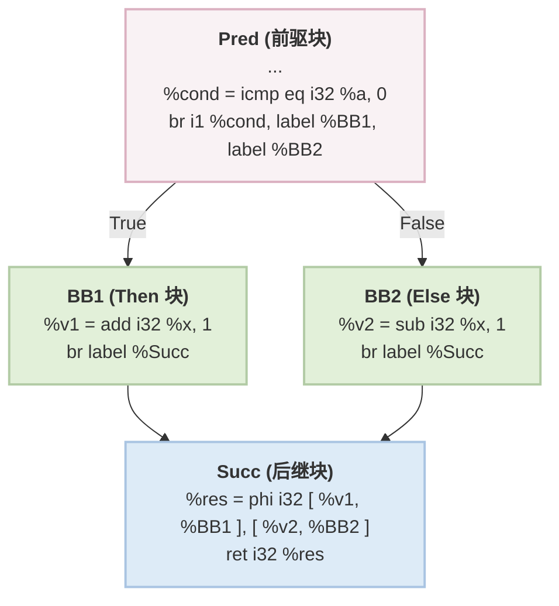

优化后

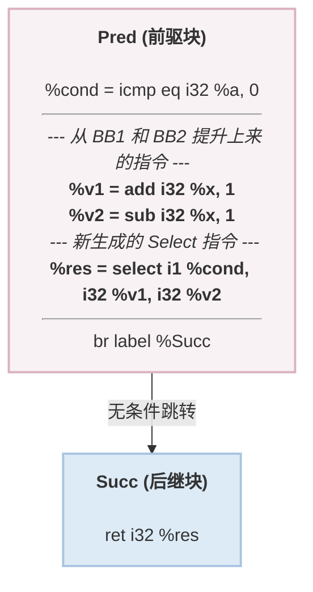

- 算法流程：

  1. 获取当前基本块True块

     只能有1个前驱和1个后继，前驱末尾是条件跳转（并且条件不是常量），获取该条件跳转指令

     获取两个跳转路径目标：Dest0,Dest1

     1. 如果Dest0和Dest1,其中有一个是当前块，一个是后继，那么标记没有else块
     2. 如果Dest0和Dest1，其中有一个是当前块，一个不是后继（记做else），并且这个else块只有一个前驱和后继，标记有else块

     如果该基本块和else块之中有Store，Load，Call，SDIV , UDIV , SREM, FDIV, FREM,不能IfConversion

     待转换的基本块和else块中指令总数<=4（如果只有True块，那么它之中的指令数<=4）

  2. 将该基本块和else块之中的指令除了终止指令全部移动到前驱块终止指令之前

  3. 遍历后继块中所有Phi，创建Select指令，根据条件真假选择Phi之前对应的两个值，将生成的Select插入到前驱块的末尾，RAUW替换所有使用PHI的地方变成使用Select，删除后继块中的PHI指令

  4. 修改前驱块的条件分支，变成无条件分支，指向后继块，删除当前块，如果有else块一并删除


##### Local2Global

将局部Alloca分配的大数组提升为全局变量

- 算法流程：
  1. 遍历Module之下所有函数所有指令，找到Alloca，计算其分配的变量占用的字节数，如果大于阈值（1024 size_t），那么加入工作队列之中
  2. 创建全局变量，提取原Alloca的底层类型，并复用原变量名字，RAUW替换alloca为该全局变量，清理Alloca


##### Global2Local

将全局变量Local到Main函数，从而在Mem2Reg可以将其提升为寄存器变量

- 算法流程：

  1. Local地点：Main，RISCV阈值32 size_t

  2. 遍历模块中所有全局变量：

     如果没人使用它，跳过

     如果这个全局变量大于阈值，跳过

     遍历使用该全局变量的所有指令，获取该指令所在函数，如果User不是当前函数，并且当前函数可以调用到所在函数，不进行优化，如果User是当前函数并且没有被当作参数传递给了Memcpy，才可以进行优化

     创建Alloca指令，将当前函数内所有用到该全局变量的地方全部替换成Alloca，插入到当前函数入口块PHI后面

     初始化：分为数组类型和标量类型进行初始化

##### Local&Global策略：

将极小变量提升到局部，变成寄存器变量，将极大变量提升为全局变量防止栈溢出


##### SCCP稀疏化常量传播

函数内稀疏化常量传播

> 没有支持向量化的相关支持


##### GVNPRE

依赖AnalysisPass：Dominant，AliasAnalysis，SideEffect

运行之前先运行BCE和CFGSimplify，InstSimplify，DCE，SCCP

- 算法流程：

  1. GVN：

     外层：不动点循环

     清理哈希表

     > 核心数据结构：
     >
     > **`ValueNum` (值编号缓存表)**
     >
     > **`ExpressionTable` (表达式查重表)**
     >
     > **`LeaderTable` (领导者备忘录)**

     RPO逆后序遍历目标函数中每个基本块（如果发现在死块里面就直接跳过），遍历基本块中每一条指令（跳过PHI指令）

     1. 如果是LOAD指令：

        找到该LOAD在基本块中的位置，从该位置向前扫描每一条指令，直到入口块第一条指令，调用别名分析，找到和它使用同一个地址的最近的一条指令

        如果该指令是LOAD/STORE（MustAlias），那么RAUW将使用LOAD的全部换成上一次使用的值，然后删除LOAD

        如果STORE（MayAlias），放弃优化

        如果STORE（NoAlias）/LOAD（MayAlias/NoAlias），继续寻找

        如果CALL，调用getInstModRefInfo，如果结果包含Mod，那么放弃优化，如果Ref/NoModRef，继续寻找

        如果经过上面优化是True，那么就返回True处理下一条指令，如果经过上面优化是False（放弃优化），那么执行下面的逻辑

        记录：在ValueNum哈希表中进行寻找，如果编号过直接返回，如果没有，直接分配NextValueNum++一个新的编号，然后将{Num，LOADINST，该指令所在基本块}记录在InstTable之中

        返回false（只是记录，原本程序逻辑和代码结构没变）

     2. 如果是CALL指令：调用副作用分析发现只是Ref

        找到该CALL在基本块中的位置，从该位置向前扫描每一条指令，直到入口块第一条指令

        如果遇到STORE，调用Alias，如果不是NoAlias，放弃优化

        如果遇到CALL，调用getInstModRefInfo，如果遇到是一模一样的CALL，那么RAUW直接替换，删除该CALL，如果是其他CALL，如果计算出来是ModSet那么放弃优化

        如果优化失败了，执行下面的逻辑

        记录：和上面LOAD的一样

     3. 如果是Br条件跳转指令：

        如果发现Cond是常量，那么找到永远不会执行的那个分支，将这个分支里面的块收集到死块集合之中

     4. 如果指令没有返回值直接跳过

     5. 值编号：

        获取下一个编号NextNum

        获取Num编号

        Num编号逻辑：

        1. 如果ValueNum哈希表能查到，直接返回查到的

        2. 如果传入的不是一条具体的指令，那么就分配新号码ValueNum++

        3. 如果是普通运算指令

           记录这条指令的返回值类型和Opcode，然后获取当前指令的所有操作数的ValueNum，存入该指令的VarArgs

           如果是ADD/MUL/AND/OR/XOR这种满足交换律的，按照从小到大的ValueNum排序VarArgs

           如果是比较指令，同样满足上面的小ValueNum的原则，但是比较符号也要一同取反，然后将Opcode和具体比较符号通过`(C->getOpcode() << 8) | Predicate`位运算结合在一起作为唯一的Opcode

        4. 如果是LOAD/STORE：直接分配新号码

        5. 如果是GEP：

           依次对基地址和索引求哈希

        6. 如果是CALL：

           调用副作用分析

           如果NoModRef，处理方法同普通运算指令（提取表达式），算哈希，存入哈希表

           其他情况直接分配新号码

        7. 如果是PHI/ALLOCA/RET/BR这种指令，直接分配新号码

        如果Alloca/Ret/Br/PHI，将{Num，INST，该指令所在基本块}记录在InstTable之中，直接返回

        如果Num>=NextNum，那么将{Num，INST，该指令所在基本块}记录在InstTable之中，直接返回

        根据当前指令所在基本块和Num去找Leader，根据Num去找LeaderTable中到Leaders，遍历所有Leaders，查看Leader所在基本块是不是支配当前指令所在块，如果找到这么一条指令就存起来，如果这条指令是常量直接返回不用找了，循环结束之后返回指令

        如果没找到就将自己{Num，INST，该指令所在基本块}记录在LeaderTable之中

        如果查到自己直接false

        RAUW将使用当前指令的地方全部换成Leader，然后删除当前指令，返回即可

        > 这里的LeaderTable就是上面的InstTable

  2. PRE：

     处理死块：

     遍历死块中所有指令，调用分配ValueNum的函数分配Num，然后插入到LeaderTable之中

     外层：不动点循环

     DFS遍历当前函数所有基本块（函数入口块跳过），遍历当前基本块之中的每一条指令

     1. 如果是ALLOCA/RET/BR/PHI/无返回值的指令/比较指令/LOAD/STORE/CALL（经过SideEffect后不是NoModRef的纯函数的拒绝）

        > GEP提升，纯函数提升

     2. 前驱块分析：

        获取当前指令的ValueNum

        遍历当前指令所在块的前驱：

        如果前驱不可达放弃，如果前驱是循环回边放弃

        PHITranslate:

        查PHITranslateTable如果缓存之中有直接返回翻译出来的结果，如果没有执行下面的逻辑，执行完之后存入缓存，返回翻译后的新ValueNum

        1. 如果当前要翻译的编号本身是PHI节点：

           看这个PHI是不是在当前块之中如果不是，说明不受跨块影响，不用翻译

           遍历PHI输入值，找到属于目标前驱的那个输入值返回输入值编号

        2. 如果Num不是PHI，说明是普通算数指令：

           从表达式哈希之中拿到表达式

           遍历表达式中每一个操作数，调用PHITranslate

           如果是ADD/MUL/OR/XOR/AND这些满足交换律的，重新排序表达式的ValueNum值，从小到大

           如果全局表达式表中能查到NewNum，那么就返回

        3. 如果查不到就返回旧Num

        拿着翻译后的Num去找Leader

        如果没找到，那么记录这个前驱PREPred，NumWithout++，如果找到了自己说明是循环回边，NumWithout = 2，直接放弃，如果找到了真的，加入到PredMap之中，NumWith++

        只有NumWithout == 1 且 NumWith > 0的时候才能进行后面的逻辑

        如果要提升的是DIV/REM直接返回

        clone当前指令，插入到PREPred前驱块末尾（在终止指令之前），在当前块PHI指令最后插入PHI，遍历PredMap，如果以前就有那么就直接加入输入值，如果是刚才缺失的路径那么就把刚插入的那条指令加入输入值

        给新的PHI发和原指令一样的Num，然后RAUW进行替换，删除原指令，更新LeaderTable

  3. 清空哈希表等数据结构


##### Reassociate表达式重结合

利用代数中结合律和交换律重新排列表达式中的计算顺序，从而暴露更多的优化机会

排序的依据：排序的依据就是 Rank（秩），规则很简单：Rank 越小，在表达式树中越靠右（越容易被沉到底部折叠）；Rank 越大，越靠左

为SCCP，GVN，LICM铺路

运行之后运行DCE

- 算法流程：

  1. 创建RankMap

     初始化rank=2

     遍历函数的所有参数，为这些参数建立从3递增的rank（每个参数的rank都各不相同）

     逆后序遍历函数中的基本块，每个基本块的rank间隔为`++Rank << 16`，遍历块内指令，为每个符合条件（不标ADD, SUB,MUL,AND, OR, XOR其余都标）的指令在本基本块的rank基础上分配rank并递增rank

  2. 不动点循环：

     逆后序遍历函数中基本块，遍历基本块之中的所有指令

     如果是死指令，断开对子节点的Use，直接跳过（留给后续DCE），如果不是调用下面的逻辑optimizeInst（该函数运行期间会收集TodoList）

     While循环遍历TodoList：如果是死代码，断开它对子节点的Use，然后跳过（留给后续DCE），如果不是死代码，继续运行optimizeInst

  3. 保留CFG相关的分析结果

  4. optimizeInst：

     1. 规范化：

        如果不是ADD，MUL，AND，OR，XOR，SUB直接返回执行下一条指令

        如果本条指令是SUB A-B指令，直接优化成A + B×（-1），将新生成的指令加入TodoList，然后直接返回执行下一条指令

     2. 内部节点过滤：

        如果这条指令只有一个User，并且User的Opcode和这条指令的Opcode一样，并且User不是自己，并且User和这条指令在同一个基本块之内：

        将User的指令加入到TodoList之中，这条指令直接退出，不进行下面的优化步骤

     3. ReassociateExp：(走到这里传入的Inst一定是Root)

        1. Linearize：

           WorkList While循环：

           1. 遍历当前指令的操作数

              如果Opcode和Root Opcode一样，并且只有一个User，那么加入WorkList

              否则，压入最终的Ops数组之中

        2. 排序：Rank大的排在Ops前面，Rank小的排在Ops后面

        3. OptExp：

           1. 常量折叠：从Ops数组末尾开始循环，将常亮根据每步的Opcode直接做折叠，拿到最后的常量

           2. 如果Ops全空了，那么直接返回最后的常量

           3. 简化：

              如果总常量是0并且当前是加法/总常量是1并且当前是乘法，直接扔掉总常量

              如果当前是乘法并且总常量是0,直接返回0

           4. 如果Ops之中只有一个变量了，那么直接返回这个变量

           5. 高级优化：

              1. ADD：

                 遍历排好序的Ops数组

                 优化1：合并同类项，比如有C（C为常量）个Y，找到这C个Y，然后创建乘法C×Y，将原来的删掉，将新乘法加入到Ops数组之中

                 优化2：抵消相反数，一旦找到MUL（X，-1），就会找X是否同时存在，如果同时存在那么直接二者删掉

                 优化3：提取公因式，匹配模式：A* B + A* C -> A*(B+C)，具体来说遍历所有是乘法的操作数，统计他们的出现次数，找到出现次数最多的因子，如果出现次数>1，那么就去乘法项之中把这个因子提取出来，将剩下部分加起来

              2. MUL：分治思想

                 传入的Ops大小必须>=4

                 提取Ops之中重复的变量，从Ops之中删去，按照(X,指数)存储起来，如果找不到就放弃优化

                 合并相同指数的底数：$A^N$×$B^N$=$(A×B)^N$,具体来说就是先生成一条底数乘法指令然后删除已经被合并的因子

                 指数奇数：如果指数是奇数，把底数拿出来一份，放入外层乘积列表之中，所有因子的指数都必须统一右移 1 位（减半向下取整，`Power >>= 1`）

                 递归：处理偶数次幂，如果减半后最大的指数仍然大于 0，说明还需要继续算。直接递归调用自己，递归返回的结果（我们称之为 `SquareRoot`），需要被平方。所以它把 `SquareRoot` 往外层乘积列表里塞了两次

                 把当前层级 `OuterProduct` 里面收集到的所有东西（包括奇数剥离出来的底数，以及递归返回的平方项）统统乘起来

           6. 如果在刚才的高级优化之中数组长度发生改变，递归调用OptExp自己，直到数组长度不变

           如果OptExp算出一个结果Value，直接RAUW将使用当前指令的地方全部换成Value，将Root放入TodoList，完成优化

        4. 如果Ops大小为1了，直接RAUW将使用当前指令的地方全部换成Value，将Root放入TodoList，完成优化

        5. 重建表达式树：

           1. 取出最底层的两个叶子：从 `Ops` 数组的末尾（`back`）弹出两个元素，分别作为 `RHS` 和 `LHS`。此时这两个元素是整棵树中 Rank 最小的（通常是常量或最外层的变量）
           2. 生成底层指令：根据原 Root 指令的 Opcode（例如 `ADD` 或 `MUL`），生成一条新的二元指令 `ResultInst = Opcode(LHS, RHS)`
           3. 插入新指令：将 `ResultInst` 插入到原 Root 指令的物理位置之前（`insertBefore`），以保证新生成的指令绝对满足支配关系（Dominance）
           4. 新指令入队：将 `ResultInst` 加入 `TodoList`（因为它是一条全新生成的指令，下一轮也许还能触发别处的优化）
           5. While 循环挂载剩余节点：
              - 只要 `Ops` 数组还不为空，就继续从末尾弹出一个元素，记为 `NextVal`
              - 生成新的指令：`NewInst = Opcode(NextVal, ResultInst)`（即：把刚才生成的结果当做一边，新取出的变量当做另一边）
              - 将 `NewInst` 同样插入到原 Root 指令之前
              - 将 `NewInst` 压入 `TodoList`
              - 更新游标：`ResultInst = NewInst`
           6. 收尾与替换 (RAUW)：
              - 循环结束后，最后的 `ResultInst` 就是这棵新树的最顶层新根节点
              - 调用 `replaceAllUsesWith(RAUW)`，将所有引用了旧 Root 指令的地方，全部替换为 `ResultInst`
              - 将旧的 Root 指令压入 `TodoList`


##### LoopSimplify

依赖Dominant和LoopInfo两个AnalysisPass

- 目的：确保Loop满足规范形式
  - 唯一的 PreHeader（入口块）
  - 唯一的 Back Edge
  - Dedicated Exits （ 所有的 Exit Block 只能被**循环内部**的基本块指向）

- 算法流程：

  PreHeader是用来汇聚外部块的进入的

  Latch块是用来汇聚回边的

  Dedicated Exits 是用来汇聚所有从Loop中Exit并和外部跳转进行分割的

  1. 插入PreHeader唯一入口块

     得到原Header，遍历Header的所有前驱，筛选出那些来自循环外部的块，然后将这些块先去指向PreHeader

     创建PreHeader的后，改动Value/User/Use（其实也是改动Br），改动Br跳转指令，改动Phi指令

     ```
     // ================= 转换前 =================
     Header:
         phi [ 1, pre, 2, pre, 3, x, 4, y ]


     // ================= 转换后 =================
     preHeader:
         Mergephi [ 1, pre, 2, pre ]
    
     Header:
         phi [ Mergephi, preHeader, 3, x, 4, y ]
     ```

  2. 构造Dedicated Exits 专用出口块

     当一个出口块（Exit BB）同时接收**循环内**和**循环外**的跳转时

     把所有来自**循环内部**的边拦截住，让它们先跳到一个新创建的中间块，然后再由这个新块跳向原来的 Exit BB。

     同样要创建好之后：改动Value/User/Use（其实也是改动Br），改动Br跳转指令，改动Phi指令

  3. 构造唯一回边--添加Latch块

     将多条跳转回Header的边汇聚到唯一的Latch块中

     同样要创建好之后：改动Value/User/Use（其实也是改动Br），改动Br跳转指令，改动Phi指令

  4. 简化Header中的PHI节点

     为什么要简化：在LoopSimplify这个pass进行之后，Header中PHI最多只有两个入口（PreHeader，Latch）

     如果只有一个来源直接进行替换，替换死循环PHI--**替换这两类PHI**

- 图解：

  转换前

  ```mermaid
  graph TD
      %% 外部区域
      O1[Outside 1]
      O2[Outside 2]
      O3[Outside 3]
  
      %% 循环内部
      subgraph LoopArea [Loop]
          direction TB
          H[Header]
          B1[Body 1]
          B2[Body 2]
  
          H --> B1
          H --> B2
          B1 -->|回边 1| H
          B2 -->|回边 2| H
      end
  
      %% 出口区域
      E[ExitingBlock]
  
      %% 跨区域连线
      O1 --> H
      O2 --> H
      B1 --> E
      O3 --> E
  
      %% 样式调整匹配你的手绘布局
      classDef default fill:#f8f9fa,stroke:#333,stroke-width:2px;
      classDef loopBox fill:#ffffff,stroke:#000,stroke-width:2px;
      class LoopArea loopBox;
  ```

  转换后

  ```mermaid
  graph TD
      %% 外部区域
      O1[Outside 1]
      O2[Outside 2]
      O3[Outside 3]
  
      %% 循环内部
      subgraph LoopArea [Loop]
          direction TB
          PH["新块: PreHeader"]
          H["Header<br>(PHI 被极大简化)"]
          B1[Body 1]
          B2[Body 2]
          L["新块: Latch"]
  
          PH -->|① 唯一入口| H
          H --> B1
          H --> B2
          B1 --> L
          B2 --> L
          L -->|③ 唯一回边| H
      end
  
      %% 出口区域
      DE["新块: Dedicated Exit"]
      E[ExitingBlock]
  
      %% 跨区域连线
      O1 --> PH
      O2 --> PH
  
      B1 -->|② 拦截内部跳出| DE
      DE --> E
      O3 -->|外部连线保持原样| E
  
      %% 样式标注
      classDef default fill:#f8f9fa,stroke:#333,stroke-width:2px;
      classDef loopBox fill:#ffffff,stroke:#000,stroke-width:2px;
      classDef newBlock fill:#d1e7dd,stroke:#198754,stroke-width:2px,color:#0f5132;
      class LoopArea loopBox;
      class PH,L,DE newBlock;
  ```

##### LCSSA--闭环SSA形式

依赖Dominant和LoopInfo两个AnalysisPass

标准SSA：每个变量只被赋值一次，且使用该变量的地方必须被其定义所支配

LCSSA附加规则：如果一个变量是在**循环内部**定义的，但它在**循环外部**被使用了，那么这个跨越循环边界的数据流，**必须**通过在循环退出块（Exit Block）中的 PHI 节点来传递。

- 算法流程：

  外层：**基于自然循环后序遍历的同时，然后基于支配树找出直接支配ExitingBlock的,并且在循环内的这些Block，然后搜集这些块中的指令**

  1. 处理每一条**在循环内定义的**指令，如果是死循环（ExitingBlock没有）就不处理

     如果存在ExitingBlock，进行下面的内容

  2. 寻找**这条指令在循环外部的Uses**：

     遍历这条指令被Use的所有地方

     如果发生在永远执行不到的死代码块中，直接将Use替换为UndefValue

     如果User**是一个Phi**，那么其实在控制流的角度看所对应的Use其实是发生**在Phi对应的前驱基本块之中**

     如果User普通情况，那我们的Use其实就是这条User所在的基本块

     如果这两个情况的基本块在循环之外，这个也就是**一个循环边界，记录下来**

  3. 插入LCSSA PHI：

     确定指令在支配树上的起点：本BasicBlock

     **遍历所有ExitingBlock：**

     1. 如果指令所在块不支配ExitingBlock，跳过
     2. 如果已经为ExitingBlock插入过值了，跳过

     下面这几条默认指令所在块支配ExitingBlock：

     1. 如果指令所在块支配ExitingBlock，插入LCSSA，添加指令I为输入值

     2. 如果ExitingBlock的某个前驱不在循环之内，但是指令所在块又支配ExitingBlock：

        说明执行流先从其他出口跳转出去，然后回到了ExitingBlock

     3. 如果该ExitingBlock是其他不相交的循环的循环头：

        这时我们插入LCSSA可能会破坏另一个循环的LCSSA形式，但是还是插入这个LCSSA

        后两条直接把刚生成的LCSSA加入队列等待下一轮算法运行即可

  4. 重写外部Use:利用支配树实现**（Minimal SSA）**

     **遍历第二条说的循环边界，并在同时倒序爬支配树，寻找UserBlock的IDOM**

     1. 循环只有一个ExitingBlock：IDOM一定会落在这个ExitingBlock上面（即IDOM落在循环外面）

        这时其实还是线性的，那么我们递归找IDOM（ExitingBlock）要值即可

     2. 循环有多个ExitingBlock，但UserBlock仅仅出现在某个ExitingBlock下游：

        同样沿着IDOM就会落在该ExitingBlock下面，同1（IDOM落在循环外面）

     3. 循环有多个ExitingBlock，且UserBlock落在ExitingBlock的汇合处：

        **（IDOM落在循环里面）（理解：同时支配ExitingBlock的地方只能是在循环内部）**

        同样我们递归，朝这多个ExitingBlock要值

- 图解：

  优化前：存在一个在循环内部定义，但是在循环外部被使用的变量

  那我们就说这样的变量是跨越循环边界的数据流

  ```mermaid
  graph TD
      %% 定义节点样式类，保持清晰度
      classDef loopBlock fill:#e1f5fe,stroke:#01579b,stroke-width:2px;
      classDef exitBlock fill:#fce4ec,stroke:#880e4f,stroke-width:2px;
  
      %% 外部节点
      PreHeader[PreHeader]
  
      %% 循环内部结构
      subgraph Loop
          direction TB
          Header[Header]
          %% 在 Body 节点中明确标注文本内容
          Body["Body<br/>define: val"]
          Latch[Latch]
      end
  
      %% 控制流
      PreHeader --> Header
      Header --> Body
      Body --> Latch
      Latch --> Header
  
      %% 外部节点
      %% 在 Exiting Block 节点中明确标注文本内容
      ExitingBlock["Exiting Block<br/>Use: val"]
  
      %% 指向退出块的连线
      %% 捕捉草图中从 Body 到 Exiting Block 的直接连接
      Body --> ExitingBlock
  
      %% 应用样式类
      class Header,Body,Latch loopBlock;
      class ExitingBlock exitBlock;
  ```

  优化后：

  那我们引入这种只有一个输入值的Phi，外面的Use都只能使用这个Phi，不能使用里面的原变量

  ```mermaid
  graph TD
      %% 定义节点样式类，保持清晰度
      classDef loopBlock fill:#e1f5fe,stroke:#01579b,stroke-width:2px;
      classDef exitBlock fill:#fce4ec,stroke:#880e4f,stroke-width:2px;
  
      %% 外部节点
      PreHeader[PreHeader]
  
      %% 循环内部结构
      subgraph Loop
          direction TB
          Header[Header]
          %% 在 Body 节点中明确标注文本内容
          Body["Body<br/>define: val"]
          Latch[Latch]
      end
  
      %% 控制流
      PreHeader --> Header
      Header --> Body
      Body --> Latch
      Latch --> Header
  
      %% 外部节点
      %% 在 Exiting Block 节点中明确标注文本内容
      ExitingBlock["Exiting Block<br/>%val.lcssa = phi i32 [ %val, %Body ]<br/>Use：val.lcssa"]
  
      %% 指向退出块的连线
      %% 捕捉草图中从 Body 到 Exiting Block 的直接连接
      Body --> ExitingBlock
  
      %% 应用样式类
      class Header,Body,Latch loopBlock;
      class ExitingBlock exitBlock;
  ```

##### LoopRotate循环旋转

依赖Dominant和LoopInfo两个AnalysisPass

目的：把一个传统的while结构转换成do-while结构

循环内部少了一次无条件跳转，对CPU流水线指令和分支预测提升巨大

- 算法流程：

  顶层遍历：遍历Top-Level Loops，然后利用逆后序遍历去遍历每个loop

  1. 循环可以Rotate条件1：

     1. 满足LoopSimplify形式：

        PreHeader：从Header的前驱中只能有一个来自循环外部的块（即PreHeader），并且这个PreHeader只能有一个后继就是Header（即无条件跳转）

        Latch：Latch必须唯一

        DedicatedExits：必须有，遍历所有从循环内部跳到循环外部的这些块，这些块的前驱只能来自循环内部

  2. 循环可以Rotate条件2：

     1. 循环只有1个/2个基本块，不进行Rotate
     2. **循环只能有一个Exit Block**
     3. Header必须以条件跳转结尾，并且Header是ExitingBlcok（一个分支跳到Exit Block）

  3. 将Header的两个后继，Body作为NewHeader，Exit Block依旧作为Exit Block

  4. 循环可以Rotate条件3：

     1. **Exit Block的前驱只能是Header，并且唯一**
     2. **Latch不能是ExitingBlock**，Latch后继必须是Header，并且只有一个后继
     3. Body（NewHeader）的前驱只能是Header，并且唯一

  5. Body（NewHeader）PHI折叠

     无User：直接删除

     **有LCSSA标记的不能删--这里需要更新LCSSA算法，看看怎样打上.lcssa标记**

     PHI的输入值全部一样（但不是自我引用）：删除

     RAUW删除

  6. 核心Rotate1:将Header中的指令**clone到**PreHeader，并更新Body的PHI节点

     1. 删除PreHeader中的无条件跳转指令

     2. 准备Map：

        Header->PreHeader->Body

        [Header中旧 Phi 节点] -> [来自 PreHeader 的初始值]->[Body新建立的PHI]

        [Header中普通指令] -> [存入PreHeader的指令]->[Body新建立的PHI]

        Body新建立的PHI：输入值来自Header和PreHeader

     3. 处理Header中的PHI节点

        处理Body:在Body中建立一个新PHI节点，在原PHI节点中提取来自PreHeader的初始值作为新PHI的输入边（来源为PreHeader），提取原PHI节点中来自Latch的迭代值作为新PHI的输入边（来源为Header），更新Map

     4. 处理Header的普通指令

        处理PreHeader：遍历Header的普通指令，然后进行clone，然后根据上面的Map去更新这条克隆指令的usee，Use关系（即操作数），然后插入到PreHeader

        处理Body：如果Body中用到了这个值，那么我们在Body中建立一个新PHI节点（后续步骤同3），更新Map，如果没用到就不用建立PHI了

  7. 核心Rotate2：更新所有普通指令的Use关系

     获取Map中所有来自Header的指令的Use，更新这些Use

     1. 如果UserBlock在Header

        普通指令不用管，PHI指令将Header的输入边替换为来自Body的输入边

     2. 如果UserBlock在Body

        如果这个User不是刚才Body建立的PHI，就将所有对Header的引用换成新建的这个PHI

     3. 如果UserBlock在循环外部

        更新ExitBlock：更新Exit中LCSSA PHI，添加来自PreHeader的输入边，如果不存在这么一个LCSSA，就重新建立一个PHI（输入来自PreHeader，和Header），重新建立需要去找这个Use替换成这个新PHI

     4. 更新ExitBlock中不来自Header定义的但是传递到这里的LCSSA PHI，给他们添加一个来自PreHeader的输入

  8. 核心Rotate3：CFG重连

     去除PreHeader和Header连接，添加PreHeader与Body，PreHeader与Exit Block连接

     更新Header的PHI：去除PreHeader的输入边

     因为Header前驱只有Latch了，所以折叠PHI（逻辑同第6步）

     **更新loopinfo的Header信息**

  9. 常量折叠与修复LoopSimplify形式：

     **修复PreHeader：**

     1. 常量折叠：尝试折叠PreHeader中的Br条件分支，如果100%就能进入Body，那么就换成无条件分支，切断与ExitBlock的分支，这时PreHeader还可以做PreHeader
     2. 如果不能进行折叠，直接在PreHeader和Body直接创建一个NewPreHeader，然后在这个NewPreHeader之中加入一个Br无条件跳转，修改PreHeader的Br分支--**这里好好读一读LoopSimplify相关逻辑**

     **修复Dedicated Exits（独占出口块）：**

     ExitBlock从只来自Header，变成来自PreHeader和Header，打破了Dedicated Exits的要求

     所以我们在ExitBlock和PreHeader，Header中加入一个Exit，然后再无条件转接Exit--**这里好好读一读LoopSimplify相关逻辑**

  10. 合并Header到Latch

      删除Latch中无条件跳转，将Header中所有指令搬到Latch末尾，将Header的后继作为Latch的后继（更新CFG），修复和Header相关的PHI

      删除Header

  11. 更新支配树和LoopInfo

- 图解

  ```mermaid
  graph TD
      PreHeader --> Header
      Header --> Body
      Header --> Exit
      Body --> Latch
      Latch --> Header
  ```

  ```mermaid
  graph TD
      PreHeader --> Body
      PreHeader --> Exit
      Body --> Latch
      Latch --> Header
      Header --> Body
      Header --> Exit
  ```

  ```mermaid
  graph TD
      PreHeader --> Body
      PreHeader --> Exit
      Body -->  Latch+Header
      Latch+Header --> Body
      Latch+Header --> Exit
  ```

##### LICM循环不变量代码外提

依赖AnalysisPass:Dominant,LoopInfo,BasicAliasAnalysis,SideEffect

- 算法流程：下沉Sink，外提Hoist

  最外层：依然是遍历顶层循环+后序遍历单棵循环树

  1. 前置检查：

     1. 是否符合LCSSA形式
     2. 是否符合LoopSimplify形式（PreHeader，Latch，Dedicated Exits）

  2. 下沉Sink：

     一条指令在**每次迭代中都在计算**，但是**结果只有在退出循环才被使用**

     Sink：将其沉到循环的ExitBlock，只在退出循环时执行一次

     后序遍历--从循环尾开始向上遍历到循环头，倒序遍历本层循环中基本块中所有指令：

     1. 检查：

        1. 检查是否存在DedicatedExits

        2. 检查指令--判断一条指令是否可以被安全的移出循环：--**需要使用别名分析**

           绝对不能移动：

           RET，BR，PHI，ALLOCA，Binary中的：SDIV，FDIV，SREM，FREM

           可以移动：

           排除上面之后的BinaryInst

           严格检查可以移动：LOAD，STORE，CALL

           CALL：

           调用副作用分析，分析是否含内置函数和Untracked标记，有的话直接false

           检查ModRefInfo，只有NoModRef/Ref可以

           调用ModRefInfo

           检查ModSet是否为空，untracked是否是未标记的

           如果RefSet依旧为空，那么直接true

           如果RefSet不为空，遍历Set中每一条指令，比对函数中中每一条指令，调用别名分析分析二者，只要一条会修改这块内存那么就直接false

           LOAD：遍历循环之中每一条其他指令，调用副作用分析`getInstModRefInfo`检查是否会影响LOAD读取的地址

           STORE：如果是激进外提直接否定，不提STORE

           遍历循环之中每一条其他指令，调用副作用分析`getInstModRefInfo`检查是否会影响STORE读取的地址，并用支配树证明，如果当前的Store是最后一次写入（覆盖掉之前所有的）其实是可以下沉到循环之外的

        3. 检查这条指令的所有User是否全在循环之外

        4. 判断循环不变量：

           循环不变量（一条指令的操作数都是循环不变量，即所有操作数的定义都在循环外/操作数是常量，递推：该变量的所有操作数的**可达定义只有一个（即定义是确定的，没有经过if条件），这个定义来自循环内，并且它本身也是循环不变量**）

     2. 下沉：

        遍历所有出口块，直接将指令I clone 到对应的 Exit Block（受指令I所在块支配） 中（PHI节点之后）

        遍历clone出来的指令I的操作数，如果操作数来自循环内部但没有创建LCSSA PHI的话，那我们就去创建PHI并替换指令I的操作数，如果已经创建，直接替换指令I的操作数即可

        遍历使用指令I的User，将这些User的Usee指令I换成我们新创建的指令，然后删除旧指令

  3. 外提Hoist：

     RPO遍历循环中所有基本块，正向遍历基本块中所有指令

     1. 条件：

        再次检查是否存在PreHeader

        检查激进Hoist：

        如果这条指令所在的基本块，支配该循环中所有的Exit出口块和所有的Latch回边块，标记为激进Hoist（该块后向支配PreHeader的逻辑，只不过用支配树的逻辑实现）

        检查指令：和sink第一条相同

        检查循环不变量：和sink第三条相同

     2. 外提：统一move到PreHeader块末尾


##### LoopDeletion循环删除

依赖AnalysisPass：Dominant，LoopInfo，BasicAliasAnalysis，SideEffect，SCEV

- 算法流程：

  1. 符合LCSSA形式

  2. 检查是否符合LoopSimplify形式，并获得PreHeader

  3. 获取循环的所有ExitBlock，必须是唯一ExitBlock

  4. 如果循环永远不会执行：

     1. 判断循环会不会进入：

        获取PreHeader，如果PreHeader是整个函数的EntryBlock，那么一定可以进入

        遍历PreHeader所有前驱块，找到这些前驱块的终止指令，如果是Br并且条件是常量，那么提取出两个目标基本块，如果条件不是常量那么直接返回可以进入，其他终止指令的情况直接保守可以进入，如果两个目标基本块中那个True的正好是PreHeader，那么可以进入，反之不可以进入

     2. 如果不可以进入

        1. 删掉PreHeader的旧分支指令，构建一条分支指令`br ExitBlock`
        2. 遍历ExitBlock中的PHI节点，强制将第0项的来源改为PreHeader，将后续所有项删除，值不变
        3. 遍历循环里的所有指令，如果循环外还有指令使用这些值，将这些Use全改成UndefValue
        4. 删除循环之中的所有指令（删除之前现在所有UseDef清除）所有基本块
        5. 更新支配树，LoopInfo，SCEV

  5. 如果是多出口的情况，直接返回

  6. 常规循环删除：

     1. 判断：

        取出这个唯一ExitBlock的所有PHI节点，逐个检查这个PHI是否是一个平凡PHI（所有输入值都是一样的），只要有一个输入值不一样的那么就返回，如果这个输入值是一个指令，如果还在循环内，直接返回

        遍历循环体内的所有指令，进行循环级副作用分析，如果有副作用直接返回

        DFS遍历这个循环

        经过上述检验的可以执行下述的删除

     2. 如果符合条件，执行删除，逻辑和4.2相同


##### LoopUnswitch

将循环内部依赖于**循环不变量**的分支移动到循环外

先运行LoopSimplify，LCSSA，LICM再运行LoopUnswitch

依赖AnalysisPass：DominatorTree，LoopInfo，SCEV，MemorySSA

实现了如下两种UnSwitch的形式

- Trivial Unswitch：目标分支的至少一个后继可以退出循环
- Non-trivial Unswitch：两个分支的后继都留在循环内

并且只做了Full Unswitch，即分支条件全是循环不变量

- 算法流程：

  1. 确认是loopsimplify，LCSSA形式

  2. 优先执行Trivial Unswitch，其次执行Non-trivial Unswitch（并且每个函数中二者只能执行其一）

  3. Full Trivial Unswitch：

     检查：从 LoopInfo::Header 开始向下检查每个必经的基本块，检查当前块的 MemoryDef 以及副作用。如果存在除 MemoryPhi 以外的 MemoryDef，或者存在具有副作用的指令，则停止扫描。

     获取当前块ParentBB的分支指令，必须是非常量条件分支

     核心：检查整个条件是不是全都是循环不变量，然后明确true和false哪个分支的successor是退出循环的，哪个是继续循环的（这里不接受两个successor都退出循环或两个successor都继续循环），该分支属于当前循环本身，而不是位于某个内层子循环中。

     检查离开分支的ExitBB中的PHI中的incoming value，这个incoming value必须也是循环不变量（不能在循环内被计算），否则不能被执行

     然后新建一个NewPreHeader插入在OldPreHeader以及Header之间，并且更新Header的PHI之中 incoming block由OldPreHeader->NewPreHeader

     如果ExitBB只有当前分支块 ParentBB这一个前驱，那么出口直接复用，如果ExitBB还有其他前驱，那么进行切分，旧的ExitBB保留全部PHI，并新增跳到NewBB的Br无条件分支指令，NewBB保留原来旧ExitBB所有其他指令

     然后删除OldPreHeader原来的无条件跳转，然后将ParentBB的分支指令从ParentBB移动到OldPreHeader，并根据true还是false更新这条分支指令successor（退出方向   -> ExitBB 或切分得到的 NewBB，继续方向   -> NewPreHeader）

     然后创建ParentBB的新分支指令Br无条件跳转到继续循环的那个块上

     对出口 PHI 进行修复：

     - 如果直接复用原来的 `ExitBB`，则将 PHI 中来自 `ParentBB` 的 incoming block 修改为来自 `OldPreHeader`，incoming value 保持不变。
     - 如果对ExitBB进行了切分，则不能简单地把原 PHI 的 incoming block 修改为OldPreHeader。需要在切分得到的NewBB中创建新的合流 PHI，用来合并：
       - 从 `OldPreHeader` 直接退出时使用的循环不变量值；
       - 从原 `ExitBB` 正常退出时得到的原 PHI 结果。

     最后替换循环内所有使用循环不变量的Use为确定的True/False常量

     变换完成后重新获取当前ParentBB的 terminator：

     - 如果当前terminator已经变成无条件 branch，则根据其唯一successor更新下一个必经基本块，并继续扫描。
     - 如果successor已经离开当前循环，或者该基本块已经被访问过，则停止扫描。

     

  4. Full Non-trivial Unswitch：

     获取当前块ParentBB，以及对应的分支指令。要求整个分支条件都是循环不变量，并且该分支属于当前循环本身，而不是位于某个内层子循环中。

     根据目前的分支指令确定两个分支的successor，根据支配树，确定我们每个分支具体需要clone的支配子树（如果某些基本块被其中一个 successor 支配，并且只能通过该 successor 到达，那么这些基本块只属于对应的专门化路径。在克隆某个循环版本时，由另一个 successor 独占支配的基本块不需要复制；这些块在当前专门化版本中不可达。）

     然后新建一个NewPreHeader插入在OldPreHeader以及Header之间，并且更新Header的PHI之中 incoming block由OldPreHeader->NewPreHeader--**这一部分和刚才Trivial Unswitch一样**

     克隆循环：克隆当前循环所需要的全部基本块，并且为克隆循环新建一个 ClonedPreHeader。在clone过程中建立原值到clone值的映射，clone每条指令的时候必须重新映射其操作数，然后克隆循环 Header 中的 PHI,并根据其映射修改相关的incoming，克隆循环内其他 PHI 时，也必须同时映射 incoming value 和 incoming block，如果根据支配子树裁剪了部分基本块，那么必须删除由未克隆基本块产生的 PHI incoming，并在 PHI 只剩一个 incoming value 时进一步简化 PHI，对于循环出口和 LCSSA PHI，需要为克隆循环建立对应的退出值。原循环退出产生的值和克隆循环退出产生的值，最终需要在循环外合流

     然后删除OldPreHeader原来的无条件跳转，然后将ParentBB的分支指令从ParentBB移动到OldPreHeader，并根据true还是false更新这条分支指令successor

     然后对原循环进行专门化，由于原循环负责 `Cond = false` 的版本，所以原循环中的 `ParentBB` 不再需要保留原条件分支，而是创建新的无条件 branch，删除原循环之中不需要保留的那条分支的CFG边，必须删除 `CloneSucc` 中所有来自 `ParentBB` 的 PHI incoming，

     然后对clone循环进行专门化，根据映射将克隆循环中的原条件 branch 替换为无条件 branch，同时删除克隆循环中指向另一个 successor 的 CFG 边，并删除对应 successor PHI 中来自 `ClonedParentBB` 的 incoming

     然后进行循环不变量的常量替换，并替换该循环内所有对该循环不变量的Use

     对于每个原循环 ExitBB：

     1. 保留原循环版本的退出 incoming。
     2. 增加克隆循环版本对应的退出 incoming。
     3. 如果原 ExitBB 不能直接同时承接两个循环版本，则切分或新建 ExitMergeBB。
     4. 在 ExitMergeBB 中建立合流 PHI。
     5. 所有循环外 Use 改为使用合流 PHI 的结果。

     


#### AnalysisPass

##### Dominant支配树

##### PostDominant后支配树

##### LoopInfo/LoopAnalysis循环分析

建立循环森林


##### MemorySSA

将内存状态抽象成SSA风格定义链，标记每一处内存写入点和内存读取点，构建内存图

使用MemorySSA的TransformPass：

1. LoadElimination：查询 Load 最近的相关 Store，执行跨块 Store-to-Load Forwarding
2. GVNPRE：使用Store 转发；用相同 clobber 判断两次 Load 读取同一内存版本
3. LICM：证明 Load 的最近相关写入位于循环外，从而提升 Load
4. DSE：证明所有到达路径都已经写入同一个值，删除后续冗余 Store
5. InstSimplify
6. SCCPLocalAggregateSimplify

- 内存状态结点：

  - LiveOnEntry：函数入口时未知的初始内存状态，**无对应IR**，无任何对应，每个函数只创建一个

  - Phi：多个CFG前驱的内存状态汇合，**对应IR在每个基本块入口**

    incoming:(PredBB1, PredBB1Status)记录每个前驱CFG的内存节点状态

  - Use：读取内存但不产生新内存版本,**对应IR：Load**

  - Def：可能修改内存，产生新内存版本，**对应IR：Store/Call**

- 内存状态图：

  1. 每个函数入口对应一个LiveOnEntry
  2. 只在可达MemoryDef所在块的迭代支配边界MemoryPhi（PrunedPHI，和mem2reg算法差不多一样）
  3. 每个store/call产生一个新内存状态
  4. 每个load使用当前内存状态，但不产生新状态

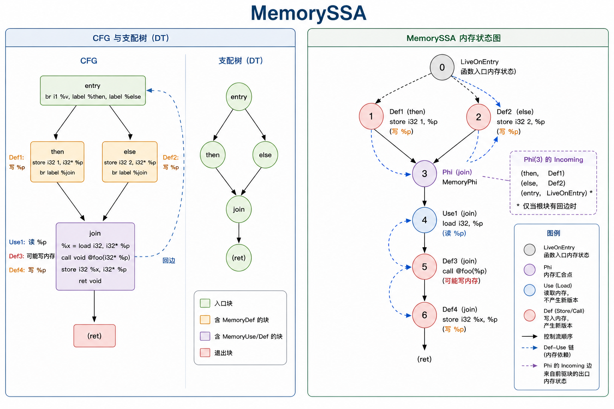

参考资料：https://zhuanlan.zhihu.com/p/715818784

##### SCEV标量演化分析

依赖AnalysisPass：


#### TransformPass

#### CFG规范化Pass


##### CFGSimplify

- 算法流程：**该pass内部使用不动点循环，因为子优化之间会互相创造优化机会**

  1. 消除死块：排除入口块之后，检查前驱块：没有/唯一的前驱是自己，满足条件删除，先维护后继块的PHI，然后再进行删除

     

  2. 终结指令常量折叠：

     拿到终结指令，如果是条件跳转：

     1. 如果两个分支目标相同（平行边）：将该条件跳转改成无条件跳转，并在目标块的前驱列表中删除一个前驱边
     2. 如果条件分支的条件是常量，则根据常量值选择一条边，删除另一条边，改为无条件分支 -- **这种优化为上面消除子块创建优化机会**

     

  3. **折叠已知分支条件 -- 编写较麻烦**

     > 和上面第二步区别：第二步要求条件是常量，这一步主要针对条件是变量的情况

     要求当前基本块含多个前驱，并且条件值本身不是常量，不能是自环（条件值不能正确推导），前驱必须也是条件分支，处理时，判断所有前驱是否都能从其Cond条件值推导出该块的Cond条件值（相同或相反），然后根据该块推导出的条件值删除一条分支，并维护后继块PHI

     

  4. 消除重复的PHI节点：-- **这个其实属于纯PHI化简了**

     满足前驱块数量相同，数据流来源完全一致的两个PHI可以删除其中一个

     基准指针遍历基本块开头的每一个PHI节点，候选指针从基准指针的下一个开始遍历，比较重复，如果重复了就替换候选指针中的所有使用，然后加入到Removed集合之中，然后打断两个指针从头开始再次遍历

     最后将Removed集合中的PHI节点全部删除即可

     

  5. 穿透分支条件PHI：

     当前块必须只含分支指令，XOR指令（可选），PHI指令，并且PHI形式满足分支条件PHI形式

     ```
         %cond = phi i1 [ true, %P0 ], [ false, %P1 ]
         br i1 %cond, label %T, label %F
     
         %cond = phi i1 [ true, %P0 ], [ false, %P1 ]
         %not = xor i1 %cond, true
         br i1 %not, label %T, label %F
     ```

     必须让条件PHI的incoming数量对应前驱块的数量

     

  6. 规范化分支条件PHI

  7. 基本块合并：

     检查：该基本块的前驱只有一个，保证前驱也只有该基本块这一个后继

     合并：

     1. 处理该基本块中的PHI节点（一定来自前驱，并且只有一个incoming），直接删除PHI拿值替换
     2. 修改后继块PHI的incoming block
     3. 将该基本块中的指令，全部搬到前驱的终结指令之前，删去前驱的原终结指令
     4. 删除该基本块

     

  8. simplifyBranch：处理无条件跳转

     1. simplifyUncond:该基本块末尾是一条无条件跳转指令

        1. 如果该基本块PHI指令之后就是终结指令，并且不是入口块：检查后继不是自身，检查该基本块的前驱和该基本块的后继的前驱没有重合的，检查该基本块中的PHI节点没有被除了该基本块后继的PHI之外任何其他使用

           修改该基本块后继的PHI，将来源改成该基本块的前驱（考虑多个前驱的情况）

           修改基本块前驱末尾的跳转指令

           删除该基本块中的指令，删除该基本块


##### BreakCriticalEdges打破关键边

GVN-PRE前置Pass，放置在LoopSimplify之前

关键边：一条边 `A -> B` 被称为**关键边（Critical Edge）**，当且仅当它**同时满足**以下两个条件：

1. 源基本块 A 有多个后继（SysY编译器只支持条件分支指令，所以只能是2个
2. 目标基本块 B 有多个前驱

打破关键边：在关键边的位置插入新的块

- 算法流程：

  1. 找到关键边：源块A两个后继，目标基本块多个前驱

  2. 创建新基本块，插入到函数之中，并创建新的Br无条件分支指令，指向目标块，修改源基本块A中的分支指令，让其指向新基本块，修复目标块B中的PHI节点，将来源为A的全部换成来源为新基本块


##### UnifyFuncExits统一函数出口

用在中端转入后端前PassPipeline收尾阶段

- 算法流程：将该函数中所有含Ret的基本块中的Ret换成无条件跳转Br，无条件跳转到新插入的UnifiedExit基本块，根据返回值类型创建PHI以及新的Ret指令


#### 清理类Pass

##### DAE死参数消除

注意要在Mem2Reg运行后运行

- 算法流程：

  1. 遍历所有函数

     跳过Runtime库函数，llvm intrinsic，main函数

     **形参常量特化**：遍历该函数每个形参，检查**调用该函数**的所有 `CallInst`。如果某个参数在所有调用点传入的都是**同一个常量/如果不是同一个常量，可以分组创建函数副本进行特化**，则在函数体内将该形参的所有 Use 替换为该常量（`RAUW`）

     ```
     define i32 @foo(i32 %x) {
     entry:
       %v = add i32 %x, 1
       ret i32 %v
     }
     call i32 @foo(i32 10)
     
     ->
     
     define i32 @foo(i32 %x) {
     entry:
       %v = add i32 10, 1
       ret i32 %v
     }
     ```

     **冗余参数合并**：检查调用该函数的所有 `CallInst`。如果某几个参数在所有调用点传入的**实参完全相同**（例如 arg2 永远等于 arg1），则在函数体内将 arg2 的所有 Use 替换为 arg1

     ```
     define i32 @foo(i32 %a, i32 %b) {
     entry:
       %x = add i32 %a, %b
       ret i32 %x
     }
     call i32 @foo(i32 %v1, i32 %v1)
     call i32 @foo(i32 %v2, i32 %v2)
     
     ->
     
     define i32 @foo(i32 %a, i32 %b) {
     entry:
       %x = add i32 %a, %a
       ret i32 %x
     }
     ```

  2. 遍历所有函数：找到死参数

     跳过sysylib，memcpy，main函数

     遍历该函数的参数列表，如果该参数Use=0,标注为Dead，如果Use!=0,遍历每个User，如果是CallInst就递归判断，在中途中还要记录已经判断过的函数，如有一个地方用到那么就是Live，否则Dead，其他情况标注为Live

  3. 遍历所有函数：清除死参数与函数重写

     跳过sysylib，memcpy，main函数

     删除掉函数中所有死参数，并进行更新基本块中的Use，找到调用旧函数的所有CallInst，创建新的CallInst，并根据新的形参列表决定传入的实参，删去旧的CallInst


##### DeadFunctionElimination死函数消除

目前在SysY2022之中，**函数只能通过Call指令进行调用**，没有其他调用方式，所以我们不需要考虑函数地址逃逸或者调用函数指针的情况

- 算法逻辑：main函数一定Live ，从main函数开始，收集函数中可达基本块中的Call指令，将被Call指令调用的函数标记为Live，然后删除剩下的死函数即可 -- **可达调用图遍历**

效果显著，把基本上全部死函数都消除掉了

##### LatePhiCleanup晚期PHI函数清理

> 只是一个在优化后期轻量级的PHI函数清理


#### 循环优化类Pass


#### 并行化与向量化Pass

> 目前并未支持，决赛根据SysY2026进行相关拓展

### 参考博客

### AnalysisPass构建结果补充

本节以 `FunctionAnalysisPass.def` 中实际注册的函数级AnalysisPass为准，仿照前文MemorySSA的说明方式，重点描述每个Pass把IR抽象成了什么分析模型，以及TransformPass实际消费的是模型中的哪一种关系。`LoopAnalysis`和`MemorySSAAnalysis`已经在前文说明，因此不再重复；`SCEVExpander`是把SCEV表达式重新展开成IR的工具，不是独立注册的AnalysisPass。

下列示意图画的是分析结果的语义结构。Dominant和PostDominant在Pass运行时直接建树；SCEV、LoopDependence和LoopAccess返回的是惰性查询器，相关模型在首次查询时形成。BasicAA图展示一次按需查询所展开的来源模型和查询结论，其中只有来源摘要及部分普通指针对结论会缓存；这些图都不表示Pass入口已经急切枚举了全函数的全部关系。

##### Dominant/DominantAnalysis支配树分析

将从函数入口可达的CFG抽象成一棵直接支配树：如果从Entry到基本块B的每一条路径都经过A，则A支配B；树中B的父节点是离B最近的严格支配者。

依赖AnalysisPass：无。

使用Dominant的主要TransformPass：

1. Mem2Reg：根据迭代支配边界确定PHI插入位置，再沿支配树完成SSA重命名
2. LCSSA、LICM、ConstantHoist：证明定义或被移动指令在循环出口和目标位置仍然可用
3. GVNPRE、LoadElimination、InstSimplify：选择能够支配使用点的等价值或内存值
4. LoopFusion、LoopInterchange、LoopRotate、LoopUnroll、LoopUnswitch、UnrollAndJam：验证循环CFG形状及变换后的值可用性
5. ConstraintElimination、RangeAwareSimplify、GepCombine：只在被某个条件支配的区域内使用路径事实

- 支配树中的对象：

  - Root：对应函数Entry基本块，每个函数至多一个
  - Block节点：每个从Entry可达的BasicBlock对应一个节点；入口不可达块不进入分析结果
  - IDom树边：`parent -> child`表示`parent = IDom(child)`；它把“支配”这个偏序关系压缩成一棵树
  - Euler区间：对支配树做一次DFS得到进入/离开编号；A的区间包含B的区间当且仅当A支配B。它只是树的查询索引，不是另一张图

- 支配树构建：

  1. 从Entry遍历CFG，只为可达块编号，并记录每个块的全部CFG前驱
  2. 使用Semi-NCA在编号后的CFG上求每个块的半支配者
  3. 沿候选支配链把半支配关系修正为直接支配关系
  4. 按`IDom -> Block`连接树边，以Entry节点作为根
  5. 对树编号，使块间`dominates`能够使用Euler区间查询；`dominatesValue`在此基础上对同块定义和使用另行检查指令顺序
  6. 迭代支配边界由这棵树和CFG边按查询即时导出，不额外持久化另一张边界图

下图中，Then、Else和Merge的直接支配者都是Entry，因为到达Merge存在两条互不经过对方的路径；Exit只有经过Merge才能到达，所以Merge是Exit的直接支配者。


##### PostDominant/PostDominantAnalysis后支配树分析

将入口可达CFG反向观察，并增加一个无对应IR的VirtualExit，构建单根的直接后支配树：如果从B出发、最终到达某个真实出口的每条路径都经过A，则A后支配B。

依赖AnalysisPass：无。

使用PostDominant的TransformPass：

1. ADCE：沿直接后支配链恢复活跃指令所依赖的控制分支，并为被删除分支选择安全的汇合目标
2. LoopFusion：证明循环体、Latch和退出路径形成能够安全融合的控制流形状
3. LoopInterchange、UnrollAndJam：证明循环Latch后支配迭代路径，避免变换跳过必要控制流

- 后支配树中的对象：

  - VirtualExit：分析层创建的虚拟根，**无对应IR**；它把多个真实出口统一成单根问题
  - Block节点：每个从函数Entry可达的真实基本块对应一个节点，包括不能到达真实出口的块
  - IPostDom树边：`parent -> child`表示`parent = IPostDom(child)`
  - ExitReachable事实：单独标记“从Entry可达并且还能到达至少一个真实出口”的块，不能与树节点集合混为一谈

VirtualExit对应的空Block指针只是分析哨兵，不代表存在一个可以跳转到的真实后支配基本块。

- 后支配树构建：

  1. 先从函数Entry求入口可达区域，排除整段不可达CFG
  2. 在该区域中寻找没有后继的有效真实出口，并建立CFG的反向邻接关系
  3. 创建VirtualExit，把所有真实出口作为它在反向CFG中的后继
  4. 从VirtualExit在反向CFG上遍历，并使用Semi-NCA求能到达出口区域的直接后支配关系
  5. 对入口可达但不能到达任何真实出口的块，不猜测无限区域内部的后支配关系，而是把每个块保守地直接挂到VirtualExit
  6. 如果函数没有真实出口，则所有入口可达块都直接挂到VirtualExit；这些块之间不会发布后支配关系

下图中，ExitA和ExitB被VirtualExit统一；Then只能经过ExitA结束，所以ExitA直接后支配Then。Entry可以从两个不同出口结束，除VirtualExit外没有共同的严格后支配块。


##### BasicAA/BasicAliasAnalysis基础别名分析

BasicAA不预先构建一张“全函数别名图”，而是返回一个惰性查询器。对某个指针或一对MemoryLocation首次查询时，它沿指针SSA来源构建来源摘要，再给出`NoAlias`、`MayAlias`或`MustAlias`结论。

依赖AnalysisPass：SCEV；具体别名查询还接收LoopInfo，以便在允许时使用循环下标距离。

使用BasicAA的主要TransformPass：

1. LoadElimination、GVNPRE、LICM、DSE：判断Load、Store和Call访问的内存区间是否可能冲突
2. InstSimplify、LocalAggregateSimplify、SCCP：证明局部Load/Store或聚合对象访问互不覆盖
3. LoopUnroll、UnrollAndJam：借助循环下标距离区分不同迭代中的访问
4. StoreOnlyGlobalElimination、TailRecursionElimination：判断调用或全局对象之间是否存在潜在内存联系

- 一次查询构建的指针来源模型：

  - 底层对象集合：指针可能来自哪些Alloca、Global或形参；集合之外仍可能有来源时同时保留Unknown
  - 字节偏移区间：相对底层对象的最小和最大偏移；相等时表示精确偏移
  - 对象与访问属性：一致的对象大小、已知对齐，以及可能来自栈、全局或形参的类别事实
  - MemoryLocation：把指针与本次Load/Store的实际访问字节数绑定；别名判断比较的是两个访问区间，不只是两个裸地址

- 查询得到的关系：

  - MustAlias：两个位置确定从同一地址开始，例如同一个规范化SSA指针
  - NoAlias：能够证明底层对象互斥，或同一对象内两个已知字节区间不重叠
  - MayAlias：证据不足时的保守结果，不表示已经证明两个位置一定重叠

- 来源摘要与别名结论的构建：

  1. 普通裸指针对查询剥离零偏移GEP和单入PHI；来源及底层对象追踪可以穿过BitCast，但显式MemoryLocation的访问宽度始终保留
  2. 对PHI和Select分别展开可达来源并合并；只有所有来源都支持同一个强结论时才保留该结论
  3. 来源摘要沿GEP传播：常量下标可以累加精确字节偏移，变量下标会使来源摘要失去Min/Max；类型布局和已知整数倍数继续提供对齐事实
  4. 访问对的距离证明独立地把完整GEP链线性化为`Base + ConstantOffset + Σ(Index × ByteCoefficient)`，再对两个表达式相减
  5. 先比较底层对象；对象不互斥时，再比较同一对象内由偏移和访问宽度组成的字节区间
  6. 在循环距离查询中使用SCEV识别归纳下标、距离和无回绕事实
  7. 对依赖“不同对象身份”得到的NoAlias，再检查完整MemoryLocation是否位于各自对象边界内；潜在越界会撤回这条证明为MayAlias
  8. 来源摘要和已经完成的普通查询按需复用，但MemoryLocation结果不存在预先保存的全函数矩阵

当某项强结论所依赖的来源、仿射距离、无回绕、算术或对象内边界证明失败时，那一条证明路径退化为MayAlias；已经由“同一个SSA地址”或“同一对象内确定的字节距离”等独立证据得到的结论不受影响。对于能够从全部直接调用点证明的形参互斥关系，Pass入口还会加入跨调用点的对象级NoAlias事实。

下图表示一次查询如何展开来源，而不是BasicAA永久保存的图。示例访问宽度均为4字节：`%p`和`%q`位于16字节对象A内的不重叠区间，因此为NoAlias；`%r`可能选择两者，所以与任一者都只能得到MayAlias。

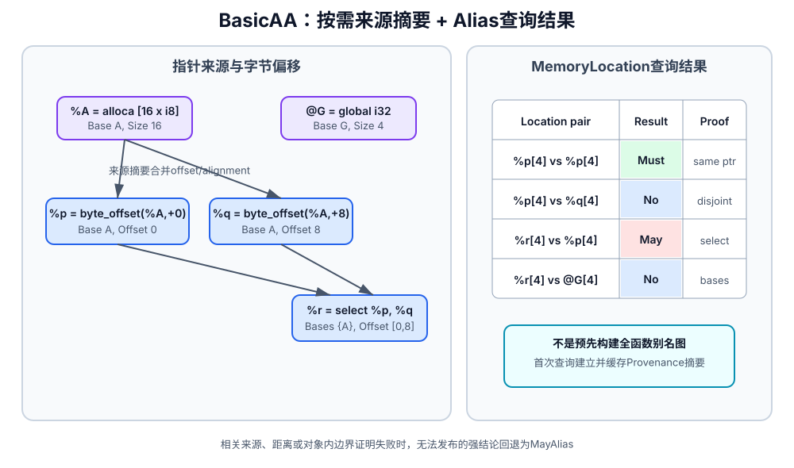

##### SideEffect/SideEffectAnalysis函数副作用分析

SideEffect把请求函数及其可达直接调用闭包抽象成函数效果摘要。调用图只是固定点传播时的临时骨架；最终结果描述函数直接执行以及调用其他函数后，对外部可见程序内存和程序外状态可能产生的全部效果。

依赖AnalysisPass：SideEffectAnalysis构建本身无依赖；消费调用效果的指令级与循环级辅助查询会组合BasicAA和LoopInfo。

使用SideEffect的主要TransformPass：

1. DCE、FunctionMemoization：判断Call是否可观察、是否可以删除或记忆化
2. LICM、GVNPRE：判断Call会不会读取或破坏待移动、待复用的内存值
3. FuncInline、TailRecursionElimination：检查调用的内存、I/O和顺序语义
4. StoreOnlyGlobalElimination：沿调用闭包判断全局对象是否可能被读取

- 最终函数效果摘要：

  - ModSet：函数及其可达调用可能写入的外部可见底层对象
  - RefSet：函数及其可达调用可能读取的外部可见底层对象
  - 指针来源层：把函数内GEP、BitCast、PHI、Select及可安全跟踪的局部指针槽折回形参、全局或局部Alloca等已追踪底层对象；生成ModSet/RefSet时只发布其中的外部可见根
  - hasBuiltin：兼容性的综合保守标志，表示摘要包含Builtin、未知指针或其他不能按普通用户函数处理的行为
  - UnknownMemory：可能访问无法可靠映射到已追踪底层对象、或来源仍包含未知分支的程序内存
  - ObservableEffect：可能产生输入输出等程序内存之外的可观察行为
  - OrderingBarrier：调用形成不能任意跨越的严格顺序屏障
  - CrossObject效果：某些数组I/O契约可能越过传入对象边界，并单独保留越界时的读写角色

普通局部Alloca的读写不会作为ModSet或RefSet的根发布，因为它对当前函数外不可见；但局部指针的来源传播仍参与把访问折回外部对象。程序内存的Mod/Ref与I/O、顺序屏障也是彼此独立的语义，不能用一个“有副作用”布尔值代替。

- 调用闭包摘要构建：

  1. 从请求函数广度发现所有可达的直接用户函数，并为每个函数构建指针来源层
  2. 扫描Load、Store和已知Builtin，先形成每个函数的局部Mod/Ref及独立效果标志
  3. 对直接用户调用只记录`caller -> callee`及调用点实参，不递归向AnalysisManager请求callee，因而能够处理递归调用
  4. 反复把callee摘要沿调用边映射回caller：全局根原样传播，callee形参按参数位置替换成caller实参，再把实参折回caller的外部根
  5. 所有集合和标志只做单调合并，直到调用图固定点不再变化
  6. 固定点收敛后，为闭包中的每个函数形成完整摘要，并返回请求函数的摘要

未知或间接调用会同时保守设置hasBuiltin、UnknownMemory、ObservableEffect和OrderingBarrier；callee形参无法映射到caller实参、或指针来源含有未跟踪分支时，也会发布hasBuiltin和UnknownMemory。已知Builtin不成为用户调用图节点，而是按其运行时契约直接加入当前函数的局部摘要。

下图中，foo写入形参`%p`，在main的调用点映射成实参`@G`；bar读取的全局`@A`原样向上传播，所以固定点后的main摘要为`Mod {@G}`、`Ref {@A}`。

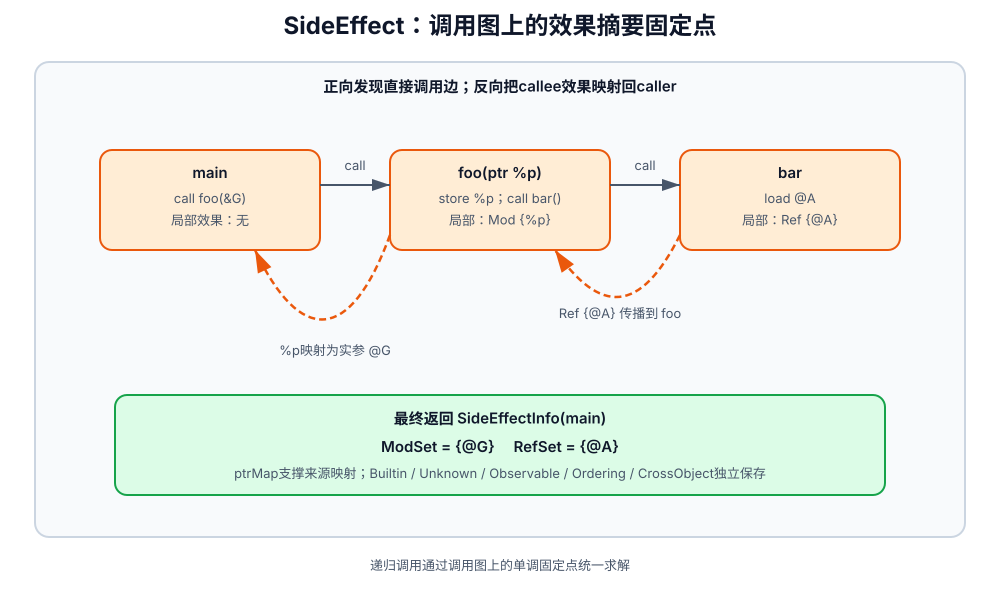

##### RangeAnalysis值域分析

RangeAnalysis不是给每个SSA值只附加一个区间，而是在CFG上构建一层控制流敏感的抽象事实：同一个值在全局、某条分支边、被条件支配的区域以及单个块内可以拥有不同范围。

依赖AnalysisPass：SCEV、Dominant；SCEV进一步依赖LoopAnalysis和Dominant。

使用RangeAnalysis的TransformPass：

1. ConstraintElimination、RangeAwareSimplify：在特定支配上下文中消除恒真/恒假的比较和分支
2. GepCombine、LocalAggregateSimplify：证明索引、偏移和聚合访问范围
3. LoopIdiomRecognize、LoopUnroll：使用归纳变量范围、有限性和次数上界判断变换机会

- 范围事实：

  - 整数事实：`SignedRange × UnsignedRange × KnownBits`的乘积抽象域。有符号闭区间、无符号位模式区间和确定为零/一的位会反复交叉约化
  - 浮点事实：数值包络加上`mayNaN`、正零和负零标志；虽然查询接口保留上下文形式，但当前求解流程在收尾时清空且不重建浮点Context，因此最终结果实际只保留全局浮点事实
  - Top：现有证据允许该类型的全部值；Bottom：当前路径或事实组合不可达

- 整数事实所在的位置：

  - Global事实：不依赖当前控制流位置，对值的所有可达使用都成立
  - Edge事实：只在`Pred -> Succ`这条可行CFG边上成立，例如条件分支真假两侧得到的不同约束
  - Dominated Context事实：条件成立后，在被该条件控制并受相应块支配的区域内成立
  - BlockLocal事实：只在单个基本块内成立；当前最终结果中的BlockLocal主要来自SCEV归纳提示

- 范围事实构建：

  1. 从Entry开始标记可执行块和可行CFG边，为常量建立精确事实，为未知输入建立Top
  2. 使用每种指令的抽象传递函数计算结果；PHI只合并可行入边上的事实
  3. 条件分支在求解期生成真假两侧的上下文约束；只有条件已经成为常量时才排除未选择边，非恒定比较仍把两侧都标为可行
  4. 工作列表反复传播值更新和新发现的可行边；循环增长超过预算时扩宽到Top以保证收敛
  5. 在前向固定点后执行预算化反向变窄；如果变窄未完整结束，则丢弃可能不可靠的精细事实
  6. 清除求解期路径状态，从最终整数格重新构建整数Edge事实，以及能够从唯一入边安全提升的Dominated Context事实
  7. 最后叠加SCEV已经证明“有限且不回绕”的循环归纳范围，作为循环体内的局部事实

查询某个位置时，会把适用于该位置的Global事实与支配它的Context/BlockLocal事实相交；查询CFG边时再叠加对应Edge事实。无法证明溢出安全、分支关系或求解预算耗尽时，事实向Top退化，而不会给出过窄范围。

下图假设已有全局事实`%x ∈ [0,20]`。`%x < 10`把它拆成True边的`[0,9]`和False边的`[10,20]`；两条路径重新汇合后，查询原值不再叠加任一分支的Edge事实，因而回到全局`[0,20]`。如果Merge中创建了新的PHI值，则该PHI会对可行入边事实求并。

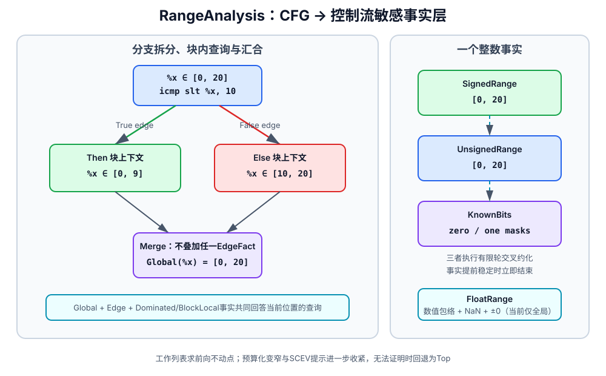

##### SCEV/SCEVAnalysis标量演化分析

SCEV把标量SSA值抽象成一张驻留共享、不可变的符号表达式DAG，并在这张DAG上按需派生循环归纳、TripCount和BackedgeTakenCount等摘要。`run`只绑定函数、LoopInfo和DominatorTree；首次查询某个值或循环时，相关DAG节点才会被创建。

依赖AnalysisPass：LoopAnalysis、Dominant。

使用SCEV的主要TransformPass和工具：

1. IndVarSimplify、LoopStrengthReduction：识别规范归纳变量并改写昂贵的递推计算
2. LoopDeletion、LoopUnroll、LoopUnswitch、LoopIdiomRecognize：查询TripCount、回边次数、有限性及无回绕事实
3. LoopDistribution、LoopFusion、LoopInterchange、UnrollAndJam：把地址和循环次数转换成可比较的符号关系
4. SCEVExpander：消费SCEV DAG，把变换所需的符号表达式在指定插入点重新生成IR；它不是AnalysisPass

- 表达式DAG中的节点与边：

  - 叶节点：整数Constant，或不能进一步建模但仍保留原始IR身份的Unknown
  - 普通运算节点：算术、位运算、Cast、Compare、Select、Min/Max等；有向边指向操作数
  - Recurrence节点：把循环Header PHI及其回边更新抽象成绑定某个Loop的递推。加法递推使用二项式基底，可表达`{C0,+,C1,+,...}<L>`；还支持简单乘法和除法递推
  - 驻留共享：节点按“种类、类型、循环和操作数”形成结构键；结构相同的表达式返回同一稳定节点，所以不同IR值可以共享子DAG

- 从IR到SCEV：

  1. 首次查询IR值时先查缓存，并记录当前递归路径以截断SSA环
  2. Constant、Binary、GEP、Cast和Select按照IR语义转换为表达式；构造过程中执行安全的常量折叠和代数规范化
  3. 对循环Header PHI，分离循环外Start与回边Update；能提取统一增量时构建AddRec，简单乘除更新构建MulRec或DivRec
  4. 不能安全识别的值构建Unknown叶子，不用猜测的闭式表达式替代IR
  5. 新表达式按结构驻留；同一个IR值的结果和常用循环计数表达式按需缓存

- 在DAG上派生的循环摘要：

  - 规范归纳变量：Header PHI、Start、Step及可折叠的常量起点/步长
  - 循环次数：结合退出比较、继续方向和比较所观察的迭代阶段，派生TripCount和BackedgeTakenCount
  - 有限与无回绕证明：结合循环形状；需要时再与Range和支配上下文交叉证明运行时递推安全
  - 变换辅助结果：按展开因子派生主循环/余数次数，或把递推求值到指定迭代

这些循环摘要是对表达式DAG的按需查询结果，并非全部在Pass入口一次性构造或永久缓存。识别不到规范退出、步长、边界或无回绕证据时，相应摘要为空，使用方必须保守放弃变换。

下图中，`%i = phi [0, %i+1]`变成`{0,+,1}<L>`，整数`%value`则共享该递推节点构成`%base + 4 × {0,+,1}<L>`；循环次数摘要与表达式DAG并列提供给使用方。

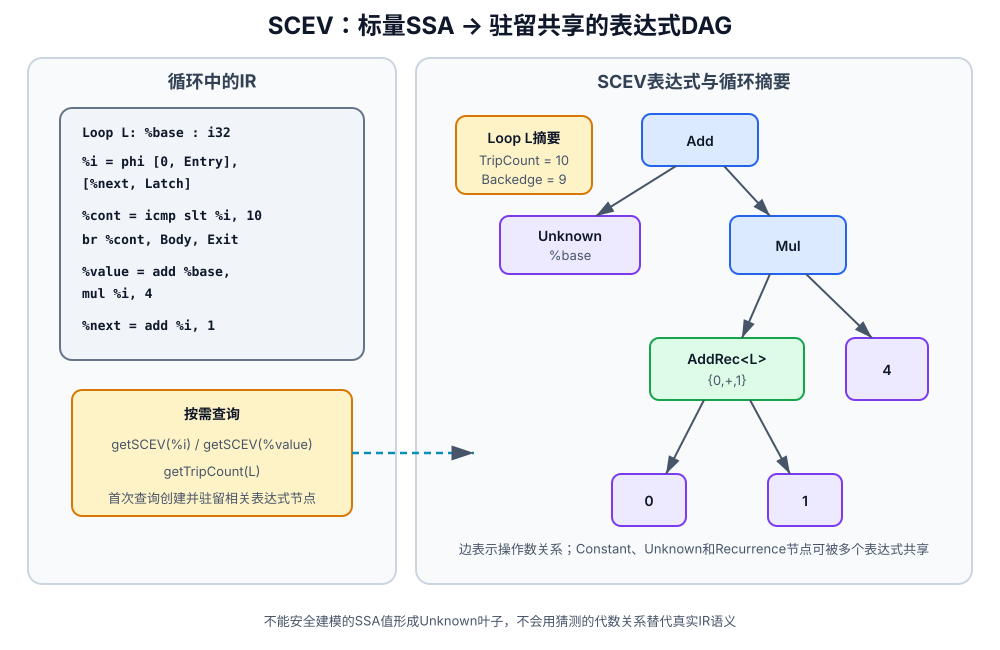

##### LoopDependence/LoopDependenceAnalysis循环依赖分析

LoopDependence按循环作用域把可建模的Load、Store和Call内存效果抽象成访存节点，再以可能影响执行次序的读写冲突作为有向边，构建每个循环及其子循环的保守内存依赖图。

依赖AnalysisPass：LoopAnalysis、SCEV、BasicAA、SideEffect。

使用LoopDependence的TransformPass和下游分析：

1. LoopDistribution：检查分到前后两个循环的指令集合之间是否存在被反转的依赖边
2. LoopInterchange：检查交换循环轴后，依赖方向是否仍保持合法
3. LoopAccess：复用稳定访存节点和字节步长，继续构建完整迭代域访问足迹

- 依赖图的访存节点：

  - 一条标量Load或Store对应一个节点
  - 一次Call可根据SideEffect摘要展开成多个可映射的实际MemoryLocation节点；所有调用的程序外可观察效果和顺序屏障都另记摘要标志
  - 节点记录读/写角色、原始指针、实际访问宽度、底层根对象、稳定指令顺序
  - 地址被拆成按地址带排列的仿射Subscript，每个Subscript保存循环轴系数和循环不变量项，并配套一个字节步长

无法把某次访存可靠映射成地址节点时，该访问不会以一个“假的未知地址节点”进入图，而是被跳过并设置UnknownMemory。循环中的程序外可观察行为和严格顺序屏障也分别作为循环摘要标志保存。

- 依赖图的边：

  - Flow：Source写、Sink读，表示真依赖
  - Anti：Source读、Sink写，表示反依赖
  - Output：Source写、Sink写，表示输出依赖
  - Unknown：表示层预留的保守类型；当前构建器对有效读写角色会归入Flow、Anti或Output，不确定性主要由AnyDirection和UnknownMemory表达
  - DirectionMasks：按作用域循环树的前序轴顺序描述Sink相对Source可能位于Earlier、Same或Later迭代；对单一嵌套链，这个顺序就是外到内

当前构建器只在地址相等能够强制两个访问使用同一循环坐标时发布`SameIteration`；否则在该轴记录`AnyDirection`，不会从仿射距离进一步发布单独的Earlier或Later。`Earlier/Later`位保留在表示层中，但不能当作当前构建流程已经能够证明的结果。

- 循环依赖图构建：

  1. 按外到内前序收集目标循环及全部子循环，形成方向向量的轴顺序
  2. 按函数稳定指令顺序扫描循环树，把Load、Store及SideEffect可映射的Call效果转换成访存节点
  3. 使用SCEV把下标转换成循环轴与循环不变量组成的仿射表达式，并根据类型布局换算成字节步长
  4. 枚举至少一侧写入的访问对；对不同Root，BasicAA证明NoAlias的访问对直接删除，不在图中建边
  5. 根据Source/Sink读写角色建立Flow、Anti或Output边，并逐轴判断地址相等是否强制SameIteration
  6. 写访问与自身也会形成自依赖记录；示意图为清晰省略这类自边
  7. 地址、调用效果或访问对预算不足时设置UnknownMemory，合法性查询据此保守失败

下图中，S1写`A[i]`、S2读`A[i]`，因此形成`Flow + SameIteration`边；S3访问独立对象B，BasicAA证明A与B互斥后不建立边。

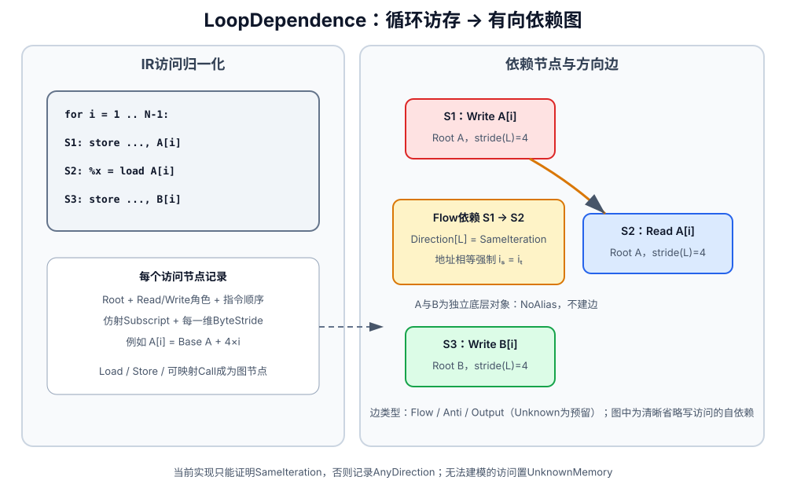

##### LoopAccess/LoopAccessAnalysis循环访问足迹分析

LoopAccess在LoopDependence的单次访存节点之上，把循环的完整迭代坐标域映射成字节地址域，为每个访问构建“它在整个循环执行期间覆盖哪些地址、以什么步长覆盖”的访问足迹。

依赖AnalysisPass：LoopAnalysis、SCEV、RangeAnalysis、Dominant、BasicAA、LoopDependence。

使用LoopAccess的TransformPass：

1. LoopFusion：比较两个循环的访问关系，只允许无冲突或能够证明局限在相同逻辑迭代的冲突
2. UnrollAndJam：检查矩形循环巢、迭代独立性、连续访问和跨轴复用

- 单个访问的足迹：

  - Base与Start：优先使用BasicAA证明的唯一底层对象，证明不到时回退为LoopDependence记录的Root；Start表示逻辑迭代原点相对Base的起始字节偏移
  - Dimension：每个实际覆盖访问的循环轴各形成一维，保存符号TripCount、可选常量次数、该轴总字节步长、有限性和单位步长事实
  - 常量字节区间：当各维次数均为常量时，计算整个迭代域覆盖的`[MinByteOffset, MaxByteOffsetExclusive)`半开区间
  - Empty：某一维常量TripCount为零，整个迭代域不会实际执行这次访问
  - Consecutive：最内层变化维的相邻迭代访问相邻元素，并且访问必执行、地址不回绕
  - FullAccess：整个已证明迭代域在地址上无洞连续
  - Exact：Base、Start、所有维度、必执行性和地址安全证明均成立
  - 单次访问属性：ElementSize和Alignment

`Exact`表示基址、起点、各维步长与有限次数、必执行性、地址无回绕都已获证明；如果对象大小已知，还要求常量足迹没有越过对象边界。对象大小本身未知不会单独否定Exact，但会减少可用的边界证明。单层符号TripCount只要存在且已经证明有限，也可以得到Exact或FullAccess；多维完整无洞足迹通常还需要常量次数验证混合基数布局。

- 循环访问模型构建：

  1. 从LoopDependence取得当前作用域的稳定访存节点、读写角色和UnknownMemory状态
  2. 使用BasicAA来源摘要优先确定唯一Base、对象大小、对齐和精确Start；如果Base不唯一则回退为LoopDependence的Root，如果Start缺失则再由常量Subscript与Root来源偏移合成
  3. 按循环嵌套顺序收集真正覆盖该访问指令的轴，排除同一作用域中的兄弟循环
  4. 从SCEV取得各轴TripCount和有限性，从仿射访问表达式合成各轴总字节步长
  5. 使用DominatorTree证明访问在迭代域内必执行，并组合SCEV与Range证明整数地址计算不回绕
  6. 常量次数允许累加各维位移，得到最小偏移和半开区间；已知对象大小用于撤销越界的强结论
  7. 最内层变化维恰好跨一个元素时发布Consecutive；各维按混合基数无洞衔接时发布FullAccess
  8. 形成该循环作用域的访问列表与一一对应的足迹

- 访问对和循环级结论：

  - `NoConflict`：确定不会形成读写冲突
  - `SameIterationOnly`：地址相等会强制两个循环轴处于相同逻辑迭代
  - `Unknown`：现有证据不能限制冲突范围
  - 在这些访问对结论上继续汇总迭代独立性、融合合法性、矩形循环巢和跨轴复用

访问对分类并不是简单拿两个`Min/Max`足迹区间做相交测试；实现会直接比较底层根、读写角色和映射循环轴后的混合基数仿射表达式。非必执行或可能回绕会降低相应足迹的Exact、Consecutive和FullAccess，但不直接否定独立的访问对分类；UnknownMemory或访问对预算耗尽才会使循环级独立性与融合合法性保守失败。

下图使用常量`M=3`、`N=4`的矩形循环巢。`A[i][j]`把坐标`(i,j)`映射为`4 × (4i+j)`，外层字节步长16、内层字节步长4，完整足迹是`[0,48)`，因此在必执行且无回绕时形成精确、连续、无洞的FullAccess。

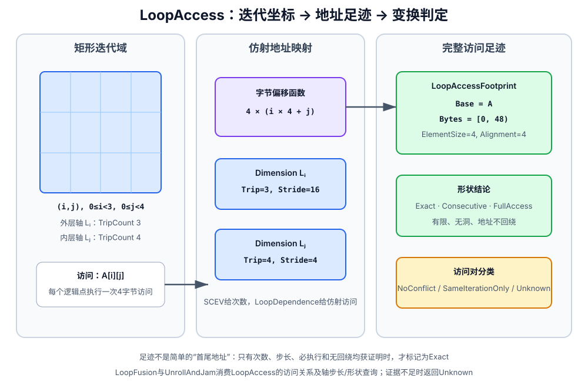

### TransformPass变换流程补充

#### 模块、跨函数与全局表示变换

##### GlobalInitializerFold

在模块中没有任何直接调用`main`的前提下，把`main`入口安全前缀中“完整全局对象到完整全局对象”的运行时`memcpy`改成目标全局量的静态初始化器，从而删除程序启动时本不需要执行的复制。

依赖AnalysisPass：无。

- 变换流程：

  1. 先扫描整个模块；只要任一Call直接以`main`为callee，就拒绝整个Pass。这里不是调用图可达性分析：即使调用位于从`main`不可达的函数中，也会阻止折叠。

     例：`dead_helper: call @main()`即使不可达，也会使`main`入口的`memcpy`保持原样；模块中完全没有直接调用`main`时才继续。

  2. 无条件剥离指针BitCast，并剥离全零GEP；“同形”检查发生在最终得到的源、目标全局对象之间，而不是逐个检查BitCast。随后要求二者不同、复制长度精确覆盖整个对象，且复制非volatile。

     例：`memcpy(gep @dst, 0, 0, gep @src, 0, 0, 64)`可还原为`@dst`和`@src`；`memcpy(..., 60)`或`gep @src, 0, 1`只覆盖子对象，不能折叠。

  3. 顺序扫描Entry的安全前缀。遇到其他Load、Store或Call后永久关闭本轮折叠，避免把本来发生在一次可观察内存操作之后的复制提前到静态初始化阶段。

     例：`load @src; memcpy(@dst,@src,64)`保持原样，因为Load可能观察复制前的状态。

  4. 把源全局的显式初始化器复制给目标；源没有显式初始化器时，目标改成零初始化表示，然后删除对应`memcpy`。

     例：`@src = {1,2}; @dst = zeroinit; main: memcpy(@dst,@src,sizeof)`变为`@dst = {1,2}`，入口复制消失。

- 保守边界：

  - 模块任意位置出现直接调用`main`都会退出，不区分该调用是否可达
  - 目标必须是可变全局，源可以是全局变量或全局常量
  - 类型形状、对象大小和复制长度必须完全一致
  - 只处理Entry安全前缀，不尝试跨普通内存操作证明等价

##### Local2Global

把非递归`main`入口中的大型Alloca改成同型全局对象，避免大对象占用主函数栈帧。

依赖AnalysisPass：无。

- 变换流程：

  1. 建立直接调用图；如果`main`可能递归回到自身，则放弃整个Pass，因为每次递归本应获得独立栈对象。

     例：递归`main`中的`%buf = alloca [4096 x i32]`不能改成所有递归层共享的`@buf`。

  2. 只扫描`main` Entry中的Alloca，并以目标后端阈值筛选大型对象。

     例：入口中的`alloca [4096 x i32]`进入候选；小标量Alloca和非入口块Alloca不处理。

  3. 为候选创建同型全局变量，替换原Alloca的全部使用，再删除Alloca。

     例：`%buf = alloca [4096 x i32]; gep %buf,0,%i`变为`@buf : [4096 x i32]; gep @buf,0,%i`。

- 保守边界：

  - 仅处理`main`，利用“程序入口对象生命周期等同整次程序执行”的语义
  - 只提升超过阈值的入口对象，不改变小对象和动态控制区域中的分配
  - 计时调用不观察栈/全局存储位置，因此不是该表示变换的屏障

##### Global2Local

把满足当前数组或标量使用门禁的小型可变全局对象重新放回`main`的Entry栈槽，并显式恢复其初始化，使后续Mem2Reg和局部聚合优化能够继续标量化。

依赖AnalysisPass：LoopAnalysis。

- 变换流程：

  1. 只在非递归`main`上工作，并收集从`main`可达的函数；候选全局不能被任何其他可达函数引用。

     例：若`main`和其调用的`foo`都读取`@g`，则不能只把`main`中的引用改成局部槽；只有`main`使用`@g`时才继续。

  2. 筛选不超过大小阈值的可变全局，并按对象种类使用不同门禁：数组只显式拒绝原有Memcpy用途；标量的每个`main`内Use都必须是以该全局本身作为地址的直接Load/Store，不能把标量全局地址传给Call、作为Store值或参与指针运算。数组的普通GEP、Call实参等用途不进入这条标量直接访问检查。

     例：标量`%x = load @g`是安全直接使用，而`call @use_ptr(@g)`会拒绝标量`@g`；数组`call @use_array(@a)`本身不会触发标量门禁，但`memcpy(...,@a,...)`会拒绝数组`@a`。

  3. 保守模式只对“至少存在一个Store”的标量施加更严格限制：循环内Store立即拒绝；并且一旦存在Store，全部标量Use都必须位于Entry，且不能有循环内Load/Store。完全只读的标量仍可在循环或Entry之外直接Load。宽松模式跳过这些位置限制，但仍要求标量Use是直接Load/Store。

     例：保守模式下`loop: store %v,@g`不变；只有`loop: %x=load @g`而没有任何Store时仍可局部化；宽松模式则允许直接Store/Load分散在多个块中。

  4. 在`main` Entry的PHI区之后创建Alloca。数组插入从原全局到局部对象的完整Memcpy；标量插入显式初值或类型零值Store。

     例：`@g = 7`变为`%g.local = alloca i32; store 7,%g.local`；`@a=[1,2]`变为局部数组加一次完整初始化Memcpy。

  5. 只替换收集阶段确认的`main` Use；不可达函数中的旧引用仍指向原全局。

     例：`main`中的`load @g`改为`load %g.local`，与`main`无调用关系的死函数仍可暂时保留`@g`引用，交给后续模块清理。

- 保守边界：

  - 递归`main`或由`main`可达的其他函数直接引用候选全局时拒绝变换
  - 标量的非直接Load/Store Use会拒绝候选；数组当前只专门拒绝已有Memcpy用途
  - 该Pass改变对象与内存访问，但不改变CFG，因此只保留循环、支配和后支配结构

##### StoreOnlyGlobalElimination

在全模块范围汇总每个全局对象真正可能被读取的位置，删除永远不可观察的全局Store，并把最终成为只读的标量全局Load传播成初始化常量。

依赖AnalysisPass：SideEffect、BasicAA、LoopAnalysis。

- 变换流程：

  1. Load地址使用两级追踪。精确层只沿GEP和同形BitCast回溯唯一全局根，并尽量把读取记录到标量槽或数组第一维常量索引；精确层失败后，保守层才沿GEP、任意BitCast、PHI和Select收集所有可能的全局根，此时不再保留索引精度。

     例：`load @a[2]`只记录索引2；`load (select %c,@a,@b)`会把`@a`和`@b`都记为任意索引可读。保守层遇到未知产生者或深度预算耗尽并报告escape时，会把所有候选全局都标成任意索引可读，而不只影响某一个根。

  2. 把Call纳入读取摘要：Builtin按内存属性处理；已定义函数通常使用SideEffect的RefSet并把被读取形参映射到实参，但`SEI.hasBuiltin`为真时直接把所有候选全局标成可读；未知调用同样保守认为可能读取全部候选全局。

     例：若`foo(ptr %p)`的RefSet包含`%p`，`call foo(@a)`会把`@a`标为可读；`foo`只写`%p`则不会。

  3. 第二次扫描Store。一个全局从未被读时删除其全部写；只有若干常量索引被读时，删除写向其他确定索引的Store。

     例：只有`load @a[0]`时，`store 1,@a[0]`保留，而`store 2,@a[3]`删除；从未读取`@g`时，所有`store _,@g`删除。

  4. 对删写后只读的标量全局，使用BasicAA和调用ModRef重新证明整个模块不存在间接写，然后把完整对象Load替换成显式初始化常量或零值。

     例：`@g = 5`且模块无写时，`%x = load @g`变为常量`5`；未显式初始化的标量变为类型零值。

  5. Store和Load删除后，统一移除已经没有任何Use的全局对象。

     例：`@g`的最后一条死Store被删除后，`@g`本身也从模块全局表移除。

- 保守边界：

  - 变量索引使对应精确根退化为任意索引；保守地址追踪escape、含Builtin的函数摘要或未知调用会扩大到全部候选全局
  - 索引级删除只针对能够还原到全局根的确定常量路径
  - 常量传播要求没有直接、间接或调用产生的任何写入

##### FuncInline

用被调函数CFG的克隆替换一个直接Call，把形参绑定为实参，并把所有返回路径重新汇合到调用点之后。

依赖AnalysisPass：SideEffect。

- 变换流程：

  1. 快照本轮原有直接调用点并统计每个callee的调用频次；克隆体中新出现的Call不在同一轮继续展开，限制递归式代码增长。

     例：`main -> foo -> bar`本轮只处理原先位于`main`中的`foo`调用，不因内联`foo`后立即继续内联新出现的`bar`。

  2. 按语义和收益筛选：拒绝计时调用边界、体积乘调用次数过大、不能安全移动Alloca的调用，以及更适合FunctionMemoization的多分支纯递归函数；递归内联还要求显式开启并使用更严格预算。

     例：小型`add1`可内联；含两个自递归分支的纯`fib`保留给Memoization；大型多调用点函数保持Call。

  3. 建立`Param -> Arg`映射，克隆callee全部基本块和指令，并清除克隆Call上的Tail标志。

     例：`foo(i32 %x){ %y=add %x,1; ret %y }`在`call foo(7)`处克隆为`%y.inline=add 7,1`。

  4. 把克隆入口中的Alloca移动到caller Entry，保持当前IR“栈对象在函数入口分配”的约定。

     例：callee入口的`%tmp=alloca i32`不会留在调用点所在循环中，而是移动到caller入口。

  5. 在Call之后切分原基本块。单返回路径直接使用返回值；多返回路径在续接块头部创建PHI合并各个返回值。

     例：callee两个出口分别返回`%a/%b`时，原`%r=call`改由`%r.inline=phi [%a,RetA],[%b,RetB]`替代。

  6. 把克隆体每条Ret改成跳往续接块的Br，再把原Call改成跳往克隆Entry的Br并删除Call。

     例：`Before: A: %r=call foo(); %z=add %r,1`变为`A -> foo.entry.clone -> ... -> A.cont`，`%z`位于`A.cont`。

- 保守边界：

  - 只处理有函数体的直接调用，形参与实参数量、类型映射必须完整
  - 不能跨越计时边界改变调用或Alloca的动态执行区间
  - 一旦提交，CFG、调用图、别名和副作用分析全部失效

##### TailRecursionElimination

通过整函数计时门禁后，先标记普通尾调用，再把安全的直接自尾递归改写成函数内循环；对整数`ADD/MUL`形式的伪尾递归额外引入累加器PHI。

依赖AnalysisPass：SideEffect、BasicAA、LoopAnalysis。

- 变换流程：

  1. 首先检查当前函数及其直接调用闭包中是否出现计时调用；该查询会扫描函数中的全部基本块，连不可达块也计算在内。一旦命中，整个Pass立即返回，既不设置普通tail标志，也不尝试把自递归改成循环。

     例：即使`_sysy_starttime`只位于当前函数的不可达块中，另一出口的`%r=call @g(); ret %r`也不会在本Pass中获得tail标志。

  2. 标记“Call紧邻Ret”的普通尾调用。void函数要求Call也返回void；非void函数必须直接返回Call结果；自调用暂留给转循环阶段。设置标志前还会反向遍历每个实参的完整指令操作数闭包，只要能够追到任意Alloca就拒绝该调用。

     例：`%r=call @g(%x); ret %r`可以获得tail标志；`%p=gep %local,...; %r=call @g(%p); ret %r`因实参闭包追到Alloca而保持普通Call。

  3. 只有函数确实直接自递归、且所有Entry Alloca的地址都不逃逸当前栈帧时，才尝试转循环。

     例：把入口Alloca地址传给递归调用会让多个递归帧本应独立的对象合并，因此保持递归。

  4. 找到每个返回路径上的最后一个Self Call，接受真尾递归`ret call`，或唯一整数`ADD/MUL`累加形式；Call与Ret之间的其他指令必须可安全前移且不依赖递归结果。

     例：`%r=call f(n-1); %v=mul n,%r; ret %v`是可识别乘法累加；浮点`fmul`因重新结合语义不安全而拒绝。

  5. 首次提交时在旧Entry之前创建一次性新Entry，把旧Entry作为LoopHeader；入口Alloca移到新Entry，并为每个函数形参在LoopHeader创建PHI。

     例：形参`%n`变成`%n.loop = phi [%n,NewEntry],[%n.next,TailBB]`。

  6. 把Self Call的每个实参接成形参PHI的回边输入，以跳回LoopHeader的Br替换Call和Ret。

     例：`return f(n-1)`变为计算`%n.next=n-1`后`br LoopHeader`，不再创建新栈帧。

  7. 对`return C + f(next)`或`return C * f(next)`创建累加器PHI，初值分别为0或1，每次回边更新累加值；正常返回路径再使用累计状态。首个成功累加站点确定ADD或MUL模式，之后操作不同的站点只被跳过，不会回滚已经完成的转换。

     例：`return n * fact(n-1)`形成`%acc=phi [1,NewEntry],[%acc*n,TailBB]`，尾递归回边同时传入`n-1`。

  8. 候选也可以无条件跳到共享返回块，但该块必须严格只含若干PHI和唯一Ret。Pass把Ret克隆回候选块，并按当前前驱解析目标块PHI；解析后的返回值仍必须精确等于Self Call或受支持的ADD/MUL累加器。任何BitCast返回包装最终都不能通过这一形状检查，共享返回块内出现BitCast还会更早破坏`PHI* + Ret`结构。

     例：`TailBB -> RetBB: %r=phi [%self,TailBB]; ret %r`可在TailBB按该incoming克隆专用Ret并还原成真尾递归站点；若该incoming是`bitcast %self`，则解析后仍不是Self Call本身，候选保持递归。

- 保守边界：

  - Call之后的Store、可能fault/poison的指令、不可证明必返的调用或被Self Call修改内存的只读调用都会阻止前移
  - 普通tail调用的任一实参只要通过操作数闭包依赖Alloca，就不会设置tail标志
  - 已建立累加器后只继续转换相同的整数ADD或MUL站点，其他站点保持递归
  - 只改Tail元数据时保留全部结构分析；转循环后CFG和SSA分析必须重建

##### FunctionMemoization

为满足严格纯函数条件的多分支递归函数插入直接映射缓存：调用先查`参数键 -> 结果`，命中立即返回，未命中执行原递归体并在返回前发布结果。

依赖AnalysisPass：SideEffect。

- 变换流程：

  1. 先快照模块原有函数，并在修改任何CFG之前完整验证所有候选。函数必须不是保留签名，只能有直接调用用途；参数数目为1～4，参数和返回值都是i32/f32；原Entry无前驱、无PHI，全部基本块从入口可达，并且至少存在一个合法Ret。

     例：纯标量`fib(n)=fib(n-1)+fib(n-2)`可进入候选；五参数函数、带不可达块的函数或Entry以PHI开头的函数都会在快照阶段被拒绝。

  2. 继续验证函数必须完全NoModRef、至少有两个Self Call并存在函数外入口调用；拒绝Alloca、Load、Store、GEP、指针结果、非自递归Call、`undef`、FPTOSI、未知opcode、非受支持标量间BitCast以及危险除余/移位。

     例：读取全局量、只含一个Self Call或执行`fptosi`的递归函数不缓存。

  3. 对快照中的候选按模块总缓存预算依次处理。单函数缓存字节数在创建任何全局或接入CFG之前计算，超过剩余预算便直接跳过；配置容量小于16或不是二次幂时，构造器会回退到默认4096项。

     例：前两个候选已耗尽模块缓存上限时，第三个候选不会创建任何缓存全局或临时入口块。

  4. 把每个参数规范成32位键。整数直接使用，float按位BitCast，从而区分`+0/-0`及不同NaN位模式。

     例：参数`1.0f`使用其IEEE 32位模式作为Key，而不是执行浮点相等折叠。

  5. 用逐参数`XOR + 常量乘法`混合哈希，并以二次幂容量掩码得到直接映射槽号。

     例：`slot = hash(key0,key1) & (CacheEntries-1)`。

  6. 为Valid位、每个参数Key和Result分别创建同容量全局数组，并生成Lookup与Hit基本块。

     例：单参数函数得到`@valid[N]`、`@key0[N]`、`@result[N]`三组缓存。

  7. Lookup要求`valid == 1`且槽中每个Key都相等；命中边进入Hit加载结果并Ret，未命中边进入原Entry。完整Lookup/Hit CFG接入后，清除所有递归Call原有的tail标志，因为缓存入口改变了原尾调用约定。

     例：哈希碰撞但Key不同会走Miss，不会误用另一个输入的结果。

  8. 在每个原Ret前按`valid=0 -> 写全部Key -> 写Result -> valid=1`的顺序发布，避免递归调用观察到半写入槽。

     例：计算`fib(20)`完成后先失效旧槽，完整写入`20/result`，最后才允许后续调用命中。

- 保守边界：

  - 这是有冲突覆盖的直接映射缓存，不依赖哈希唯一性，命中时必须逐Key复核
  - 函数必须确定、纯、标量且无计时边界；任何内存、指针或未定义语义都会拒绝
  - 新增全局状态和CFG后，模块及函数分析均需失效

##### LateDeadGlobalCleanup

在流水线末尾用廉价的Use形状检查删除“只被直接写入”的标量全局，并清扫所有已经没有Use的全局对象。

依赖AnalysisPass：无。

- 变换流程：

  1. 对仍有Use的标量全局，要求每个Use都是以该全局本身作为地址的直接Store；只要存在Load、GEP、Call或地址逃逸就不是候选。

     例：`store 1,@g; store 2,@g`使`@g`成为纯写候选；`%x=load @g`会保留整个对象。

  2. 先删除所有已证明不可观察的Store，使它们对全局量的Use消失。

     例：两条`store _,@g`删除后，`@g`的Use计数变成0。

  3. 再遍历全局表，删除原本就无Use、或刚被上一步清空Use的全局对象。

     例：从未引用的`@unused`和刚失去最后一条Store的`@g`一起移除。

- 保守边界：

  - 纯写判定只处理标量和直接Store地址，是StoreOnlyGlobalElimination之后的低成本收尾
  - 数组、派生地址或任何非Store Use不会做深入证明

#### SSA、标量表达式与地址规范化

##### Mem2Reg/PromotePass

把函数入口中只通过直接标量Load/Store访问的Alloca提升成SSA值：沿控制流汇合处放置必要PHI，再删除原Alloca及其内存读写。

依赖AnalysisPass：Dominant。

- 变换流程：

  1. 每轮重新扫描Entry中的Alloca，只接收非数组、非void的标量对象。每个Use都必须是类型匹配的直接Load，或把同类型值写入该Alloca的直接Store；地址逃逸、间接寻址、类型不匹配以及位于入口支配树之外的Use都会拒绝提升。

     例：`%a = alloca i32; %x = load %a; store %v, %a`可以提升；`call @foo(%a)`、`gep %a, ...`或`store %a, %slot`使地址逃逸，保持内存形式。

  2. 先处理无需PHI的快速路径：

     - 无Use的Alloca直接删除。

       `Before: %a = alloca i32`
       `After:  <删除 %a>`

     - 恰好一个Store且该Store支配全部Load时，所有Load直接改用Store写入值，然后删除Load、Store和Alloca。同块内还必须保证Store位于Load之前。

       `Before: store %v, %a; ...; %x = load %a; use %x`
       `After:  use %v`

     - 所有访问都在一个基本块时，按指令顺序让每个Load读取其前方最近的Store；对象从未Store时读取`undef`。若存在Store但某个Load位于首个Store之前，则放弃该快速路径，交给通用SSA构造。

       `Before: store 1,%a; %x=load %a; store 2,%a; %y=load %a`
       `After:  %x使用1；%y使用2；四条内存指令与%a删除`

  3. 对剩余Alloca收集Store定义块，并从“可能在本块首次Store之前读取”的块反向传播Live-In。传播遇到其他定义块即停止，据此计算活跃性裁剪后的迭代支配边界，只在真正需要合流的块首插入PHI。

     例：

     ```text
     Before:
       Entry -> Then(store 1,%a) -> Merge
             -> Else(store 2,%a) -> Merge
       Merge: %x = load %a

     放置PHI后:
       Merge: %a.phi = phi [1,Then], [2,Else]
     ```

     若某个支配边界之后从不读取`%a`，Pruned SSA不会仅因控制流汇合而多插一个无用PHI。

  4. 为每个Alloca建立“当前SSA值”栈，入口初值为同类型`undef`。沿支配树深度优先重命名：进入块时先压入该块新PHI；Load替换为栈顶值；Store把写入值压栈；离开块前把当前值填到各CFG后继的PHI入边，离开支配子树时再恢复栈。

     ```text
     Before:
       Merge:
         %x = load %a
         %y = add %x, 3

     After:
       Merge:
         %a.phi = phi [1,Then], [2,Else]
         %y = add %a.phi, 3
     ```

  5. 删除已经没有访问的Alloca，并反复折叠除自引用外所有Incoming都相同的退化PHI。一次PHI折叠可能继续暴露另一处退化PHI，因此该步骤和整个Alloca收集都执行到不再产生提升。

     `Before: %p = phi [%p,Back], [%v,Entry]`
     `After:  所有%p的Use改为%v，删除%p`

- 保守边界：

  - 只提升Entry中的标量Alloca，不处理数组，也不穿过GEP、BitCast、PHI、Select或Call追踪地址
  - 唯一Store快速路径必须先验证全部Load，不能改写一部分后再因不支配而失败
  - 不可达Use不参与重命名，因此会使整个Alloca保持原状
  - 该Pass不改变CFG；它改变内存对象和SSA值流，BasicAA与SideEffect等结果需要重建

##### InstSimplify

用局部恒等式、常量折叠和跨PHI合并反复替换等价值，使二元表达式、Select和PHI在函数内达到局部不动点。

依赖AnalysisPass：Dominant、BasicAA、LoopAnalysis、MemorySSA；PHI-of-Load的逐指令ModRef后备查询会按需使用SideEffect。

- 变换流程：

  1. 把当前仍在函数中且拥有Use的指令放入去重工作表。每次化简成功后，先把新定义放到旧指令位置，再执行RAUW并删除旧指令；原用户和新指令重新入队，使新暴露的模式在同一轮继续收敛。

     `Before: %a=add %x,0; %b=mul %a,1`
     `After:  %b先变成mul %x,1，再继续折叠为%x`

  2. 对二元运算先规范可交换操作数，把非常量放左、常量放右，再按操作码应用严格等价规则：

     - 常量、单位元、吸收元和相消。

       `add %x,0 -> %x`，`sub %x,%x -> 0`，`mul %x,1 -> %x`，`and %x,0 -> 0`，`xor %x,%x -> 0`

     - 合并嵌套常量和简单代数式。

       `(add (add %x,3),4) -> add %x,7`
       `add %x,(sub %y,%x) -> %y`

     - 提取减法公共因子及平方差。

       `(mul %a,%b) - (mul %a,%c) -> mul %a,(sub %b,%c)`
       `(mul %x,%x) - (mul %y,%y) -> mul (add %x,%y),(sub %x,%y)`

     - 将整数乘正二次幂改为左移，并处理安全的除余单位元。

       `mul %x,8 -> shl %x,3`
       `sdiv %x,1 -> %x`，`srem %x,1 -> 0`

     - 应用布尔互补、吸收律和双重取反。

       `and %x,(or %x,%y) -> %x`
       `or %x,(xor %x,true) -> true`
       `xor (xor %x,true),true -> %x`

     - 折叠常量比较、布尔扩展比较、整数自比较、已知min/max边界，以及二次幂余数等式。

       `icmp eq %x,%x -> true`
       `icmp eq (zext %c),1 -> %c`
       `icmp eq (urem %x,8),0 -> icmp eq (and %x,7),0`

  3. 化简Select：先处理同臂、`undef`臂和常量条件，再把布尔Select规范成AND/OR/NOT，把`select i1 %c, 1, 0`变成目标整数类型的Zext，并折叠由同一比较选择其操作数的模式。

     `select %c,%x,%x -> %x`
     `select %c,true,%y -> or %c,%y`
     `select %c,1,0 -> zext %c`
     `select (icmp ne %x,%y),%x,%y -> %x`

  4. 对非LCSSA PHI依次尝试三类跨臂合并：

     - 所有Incoming都是同操作码二元式且恰有一侧公共时，为变化侧建立PHI，再在汇合块重建一次公共运算。

       ```text
       Before: %r = phi [add %c,%a,T], [add %c,%b,F]
       After:  %v = phi [%a,T], [%b,F]
               %r = add %c,%v
       ```

     - 所有Incoming都是动态GEP且最多一个基址/索引位置不同，合并差异项后只保留汇合块中的一条GEP。

       ```text
       Before: %p = phi [gep @A,0,%i,T], [gep @A,0,%j,F]
       After:  %k = phi [%i,T], [%j,F]
               %p = gep @A,0,%k
       ```

     - 所有Incoming都是对应前驱中的单用户Load时，先合并地址，再把Load下沉到汇合块。每条Load到前驱出口之间必须无相关写入且无计时屏障。

       ```text
       Before: T: %x=load %p    F: %y=load %q
               M: %v=phi [%x,T],[%y,F]
       After:  M: %addr=phi [%p,T],[%q,F]
                  %v=load %addr
       ```

     创建第一条合并Load后，旧MemorySSA不再包含新访问；同轮后续候选改用逐指令ModRef扫描，不继续相信陈旧内存图。

  5. 若上述跨臂模式都不成立，再折叠普通退化PHI：忽略自引用和`undef`后，其余Incoming必须是同一值；含`undef`时还必须证明公共值支配PHI。

     `phi [%x,A],[%x,B] -> %x`
     `phi [%x,A],[undef,B] -> %x`仅在`%x`支配PHI时成立。

- 保守边界：

  - 浮点恒等式严格保留NaN和有符号零语义，例如不会把任意`x * 0.0`折成零，也不会把浮点`x == x`折成真
  - 显式命名为`.lcssa`的PHI不在该Pass中折叠
  - PHI合并要求公共定义支配新位置，并拒绝跨计时屏障移动计算
  - PHI-of-Load还限制单用户、对应前驱位置及无内存Clobber；当前也不下沉未逃逸Alloca上的直接Load或常量索引GEP上的Load，证明失败就保持原来的分支Load
  - 该Pass不删除分支或基本块，CFG结构保持不变

##### SCCP

同时求解“哪些CFG边可执行”和“每个SSA值是否为常量”，再统一传播常量、删除不可达块并折叠常量分支；当前实现还用MemorySSA加入了受严格证明约束的Store到Load常量传播。

依赖AnalysisPass：MemorySSA、BasicAA、LoopAnalysis。

- 变换流程：

  1. 在进入稀疏求解前，为Load预建有限的内存依赖。MemorySSA必须完整找到所有反向路径上的首个Clobber；每个Clobber都必须是与Load地址MustAlias、完整覆盖且类型匹配的Store，并且所有路径写入同一个非`undef` SSA值。

     ```text
     Before:
       T: store %v,%p -> M
       F: store %v,%p -> M
       M: %x=load %p

     稀疏依赖:
       两条Store共同把%v传播给%x
     ```

     若任一路径到达LiveOnEntry、Call、部分覆盖Store、MayAlias Store或另一写入值，则该Load不进入内存常量模型。

  2. 使用当前实现的三态值格求解：

     - `Top`：尚未从可行路径获得信息
     - `Constant(C)`：所有已知可行来源都是同一常量
     - `Bottom`：值已过定义，不能再视为常量

     入口块初始可执行，函数参数初始为Bottom。值格只能按`Top -> Constant -> Bottom`下降，保证工作表收敛。

     `Before: %x = add 2,3`
     `格值:   %x = Constant(5)`

  3. 块工作表和指令工作表交替运行到不动点。常量条件只开放选中的CFG边，过定义条件开放两边，PHI只合并已证明可行的Incoming边。

     ```text
     Before:
       Entry: br true, T, F
       T: br M
       F: br M
       M: %x=phi [4,T],[9,F]

     求解后:
       Entry->T与T->M可行，%x = Constant(4)
     ```

  4. 在可执行块中传播二元运算、Cast和Select。即使一个操作数已经Bottom，仍先检查乘零、加零、除一等对任意值都成立的恒等式；两个操作数都是常量时交给统一常量折叠器。

     `mul %unknown,0 -> Constant(0)`
     `select true,%a,%b -> 传播%a的格值`
     `sitofp 3 -> Constant(3.0)`

     Call、GEP和BitCast结果当前不做常量求值，统一视为Bottom；Load只接收第1步已经证明的共同Store值。

  5. 求解完成后才集中改写IR，避免分析过程中修改CFG：

     - 用常量替换可达块中的纯SSA定义；Call、Alloca、Store和终结指令不会仅因格值而删除。

       `Before: %x=add 2,3; %y=mul %x,%n`
       `After:  %y=mul 5,%n`

     - 删除不可执行块前，先移除其在可达后继PHI中的Incoming，并把零输入PHI改成`undef`、单输入PHI改成唯一值。

       `phi [4,T],[9,DeadF] -> 4`

     - 把死块定义仍残留的外部Use改成同类型`undef`，再断开指令并摘除基本块。

     - 把已知条件Br改成无条件Br，同时删除未选边在目标PHI中的Incoming。

       `br true,T,F -> br T`

- 保守边界：

  - 内存增强最多检查有限数量的Load，每次MemorySSA查询也有预算；预算耗尽只关闭后续内存传播，不影响普通SCCP
  - MemorySSA结果必须完整，且所有到达Store必须写入同一个SSA值；仅仅“写入数值相等的不同表达式”不足以建立依赖
  - 未建模的Call、GEP、BitCast和无法证明的Load不会被猜成常量
  - 浮点恒等式区分NaN、无穷和正负零
  - 删除块或折叠边时所有CFG相关分析失效；仅发生值替换时才保留支配、后支配和循环结构

##### Reassociate

把整数可重结合表达式展平成有序操作数列，执行常量归并、重复项消除、公因式提取和重复乘因子压缩，再按确定次序重建表达式树，为GVN、DCE和后端匹配形成稳定形态。

依赖AnalysisPass：SideEffect（通过共享DCE合法性查询判断无用户Call是否具有可观察行为）。

- 变换流程：

  1. 按函数参数顺序、CFG逆后序和块内顺序建立与对象地址无关的稳定排名。常量排名最低，除余等高延迟叶子靠近重建表达式根；同排名使用稳定SSA创建顺序打破平局。

     `Before: add %b,%a`
     `After:  按全函数固定排名规范为add %a,%b`
     具体哪一项在左由稳定排名决定，而不是由本次进程中的指针地址决定。

  2. 只处理整数可重结合操作。沿候选定义链检查计时屏障和遍历预算；开启`PreserveAddressArithmetic`时，最终经整数扩展/截断进入GEP的表达式整体跳过，留给GEPCombine和循环强度削减。

     例：普通`add`树可重建；`%idx=add %i,4; %p=gep @A,0,%idx`在地址保护模式下保持原形。

  3. 先把整数减法规范成“加上乘负一”，新建节点随后也进入待办表继续重结合。

     `sub %x,%y -> add %x,(mul %y,-1)`

  4. 从最外层根展开所有单用户、同操作码子树；共享子表达式保留为一个叶子，避免为规范形状复制计算。

     `add (add %a,%b),(add %c,%d) -> 操作数列[%a,%b,%c,%d]`
     若`add %a,%b`还有另一个用户，则它作为整体叶子，不继续拆开。

  5. 在展平序列上依次执行代数收缩：

     - 归并全部常量并删除加零、乘一，乘积中出现整数零时整棵树直接为零。

       `(x + 3) + 4 -> x + 7`
       `(x * 9) * 0 -> 0`

     - 把重复加法项改成常量乘法。

       `x + x + y -> (2 * x) + y`

     - 一一消去`X`和以`-1 * X`表示的负项。

       `x + (-1*x) + y -> y`

     - 选择覆盖加法项最多的公共乘因子并提取。

       `(a*b) + (a*c) + d -> a*(b+c) + d`

     - 当乘积至少含四个因子且存在重复项时，按指数折半构造可复用平方，缩短重复乘法链。

       `x*x*x*x -> %sq=x*x; %result=%sq*%sq`

  6. 对剩余操作数按确定排名排序。若原根已经是同一规范链则保持；否则在旧根之前重建有序链、替换原根全部Use，并把新旧节点加入待办表。

     `Before: add %c,(add %a,%b)`
     `After:  按固定排名重建为同一确定顺序的add链`

  7. 以CFG逆后序反复扫描旧节点，同时消费新建节点待办表；任一局部改写都会触发下一轮，直到形状与代数规则同时达到不动点。失去Use的旧纯计算只被跳过，实际删除交给后续DCE。

- 保守边界：

  - 不重结合浮点表达式，避免改变舍入、NaN和有符号零语义
  - 只展开单用户子树，不通过复制共享定义换取更大的代数窗口
  - 定义链检查预算或计时屏障证明失败时放弃该根
  - 地址保护模式会沿Zext、Sext、Trunc追踪到GEP并保留整棵地址算术
  - 该Pass不改CFG，但可能改变指针索引及调用实参表达式，因此别名和副作用结果失效

##### RangeAwareSimplify

消费RangeAnalysis在具体程序点给出的整数区间、浮点范围和KnownBits，把已经被证明为单值或条件确定的表达式替换掉，并对非负整数执行安全的二次幂除余强度削减。

依赖AnalysisPass：RangeAnalysis、Dominant。

- 变换流程：

  1. 所有整数证明先查询RangeAnalysis的程序点结论；若值是在当前块定义的纯整数表达式，再以深度3有界递归解释ADD、SUB、MUL、DIV、MOD、移位、AND和OR，并与原范围取交。递归环、跨块定义和预算耗尽时只保留基础事实。

     例：已知`%x in [0,3]`，当前块内`%y=add %x,1`可补强为`[1,4]`；若`%y`定义在另一块，则不在这里递归展开。

  2. 首先折叠被区间或KnownBits证明为单值的纯计算。PHI、Call、Load和Store不参与该步骤；浮点单值折叠保留只可能为负零的符号。

     `Before: %x = <纯整数计算>, Range(%x)=[7,7]; use %x`
     `After:  use 7`

     `Before: %f = <纯浮点计算>, FloatRange(%f)={-0.0}; use %f`
     `After:  use -0.0`

  3. 折叠范围已经决定的比较：

     - 整数先用KnownBits冲突证明`==/!=`，再用区间端点证明六类谓词。

       `Range(%a)=[0,4], Range(%b)=[10,20]`时，`icmp slt %a,%b -> true`，`icmp eq %a,%b -> false`。

     - 浮点只有在两侧均存在数值且明确排除NaN时才使用端点关系。

       `FloatRange(%a)=[0,1]`、`FloatRange(%b)=[2,3]`且双方`NoNaN`时，`fcmp lt %a,%b -> true`；可能含NaN时保持原比较。

  4. 处理`icmp(select(...), rhs)`：分别证明Select真、假两臂的比较结果。两臂结果相同则折成布尔常量；真臂结果为真、假臂结果为假时，比较本身改成Select条件。

     `icmp slt (select %c,1,20),10 -> %c`

     反向结果“真臂为假、假臂为真”当前不会为了它额外构造`not %c`。

  5. 若Select条件本身被区间或KnownBits证明恒真/恒假，直接选择对应臂。

     `Range(%cond)=[1,1]`时，`select %cond,%x,%y -> %x`。

  6. 识别由Select表达的整数绝对值和min/max，仅在操作数范围已经决定选择方向时删除Select。

     `Range(%x)=[0,100]`时，`select (%x<0),(0-%x),%x -> %x`。
     `Range(%a)=[0,4]`、`Range(%b)=[10,20]`时，`select (%a<%b),%a,%b -> %a`。

  7. 对有符号DIV/MOD，若除数是正的二次幂，并且被除数在该程序点由区间或符号KnownBits证明非负，则改成移位或掩码。

     `sdiv %x,8 -> ashr %x,3`
     `srem %x,8 -> and %x,7`

     上述改写只在`%x >= 0`已获证明时提交；负数的有符号舍入/余数语义不同。

  8. `convertSignedToUnsigned`当前是明确的no-op：它只快照有符号MOD并查询两侧范围，既不把操作码改成UREM，也不创建任何IR，也始终返回`false`。

     `Before: srem %x,%y`
     `After:  srem %x,%y`（即使两侧范围均非负，目前仍保持不变）

- 保守边界：

  - Top、Bottom、递归预算耗尽和跨块局部表达式都不能作为折叠证据
  - 同一轮各步骤复用变换前取得的RangeAnalysis，不在每次RAUW后重算范围
  - 浮点比较必须排除NaN；浮点常量折叠保留正负零信息
  - Abs和min/max只识别当前源码列出的Select形状，不进行任意条件代数化
  - 该Pass只替换值，不直接删除CFG边；常量Br由后续CFGSimplify处理

##### ConstraintElimination

沿支配树传播由已走条件边建立的整数路径约束，证明后续条件分支恒真或恒假，并把分支条件替换成布尔常量；实际删边和删块留给后续CFGSimplify。

依赖AnalysisPass：Dominant、RangeAnalysis。

- 变换流程：

  1. 把可用条件规范成`Value Predicate Bound`。只接受i32比较；进入条件的False边时先把谓词取反。

     ```text
     Before:
       P: br (x < 10), T, F
       T: ...

     T中的路径约束:
       x < 10

     F中的路径约束:
       x >= 10
     ```

  2. 对含常量加减的比较，先用RangeAnalysis证明ADD/SUB在当前程序点不会i32回绕，才允许移项或分解成`Base + Offset`。当前只吸收可精确改写的常量边界，以及两侧偏移差为0或特定`±1`的严格/非严格谓词变化。

     `(x + 3) < 10`被规范为路径事实`x < 7`。
     `(x + 1) <= y`被规范为`x < y`。
     若`x + 3`可能有符号溢出，则仍把整个`x + 3`视为不可分基值。

  3. 显式深度优先遍历支配树，并用栈维护当前支配路径上的约束。一个块只有恰好一个CFG前驱，且该前驱以条件分支直接选择当前块时，才把对应边约束压栈；离开支配子树时恢复到进入前深度，避免把一条分支事实泄漏给兄弟子树。

     例：Then子树可使用`x < 10`，Else子树使用`x >= 10`；两者汇合后的多前驱块不会直接继承任一单边事实。

  4. 对当前块末尾的条件分支提取目标约束，并临时把RangeAnalysis给出的`Value >= Min`、`Value <= Max`加入栈，然后尝试：

     - 直接蕴含及交换比较两侧后的等价蕴含。

       外层已知`x < 10`时，内层`x < 20`恒真。

     - 证明目标的否定，从而得到恒假。

       外层False边已知`x >= 10`时，内层`x < 5`恒假。

     - 通过一个中间值进行一跳传递，并最终证明常量边界。

       已知`x < y`和`y <= 10`时，可证明后续`x < 10`。

     - 使用临时范围上下界补足路径事实。

       路径栈已有其他条件且`Range(x)=[0,4]`时，`x < 10`可由临时上界证明。

  5. 遍历完成后才统一提交候选；重新确认Br仍是条件分支且仍使用原比较，然后只把Br的条件操作数替换为`true`或`false`。

     `Before: br (x < 20), T, F`
     `After:  br true, T, F`
     下一次CFGSimplify再把它改成`br T`并删除不可达路径。

- 保守边界：

  - 仅处理直接作为条件Br条件的i32 Binary比较，不折叠普通数据流中的比较Use
  - 多前驱块不从任一前驱边继承条件，即使更复杂分析可能证明某个条件在汇合处成立
  - 传递推理当前只跨一个中间值，且目标必须可归结为常量边界
  - 常量移项和偏移重写必须先证明无有符号回绕；范围未知时保持原比较
  - 该Pass不直接改变CFG，因此当前支配树和循环树仍可保留

##### GepCombine

把可以证明等价的链式GEP、PHI上的同形GEP和同块相邻地址计算合并成更少、更规范的地址表达式。

依赖AnalysisPass：RangeAnalysis、Dominant。

- 变换流程：

  1. 先至多执行四轮链式GEP合并，使一轮删除中间基址后暴露出的更长链继续收敛。中间Base GEP必须只有当前这一个Use，且两条地址计算之间没有计时屏障。

     - 当前GEP首索引为零时，把其后续索引直接接到Base GEP索引之后。

       ```text
       Before: %row = gep @A, 0, %i
               %elt = gep %row, 0, %j
       After:  %elt = gep @A, 0, %i, %j
       ```

     - Base GEP末索引为零时，删除交界零后拼接索引。

       `gep (gep %base,0),%i -> gep %base,%i`

     - 两个交界索引都是常量时，以checked i32加法合并；合并后最多只能有一个非零索引。

       `gep (gep %base,4),3 -> gep %base,7`
       常量和溢出或结果仍含多个非零索引时不合并。

  2. 外提指针PHI上的同形GEP。候选PHI至少两个Incoming、至多一个Use；所有Incoming必须是同基址、同索引数的GEP，并且最多一个索引位置不同。

     - Incoming GEP完全相同时，在汇合块重新创建一次GEP，再删除旧指针PHI。不能直接选择某个前驱的GEP，因为它未必支配另一条路径。

       `phi [gep @A,0,%i,T],[gep @A,0,%i,F] -> gep @A,0,%i`

     - 恰好一个索引位置不同时，先合并该索引，再生成公共GEP。

       ```text
       Before: %p = phi [gep @A,0,%i,T], [gep @A,0,%j,F]
       After:  %k = phi [%i,T], [%j,F]
               %p = gep @A,0,%k
       ```

  3. 在每个基本块内按“基址和除最后索引外的全部索引”分组，按程序顺序比较组内相邻GEP，并把当前地址重基址到前一地址：

     - 当前末索引是`PrevIndex + Constant`，且RangeAnalysis证明该加法不回绕时，当前GEP改成以前一GEP为基址的常量步进。

       ```text
       Before: %p = gep @A,0,%i
               %i1 = add %i,1
               %q = gep @A,0,%i1
       After:  %p = gep @A,0,%i
               %q = gep %p,1
       ```

     - 前后末索引分别是同一基值加常量时，验证两次原加法和偏移差均不回绕，再用`CurrentOffset - PreviousOffset`重基址。

       `gep @A,0,(i+4); gep @A,0,(i+7) -> 前者保持；后者改为gep %prev,3`

- 保守边界：

  - 链式合并不复制多用户Base GEP，也不跨计时屏障
  - 常量索引相加、偏移差和动态索引加法都必须有i32无回绕证明
  - PHI外提拒绝自引用、多个变化位置、不同基址和多用户PHI
  - 块内重基址只比较同形地址组中的相邻成员，不跨基本块搜索
  - 该Pass不改变CFG；它改变指针表达式，依赖具体地址和值形态的分析需重建

##### GepEvaluate

折叠不改变地址的退化GEP，传播未定义基址，并把含多个非零索引的复杂GEP分解成类型层次更清晰的两段地址计算。

依赖AnalysisPass：无。

- 变换流程：

  1. 快照函数内全部GEP，逐条处理；这样可以在原GEP前插入新定义或删除原指令，而不破坏本轮遍历。

  2. 空索引GEP不改变地址，直接把全部Use改接原基址并删除GEP。

     `Before: %p = gep %base; use %p`
     `After:  use %base`

  3. 基址为`undef`时，GEP结果也替换成结果指针类型的`undef`。

     `Before: %p = gep undef,0,%i; use %p`
     `After:  use undef`

  4. 扫描索引并忽略首位的常量零；遇到第二个非零索引时，在它之前切分。前段先计算中间对象地址，原GEP再以该地址为基址，并补一个规范首零处理剩余索引。

     ```text
     Before:
       %p = gep @A, 0, %i, %j
   
     After:
       %row = gep @A, 0, %i
       %p   = gep %row, 0, %j
     ```

     原GEP通过`reset`原位改写，因此它原有的全部用户保持连接；前段GEP会根据索引后的对象层次重新计算结果指针类型。

- 保守边界：

  - 该Pass只重新分组原索引，不合并动态索引、不执行索引算术，也不证明对象边界
  - 一次运行只在第二个非零索引处切一刀；剩余后段仍复杂时由后续Pass调用继续规范
  - 非空、非`undef`且不足两个非零索引的GEP保持原样
  - 不改变CFG，支配与循环结构保持有效

##### ConstantHoist

把多次使用、数值接近的大i32字面量改写成一个公共SSA基值和各使用块中的小常量偏移，减少重复的大立即数物化，同时保留GEP、比较和除余等专用匹配所需的字面量。

依赖AnalysisPass：Dominant、LoopAnalysis。

- 变换流程：

  1. 扫描所有非PHI操作数，只收集绝对值不小于2048的i32常量，并排除依赖字面量形态的位置：

     - GEP索引、Call实参、Select操作数和比较操作数
     - 除余的除数、移位量
     - MUL及AND/OR/XOR常量
     - 其他未明确允许的指令

     当前主要允许ADD/SUB中的大常量和可作为Store值的常量进入候选。

     例：`add %x,100000`可以收集；`sdiv %x,4096`和`gep @A,0,4096`保持字面常量，留给强度削减或地址匹配。

  2. 按常量值排序，并用宽度小于2048的滑动窗口分组，使组内任意成员相对所选基值的偏移都可作为小立即数。总Use少于2的组删除；选择Use最多的成员作为基值。

     `常量100000、100008、101000`可进入同组；`100000、103000`不能共用同一小偏移窗口。

  3. 应用收益阈值：包含循环Use的组至少需要2次总Use；完全位于直线代码中的组至少需要3次，避免为少量静态使用额外创建基值。

     例：循环体内两次使用`100000/100008`可以提升；直线代码只有两次使用时保持字面量。

  4. 用支配树计算覆盖整组Use的最近公共支配块。若该块位于循环内，则优先把基值移动到最外层规范循环的PreHeader；缺少规范PreHeader时退回函数Entry。任何使用与插入点之间存在计时屏障都会拒绝整组。

     ```text
     Before:
       Loop:
         %a = add %x,100000
         %b = sub %y,100008

     插入位置:
       PreHeader中物化一次公共基值
     ```

  5. 在公共块PHI之后生成`0 + BaseConstant`作为公共SSA定义。等于基值的字面量直接替换为该SSA值；其他成员在各自使用块的最早Use之前各生成一条`BaseSSA + SmallOffset`，同块相同偏移共同复用。

     ```text
     Before:
       %a = add %x,100000
       %b = sub %y,100008
       %c = add %z,100000
   
     After:
       %base = add 0,100000
       %c8   = add %base,8
       %a = add %x,%base
       %b = sub %y,%c8
       %c = add %z,%base
     ```

- 保守边界：

  - 只处理i32大整数，不提升浮点、i64或小立即数
  - PHI Incoming按边使用，当前统一排除整个PHI，避免错误选择块内物化位置
  - 字面量敏感位置保持原常量，不以公共SSA值遮蔽后续专用优化
  - 使用次数不足、无法找到安全支配点、循环形态不适合或跨计时屏障时不变换
  - 该Pass只改SSA表达式，不改变CFG

##### LatePhiCleanup

在流水线晚期反复删除没有用户的PHI，并把具有唯一支配安全公共Incoming的退化PHI替换掉，清理CFG和循环变换留下的PHI残骸。

依赖AnalysisPass：Dominant。

- 变换流程：

  1. 每轮快照函数中的全部PHI，先直接删除没有任何Use的节点。

     `Before: %dead = phi [%a,A],[%b,B]，且%dead无用户`
     `After:  <删除%dead>`

  2. 对仍有Use的PHI汇总Incoming：

     - 忽略指向PHI自身的回边
     - 暂时忽略`undef`
     - 其余Incoming必须全部是同一个Value

     `phi [%x,A],[%x,B]`的公共值为`%x`。
     `phi [%p,Back],[%x,Entry]`忽略自引用`%p`后，公共值也是`%x`。
     `phi [%x,A],[%y,B]`不是退化PHI，保持不动。

  3. 验证公共值在替换位置可用。若PHI块只有唯一CFG前驱并与Incoming前驱一致，则该边上的值天然可用；否则必须由DominatorTree证明公共值支配PHI。含`undef`也不能绕过此检查。

     `phi [%x,A],[undef,B] -> %x`仅当`%x`支配PHI，或该块实际只有对应的唯一前驱时成立。

     零Incoming PHI会替换成同类型`undef`；全是自引用/`undef`但仍有Incoming的PHI没有可验证公共值，当前保持原样。

  4. 对安全候选执行RAUW并删除PHI。一次删除可能让上游PHI失去最后一个用户，或让另一PHI的Incoming退化，因此“删死PHI”和“折叠退化PHI”交替运行到不动点。

     ```text
     Before:
       %p1 = phi [%x,A],[%x,B]
       %p2 = phi [%p1,A],[%x,B]
   
     After:
       %p1 -> %x
       %p2随下一轮继续折叠为%x
     ```

- 保守边界：

  - 多个不同的非`undef`、非自引用Incoming绝不合并
  - 不能证明公共值支配PHI时保持节点，避免产生use-before-def
  - 当前不会把“所有Incoming均为自引用或`undef`”的非空PHI武断替换为`undef`
  - 该Pass不修改CFG；值流变化会使别名和副作用摘要失效

#### 值冗余、内存优化与死代码消除

##### LocalGVN

在每个基本块内部为纯表达式建立局部Leader表，把后出现的相同计算改用本块中较早的结果；它不跨基本块求值号，也不处理内存表达式。

依赖AnalysisPass：无。

- 变换流程：

  1. 对每个基本块单独创建空Leader表，并按程序顺序扫描该块的稳定指令快照。进入下一个基本块时不继承上一块的结果。

     Before -> After：

     ```llvm
     entry:
       %a = add i32 %x, %y
       br label %next
     next:
       %b = add i32 %x, %y
     ```

     保持原样。`%a`虽然在CFG上位于`%b`之前，但LocalGVN不做跨块支配证明。

  2. 为有结果的纯二元运算、GEP、Select和支持的Cast构造表达式键。键包含精确结果类型、操作码/谓词和原始操作数；交换律二元运算会先规范操作数次序。

     Before -> After：

     ```llvm
     %a = add i32 %x, %y
     %b = add i32 %y, %x
     %r = mul i32 %b, 4
     ```

     变为：

     ```llvm
     %a = add i32 %x, %y
     %r = mul i32 %a, 4
     ```

     `%b`与`%a`具有相同的规范键，因此其Use改接`%a`后删除。

  3. 相同GEP、Select和Cast也按“操作数完全相同且结果类型相同”合并，不执行额外的代数等价推理。

     Before -> After：

     ```llvm
     %p = gep @A, 0, %i
     %q = gep @A, 0, %i
     %v = load %q
     ```

     变为：

     ```llvm
     %p = gep @A, 0, %i
     %v = load %p
     ```

     这里只合并地址计算，Load本身不进入LocalGVN表达式表。

  4. 遇到当前函数可到达的计时调用时立即清空本块Leader表，后续表达式不能与屏障前结果合并。

     Before -> After：

     ```llvm
     %a = add i32 %x, %y
     call void @_sysy_starttime(...)
     %b = add i32 %x, %y
     ```

     保持两条Add。计时边界两侧即使操作数相同，也不改变其计算所在的计时区间。

- 保守边界：

  - 只处理二元运算、GEP、Select、Trunc、Zext、Sext、FPToSI、SIToFP和BitCast
  - Void结果、Load、Store、Call、PHI、终结指令和带`undef`操作数的表达式不进入Leader表
  - 不跨基本块、控制流边或计时调用复用结果
  - 变换只删除普通值指令，不改变CFG；别名和副作用摘要仍因Value/Use图变化而失效

##### GVNPRE

先以全局值编号删除支配冗余，再在开启PRE时为“部分路径已有、恰好一条路径缺失”的纯表达式补计算并用PHI合流；Load和只读Call使用MemorySSA版本而不是仅比较语法。

依赖AnalysisPass：Dominant、LoopAnalysis、BasicAA、MemorySSA、SideEffect。

- 变换流程：

  1. 先应用函数和基本块规模预算。预算内最多运行若干轮GVN固定点；每轮都清空旧值号、重建入口可达块和RPO，使上一轮删除暴露的新Leader能够在下一轮继续生效。

     Before -> After：

     ```llvm
     %a = add i32 %x, %y
     %b = add i32 %a, 0
     %c = add i32 %x, %y
     ```

     第一轮把`%c`替换为`%a`；后续轮使用重建后的值号继续处理由删除暴露的同余关系。

  2. 普通全局值编号键包含结果类型、操作码/比较谓词和操作数值号。交换律运算会排序值号；比较交换两侧时同步反转谓词。已有同值号定义必须在支配关系和块内顺序上对当前Use可用，才能作为Leader。

     Before -> After：

     ```llvm
     entry:
       %a = add i32 %x, %y
       br label %use
     use:
       %b = add i32 %y, %x
       %r = mul i32 %b, 2
     ```

     变为：

     ```llvm
     entry:
       %a = add i32 %x, %y
       br label %use
     use:
       %r = mul i32 %a, 2
     ```

     如果两个等价定义位于互不支配的分支，则本阶段不会任选一条替换另一条。

  3. 扫描常量条件分支时，先从未取后继收集候选死区域，再剔除仍有区域外前驱的块。确认只由死边到达的块不参与当前轮Leader选择和PRE路径统计，但GVNPRE本身不删除这些块。

     Before -> After：

     ```llvm
     br i1 true, label %live, label %dead
     dead:
       %x = add i32 %a, %b
       br label %merge
     ```

     本Pass中CFG保持原样，但`dead`中的`%x`不会被当成可达Leader；后续SCCP或CFGSimplify负责删除死边和死块。

  4. Load优先查询MemorySSA。若所有路径上的最近Clobber都是对目标位置的MustAlias完整Store，并且写入同一个类型兼容且支配Load的SSA值，则执行Store-to-Load forwarding。

     Before -> After：

     ```llvm
     left:
       store i32 %v, ptr %p
       br label %merge
     right:
       store i32 %v, ptr %p
       br label %merge
     merge:
       %x = load i32, ptr %p
     ```

     变为：

     ```llvm
     merge:
       ; %x的所有Use直接改用%v，原Load删除
     ```

     两条Store不需要各自支配`merge`，但共同写入值`%v`必须在Load处可用。

  5. 如果不能转发Store值，则可复用具有相同Clobber集合的支配Load；相同MemorySSA签名只用于筛选，仍要证明两条Load之间的每条CFG路径都没有相关写入。

     Before -> After：

     ```llvm
     %a = load i32, ptr %p
     ; 中间所有路径都没有可能修改%p的指令
     %b = load i32, ptr %p
     %r = add i32 %b, 1
     ```

     变为：

     ```llvm
     %a = load i32, ptr %p
     %r = add i32 %a, 1
     ```

     循环中同一个静态Store可能代表不同迭代的写入，因此仅有“Clobber节点相同”并不足以替换。

  6. 对返回标量的可CSE调用，先要求直接callee、非builtin、非计时、结果非void/指针且程序内存行为至多为Ref。NoModRef调用可按目标和实参值号合并；只读调用还必须为每个读取位置构造相同的MemorySSA Clobber签名。

     Before -> After：

     ```llvm
     %a = call i32 @readonly(ptr %p, i32 %n)
     ; 没有修改@readonly实际读取的位置
     %b = call i32 @readonly(ptr %p, i32 %n)
     ```

     变为：

     ```llvm
     %a = call i32 @readonly(ptr %p, i32 %n)
     ; %b的Use改用%a，第二次Call删除
     ```

     若中间Store可能修改`%p`指向位置，即使实参完全相同也保留第二次调用。

  7. 每轮GVN开始时还会递归比较同块、同型、同入边数量的PHI；两个PHI的对应incoming值图同余且不跨计时屏障时，后一个改用前一个。

     Before -> After：

     ```llvm
     %p = phi i32 [%a, %left], [%b, %right]
     %q = phi i32 [%a, %left], [%b, %right]
     %r = add i32 %q, 1
     ```

     变为：

     ```llvm
     %p = phi i32 [%a, %left], [%b, %right]
     %r = add i32 %p, 1
     ```

  8. 开启PRE后，每轮先用当前IR重建值号表和各块出口可用集。对一个汇合块中的纯表达式，分别把它的值号经PHI翻译到各前驱；只有恰好一条非回边前驱缺失、至少一条前驱已有时才继续。

     Before：

     ```llvm
     left:
       %l = add i32 %x, %y
       br label %merge
     right:
       br label %merge
     merge:
       %m = add i32 %x, %y
       use %m
     ```

     After：

     ```llvm
     left:
       %l = add i32 %x, %y
       br label %merge
     right:
       %r = add i32 %x, %y
       br label %merge
     merge:
       %m.pre = phi i32 [%l, %left], [%r, %right]
       use %m.pre
     ```

     缺失前驱上的克隆使用经PHI翻译后在该边出口确实可用的操作数，而不是直接复制汇合块局部定义。

  9. 新表达式和合流PHI会改变后续可用性，因此PRE也按有界固定点运行；每轮只基于新快照继续发现机会。

     例：第一轮在内层diamond补出的`add`及PHI，可能让外层merge的同一表达式在下一轮成为“仅缺一条路径”的候选。

- 保守边界：

  - 函数或单块超过规模预算时整个求解器不运行；GVN和PRE都设固定轮数上限
  - 未知、Mod或ModRef调用不能参与Call CSE；只读调用摘要含未知内存、可观察行为、顺序屏障或跨对象访问时也拒绝
  - PRE不处理PHI、Load、Store、Call、比较、控制指令，以及可能fault或产生poison的表达式
  - PRE拒绝回边、死前驱、多于一条缺失路径、无法解析SSA操作数和跨计时屏障候选
  - Pass不直接改CFG；值、Load和Call删除后，BasicAA、MemorySSA与SideEffect必须重算

##### LoadElimination

先用MemorySSA快速删除有统一到达值或可复用内存版本的Load，再以块内逆扫、支配Load和前驱数据流作为后备，把剩余Load替换成已有SSA值或新建PHI。

依赖AnalysisPass：BasicAA、LoopAnalysis、Dominant、MemorySSA、SideEffect。

- 变换流程：

  1. 在函数级查询预算内，为每条Load向MemorySSA询问所有反向路径上的最近Clobber。只有查询完整且Clobber集合非空的Load才进入快速层候选表；这一阶段只收集，不修改IR。

     例：入口未知内存直接到达的`load %p`没有具体Clobber，保持原样；两条分支均有明确Store的汇合Load可进入下一步。

  2. 如果全部Clobber都是对Load位置的MustAlias完整Store，写入同一个类型兼容值，而且该值支配Load，则直接用共同写入值替换Load。

     Before -> After：

     ```llvm
     left:
       store i32 %v, ptr %p
       br label %merge
     right:
       store i32 %v, ptr %p
       br label %merge
     merge:
       %x = load i32, ptr %p
       use %x
     ```

     变为：

     ```llvm
     merge:
       use %v
     ```

  3. 共同Store值证明失败时，寻找具有完全相同Clobber集合、类型相同并支配当前Load的较早Load；随后额外检查两者之间所有路径没有相关写。

     Before -> After：

     ```llvm
     entry:
       %a = load i32, ptr %p
       br i1 %c, label %left, label %right
     left:
       ; 只读%q，BasicAA证明q与p不别名
       br label %merge
     right:
       br label %merge
     merge:
       %b = load i32, ptr %p
       use %b
     ```

     变为`use %a`并删除`%b`。

  4. 快速层先解析“Load替换成另一条待删除Load”形成的传递计划并检测环，再批量迁移Use、批量删除Load，避免先删除定义造成悬空替换值。

     Before -> After：

     ```llvm
     %a = load i32, ptr %p
     %b = load i32, ptr %p   ; 计划%b -> %a
     %c = load i32, ptr %p   ; 计划%c -> %b
     use %c
     ```

     先解析为`%c -> %a`，再统一删除`%b/%c`，最终为`use %a`。

  5. 快速层删除Load后，旧BasicAA和MemorySSA引用修改前的Value/Use图，因此在进入后备层前立即失效并重建BasicAA；支配和循环结构继续复用。

     这一步本身不产生额外Before -> After IR，而是保证后续查询不会读取已经删除的Load节点。

  6. 后备层按支配树前序处理剩余Load。首先从Load前一条指令向块首逆扫：最近MustAlias Store给出写入值，最近MustAlias Load给出已有读取；MayAlias写或可能修改该位置的Call立即终止证明。

     Store-to-Load Before -> After：

     ```llvm
     store i32 %v, ptr %p
     %x = load i32, ptr %p
     use %x
     ```

     变为`use %v`。

     Load-to-Load Before -> After：

     ```llvm
     %a = load i32, ptr %p
     %b = load i32, ptr %p
     use %b
     ```

     变为`use %a`。

  7. 当前块入口没有可用值时，在函数总预算内沿支配关系寻找循环外或较早的支配Load，并证明到目标Load的全部路径均无相关修改。

     Before -> After：

     ```llvm
     preheader:
       %a = load i32, ptr %p
       br label %loop
     loop:
       ; 循环内没有任何可能写p的指令
       %b = load i32, ptr %p
       use %b
       br ...
     ```

     变为循环内`use %a`，删除`%b`。

  8. 如果没有可复用的支配Load，则递归求每条前驱出口的最近已知值。所有前驱给出同一值时直接替换；值不同但每条边都确定时，在目标块头创建PHI。

     相同值 Before -> After：

     ```llvm
     left:  store i32 %v, ptr %p; br label %merge
     right: store i32 %v, ptr %p; br label %merge
     merge: %x = load i32, ptr %p
     ```

     变为`%x -> %v`。

     不同值 Before -> After：

     ```llvm
     left:  store i32 %a, ptr %p; br label %merge
     right: store i32 %b, ptr %p; br label %merge
     merge:
       %x = load i32, ptr %p
       use %x
     ```

     变为：

     ```llvm
     merge:
       %x.forward = phi i32 [%a, %left], [%b, %right]
       use %x.forward
     ```

- 保守边界：

  - MemorySSA查询不完整、Clobber为空、覆盖宽度不足、非MustAlias或共同值不支配Load时不执行快速转发
  - “相同Clobber节点”不能单独证明循环不同迭代中的Load相同，必须再做全路径无写检查
  - 任意MayAlias Store、Mod/ModRef Call或未知内存操作都会阻断后备扫描
  - 前驱递归遇到CFG环、嵌套PHI需求、无定义入口、深度预算或查询预算耗尽时保留Load
  - 计时调用不读写SysY程序内存，可在ModRef意义上透明；但不能因此忽略其他顺序约束

##### DSE

分四层删除死Store：先由MemorySSA证明“所有路径上必被后写覆盖”，再删除“写入现有相同值”的Store，最后使用块内逆扫和有界CFG遍历补充处理。

依赖AnalysisPass：BasicAA、LoopAnalysis、MemorySSA、SideEffect。

- 变换流程：

  1. 第一层遍历Store，并在查询预算内让MemorySSA正向检查其所有可达内存路径。只有每条路径在首次读取或未知Clobber之前，都遇到MustAlias且完整覆盖的后继写时，旧Store才可删除。

     Before -> After：

     ```llvm
     store i32 0, ptr %p
     br i1 %c, label %left, label %right
     left:
       store i32 1, ptr %p
       br label %merge
     right:
       store i32 2, ptr %p
       br label %merge
     ```

     变为：

     ```llvm
     br i1 %c, label %left, label %right
     left:
       store i32 1, ptr %p
       br label %merge
     right:
       store i32 2, ptr %p
       br label %merge
     ```

     两条后写的值可以不同，因为这里证明的是旧值在所有路径上都不会被观察。

  2. 第一层先收集后删除；只要删除过MemoryDef，就在Pass内部失效并重建BasicAA和MemorySSA，防止后续查询继续引用已删除节点。

     这一步不产生额外IR模式，而是把“覆盖删除”和下一层“重复值删除”严格分成两个一致的内存图快照。

  3. 第二层反向查询Store之前的内存状态。如果目标位置已经保存同一个SSA值，且别名、覆盖和MemorySSA路径证明完整，则当前Store不改变程序内存，可删除。

     Before -> After：

     ```llvm
     store i32 %v, ptr %p
     ; 中间没有改变p当前值的相关操作
     store i32 %v, ptr %p
     ```

     变为只保留第一条Store。

  4. 第二层删除完后再次失效旧内存分析；后续不再使用MemorySSA，只重建块内扫描所需的BasicAA。

  5. 第三层逐块从后向前维护“尚未被观察的后继Store”集合。当前Store若被MustAlias且写入宽度相同的后继Store覆盖即可删除；Load会清除所有可能别名的待定Store，Call则根据目标位置的ModRef清除冲突项。

     覆盖 Before -> After：

     ```llvm
     store i32 1, ptr %p
     store i32 2, ptr %p
     ```

     变为：

     ```llvm
     store i32 2, ptr %p
     ```

     读取阻断示例：

     ```llvm
     store i32 1, ptr %p
     %x = load i32, ptr %p
     store i32 2, ptr %p
     ```

     保持第一条Store，因为`%x`观察了值1。

  6. 第四层对剩余Store做有界CFG后继遍历，分类每条路径上的首次相关事件：完整覆盖为Kill，可能读取/修改为Clobber，没有相关事件为Transparent。所有可达路径都先到Kill时才删除。

     Before -> After：

     ```llvm
     store i32 0, ptr %p
     br i1 %c, label %left, label %right
     left:
       br label %overwrite
     right:
       br label %overwrite
     overwrite:
       store i32 1, ptr %p
     ```

     变为删除入口的`store 0`。

  7. 对确认未逃逸的局部Alloca地址，函数出口不会观察其最终内存状态，因此可以删除“直到退出都未被读”的尾部Store。

     Before -> After：

     ```llvm
     %a = alloca i32
     store i32 7, ptr %a
     ret void
     ```

     如果`%a`只经过安全GEP/BitCast并仅作为直接Load/Store地址，变为：

     ```llvm
     %a = alloca i32
     ret void
     ```

     `%a`及派生地址随后可由DCE或聚合清理删除。

- 保守边界：

  - 后写必须完整覆盖旧写；覆盖宽度不同或仅部分重叠时不能删除
  - Load、MayAlias写、未知内存指令以及具有Ref或Mod效果的Call会阻断对应证明
  - CFG证明要求所有路径均先覆盖；任一路径读取、离开可观察对象或超过遍历预算都保留Store
  - “函数出口不观察最终值”只适用于沿完整Use闭包证明未逃逸的局部栈对象
  - 四层之间在删除MemoryDef后主动重建分析，不能把旧MemorySSA结论跨阶段复用

##### LocalAggregateSimplify

按固定顺序折叠只读全局表、转发局部数组常量值、展开只读局部表、把常量路径聚合拆成标量槽，最后删除从未被观察的聚合对象。

依赖AnalysisPass：Dominant、RangeAnalysis、BasicAA、LoopAnalysis、MemorySSA。

- 变换流程：

  1. 第一阶段先处理全程序只读的全局对象。常量GEP路径直接读取静态初始化元素，用该常量替换Load，并逆向删除失去Use的GEP/BitCast链。

     Before -> After：

     ```llvm
     @table = constant [4 x i32] [10, 20, 30, 40]
     %p = gep @table, 0, 2
     %x = load i32, ptr %p
     use %x
     ```

     变为：

     ```llvm
     use 30
     ```

     原Load及无Use的`%p`删除。

  2. 对一维i32只读全局表的动态`[0,index]`读取，执行有界表达式综合。只有RangeAnalysis证明索引完整落在表定义域，且综合式成本低于普通Load时才替换。

     Before -> After：

     ```llvm
     @table = constant [4 x i32] [0, 2, 4, 6]
     ; 已知0 <= %i < 4
     %p = gep @table, 0, %i
     %x = load i32, ptr %p
     ```

     可变为：

     ```llvm
     %x.synth = mul i32 %i, 2
     ```

     如果无法在完整索引域上验证表达式，保留原Load，而不是只对已见到的几个索引猜测规律。

  3. 第二阶段处理与Alloca位于同一基本块、Use形态完全受支持的局部数组。顺序解释“最近一次完整只读常量Memcpy初始化”和其后的常量路径Store，用当前精确状态转发常量索引Load。

     Before -> After：

     ```llvm
     %a = alloca [3 x i32]
     call void @memcpy(ptr %a, ptr @init, i32 12, i1 false)
     %p1 = gep %a, 0, 1
     store i32 9, ptr %p1
     %x = load i32, ptr %p1
     %p2 = gep %a, 0, 2
     %y = load i32, ptr %p2
     ```

     变为`%x -> 9`、`%y -> @init[2]`，两条Load删除；原初始化和Store暂时保留。

  4. 第三阶段为一维标量局部数组建立完整的只读展开计划。Alloca必须只有一次完整常量Memcpy初始化和若干直接元素GEP；初始化必须支配每个Load，MemorySSA必须证明初始化到Load间没有该元素的Clobber。

     常量索引 Before -> After：

     ```llvm
     %a = alloca [2 x i32]
     call void @memcpy(ptr %a, ptr @pair, i32 8, i1 false)
     %p = gep %a, 0, 1
     %x = load i32, ptr %p
     ```

     变为`%x -> @pair[1]`。

  5. 同一展开计划中的动态索引优先使用经过完整表验证的低成本综合表达式；不能综合时，统一表直接取公共值，非统一表只允许最多两个元素并构造比较/Select链。

     两元素 Before -> After：

     ```llvm
     @pair = constant [2 x i32] [11, 22]
     %a = alloca [2 x i32]
     call void @memcpy(ptr %a, ptr @pair, i32 8, i1 false)
     %p = gep %a, 0, %i
     %x = load i32, ptr %p
     ```

     变为：

     ```llvm
     %is1 = icmp eq i32 %i, 1
     %x.lookup = select i1 %is1, i32 22, i32 11
     ```

     所有Load替换都成功后，才统一删除Load、初始化Memcpy、无用GEP以及最终无Use的Alloca。

  6. 第四阶段为剩余聚合先建立完整标量化计划。只有全部访问都能还原为常量聚合路径或受支持的同型常量标量偏移，且地址不逃逸时，才为每条精确标量路径创建独立Alloca并重写访问。

     Before：

     ```llvm
     %a = alloca [2 x i32]
     %p0 = gep %a, 0, 0
     %p1 = gep %a, 0, 1
     store i32 %x, ptr %p0
     store i32 %y, ptr %p1
     %z = load i32, ptr %p1
     ```

     After：

     ```llvm
     %a.0 = alloca i32
     %a.1 = alloca i32
     store i32 %x, ptr %a.0
     store i32 %y, ptr %a.1
     %z = load i32, ptr %a.1
     ```

     后续Mem2Reg可继续把这两个标量槽提升为SSA值。

  7. 第五阶段遍历仍存活聚合的完整透明指针Use图。若只发现Store、可删除的初始化写和透明派生地址，没有任何Load、作为Memcpy源、地址存出或未知调用用途，则先删除所有写，再逆序删除派生指针，最后删除根Alloca。

     Before -> After：

     ```llvm
     %a = alloca [2 x i32]
     %p0 = gep %a, 0, 0
     %p1 = gep %a, 0, 1
     store i32 1, ptr %p0
     store i32 2, ptr %p1
     ret void
     ```

     变为：

     ```llvm
     ret void
     ```

  8. 每个阶段都重新快照仍存活的数组Alloca。前序阶段一旦改写内存IR，在第三阶段查询下一个数组前会主动失效旧BasicAA和MemorySSA并按需重建。

- 保守边界：

  - 全局常量折叠要求源对象全程序只读；任意Store、地址逃逸或未知调用用途都会拒绝
  - 动态表综合有元素数、不同常量数、表达式成本、状态数和待处理状态总量预算
  - 同块转发遇到动态路径、非完整Memcpy或无法解释的写会清空当前精确状态
  - 跨块局部表展开要求支配和MemorySSA全路径无写证明；任一Load验证失败会事务式回滚整个计划
  - 聚合标量化先完整计划后提交，路径数、槽位类型、初始化顺序或Use闭包有一点不确定就保留原聚合
  - 任一阶段可能删除Alloca、指针和内存操作，因此发生变化时不保留函数分析

##### DCE

从“没有指令用户”的值定义出发，删除当前实现白名单内、没有必须保留控制或写内存语义的指令；无用户Call还必须证明无可观察副作用且必然返回。每次删除都会把刚失去最后用户的操作数定义重新加入FIFO，直到死值链闭合。

依赖AnalysisPass：SideEffect。

- 变换流程：

  1. 对函数指令做稳定快照，逐条寻找没有指令用户的候选。Ret、Br、Store、未知语义和其他不在可删除白名单中的指令不会成为删除种子；无Use的Alloca、Load和普通值指令当前可以进入候选。

     Before -> After：

     ```llvm
     %a = add i32 %x, 1
     %b = mul i32 %a, 2
     ret i32 %x
     ```

     `%b`没有用户，先删除`%b`；随后`%a`也失去最后用户，最终变为：

     ```llvm
     ret i32 %x
     ```

  2. 删除一条指令前，先快照它的指令型操作数并清空Use；删除后，只把真正失去最后指令用户且也满足可删除条件的定义加入FIFO。

     Before -> After：

     ```llvm
     %a = add i32 %x, 1
     %b = add i32 %a, %a
     ```

     删除`%b`时虽然`%a`在两个操作数位置出现，清空全部Use后只需把`%a`去重加入一次工作表，最后两条均删除。

  3. 对无用户Call，普通builtin只有程序内存行为明确为NoModRef且无计时可观察性时才可能删除；直接函数调用还要递归证明callee及其调用闭包无可观察副作用。

     Before -> After：

     ```llvm
     %r = call i32 @pure_helper(i32 %x)
     ret i32 0
     ```

     如果`@pure_helper`及其全部callee都是NoModRef，则进入下一步必返证明；全部证明成功后删除Call。

  4. 可删除直接调用必须同时证明“入口可达CFG无环，并且每条路径最终以Ret结束”。证明沿调用图递归进行，并使用三色状态防止把直接或间接递归误判为必返。

     可删除示例：

     ```llvm
     define i32 @pure_helper(i32 %x) {
     entry:
       %r = add i32 %x, 1
       ret i32 %r
     }
     ```

     无用户的`call @pure_helper`可删除。

     保持示例：

     ```llvm
     define i32 @maybe_loop(i32 %x) {
     entry:
       br label %loop
     loop:
       br label %loop
     }
     ```

     即使没有内存副作用，无用户的`call @maybe_loop`也必须保留，因为删除会改变程序是否终止。

  5. 对非Call候选，当前`isDeletableInstruction`只检查“无指令用户、不是Ret/Br/Store、opcode属于已知白名单”，并没有调用同文件提供的`instructionMayFaultOrProducePoison`或`valueMayDependOnUndef`辅助查询。这两个辅助函数服务IfConversion、GVNPRE、LICM和循环变换等推测执行场景，不是本Pass当前删除门禁的一部分。

     普通计算 Before -> After：

     ```llvm
     %x = add i32 %a, %b
     ; %x无用户 -> 删除
     ```

     当前实现同样会删除无用户Load或除法：

     ```llvm
     %v = load i32, ptr %p
     %x = sdiv i32 %a, %b
     ; 两个结果均无用户 -> 当前DCE删除%v和%x
     ```

     文档应如实区分“DCE当前删除规则”和其他Pass使用的fault/poison合法性规则，不能把后者误写成DCE已经执行的检查。

- 保守边界：

  - DCE只从无用户指令出发，不像ADCE那样重新计算整张活跃图或改写条件分支
  - Ret、Br、Store和未知opcode始终保留；有副作用、计时可达或不能证明必返的Call保留
  - 当前实现没有为普通无用户Load、除余、FPToSI、非法移位或undef依赖增加fault/poison门禁；这是源码事实，不应借用共享辅助函数的能力扩大DCE描述
  - 直接或间接递归调用不能通过“无环且必返”证明
  - 删除不改变CFG，因此支配、后支配和循环结构可保留；Value/Use和调用集合变化会使BasicAA与SideEffect失效

##### ADCE

以可观察操作为活跃根，同时沿数据依赖和后支配控制依赖求闭包；闭包之外的整片值图会删除，不再影响任何活跃行为的条件分支会退化为某条原有后继的无条件边。

依赖AnalysisPass：PostDominant。

- 变换流程：

  1. 扫描函数建立初始Live Root。Store、Ret、未知或必须保留的指令、有可观察副作用的Call、无条件Br始终是根；不能到达真实出口区域中的条件Br也保守作为根。

     普通内存根示例：

     ```llvm
     %x = add i32 %a, %b
     store i32 %x, ptr %p
     ```

     Store为Live Root，后续数据闭包会把`%x`及其操作数定义标活。

     当前实现的重要边界：

     ```llvm
     %r = call i32 @ordinary_function(i32 %x)
     ; 即使%r无用户
     ```

     普通直接函数调用仍被保守视为Live Root。ADCE不会像DCE那样递归证明其NoModRef且必返后删除；未知调用和计时调用同样为Live Root。只有明确NoModRef的普通builtin调用可能不作为根。

  2. 从工作表弹出一条活跃指令，把它的所有指令型操作数定义标活，形成反向数据依赖闭包。

     Before -> After判定：

     ```llvm
     %a = add i32 %x, 1
     %b = mul i32 %a, 2
     store i32 %b, ptr %p
     ```

     Store使`%b`活跃，`%b`使`%a`活跃，因此三条指令全部保留。

     对照：

     ```llvm
     %a = add i32 %x, 1
     %b = mul i32 %a, 2
     ret i32 0
     ```

     `%a/%b`都不在Ret的数据闭包中，最终均删除。

  3. 对每个活跃指令所在块，借助立即后支配链寻找决定该块是否执行的条件分支，并把这些分支标活。每个活跃块只展开一次控制依赖。

     Before -> After判定：

     ```llvm
     entry:
       br i1 %c, label %write, label %skip
     write:
       store i32 1, ptr %p
       br label %merge
     skip:
       br label %merge
     ```

     Store是根，`entry`的条件分支决定Store是否执行，因此条件分支和`%c`的定义也必须保留，不能无条件进入`write`或`skip`。

  4. 活跃PHI不仅依赖incoming值，还依赖每个incoming块对应边是否执行，因此为PHI的每条incoming边补充控制依赖。

     Before -> After判定：

     ```llvm
     left:  br label %merge
     right: br label %merge
     merge:
       %x = phi i32 [%a, %left], [%b, %right]
       ret i32 %x
     ```

     Ret使PHI活跃，PHI使`%a/%b`及决定进入`left/right`的上游条件分支活跃。

  5. 标记收敛后，先处理未标活的条件终结指令。幸存边必须来自原True/False后继：优先选择当前块的立即后支配者，其次选择后支配另一侧的后继，最后稳定选择True边；同时从弃边后继的PHI中删除当前块incoming。

     Before：

     ```llvm
     entry:
       %c = icmp slt i32 %x, 0
       br i1 %c, label %left, label %right
     left:
       %dead1 = add i32 %a, 1
       br label %merge
     right:
       %dead2 = add i32 %b, 1
       br label %merge
     merge:
       ret i32 0
     ```

     After，若`merge`是立即后支配汇合且两臂都没有活跃行为：

     ```llvm
     entry:
       br label %left       ; 只选择原有后继，不创建新边
     left:
       br label %merge
     merge:
       ret i32 0
     ```

     `%c/%dead1/%dead2`删除；失去入口的`right`交给后续CFG清理。

  6. 最后收集全部未标活非终结指令。死节点之间可能仍互相引用，因此先把残余Use替换成同型`undef`，再统一删除整个死值图。

     Before -> After：

     ```llvm
     %a = phi i32 [%b, %left], [%x, %entry]
     %b = add i32 %a, 1
     ; 整个环没有任何活跃用户
     ```

     先用`undef`断开环上的残余Use，再删除`%a/%b`，避免按普通引用计数无法启动删除。

- 保守边界：

  - 普通直接函数调用、未知调用和计时调用当前都作为Live Root保留
  - 不能到达真实出口的区域缺少可靠后支配控制证明，其中的条件分支保守保留
  - 死条件分支只能选择原有后继，不能绕过中间块凭空增加CFG边
  - ADCE不会直接删除因分支改写而不可达的基本块，只删除死普通指令并修复弃边PHI；不可达块由后续CFG清理
  - 只删除普通指令时可保留支配、后支配和循环结构；改写分支后这些结构分析均失效

#### 控制流无分支化

##### IfConversion

把成本很小、两臂均可安全推测执行的Triangle或Diamond改写成同一控制块中的无条件计算与Select，删除原分支臂和汇合PHI。

依赖AnalysisPass：无。

- 变换流程：

  1. 从一个候选计算臂反向识别控制块和汇合块。控制块必须以非常量布尔条件分支；Triangle是一条边直达汇合块、另一条边经过一个计算块，Diamond则两条边各经过一个计算块。

     Triangle形状：

     ```text
             Pred
            /    \
        TrueBB   Merge
            \    /
             Merge
     ```

     Diamond形状：

     ```text
             Pred
            /    \
        TrueBB  ElseBB
            \    /
             Merge
     ```

     每个计算臂必须只有控制块这一个前驱和汇合块这一个后继；汇合块也必须恰好拥有模式中的两个前驱。

  2. 验证计算臂不含PHI，除无条件出口外只含可安全推测执行的白名单指令。当前白名单包括基本加减乘、位运算、比较、GEP、Select和若干Cast；移位还要求常量移位量在位宽内。

     可转换：

     ```llvm
     then:
       %v = add i32 %x, 1
       br label %merge
     ```

     不可转换：

     ```llvm
     then:
       %v = sdiv i32 %x, %y
       br label %merge
     ```

     `sdiv`无条件执行可能新增除零fault，因此保持分支。

  3. 检查臂内定义的所有外部用户。定义只能在本臂继续使用，或作为汇合块PHI的incoming；任意其他跨块用户都会拒绝上提。

     保持示例：

     ```llvm
     then:
       %v = add i32 %x, 1
       br label %merge
     other:
       use %v
     ```

     `%v`在模式外使用，把它移到控制块会改变SSA区域，因此不转换。

  4. 验证汇合块至少有一个PHI，且每个PHI恰有模式两条边的incoming。incoming不能是PHI自身，也不能是在汇合块内部才定义的值。

     Triangle Before：

     ```llvm
     pred:
       br i1 %c, label %then, label %merge
     then:
       %v = add i32 %x, 1
       br label %merge
     merge:
       %r = phi i32 [%v, %then], [%fallback, %pred]
     ```

  5. 最后应用代码增长预算：两个臂总候选指令不超过4，汇合PHI不超过3，总加权推测成本不超过6；浮点、乘法和转换按更高成本计。

     例：只有一条Add和一个PHI的Triangle可转换；包含四条SIToFP再加三个PHI的模式即使语义安全，也因无条件执行成本过高而保留分支。

  6. 完成全部验证后才提交。先删除控制块的条件Br，把TrueBB和可选ElseBB中的普通指令按原臂内顺序移动到控制块。

     Diamond Before：

     ```llvm
     pred:
       br i1 %c, label %then, label %else
     then:
       %a = add i32 %x, 1
       br label %merge
     else:
       %b = sub i32 %x, 1
       br label %merge
     merge:
       %r = phi i32 [%a, %then], [%b, %else]
       use %r
     ```

     移动计算后，控制块临时成为：

     ```llvm
     pred:
       %a = add i32 %x, 1
       %b = sub i32 %x, 1
     ```

  7. 根据原条件边方向，为每个汇合PHI在控制块创建Select并替换PHI全部Use，然后建立控制块到汇合块的无条件边。

     上述Diamond最终变为：

     ```llvm
     pred:
       %a = add i32 %x, 1
       %b = sub i32 %x, 1
       %r.select = select i1 %c, i32 %a, i32 %b
       br label %merge
     merge:
       use %r.select
     ```

     原`%r` PHI删除。

  8. PHI和用户全部重连后，安全删除TrueBB及可选ElseBB。每轮只提交一个模式，随后重新快照CFG并从头匹配，直到没有新的候选。

     Triangle完整After：

     ```llvm
     pred:
       %v = add i32 %x, 1
       %r.select = select i1 %c, i32 %v, i32 %fallback
       br label %merge
     merge:
       use %r.select
     ```

     原`then`块删除。

- 保守边界：

  - 只识别严格的一块Triangle或两块Diamond，不处理多出口、额外前驱、嵌套臂或臂内PHI
  - Load、Store、Call、除余以及未知指令不能被无条件上提；潜在fault、poison或副作用使模式失败
  - 条件必须是非常量布尔值；常量条件交给SCCP和CFGSimplify
  - 所有PHI和外部Use必须在提交前完整验证，避免只转换一部分值后留下不一致CFG
  - 转换删除基本块和条件边，因此支配、后支配、循环、别名与副作用分析全部失效

#### 循环规范化

##### LoopSimplify循环边界规范化

将自然循环整理成后续循环优化统一依赖的边界形态。最终结果不是一个额外分析对象，而是三类显式CFG边界：循环外入口统一经过`preheader`，多条回边统一经过唯一`latch`，循环内退出边先经过`dedicated exit`再与循环外路径汇合；在CFG已经规范时还会清理Header中的退化PHI。

依赖AnalysisPass：`LoopAnalysis`。

- 变换流程：

  1. 从`LoopInfo`取得循环森林，按后序先处理内层循环。
  2. 先检查Header的循环外前驱。如果不是“唯一外部前驱，并且该前驱只以Header为唯一后继”，则插入preheader。
  3. 再检查每个Exit。如果某个Exit同时接收循环内和循环外前驱，则插入dedicated exit。
  4. 再检查Header的循环内前驱。如果存在多条回边，则插入唯一latch。
  5. 只有上述CFG步骤都不需要修改时，才清理Header中的空PHI、单输入PHI和纯自环PHI。
  6. 一次`run`只要完成一次CFG改写便立即停止，避免继续读取已经过期的`LoopInfo`。外层固定点重建分析并再次运行后，循环才逐步得到完整规范形态。

- 插入preheader：

  1. 收集所有循环外到Header的前驱边。
  2. 新建`Pre`，把这些前驱统一重定向到`Pre`。
  3. 对Header中的每个PHI，把原先来自多个外部前驱的值先在`Pre`中合并，再让Header只保留一条来自`Pre`的incoming。

```text
before:                              after:
P1 ─┐                                P1 ─┐
    ├→ H                             P2 ─┴→ Pre → H
P2 ─┘

H: x = phi [a, P1],                  Pre: x.init = phi [a, P1],
           [b, P2],                                    [b, P2]
           [x.next, L]               H:   x = phi [x.init, Pre],
                                                    [x.next, L]
```

- 插入dedicated exit：

  1. 按退出目标归并所有循环内退出边。
  2. 如果目标Exit还存在循环外前驱，则新建`DedExit`。
  3. 把所有循环内退出边改到`DedExit`。
  4. 原Exit PHI中来自循环内前驱的值先在`DedExit`中合并，再以一条incoming进入原Exit。

```text
before:                              after:
E1(loop) ─┐                          E1 ─┐
E2(loop) ─┼→ Exit                    E2 ─┴→ DedExit → Exit
O(out)  ──┘                          O ─────────────→ Exit

Exit: y = phi [v1, E1],              DedExit: y.loop = phi [v1, E1],
              [v2, E2],                                    [v2, E2]
              [w, O]                 Exit:    y = phi [y.loop, DedExit],
                                                    [w, O]
```

- 插入唯一latch：

  1. 收集Header的全部循环内前驱。
  2. 新建`Latch`并把所有回边重定向到该块。
  3. 在`Latch`中用桥接PHI合并各回边携带的递推值。
  4. Header PHI只保留一条来自`Latch`的回边incoming。

```text
before:                              after:
B1 ─┐                                B1 ─┐
B2 ─┴→ H                             B2 ─┴→ Latch → H

H: i = phi [init, Pre],              Latch: i.back = phi [n1, B1],
           [n1, B1],                                      [n2, B2]
           [n2, B2]                  H:     i = phi [init, Pre],
                                                     [i.back, Latch]
```

- 清理Header PHI：

```text
phi []                         → undef
phi [v, Pred]                  → v
phi [self, P1], [self, P2]     → undef
```

- 保守边界：

  - 缺少Header或不存在相应前驱时，不构造该类边界块。
  - dedicated exit一次只拆分一个Exit，任何CFG变化后都不继续使用旧循环快照。
  - 本Pass不复制循环载荷，也不改变循环迭代次数。

##### LCSSA闭环SSA

把“循环内定义、循环外使用”的直接SSA边改写成显式穿过循环出口的值链。最终IR中，每个跨界值先由Exit中的`.lcssa` PHI离开循环；如果循环外还存在控制流汇合，则继续由桥接PHI传递，使普通循环外用户不再直接引用循环内定义。

依赖AnalysisPass：`DominantAnalysis`、`LoopAnalysis`。

- 变换流程：

  1. 取得支配树和循环树，先收集函数可达块，再按循环后序先处理内层循环。
  2. 从每个Exit沿直接支配链向循环内回溯，只收集当前循环层中支配某条退出路径且确有用户的定义。
  3. 对每个定义快照全部use。不可达use替换为`undef`；循环外use记录为待改写边界。
  4. PHI的概念使用位置是对应incoming的前驱块，而不是PHI所在块。这样，已经通过Exit PHI传递的循环内incoming仍被视为循环内使用。
  5. 对定义所支配的每个Exit插入`.lcssa` PHI：循环内前驱传原定义，循环外前驱传`undef`。
  6. 对不在直接Exit上的外部使用，沿IDom递归求块入口可见值。外部直线支配链直接复用上游值；从循环内IDom跨到外部汇合块时新建桥接PHI。
  7. 用Exit PHI或桥接PHI替换原跨界use。新建PHI继续进入工作队列，使其在更外层循环边界上也能形成LCSSA闭包。

- 单Exit的LCSSA改写：

```text
before:
LoopBody: %v = ...
Exiting ─────────→ Exit → Outside: use %v

after:
LoopBody: %v = ...
Exiting ─────────→ Exit:
                       %v.lcssa = phi [%v, Exiting]
                       ...
Outside: use %v.lcssa
```

- 多Exit后继续汇合：

```text
before:
LoopDef: %v = ...
Exit1 ─┐
       ├→ Merge: use %v
Exit2 ─┘

after:
Exit1: %v.x1 = phi [%v, LoopPred1]        ; .lcssa
Exit2: %v.x2 = phi [%v, LoopPred2]        ; .lcssa

Merge:
  %v.out = phi [%v.x1, Exit1],
               [%v.x2, Exit2]             ; 外部桥接PHI
  use %v.out
```

- 不支配某条退出路径时：

```text
Exit:
  %v.lcssa = phi [%v, path-dominated-by-def],
                  [undef, other-path]
```

- 保守边界：

  - 无Exit的死循环没有可达的跨界传递点，不处理。
  - 定义不能支配某路径、外部块没有IDom或路径信息不足时使用`undef`，不猜测可用值。
  - 名称包含`.lcssa`的本Pass生成PHI不会在同一循环层重复包装。
  - 本Pass只插入PHI并改写use，不改变CFG。

##### IndVarSimplify归纳变量规范化

规范化循环归纳变量SSA，而不是重建循环结构：首先合并完全相同的递推PHI；如果没有可合并递推，再把退出比较规范为“当前循环归纳变量位于左侧”的方向。

依赖AnalysisPass：`LoopAnalysis`、`SCEVAnalysis`。

- 变换流程：

  1. 按循环后序扫描Header中的整数PHI。
  2. 用SCEV递推表达式的稳定结构键寻找同类候选，但该键只负责发现候选，不能单独作为合并证明。
  3. 对同键PHI逐前驱核验：循环外起始值必须是同一SSA值；循环内回边更新必须类型相同、操作码相同、操作数逐项对应，只有可交换运算允许交换两侧。
  4. 精确同形时，以第一个PHI替换重复PHI的全部use并删除重复项。
  5. 如果当前循环没有发生递推合并，再分析SCEV验证过的退出比较。只有右侧是当前循环仿射IV而左侧不是IV时，才交换操作数并反转谓词。
  6. 一个循环出现首个变化后立即返回。由于源码使用`mergeExactRecurrences(...) || orientExitComparison(...)`，递推合并严格优先于比较方向规范化。

- 合并重复递推：

```text
before:
i = phi [0, Pre], [i.next, L]
i.next = i + 1

j = phi [0, Pre], [j.next, L]
j.next = j + 1
use j

after:
i = phi [0, Pre], [i.next, L]
i.next = i + 1
use i

; j PHI删除；失去use的j.next交给后续DCE清理
```

- 规范退出比较方向：

```text
before:
%cmp = icmp sgt N, i
br %cmp, Continue, Exit

after:
%cmp.canon = icmp slt i, N
br %cmp.canon, Continue, Exit
```

该步骤只替换比较值，不交换分支后继，也不改变迭代域。

- 保守边界：

  - SCEV键相同但SSA起点、回边操作或操作数对应关系不同，不合并。
  - 只处理当前循环的整数仿射IV和已经验证的退出比较。
  - CFG和循环结构始终不变。

#### 循环代码移动与强度削减

##### LICM循环不变量代码移动

把每轮重复而循环不变的纯计算、Load或只读调用移动到preheader；把满足严格条件的重复Store收敛为每个Exit一次写入；对不能直接提前但结果能够跨迭代复用的只读调用，构造“首次按需计算、后续读取缓存”的循环内CFG。

依赖AnalysisPass：`DominantAnalysis`、`LoopAnalysis`、`BasicAliasAnalysis`、`MemorySSAAnalysis`；判断直接callee是否可复用时，还会查询该callee的`SideEffectAnalysis`。

- 变换流程：

  1. 获取支配树、循环树、BasicAA和MemorySSA，递归按内到外处理循环。
  2. 确认LCSSA与LoopSimplify形态。缺少标准形态时，只有在Header恰有一个外部前驱和一个内部前驱时才继续，而且只允许最保守的纯标量提升；Store下沉和调用缓存关闭。
  3. 先做下沉，再做提升。
  4. 下沉按循环RPO逆序、块内逆序扫描，使用户先于定义接受检查。
  5. 提升按循环RPO正序扫描，使操作数先进入preheader并加入本轮不变量集合。
  6. 一旦移动了MemorySSA中的内存访问，旧MemorySSA不再用于后续候选，改用逐指令BasicAA/ModRef检查。
  7. 未改CFG时，每个顶层循环最多再处理一轮，以消费首轮移动暴露出的新不变量；调用缓存一旦改CFG，立即停止整个遍历。

- 提升纯计算：

  1. 候选的每个操作数必须来自循环外，或来自已经确认的不变量定义，并且该定义支配当前指令。
  2. 普通Binary、Select、GEP及有限转换可以提升。
  3. 除余的除数必须是非零常量；有符号除余还排除`-1`。
  4. 可能fault或产生poison的移位、转换，只在候选位于Header安全前缀且每次必执行时允许。
  5. 从preheader插入点到原指令的路径不得跨越timer屏障。

```text
before:
Pre → H
B:
  %t = mul %a, %b          ; a、b定义在循环外
  %u = add %t, 1
  use %u

after:
Pre:
  %t = mul %a, %b
  %u = add %t, 1
  → H
B:
  use %u
```

- 提升Load：

  1. Load地址必须循环不变。
  2. 必须证明提前执行不会引入无效解引用：Load原本位于每轮必执行的Header安全前缀，或者preheader已经有尺寸覆盖且MustAlias的Load/Store证明该地址可解引用。
  3. MemorySSA优先证明循环内没有干扰写；MemorySSA已经失效时，逐条用BasicAA和ModRef排除Store/Call修改。

```text
before:
Pre → H
H:
  %x = load %p             ; Header必执行安全前缀
  ...
Loop中没有可能修改%p的访问

after:
Pre:
  %x = load %p
  → H
H:
  ...
```

- 下沉Store：

  1. 仅处理Store，且地址和值都循环不变。
  2. 地址必须是global/alloca根上的全常量、在界GEP，写入尺寸不能超过最终对象。
  3. Store所在块必须支配全部Exiting块和全部Latch。
  4. 循环内不得有对同一位置的其他Mod或Ref。
  5. 在每个Exit的PHI区之后克隆一次Store。若操作数仍来自循环，则先为该Exit建立或复用LCSSA桥接PHI。
  6. 只有全部Exit都成功得到克隆，且原Store的每个外部use都能唯一归属某个Exit时，才删除原Store。

```text
before:
Loop B:
  store %invariant.value, %invariant.ptr
  ...
B → Exit1 / Exit2

after:
Loop B:
  ...
Exit1:
  store %invariant.value, %invariant.ptr
Exit2:
  store %invariant.value, %invariant.ptr
```

- 提升或缓存只读调用：

  1. Callee必须是直接用户函数，且副作用摘要至多包含可追踪Ref：不能有Mod、未知内存、builtin副作用或timer行为。
  2. Callee读取的global或由形参映射到的实参，在循环中不得被任何指令修改。
  3. 位于Header安全前缀、每轮必执行的调用可直接提升到preheader。
  4. 位于非Header块但支配Latch的调用可能在零次循环或提前退出路径上不执行，不能直接外提；此时构造首次计算缓存。

```text
before:
H:
  if loop_has_work → B else Exit
B:
  %r = call readonly_f(%a)
  use %r
  → Latch → H

after:
H:
  %first  = phi [true, Pre], [false, Latch]
  %cached = phi [undef, Pre], [%value, Latch]
  ...
B:
  if %first → Compute else Merge
Compute:
  %r = call readonly_f(%a)
  → Merge
Merge:
  %value = phi [%r, Compute], [%cached, B]
  use %value
  → Latch → H
```

该缓存形态不会把调用放到原本零次执行的路径上，同时让后续迭代复用首轮结果。

- 保守边界：

  - PHI、分支、返回、alloca不移动；普通下沉目前只支持Store。
  - 任何timer屏障、未知ModRef、地址可能失效、退出覆盖不完整或可能新增fault/poison时都放弃。
  - 普通移动不改CFG；调用缓存会新增`Compute`和`Merge`并使全部结构分析失效。

##### LoopStrengthReduction循环地址强度削减

把循环中每轮使用整数归纳索引重新计算的GEP改成直接递推的指针IV。完全相同的地址形状共享一个指针PHI；起点仅相差常量的地址还可以共享一个锚点指针，再在原求值位置生成小偏移GEP。

依赖AnalysisPass：`DominantAnalysis`、`LoopAnalysis`、`SCEVAnalysis`。表达式物化使用`SCEVExpander`工具，但`SCEVExpander`不是独立AnalysisPass。

- 变换流程：

  1. 建立稳定函数块次序，按“循环深度降序、Header程序次序升序”扫描，使内层循环优先使用指针IV预算。
  2. 每个循环必须具有LoopSimplify形态，不含可能到达timer的调用，并由SCEV证明trip和归纳递推no-wrap。
  3. 从作为Load/Store地址的GEP出发，递归收集“地址叶子+单常量偏移子GEP”地址族。
  4. 地址族中任一use逃出循环、流入非Load/Store地址位置或未知消费者，都会拒绝整个根。
  5. 将零基GEP链展平，要求恰有一个索引维度随当前循环变化；该维必须是当前循环的SCEV仿射递推，且具有非零常量step。
  6. 其余前缀和后缀索引必须循环不变，并能直接在preheader使用或在32预算内由SCEVExpander物化。
  7. 将索引step按GEP布局换算成末级元素地址step，并逐级检查整数范围和乘法溢出。
  8. 先构造常量偏移共享组，再构造尚未使用候选的完全同形组。
  9. 成本模型比较旧循环内GEP及可删除索引链，与新每轮Next GEP、偏移GEP和preheader设置成本。必须先有严格的每轮节省，再由trip count证明能偿还设置成本。
  10. 接受的组生成`Start GEP(preheader) → Pointer PHI(header) → Next GEP(latch)`，替换旧GEP，最后递归清理无use的旧整数索引链。

- 完全同形地址组：

```text
before:
H:
  %i = phi [0, Pre], [%i.next, L]
B:
  %p = gep %A, %i
  %x = load %p
L:
  %i.next = add %i, 1
  → H

after:
Pre:
  %p.start = gep %A, 0
H:
  %p.iv = phi [%p.start, Pre], [%p.next, L]
B:
  %x = load %p.iv
L:
  %p.next = gep %p.iv, 1
  → H
```

多个具有相同`base/start/step/前后缀`的旧GEP都直接替换为同一个`%p.iv`。

- 常量偏移共享：

```text
before:
%p0 = gep %A, %i
%p1 = gep %A, %i.plus.one
load %p0
load %p1

after:
%p.iv = phi [gep(%A, start), Pre],
            [%p.next, L]
%p0 = %p.iv
%p1 = gep %p.iv, 1
```

偏移GEP不会任意提升到Header，而是在同一偏移的旧GEP所在基本块最早原位置生成，避免让原本不执行的条件路径新增地址求值。

- 成本门禁示例：

```text
旧每轮成本 = 两条GEP + 可删除的i*stride索引链
新每轮成本 = 一条p.next + 一个必要偏移GEP
新一次性成本 = p.start + 不变量索引/SCEV物化

只有：
旧每轮成本 > 新每轮成本
且 trip带来的累计节省 > 新一次性成本
才执行改写
```

- 保守边界：

  - 多个动态维、非仿射或零step、trip可能回绕、GEP布局无法计算、base不支配preheader时不处理。
  - SCEV起点或不变量索引不能在预算内物化、路径跨timer、地址use逃逸、收益不足时不处理。
  - 最内层循环最多创建8个指针IV，其他循环最多4个。
  - CFG不变；新指针递推会使SCEV、Range、BasicAA和SideEffect结果失效。

##### LateStrengthReduce晚期整数除余强度削减

在后端前扫描仍然存在的i32常量二次幂除法和余数，把它们降低为移位、掩码或带符号偏置的移位序列。该Pass虽然不要求候选位于循环中，但通常用于清理循环优化后仍处于热点路径的高代价除余，因此归入强度削减组。

依赖AnalysisPass：无。

- 变换流程：

  1. 先快照函数中全部`DIV/MOD/UDIV/UREM`，避免替换和删除原指令破坏遍历。
  2. 只处理左右操作数都是i32且除数为常量的候选。
  3. 无符号除余的常量除数如果是二次幂，可以无条件降低。
  4. 有符号除余要求正二次幂除数。先用固定深度4的递归证明被除数非负。
  5. 非负证明覆盖：非负常量、zext、两臂都非负的select、不设置符号位的AND、适当逻辑/算术右移，以及正常量除余形成的链。
  6. 被除数已证非负时，`sdiv`使用算术右移，`srem`使用低位掩码。
  7. 非负证明失败时，目前只对`sdiv x, 2`构造带偏置序列；其他有符号除数以及所有不确定`srem`保持原样。

- 无符号二次幂除法：

```text
before:
%q = udiv i32 %x, 8

after:
%q = lshr i32 %x, 3
```

- 无符号二次幂余数：

```text
before:
%r = urem i32 %x, 8

after:
%r = and i32 %x, 7
```

- 已证明非负的有符号除余：

```text
before:
%q = sdiv i32 %nonnegative, 8
%r = srem i32 %nonnegative, 8

after:
%q = ashr i32 %nonnegative, 3
%r = and  i32 %nonnegative, 7
```

- 符号未知的`sdiv x, 2`：

算术右移对负数向负无穷取整，而`sdiv`要求向零取整，因此先根据符号位添加偏置：

```text
before:
%q = sdiv i32 %x, 2

after:
%sign   = ashr i32 %x, 31
%bias   = and  i32 %sign, 1
%biased = add  i32 %x, %bias
%q      = ashr i32 %biased, 1
```

例如`x=-3`时，直接`ashr -3,1`得到`-2`，加偏置后得到`-1`，与`sdiv -3,2`一致。

- 保守边界：

  - 非i32、非常量除数或非二次幂除数不处理。
  - 有符号除数只接受正二次幂。
  - 被除数符号未知时，不把`srem`错误改成AND；除2以外的`sdiv`也保持原样。
  - 带偏置的四条指令必须全部成功插入，任一步失败都删除临时节点，不留下半条序列。
  - CFG不变；结构分析可保留，Range、BasicAA和SideEffect缓存失效。

#### 循环结构变换

##### LoopRotate循环旋转

把“Header先判断、Body执行、Latch无条件回Header”的头测循环改成首次条件在循环外计算、后续条件在Latch计算的尾测循环。旧Body成为新Header，旧Header中的循环内条件计算最终搬到Latch，旧Header本身被删除。

依赖AnalysisPass：`DominantAnalysis`、`LoopAnalysis`。

- 变换流程：

  1. Pass内部执行局部固定点。每轮获取最新支配树和循环树，从外向内尝试一个循环；成功后立即失效并重建结构分析。
  2. 拒绝循环子树中任何可能到达timer的调用。
  3. 要求LoopSimplify形态；Latch本身不能退出，否则说明循环已经是尾测形态。
  4. 只处理包含实际Body的多块循环：Header条件分支的一侧进入唯一Exit，另一侧进入循环内Body。
  5. Exit和Body都只能由Header到达，Latch必须无条件回Header；Header中的全部非PHI、非分支指令都必须可克隆。
  6. 先清理Body中无用、空输入或全相同输入的普通PHI，保留LCSSA PHI。
  7. 对每个Header PHI，在Body建立“首次来自preheader初值、后续来自旧Header回边值”的PHI。
  8. 把Header普通计算按原顺序克隆到旧preheader。若某个Header计算仍在循环体内使用，则在Body再建立“首次克隆值、后续旧值”的PHI。
  9. 循环内use改接Body值；普通循环外use经Exit LCSSA PHI合流；原Exit LCSSA PHI补上preheader直接退出的incoming。
  10. 旧preheader执行克隆后的首次条件，选择Body或Exit。若仍存在零次旁路，则在Body前插入一个真正只通向Body的新preheader。
  11. Header和新preheader都可能退出时，插入dedicated exit并复用LoopSimplify的PHI合并逻辑。
  12. 删除Latch旧无条件分支，把旧Header中剩余的条件计算和分支整体搬到Latch，修复后继PHI前驱后删除空Header。

- 核心CFG变换：

```text
before（头测）:
Pre → H
H:
  %i = phi [%i0, Pre], [%i.next, L]
  %c = cmp %i, %N
  if %c → Body else Exit
Body:
  payload
  → L
L:
  %i.next = add %i, 1
  → H

after（尾测）:
OldPre:
  %c0 = cmp %i0, %N
  if %c0 → NewPre else DedicatedExit
NewPre:
  → Body
Body:                                      ; 新Header
  %i.body = phi [%i0, NewPre],
                [%i.next, L]
  payload
  → L
L:
  %i.next = add %i.body, 1
  %c = cmp %i.next, %N                     ; 旧Header计算搬到Latch
  if %c → Body else DedicatedExit
DedicatedExit:
  → Exit
```

- Header普通值的SSA修复：

```text
before:
H:
  %addr = gep %A, %i
  %c = cmp ...
Body:
  use %addr

after:
OldPre:
  %addr.first = gep %A, %i0
Body:
  %addr.rot = phi [%addr.first, NewPre],
                  [%addr.next, L]
  use %addr.rot
L:
  %addr.next = gep %A, %i.next
```

实际`%addr.next`来自搬到Latch的旧Header计算；示例只突出首次值与后续值的合流。

- 保守边界：

  - 单/双块循环、多个Exit、Body或Exit存在额外前驱、Latch已经退出、Header指令不可克隆时不处理。
  - 任何可能到达timer的调用都会阻止旋转。
  - 每次成功后循环指针立即过期，因此同一轮不继续扫描。
  - 旋转会改变CFG、Loop成员和指令求值位置，所有相关分析失效。

##### LoopDeletion循环删除

删除已经证明有限、没有可观察行为且SSA可以完整修复的整个循环CFG，并把preheader直接接到Exit。零次迭代循环与“会执行但无观察”的死循环使用不同的出口值证明。

依赖AnalysisPass：`LoopAnalysis`、`SCEVAnalysis`。

- 变换流程：

  1. 按内到外只考察无子循环、LCSSA、具有preheader和latch的规范循环。
  2. SCEV必须给出有效trip count和Exit。
  3. 常量次数要求非负，并且零次或已经证明no-wrap。
  4. 运行期次数只接受Header退出的规范i32 IV、直接`+1/-1`更新，以及与step匹配的严格`<`或`>`继续条件，从而排除整数回绕造成的无限循环。
  5. 对零次循环，只检查Header是否可以安全跳过，并沿Header PHI的preheader incoming递归解析Exit PHI应采用的零次路径值。
  6. 对会执行的循环，要求循环及子树中的每条指令都无可观察行为；每个Exit PHI的全部incoming必须是同一个循环外值，空PHI可替换为`undef`。
  7. 检查循环内定义的每个循环外user都属于已经规划替换的Exit PHI。
  8. 把preheader原先到Header的无条件边改到Exit，统一替换并删除Exit PHI。
  9. 先用`undef`断开异常残留use，再分两轮clear并删除全部循环块。
  10. 每次只删除一个循环，随后立即返回并失效全部分析。

- 删除零次循环：

```text
before:
Pre → H
H:
  %i = phi [%i0, Pre], [%i.next, L]
  %c = false
  if %c → Body else Exit
Exit:
  %out = phi [%i, H]
Outside:
  use %out

after:
Pre → Exit
Outside:
  use %i0
```

`%i`的零次值不是猜测出来的，而是沿Header PHI取`Pre`对应incoming递归解析。

- 删除会执行但无观察的循环：

```text
before:
Pre → Loop { 只含纯计算和控制 } → Exit
Exit:
  %out = phi [%c, ExitPred1],
             [%c, ExitPred2]        ; c定义在循环外

after:
Pre → Exit
use %c
```

- 保守边界：

  - Store、Call、必须保留的指令或无法安全跳过的未知操作都会阻止删除。
  - 无法证明有限/no-wrap、零次测试不在Header、入口不是preheader无条件边时不处理。
  - Exit PHI的incoming不同、依赖循环内定义，或存在普通跨界use时不处理。

##### LoopIdiomRecognize循环内存惯用法识别

把逐元素连续填充或复制识别为`memset`/`memcpy`；还可以把`source → temporary`与`temporary → destination`两段相邻复制合成一次`memmove`。常量次数版本替换内存操作；运行期版本建立带收益和溢出guard的intrinsic快路径，并保留原循环作为慢路径。

依赖AnalysisPass：`DominantAnalysis`、`LoopAnalysis`、`RangeAnalysis`、`SCEVAnalysis`。

- 共同访问模式：

  1. 只匹配LoopSimplify形态的最内层循环。
  2. 规范IV必须有常量起点、正单位step，并与trip-count分析中的IV一致。
  3. 地址必须是GEP，其中恰有一个索引等于规范IV，其余索引都是常量。
  4. Base定义在循环外；末级元素必须是i32或float。
  5. IV所在维度的字节stride和最终元素stride都必须等于元素大小，保证相邻迭代访问连续元素。
  6. Store必须支配Latch，且模式中的IV、更新、比较、GEP、Load、Store等值不能有循环外user。

- `memset`识别与替换：

  1. 循环中必须恰有一个Store且没有Load/Call。
  2. Store值必须是i32或float位模式，并且四个字节完全相同。
  3. 在preheader以IV起点替换动态索引，物化首元素地址。
  4. 用Range和Dominator证明该GEP位于已知global/alloca对象内。
  5. 常量trip直接生成`4 * tripCount`字节数，插入`memset`并删除Store和失去use的目标GEP。

```text
before:
for i = 0 .. N-1:
  A[i] = 0x01010101

after:
memset(&A[0], 0x01, 4 * N)
```

- `memcpy`识别与替换：

  1. 循环中必须恰有一个Load和一个Store，而且Store值就是该Load。
  2. 源和目标访问都必须满足连续线性GEP模式，元素存储类型相同。
  3. 源、目标只能通过不同的global或alloca对象根证明不相交；不能仅凭不同SSA指针猜测。
  4. 在preheader物化两个首地址，插入`memcpy`并删除被替代的Load、Store和无use GEP。

```text
before:
for i = 0 .. N-1:
  B[i] = A[i]

after:
memcpy(&B[0], &A[0], 4 * N)
```

- 消除临时数组双复制：

  1. `run`先预匹配函数中的全部简单复制循环，再两两尝试相邻组合。
  2. 两个循环的起点、常量次数或运行期bound必须完全一致。
  3. 第一Exit必须同时是第二Preheader，且桥接块只含到第二Header的无条件分支。
  4. 中间对象必须是数组alloca，只被第一Store的目标GEP和第二Load的源GEP使用；两条GEP的索引形状完全一致。
  5. 源和最终目标必须在第一preheader可用，并能证明首地址在已知对象内。
  6. 常量版本插入一次`memmove`，删除两段复制的Load/Store/GEP及失去use的temporary。

```text
before:
for i = 0 .. N-1:
  Tmp[i] = Src[i]
for i = 0 .. N-1:
  Dst[i] = Tmp[i]

after:
memmove(&Dst[0], &Src[0], 4 * N)
```

- 运行期快慢路径：

  1. 只接受Header中的`iv < bound`形态，且起点非负、bound为i32并可在preheader使用。
  2. 计算`count = max(bound - start, 0)`。
  3. Guard同时要求`count >= 8`和`count <= INT_MAX / 4`，前者保证调用收益，后者保证字节乘法不溢出。
  4. Fast块执行builtin后直接到Exit；原循环完整保留为Slow路径。
  5. 运行期Exit不能以PHI开头，因为Fast路径当前没有为这些循环结果构造额外incoming。

```text
Pre:
  %has.iter = bound > start
  %diff = bound - start
  %count = select %has.iter, %diff, 0
  %guard = (%count >= 8) && (%count <= INT_MAX/4)
  if %guard → Fast else H

Fast:
  call memcpy/memset/memmove(..., %count * 4)
  → Exit

H:
  原循环Slow路径
  → Exit
```

常量次数版本不会立即删除纯循环控制骨架，只删除已经被builtin替代的内存载荷；后续DCE和LoopDeletion负责继续清理。

- 保守边界：

  - 非单位正step、多Store、额外Load、任意Call或模式外计算/条件控制都拒绝。
  - 源目标可能重叠时不能使用`memcpy`；对象边界不能证明时任何builtin都不生成。
  - 常量trip必须为正且no-wrap，字节数必须可用i32表示。
  - 运行期bound不可在preheader使用、谓词不是严格`<`或Exit含PHI时不构造快路径。
  - 成对模式优先于单循环模式；成对成功后立即返回并失效全部分析。

##### LoopInterchange循环交换

交换直接父子循环的迭代轴。实现有两条路径：对LoopRotate产生的固定五块嵌套骨架进行真正的CFG交换；如果两轴迭代域完全相同，则可以保持CFG不变，只交换载荷中两套规范IV的角色。

依赖AnalysisPass：`DominantAnalysis`、`PostDominantAnalysis`、`LoopAnalysis`、`SCEVAnalysis`、`LoopDependenceAnalysis`。

- `run`顺序：

  1. 函数级最多成功交换4次。
  2. 按循环后序枚举Inner及其直接Outer，跳过已经处理的Header对。
  3. 对每对循环先尝试物理CFG交换。
  4. 物理形态不匹配时，再尝试同域IV角色交换。
  5. 物理交换改CFG并使全部分析失效；角色交换不改CFG，可保留支配树、后支配树和LoopInfo。

- 物理CFG交换的形状验证：

  1. Outer必须只有一个Inner，Inner必须是最内层；二者都有限且处于LCSSA。
  2. Outer直属块必须恰为`OuterHeader/Prefix/OuterLatch`，Inner块必须恰为`InnerHeader/InnerBody`。
  3. 固定边形为：

```text
Guard → OuterHeader
OuterHeader --continue→ Prefix → InnerHeader
OuterHeader --exit────────────────────────→ Exit
InnerHeader --continue→ InnerBody → InnerHeader
InnerHeader --exit────→ OuterLatch → OuterHeader
```

  4. 两套IV、起点、step、bound和退出比较都必须完整，域不能引用另一轴，控制切片不能包含`undef`。
  5. 除规范IV外，各中间块不能含PHI。
  6. InnerHeader将成为新外层控制，其普通计算只能是无副作用、无fault的算术或转换，且跨块操作数在Guard可用。
  7. 整个嵌套拒绝alloca、Call、Ret和未知可观察指令。
  8. Outer直属块不能有Store；Load只允许位于Prefix，并须证明它与Inner中的每个Write稳定不相交。
  9. LoopDependence不能含Unknown；每条依赖在Outer轴或Inner轴至少有一个方向是SameIteration。
  10. 按交换前后的字节stride计算局部性，收益必须至少达到6。

- 物理CFG提交：

  1. 新建`FirstCheck`，用Outer起点重算原Outer首次比较，保留零次迭代语义。
  2. 新建`JPre`、`KPre`作为交换后两轴的preheader，新建`JLatch`作为新外轴回边。
  3. 重接Header、Prefix、Body和Latch边，使InnerHeader成为外轴控制、OuterHeader成为内轴控制。
  4. 只修改两套IV PHI的前驱块，不改变它们的start、step或bound。

```text
before:
for i = 0 .. M-1:
  for j = 0 .. N-1:
    use A[j][i]

after:
for j = 0 .. N-1:
  for i = 0 .. M-1:
    use A[j][i]
```

```text
before CFG:
Guard → OH(i-test) → Prefix → IH(j-test) → InnerBody → IH
             └exit→ Exit       └exit→ OuterLatch → OH

after CFG（省略具体比较值）:
Guard → FirstCheck → JPre → IH(j-test)
                         IH-continue → KPre → OH(i-test)
                         OH-continue → Prefix → InnerBody → OuterLatch → OH
                         OH-exit → JLatch → IH
                         IH-exit → Exit
```

- 同域IV角色交换：

  1. Outer和Inner的SCEV start、step、trip count、zero-trip属性必须完全相同，IV类型相同且常量step非零。
  2. 两个Header都只能含自己的canonical IV；后代循环域必须能够由SCEV完整表达。
  3. Outer直属块不能有Load/Store，整个嵌套不能有Call；每次Outer迭代必须经过Inner。
  4. 收集InnerPreheader中依赖Outer IV、只服务Inner子树的纯计算前缀，离线克隆并改为依赖Inner IV。
  5. 排除两套循环控制use后，快照载荷中的OuterIV use和InnerIV use。
  6. OuterIV载荷use替换为InnerIV，InnerIV载荷use替换为OuterIV；控制use不变。
  7. LoopDependence必须证明交换合法，且stride局部性收益至少为6。

```text
控制CFG保持:
for i = 0 .. N-1:
  for j = 0 .. N-1:
    payload

payload before:
  load A[j][i]

payload after:
  load A[i][j]
```

因为两个轴遍历相同的方形域，保持控制CFG并交换payload中的轴角色，等价于交换循环执行次序。

- 保守边界：

  - 域含`undef`、不有限、相互依赖、非固定物理骨架或存在额外Header PHI时不做物理交换。
  - 调用、未知内存、副作用、依赖方向不允许交换、Prefix Load不能证明稳定时退出。
  - 同域路径中纯计算前缀有use逃逸、Outer直属块有访存或局部性收益不足时不交换角色。

##### LoopDistribution循环分布

把同一个循环中的多组独立Store语句切片拆成两个串行循环。原循环保留切点之前的语句，完整克隆保留切点之后的语句；两侧共同依赖的纯计算可以在两个循环中各保留一份。

依赖AnalysisPass：`LoopAnalysis`、`SCEVAnalysis`、`LoopDependenceAnalysis`。

- 变换流程：

  1. 每个函数最多成功分布2次。`run`将循环后序列表逆向遍历，因此优先考察外层迭代域。
  2. 候选循环及其完整子循环树都必须由SCEV证明有限。
  3. 要求LCSSA、唯一preheader/latch、唯一退出边、Exit中没有PHI。
  4. 循环块和指令数受预算限制；拒绝Call、Alloca、Ret和未知二元语义。
  5. 循环内定义不能有任何live-out，避免为两套循环重建跨循环结果。
  6. 条件分支的条件不能依赖循环内Load或Call，否则两个分区可能因内存状态不同走出不同控制轨迹。
  7. 按函数程序序收集Store，至少需要两个Store语句根。
  8. 对每个Store沿操作数向后遍历循环内定义，得到完成该语句所需的闭合计算切片；循环外定义作为不变量边界停止。
  9. 枚举保持Store次序的每个连续切点。`First`合并切点前切片，`Second`合并切点后切片。
  10. 两切片交集只能包含可重复执行的普通计算、Load和地址节点；Store、Call、终结指令和Alloca等单次行为必须恰好归属一侧，且其循环内user也必须留在同一侧。
  11. `LoopDependence`必须证明`First`在前、`Second`在后的分布合法。
  12. 按循环各维度的已知字节stride建立局部性桶，Store权重为Load的两倍。两个分区至少相差一个完整桶才接受，并选择局部性距离最大的切点。
  13. 提交时先离线克隆完整循环和一个新preheader，完成全部映射及Store归属复检后才接入CFG。
  14. 把原循环退出边从Exit改到新preheader，使执行顺序成为“原循环First分区完整执行，再执行克隆循环Second分区”。
  15. 原循环删除`Second - First`专属切片，克隆循环删除`First - Second`专属切片；共享切片保留两份。

- Statement slice示例：

```text
原循环:
%x = load A[i]
%u = add %x, 1
store %u, B[i]                  ; S1

%y = load C[i * N]
%v = mul %y, 2
store %v, D[i * N]              ; S2

S1切片 = {%x, %u, B地址, S1}
S2切片 = {%y, %v, D地址, S2}
```

若两条Store都使用`%common = load K[i]`，则`%common`属于交集，可以在两套循环中各执行一次；Store本身不能位于交集。

- 完整CFG变换：

```text
before:
Pre → H
H:
  %i = phi [0, Pre], [%i.next, L]
  S1(%i)
  S2(%i)
L:
  %i.next = add %i, 1
  if ... → H else Exit

after:
Pre → H.first
H.first:
  %i1 = phi ...
  S1(%i1)                       ; 原循环删除S2专属切片
L.first:
  if ... → H.first else DistPre

DistPre → H.second
H.second:
  %i2 = phi ...
  S2(%i2)                       ; 克隆循环删除S1专属切片
L.second:
  if ... → H.second else Exit
```

- 删除专属切片：

```text
Discarded = SecondSlice - FirstSlice
Retained  = FirstSlice

如果Discarded中的节点仍有集合外use：
  该节点及其反向依赖标记为live
其余节点：
  先统一clearOperands，再整体删除
```

该顺序可以安全删除含PHI环的封闭死子图。

- 保守边界：

  - 内存依赖控制、任意live-out、共享Store/Call、未知依赖或不合法方向都会阻止分布。
  - Exit含PHI、多个退出目标/退出边、代码量超预算或局部性收益不足时不处理。
  - 全部可失败验证在首次重定向原CFG之前完成；成功后一次只提交一个分布并失效全部分析。

##### LoopFusion循环融合

把两个严格相邻、迭代域完全相同的同级循环融合成一套循环控制。融合后的每次迭代仍保持原程序顺序：先执行第一循环的载荷，再执行第二循环的载荷。

依赖AnalysisPass：`DominantAnalysis`、`PostDominantAnalysis`、`LoopAnalysis`、`SCEVAnalysis`、`LoopAccessAnalysis`。

- 构建两个循环的结构摘要：

  1. 每个函数最多成功融合4次，按循环后序寻找作为第一循环的候选。
  2. 待融合循环及其子循环树都必须有限。
  3. 两循环都必须具有LoopSimplify形态、LCSSA、canonical IV和有效trip count。
  4. 退出比较必须位于Header；Header一侧进入Body，另一侧是唯一Exit；Latch无条件回Header。
  5. 每个循环只有一条退出边，且Body所有路径都到达Latch。
  6. 第一Exit必须是只无条件通向第二Header的唯一Bridge；该Bridge同时是第二循环的preheader，由此保证两个循环严格相邻且同级。

- 迭代域与SSA验证：

  1. 两套IV必须不同但类型相同。
  2. 常量step相同且非零。
  3. SCEV的start、step和trip count结构键必须完全相同，zero-trip属性也必须一致。
  4. 两个循环都不能有live-out。
  5. 第二Header只能包含PHI、退出比较和以该比较为条件的分支。
  6. 第一Header每个PHI必须恰有来自第一preheader和第一latch的两条incoming。
  7. 第二Header每个PHI必须恰有来自Bridge和第二latch的两条incoming。

- 指令、依赖与收益验证：

  1. 拒绝Call、Alloca、Ret和不可安全重排的fault/poison指令。
  2. Bridge中的非终结指令只允许不会访存、不会fault的GEP、Binary和有限整数转换；其操作数必须在第一preheader可用。
  3. `LoopAccess.analyzeFusion`必须证明跨循环访存顺序合法且没有Unknown。
  4. 必须至少存在一个同迭代Flow依赖对，证明融合能直接转发或改善生产者/消费者局部性。
  5. 合并块数、指令数受预算限制。
  6. 第一循环若本身是单Store的memset/memcpy候选，则保留给LoopIdiomRecognize。
  7. 名称带`.dist`的循环不立即融合，避免与LoopDistribution在固定点中反复振荡。

- 提交过程：

  1. 把Bridge中的纯计算按原顺序移动到第一preheader。
  2. 第一Header PHI的回边前驱由第一Latch改为第二Latch。
  3. 第二Header中除IV外的PHI移动到第一Header，初值前驱由Bridge改为第一preheader。
  4. 第二IV的全部use替换为第一IV。
  5. 重接三条边：
     - 第一Header原退出边改到第二Exit。
     - 第一Latch原回第一Header的边改到第二Body。
     - 第二Latch原回第二Header的边改到第一Header。
  6. 清空并删除第二Header和Bridge。

- 核心CFG变换：

```text
before:
Pre1 → H1(i-test) → Body1 → L1 → H1
                 └exit→ Bridge → H2(j-test) → Body2 → L2 → H2
                                      └exit→ Exit2

after:
Pre1 → H1(i-test) → Body1 → L1 → Body2 → L2 → H1
                 └exit────────────────────────→ Exit2
```

等价的高层循环：

```text
before:
for i = 0 .. N-1:
  S1(i)
for j = 0 .. N-1:
  S2(j)

after:
for i = 0 .. N-1:
  S1(i)
  S2(i)
```

- Bridge与Header PHI变化：

```text
before:
Bridge:
  %base2 = gep %A, 0
  → H2
H2:
  %j = phi [0, Bridge], [%j.next, L2]
  %sum2 = phi [%s0, Bridge], [%sum2.next, L2]

after:
Pre1:
  %base2 = gep %A, 0
H1:
  %i = phi [0, Pre1], [%i.next, L2]
  %sum2 = phi [%s0, Pre1], [%sum2.next, L2]

; j的载荷use全部替换为i，H2和Bridge删除
```

- 保守边界：

  - 不同迭代域、非相邻或非同级、第二Header含载荷、Body不能保证到达Latch时不融合。
  - live-out、不可重排指令、跨循环依赖Unknown/Illegal、无同迭代Flow收益或代码量超限时退出。
  - 所有结构、PHI、依赖、收益和边索引检查都在`commitCandidate`之前完成；提交后全部分析失效。

##### UnrollAndJam外循环展开并内循环合并

沿Outer循环展开多个lane，但不复制Inner循环控制；把各lane的载荷并列放进同一个共享内循环树，再把Outer IV的step放大为`Factor * step`。目标是复用Outer轴不变的读取，改善相邻lane访存，或用多条独立lane递推隐藏严格浮点归约延迟。

依赖AnalysisPass：`LoopAnalysis`、`SCEVAnalysis`、`LoopAccessAnalysis`、`DominantAnalysis`、`PostDominantAnalysis`；处理非整除余数时额外查询`BasicAliasAnalysis`并复用LoopUnroll的peeling。

- 候选形状：

  1. 每个函数最多成功2次；按循环后序枚举直接Inner及其Outer，跳过已经处理的Outer Header。
  2. `LoopAccess`必须证明二者形成直接嵌套的矩形域，并且不同Outer迭代之间没有依赖。
  3. Outer trip必须是至少2的常量；Outer IV必须是正常量step并已证no-wrap。
  4. Outer Header只能包含canonical IV和退出控制。
  5. 递归收集完整共享Inner循环树。每个共享轴都必须有限、具有正step规范IV，其start/step/bound不能引用Outer。
  6. Outer、Inner及共享子循环都必须是LoopSimplify、LCSSA、单一退出边，并且每条完整迭代路径都到达Latch。
  7. Outer中任一指令结果都不能live-out，因为当前实现没有在循环外合流多个lane的结果。
  8. 除已经识别的循环退出外，不允许其他条件CFG。
  9. 拒绝Call、Alloca、Ret及可能fault/poison的非访存指令。

- 区分共享控制和lane载荷：

  1. Outer/Inner规范IV、更新、退出比较及所有块终结指令属于共享控制，只保留一份。
  2. 从Outer IV开始做数据依赖闭包：Store始终属于lane载荷；其他使用已经标记lane值的指令继续加入闭包。
  3. 共享循环控制不能反向依赖lane值，否则不同lane不能共用同一Inner迭代域。
  4. lane PHI必须属于Outer Header之外的内部循环，所有incoming前驱和值仍位于Outer内，并且结果是标量。

```text
before:
OuterIV %i
InnerIV %j
%shared = load C[%j]            ; 不依赖i，保留一份
%a = load A[%i][%j]             ; 依赖i，lane载荷
%v = add %a, %shared            ; 依赖lane值，lane载荷
store %v, B[%i][%j]             ; Store始终属于lane载荷
```

- 收益与Factor选择：

  1. 只支持Factor 2、4或8，并受配置上限约束。
  2. 必须存在对Outer轴stride为0、但被某个共享Inner轴遍历，而且结果流向lane计算的可共享Load。
  3. 长距离coalescing收益：lane访问沿Outer轴恰好相差一个元素，而共享轴stride至少跨一个缓存行，且总遍历字节足够大。
  4. 滑动窗口收益：严格FP归约存在，Outer stride与某共享轴stride都等于一个元素，所有lane落在同一缓存行。
  5. 严格FP递推仅识别`PHI → FADD/FSUB → PHI`路径；每个lane保留独立递推，不跨lane重新结合。
  6. 估算新增指令数及GPR/FPR压力。严格FP归约优先从覆盖估计加法延迟的较大Factor向下尝试；无归约时只保守尝试Factor 2。

- 余数预处理：

  1. 如果`OuterTrip % Factor != 0`，本轮不直接jam。
  2. 当余数不超过配置预算时，构造仅启用peeling的LoopUnroll实例。
  3. 把`Remainder`个前置迭代克隆到残余Outer循环之前，使剩余trip count能够被Factor整除。
  4. Peeling改CFG后立即返回；下一轮固定点在新循环上重新分析并尝试jam。

```text
M = 5, Factor = 2

before:
Outer iterations = 0,1,2,3,4

after remainder peeling:
Peel(i=0) → ResidualOuter iterations = 1,2,3,4

next fixed-point jam:
Outer group 1 lanes = (1,2)
Outer group 2 lanes = (3,4)
```

- 离线构造lane计划：

  1. 在宽整数中验证`Factor * step`和每个`lane * step`不会溢出。
  2. 对lane 1到`Factor-1`构造`laneIV = outerIV + laneIndex * step`。
  3. 按原函数顺序克隆全部lane指令，并用当前lane的ValueMap重绑定操作数。
  4. 如果GEP服务的Load/Store沿Outer轴恰好相差一个正向或反向元素，则把克隆地址规范为“原GEP再加减laneIndex”，避免重复复杂索引计算。
  5. 构造新的Outer更新`outerIV + Factor * step`。
  6. 所有新指令在提交前保持游离；任一步失败都统一清空操作数并销毁计划。

- 集中提交：

  1. 每个lane IV插到Outer Header的PHI之后。
  2. 克隆PHI插到原所属块PHI区，其他lane载荷插到对应原块终结指令前。
  3. 新Outer更新插到Outer Latch；如果退出比较使用旧update，则插在比较之前。
  4. Outer PHI的回边值改为新更新；退出比较中引用旧update的操作数也改为新更新。
  5. CFG不变，Inner循环控制仍只有一份。

- 完整before→after：

```text
before:
for i = 0 .. M-1:
  for j = 0 .. N-1:
    B[i][j] = A[i][j] + C[j]

after, Factor = 2:
for i = 0 .. M-1 step 2:
  for j = 0 .. N-1:                 ; Inner控制只保留一份
    %shared = C[j]                   ; Outer轴不变，只Load一次
    B[i][j]   = A[i][j]   + %shared ; lane 0
    B[i+1][j] = A[i+1][j] + %shared ; lane 1
```

对应Outer更新：

```text
before:
%i.next = add %i, 1
%i = phi [...], [%i.next, OuterLatch]

after, Factor = 2:
%i.lane1 = add %i, 1
... lane1 cloned payload ...
%i.next.jam = add %i, 2
%i = phi [...], [%i.next.jam, OuterLatch]
```

- 保守边界：

  - 非矩形嵌套、Outer迭代间存在依赖、共享域引用Outer、任意live-out或额外条件控制时退出。
  - 未知内存、调用、异常行为、lane闭包反向影响共享控制时退出。
  - 没有共享读取或局部性/归约收益、寄存器压力或代码量超限时退出。
  - 余数过大或peeling失败时保持原循环。

##### LoopUnroll循环展开

根据trip count、循环体成本、代码增长和收益，按固定优先级在完全展开、peeling、常量部分展开、带余数部分展开和运行时展开中选择一种。各方式都会复制循环块和SSA状态，但保留的循环控制、主循环和尾部形态不同。

依赖AnalysisPass：`LoopAnalysis`、`DominantAnalysis`、`SCEVAnalysis`、`BasicAliasAnalysis`、`RangeAnalysis`。

- `run`主流程：

  1. 先快照Pass入口时已经存在、且尚未记录为处理过的循环Header，按循环后序形成候选列表。
  2. 只处理仍存在于函数中的Header；较早的外循环变换可能已经删除后续快照中的内层Header。
  3. 每个候选重新取得最新LoopInfo、Dominator、SCEV、BasicAA和Range。
  4. 一次`run`最多成功变换4个循环，限制函数级代码增长和反复重建分析的成本。
  5. 每次成功后记录原Header标识、清空SCEV并失效全部函数分析，再处理下一个快照候选。

- 共同合法性：

  1. 循环及子树中任何直接或经用户函数可达的timer调用都会阻止展开。
  2. 循环必须具有LoopSimplify和LCSSA形态。
  3. 必须只有一个Exit和一个Exiting块。
  4. SCEV必须给出有效trip信息。
  5. 循环子树中的每条指令都必须可克隆。
  6. 先估算直属循环体成本，再进入固定优先级决策：

```text
Full
  ↓ 未选择
Peeling
  ↓ 未选择
Partial / PartialWithRemainder
  ↓ 未选择
Runtime
```

含Call或子循环的候选在Full和Peeling失败后，不再进入Partial或Runtime路径。

- 完全展开Full：

  1. trip count必须是已经证明no-wrap的小常量，且大于1。
  2. 极小循环允许更高次数上限；含Call或子循环时使用更严格的次数和成本限制。
  3. 执行时再次确认退出测试位于Latch。
  4. 克隆出全部迭代，把前面副本的退出检查改为无条件进入下一副本。
  5. 只让最后副本进入Exit；Exit PHI取最后迭代值，原Header PHI折叠为首次值。

```text
before:
Pre → [ H/B/L ] × trip=3 → Exit

after:
Pre → Body(i=0) → Body(i=1) → Body(i=2) → Exit

; 不再存在循环回边
```

- Peeling前置迭代剥离：

  1. 优先识别`IV == 0`、`IV < 1`等只在前几次迭代成立的内部条件，计算最多需要剥离的次数。
  2. 另一种收益来自循环不变Store：剥离一次后，残余循环中的重复同值Store可删除。
  3. 克隆成本、块数和最大peel次数都受预算限制；Store收益必须覆盖克隆成本并留下最小净收益。
  4. 对已证no-wrap且常量trip足够长的循环，前K次一定执行，可以删除这些副本的退出检查。
  5. 对运行期或未证no-wrap的循环，只允许少量guarded peeling，每个副本保留短路退出。
  6. 克隆K个前置迭代，先离线验证Header PHI和Exit PHI方案，再把原preheader改到首个Peel副本。
  7. 最后一个Peel副本把状态传入原Residual Header，并删除残余循环中已经证明冗余的不变Store。

```text
before:
Pre → Loop(i=0..N-1) → Exit

after:
Pre → Peel0 → Peel1 → ResidualLoop(i=2..N-1) → Exit
        └exit────┴exit────────────────────────→ Exit

; 已证明前两次一定执行时，两条虚线式早退边会被删除
```

- 常量整除部分展开Partial：

  1. trip count必须是no-wrap常量并可被Factor整除。
  2. Factor由代码大小选择，当前优先尝试4，再尝试2。
  3. Latch-tested循环把前`Factor-1`个退出改为直连下一副本，最后副本回到第一Header。
  4. Header-tested循环保留第一Header检查，删除后续副本的头部检查，各Latch依次连接下一Header，最后回第一Header。
  5. 两种形态都把原Header PHI的回边值改为组内最后副本状态。

```text
before:
for i = 0 .. 7:
  B(i)

after, Factor = 2:
for i = 0 .. 7 step 2:
  B(i)
  B(i + 1)
```

CFG中的一个回边现在代表两次原迭代，而不是简单地复制Body后仍保留每份退出检查。

- 常量带余数部分展开PartialWithRemainder：

  1. 当常量trip不能被Factor整除时，SCEV必须给出非空主段和`0 < Remainder < Factor`。
  2. Factor份副本构成主循环，Remainder份副本构成直线Tail。
  3. `TailEntry`是主循环结束与余数副本之间的状态边界。
  4. Header PHI先改为主组最后状态；Exit PHI和Exit区域use再改为最后Tail副本状态。

```text
before:
trip = 5, Factor = 2
iterations: B0 B1 B2 B3 B4

after:
MainLoop groups:
  {B0 B1} → backedge
  {B2 B3} → TailEntry
Tail:
  B4 → Exit
```

- 运行时展开Runtime：

  1. 只处理无Call、最内层且循环体成本较小的候选。
  2. trip-count SCEV必须在展开预算内，并已有no-wrap证明，或能结合Range/SCEV在preheader证明。
  3. 尝试沿父循环向外寻找仍可物化trip count的最早入口，把分组计算尽量移出外层重复执行区域。
  4. Factor为二次幂时，用`AND`计算余数、`LSHR`计算组数；否则使用`MOD/SUB/DIV`。
  5. Factor份副本构成主循环，最多`Factor-1`份副本构成动态Tail。
  6. Preheader先判断`groups > 0`，决定进入主循环还是直接到TailEntry。
  7. TailEntry判断`remainder != 0`；每个非末Tail副本再判断是否还需要下一份。
  8. Exit PHI同时合流“零主组”“有主组但无Tail”以及每个可能Tail退出的值。

```text
Pre:
  %rem = N & 3
  %groups = N >> 2
  if %groups > 0 → Main else TailEntry

Main:
  B(lane0)
  B(lane1)
  B(lane2)
  B(lane3)
  if next.group < %groups → Main else TailEntry

TailEntry:
  if %rem != 0 → Tail0 else Exit
Tail0:
  if %rem > 1 → Tail1 else Exit
Tail1:
  if %rem > 2 → Tail2 else Exit
Tail2:
  → Exit
```

- 共享克隆与SSA修复原则：

  1. Header PHI在每份迭代中映射到该迭代开始时的状态，回边值映射到该迭代结束状态。
  2. 克隆Header PHI在载荷副本中被消去，普通数据操作数按迭代ValueMap重绑定。
  3. Exit PHI只接受实际仍可能退出的副本前驱。
  4. 任何克隆、PHI类型、边或值映射验证失败时，提交前的游离副本被整体销毁。

- 保守边界：

  - trip/no-wrap证据不足、成本或代码量超限、SCEV物化过贵时不展开。
  - 退出位置不是Header/Latch、PHI或Exit区域无法完整重建、指令不支持克隆时退出。
  - Partial和Runtime不处理含Call或嵌套循环的候选。
  - 所有成功路径都会改变CFG和SSA，最终不保留任何函数分析。
