# 参赛文档

### 代码声明

**一、第三方 IP 借鉴声明**

1. 本项目的 IR 结构设计整体借鉴自LLVM的设计理念和架构组织，但做了本项目特化
2. 一些AnalysisPass和TransformPass借鉴LLVM的算法思想，但做了本项目特化

**二、人工智能辅助工具使用声明**

在本项目开发中，使用了人工智能辅助编程工具，生成的代码范围及使用方式说明如下：

- 本项目的大部分代码使用**Codex**在编辑器中以“编码—提示-补全”模式辅助编写；
- Codex生成某些pass以及中端架构的初版架构，然后由人工原创设计pass算法及实现，然后人工进行审查
- 使用了AI大模型ChatGPT生成该文档中某些图，用来更好的说明一些优化流程
- 人工审阅与修改：所有 AI 生成的代码，均由团队成员逐行审阅，针对项目接口规范、性能要求、安全检查等进行必要的补充、重构与单元测试，确保最终代码质量与一致性。

### 分工合作

- 刘烨嘉一：负责前端以及中端
- 宋科宏：负责RISCV后端和ARM后端

### 总体框架

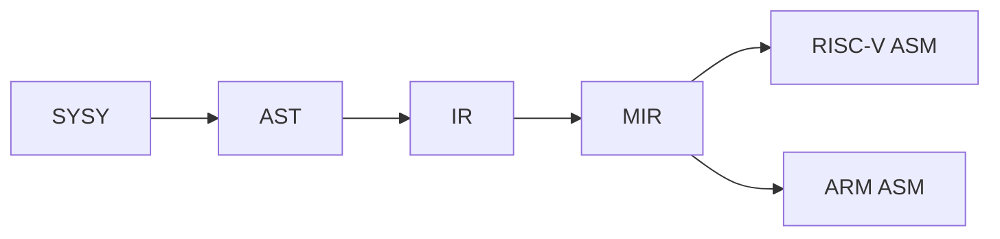

```
Compiler/
├── doc/                              # 竞赛文档
│
├── include/                          # .hpp文件
│   ├── yacc/                         # 词法、语法分析相关文件
│   ├── lib/                          # 编译器前端文件及中端基础结构文件
│   ├── ir/                           # 中端优化框架
│   │   ├── analysis/                 # 中端分析 Pass
│   │   └── opt/                	  # 中端变换与优化 Pass
│   ├── riscv/                        # RISC-V 后端
│   └── aarch64/                      # ARM 后端
│
├── src/                              # .cpp文件
│   ├── yacc/                         # 词法、语法分析相关文件
│   ├── lib/                          # 编译器前端文件及中端基础结构文件
│   ├── ir/                           # 中端优化框架
│   │   ├── analysis/                 # 中端分析 Pass
│   │   └── opt/                      # 中端变换与优化 Pass
│   ├── riscv/                        # RISC-V 后端
│   └── aarch64/                      # ARM 后端
│
├── runtime/                          # SysY 运行时库
├── main.cpp                          # 编译器入口
├── CMakeLists.txt                    # CMake 项目构建配置
└── README.md                         # 项目说明
```

### 前端

#### SysY2022及Runtime分析

> 这一部分是本人在阅读完相关文档的一些总结，目的为了便于后续开发前中端查阅需要

**Sysy2022**

- .sy文件结构：全局变量声明，全局常量声明，函数定义，唯一的main函数定义

- 注释：单行和多行（遇到第一个*/就结束）

- 数值类型：int/float类型和元素为int/float类型且按**行优先存储**的多维数组类型

  隐式类型转换：编译器在需要是可自动转换float/int，不支持程序员 `(int)`、`(float)` 主动指定转换

  > 混合运算时，int先转float，再进行计算
  >
  > float隐式转换成int时，小数部分直接丢弃，float超出int范围，进行转换为未定义行为
  >
  > int隐式转换成float时，转换后值保持不变

- 函数：

  参数为 int/float 时，按值传递

  参数为数组类型时，实际传递的是数组的起始地址，并且**形参第一维的长度必须空缺**。

  ```c
  //示例1：
  //在如下例子传入的就是a[0]，并且实际修改的就是main中的data[0]
  void process(int a[]) {
      a[0] = 100;
  }
  int main() {
      int data[3] = {1, 2, 3};
      process(data);
  }
  //示例2：
  void process(int a[][3]) {
  }
  
  //示例3：支持多维数组降维传递
  //下图传递了data[1]这个[3][4]的二维数组
  void process_matrix(int a[][4]) {
      a[0][0] = 100;
  }
  
  int main() {
      int data[2][3][4];
      process_matrix(data[1]);
      return 0;
  }
  ```

- 数值常量：**忽略所有后缀**

  - 整数常量：

    - 十进制
    - 八进制：以0开头
    - 十六进制：以0x或0X开头

  - 浮点常量：均存在整数+小数/省略整数/省略小数三种形式，**忽略所有后缀**

    - 十进制：

      普通形式：3.14 / .5 / 1.

      十进制指数：

      **注意指数的底数为10**

      ```
      1e3      = 1 × 10³    = 1000
      2.E2     = 2. × 10²  = 200
      .14e-2   = 0.14 × 10⁻² = 0.0014
      ```

    - 十六进制：

      0x 十六进制数字 '.' 十六进制数字 p 十进制指数：

      **注意指数的底数为2**

      ```
      0x1.2p3 = 1.125 × 8 = 9
      	0x1.2 = 1 + 2 × 16⁻¹
          = 1 + 2/16
          = 1.125
      	2³ = 8
      ```

- 一些规则：

  - 常量必须初始化且不能再次赋值
  - 数组每一维定义必须显式给出
  - 未初始化局部变量值不确定
  - 未初始化全局变量/数组初始值为0
  - 初始化全局变量/数组初始值为常量表达式
  - 数组只能逐维赋值，不能整个赋值

- sysy其他未提到的参考C语言即可

**Runtime**

> 由于putf在测试用例中并未出现，所以本人没有实现这一runtime函数在前中端的处理

读取函数：

- int getint()：从**标准输入**读取一个整数，并返回对应的 `int` 值

- float getfloat()：从**标准输入**读取一个浮点数，返回 32 位单精度浮点值

- int getch()：从**标准输入**中读取一个字符（将整数视为字符），并返回该字符的 ASCII 码值

  ```c
  12 34
  |
  |
  '1' → 49
  '2' → 50
  ' ' → 32
  '3' → 51
  '4' → 52
  '\n' → 10    
  ```

- int getarray(int[])：输入一串整数，第 1 个整数代表后续要输入的整数个数，该个数通过返回值返回；后续的整数通过传入的数组参数返回

  ```c
  4 10 20 30 40
  
  int main() {
      int a[10];
      int n = getarray(a);
  }
  
  /*
  n = 4
  a[0] = 10
  a[1] = 20
  a[2] = 30
  a[3] = 40
  */
  ```

- int getfarray(float[])：同上

输出函数：

- void putint(int)：向**标准输出**打印一个整数

- void putfloat(float)：向**标准输出**打印一个单精度浮点数

- void putch(int)：将整数参数解释成 ASCII 码，并输出对应字符

  ```c
  putch(65); -> A
  ```

- void putarray(int, int[])：第 1 个参数表示要输出的整数个数(假设为 N)，后面应该跟上要输出的 N个整数的数组。putarray 在输出时会在整数之间安插空格

  ```c
  示例：int n=2; inta[]={2,3}; putarray(n, a);
  输出：2:2 3
  ```

- void putfarray(int,float[])：同上

计时函数：

> 输出格式：
>
> Timer#编号@开启行号-停止行号: 时-分-秒-微秒
>
> TOTAL: 时-分-秒-微秒
>
> Timer#001@0010-0012: 0H-0M-3S-3860us

- void starttime()
- void stoptime()

**llvm intrinsic  **

在中端还引入了llvm.memcpy / llvm.memset / llvm.memmove，引入主要为了便于优化，在后端生成asm前已经替换掉

```
memcpy：从源地址 src 开始，复制 len 个字节到目标地址 dest。（不允许重叠）
@llvm.memcpy.p0.p0.i32(ptr %dest, ptr %src, i32 %len, i1 %isvolatile)

memmove：从源地址 src 开始，复制 len 个字节到目标地址 dest。（允许重叠）
@llvm.memmove.p0.p0.i32(ptr %dest, ptr %src, i32 %len, i1 %isvolatile)

memset：从目标地址 dest 开始，将连续 len 个字节全部设置为同一个字节值 value。
@llvm.memset.p0.i32(ptr %dest, i8 %value, i32 %len, i1 %isvolatile)
```

#### 词法分析+语法分析

采用业界主流的Flex+Bison工具进行构建，由人工写好.l和.y文件之后通过Flex+Bison自行构建出相关hpp/cpp文件

#### AST

整个 AST 体系以 `BaseAST` 为唯一多态根节点。具体节点直接继承`BaseAST`（表达式链节点经 `BaseExp<T>` 间接继承）

- 编译单元：`CompUnit`
- 声明与定义：`ConstDecl`,`VarDecl`,`ConstDefList`,`VarDefList`,`ConstDef`,`VarDef`
- 函数相关：`FuncDef`, `FuncParam`, `FuncParamList`
- 初始化相关：`InitValList`, `InitVal`
- 语句相关：`Block`, `BlockItemList`, `AssignStmt`, `ExpStmt`, `IfStmt`, `WhileStmt`, `BreakStmt`, `ContinueStmt`, `ReturnStmt`
-  表达式相关：`LVal`, `FuncCall`, `ArrayList`, `FuncRParamList`, `UnaryExp`, `MulExp`, `AddExp`, `RelExp`, `EqExp`, `LAndExp`, `LOrExp`, `ConValue`

##### 相关结构：

1. 编译单元及声明与定义结构：

   ```mermaid
   graph TD
   
   	N1[CompUnit] --> N3[FuncDef]
   	N1[CompUnit] --> N4[ConstDecl]
   	N1[CompUnit] --> N5[VarDecl]
   	N4[ConstDecl] --> N6[ConstDefList]
   	N5[VarDecl] --> N7[VarDefList]
   	N6[ConstDefList] --> N8[ConstDef]
   	N7[VarDefList] --> N9[VarDef]
   	N3[FuncDef] --> N10[FuncParamList]
   	N3[FuncDef] --> N11[Block]
   	N10[FuncParamList] --> N12[FuncParam]
   	N8[ConstDef] --> N13[ident]
   	N8[ConstDef] --> N14[ArrayList]
   	N8[ConstDef] --> N15[InitVal]
   	N9[VarDef] --> N13[ident]
   	N9[VarDef] --> N14[ArrayList]
   	N9[VarDef] --> N15[InitVal]
   	N3[FuncDef] --> N16[ident]
   	N3[FuncDef] --> N17[Type]
   
   	N12[FuncParam] --> N18[Type]
   	N12[FuncParam] --> N19[ident]
   	N12[FuncParam] --> N20[ArrayList]
   	N4[ConstDecl] --> N21[Type]
   	N5[VarDecl] --> N22[Type]
   ```


2. 语句相关结构：

   ```mermaid
   graph TD
   	N1[Block] --> N2[BlockItemList]
       N2[BlockItemList] --> N3[BlockItem（文法分类）]
       N3 --> N19[ConstDecl]
       N3 --> N20[VarDecl]
       N3 --> N4[AssignStmt]
   	N4[AssignStmt] --> N5[LVal]
   	N4[AssignStmt] --> N6[AddExp]
       N3 --> N7[ExpStmt]
   	N7[ExpStmt] --> N8[AddExp]
       N3 --> N9[IfStmt]
   	N9[IfStmt] --> N10[LOrExp]
       N9[IfStmt] --> N11[then/else 分支]
       N3 --> N12[WhileStmt]
   	N12[WhileStmt] --> N13[LOrExp]
       N12[WhileStmt] --> N14[循环体]
       N3 --> N15[BreakStmt]
       N3 --> N16[ContinueStmt]
       N3 --> N17[ReturnStmt]
   	N17[ReturnStmt] --> n18[AddExp]
   
   ```


3. 表达式相关结构：

   ```mermaid
   graph TD
       N1[LOrExp] --> N2[LAndExp]
       N2[LAndExp] --> N3[EqExp]
       N3[EqExp] --> N4[RelExp]
       N4[RelExp] --> N5[AddExp]
       N5[AddExp] --> N6[MulExp]
       N6[MulExp] --> N7[UnaryExp]
       N7[UnaryExp] --> N8[PrimaryExp（文法分类）]
   
       N8 --> N9[LVal]
       N8 --> N10[FuncCall]
       N8 --> N11[ConValue]
       N8 --> N5
   
       N9[LVal] --> N12[ArrayList]
       N10[FuncCall] --> N13[FuncRParamList]
   
       N12[ArrayList] --> N5[AddExp]
       N13[FuncRParamList] --> N5[AddExp]
   ```

#### IR生成

使用Visitor设计模式，将IR生成相关逻辑与AST结构，IR结构解耦，实现了将AST转化为无SSA形式的，兼容LLVM格式的中间代码IR

#### 符号表

基于《编译器设计》一书中对符号表的解析上修改，设计而来

- 功能：主要用于IR生成阶段，便于建立中端Value与前端AST Ident映射的桥梁
  - 变量遮蔽：允许在内层作用域声明与外层同名的变量。在进入新作用域的时候能够及时屏蔽外层同名变量

### 中端

#### IR

> 为方便决赛拓展向量优化，IR提前拓展向量指令

采用与LLVM IR兼容的IR，便于使用LLVM工具链LLI/LLC进行测试

##### 支持指令：为LLVM IR的子集，目前一共38条指令

```
终止与控制流指令：
Ret
Br
Call

内存操作指令：
Alloca(分配局部变量的内存，返回地址指针)
Store
Load
GetElementPtr (GEP)（根据类型和下标计算地址）

二元运算指令：
算术运算: Add, Fadd, Sub, Fsub, Mul, Fmul
Sdiv, Fdiv,Udiv -- Udiv目前仍未使用
Srem, Frem,Urem -- Frem目前仍未使用,Urem中端优化引入
逻辑运算: And, Or, Xor --中端优化时引入（这里是按位运算指令，前端逻辑判断IR生成为基本块级）
移位运算: Shl逻辑左移, Lshr逻辑右移, Ashr算术右移 -- 中端优化引入
比较运算: Icmp, Fcmp
/*
icmp eq    // 整数相等：lhs == rhs
icmp ne    // 整数不等：lhs != rhs
icmp sgt   // 有符号大于：signed(lhs) > signed(rhs)
icmp sge   // 有符号大于等于：signed(lhs) >= signed(rhs)
icmp slt   // 有符号小于：signed(lhs) < signed(rhs)
icmp sle   // 有符号小于等于：signed(lhs) <= signed(rhs)
fcmp oeq   // 有序相等：两者都不是 NaN，并且 lhs == rhs
fcmp une   // 无序不等：至少一个是 NaN，或者 lhs != rhs
fcmp ogt   // 有序大于：两者都不是 NaN，并且 lhs > rhs
fcmp oge   // 有序大于等于：两者都不是 NaN，并且 lhs >= rhs
fcmp olt   // 有序小于：两者都不是 NaN，并且 lhs < rhs
fcmp ole   // 有序小于等于：两者都不是 NaN，并且 lhs <= rhs
无序指的是NaN，只要NaN存在就无法进行比较（除了不等之外）
*/


类型转换指令：
FPTOSI
SITOFP //用于隐式类型转换
Zext零扩展
Sext符号扩展
Trunc整数截断
BitCast将指针解释成另一种类型指针 -- 中端优化引入


静态单赋值 (SSA) 与选择指令：
Phi    -- 中端优化引入
Select -- 中端优化引入

向量运算指令：
extractelement 从固定长度向量中提取一个标量元素
insertelement  把一个标量元素插入到固定长度向量
shufflevector  按照常量mask将两个输入向量进行重排
```

> IR格式：
>
> ret：`ret i32 %result` / `ret void`
>
> br：`br label %destination` / `br i1 %condition, label %true_block, label %false_block`
>
> call：`%result = call i32 @function(i32 %arg1, float %arg2)` / `call void @function(i32 %arg)` / `%result = tail call i32 @function(i32 %arg)`
>
> alloca：`%ptr = alloca i32` / `%array = alloca [10 x i32]`
>
> store：`store i32 %value, i32* %ptr` / `store float %value, float* %ptr`
>
> load：`%value = load i32, i32* %ptr` / `%value = load float, float* %ptr`
>
> getelementptr（GEP）：`%element_ptr = getelementptr inbounds [10 x i32], [10 x i32]* %array, i64 0, i64 3`（**跨过0个数组长度，访问数组中第3号（第四个）元素array[3]**）
>
> add：`%result = add i32 %lhs, %rhs`
>
> fadd：`%result = fadd float %lhs, %rhs`
>
> sub：`%result = sub i32 %lhs, %rhs`
>
> fsub：`%result = fsub float %lhs, %rhs`
>
> mul：`%result = mul i32 %lhs, %rhs`
>
> fmul：`%result = fmul float %lhs, %rhs`
>
> and：`%result = and i32 %lhs, %rhs` / `%result = and i1 %condition1, %condition2`
>
> or：`%result = or i32 %lhs, %rhs` / `%result = or i1 %condition1, %condition2`
>
> xor：`%result = xor i32 %lhs, %rhs` / `%not = xor i1 %condition, true`
>
> icmp：`%result = icmp slt i32 %lhs, %rhs` / `%result = icmp eq i32 %lhs, %rhs`
>
> fcmp：`%result = fcmp olt float %lhs, %rhs` / `%result = fcmp oeq float %lhs, %rhs`
>
> sdiv：`%result = sdiv i32 %lhs, %rhs`
>
> fdiv：`%result = fdiv float %lhs, %rhs`
>
> srem：`%result = srem i32 %lhs, %rhs`
>
> frem：`%result = frem float %lhs, %rhs`
>
> udiv：`%result = udiv i32 %lhs, %rhs`
>
> urem：`%result = urem i32 %lhs, %rhs`
>
> shl：`%result = shl i32 %value, %shift` / `%result = shl i32 %value, 3`
>
> lshr：`%result = lshr i32 %value, %shift` / `%result = lshr i32 %value, 3`
>
> ashr：`%result = ashr i32 %value, %shift` / `%result = ashr i32 %value, 3`
>
> fptosi：`%result = fptosi float %value to i32`
>
> sitofp：`%result = sitofp i32 %value to float`
>
> zext：`%result = zext i1 %value to i32` / `%result = zext i8 %value to i32`
>
> bitcast：`%result = bitcast i32* %ptr to float*`
>
> trunc：`%result = trunc i32 %value to i1` / `%result = trunc i32 %value to i8`
>
> sext：`%result = sext i8 %value to i32` / `%result = sext i1 %value to i32`
>
> phi：`%result = phi i32 [ %value1, %block1 ], [ %value2, %block2 ]`
>
> select：`%result = select i1 %condition, i32 %true_value, i32 %false_value`
>
> extractelement：`%x = extractelement <4 x i32> %v, i32 %index`
>
> insertelement：`%r = insertelement <4 x i32> %v, i32 %x, i32 %index`
>
> shufflevector：`%result = shufflevector <4 x i32> %v1,<4 x i32> %v2,<4 x i32> <i32 0, i32 4, i32 1, i32 5>`

##### Value/User/Use

仿照LLVM进行设计，但是做了精简与本项目的适配

Use--链表结点

设计特点：禁止被拷贝和移动，禁止被继承

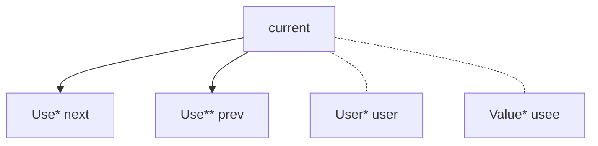


UseList --链表

设计特点：禁止被拷贝和移动，禁止被继承

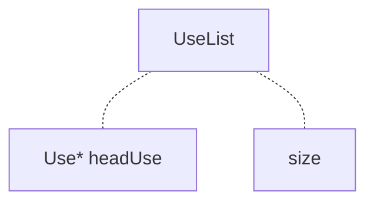

Value

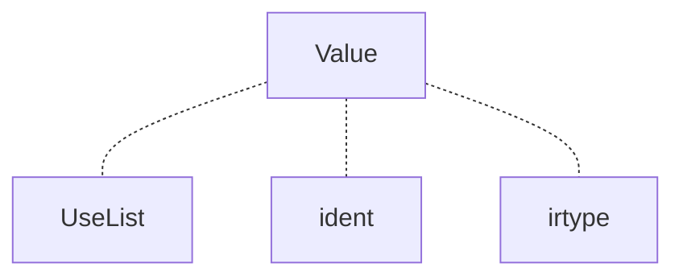

User

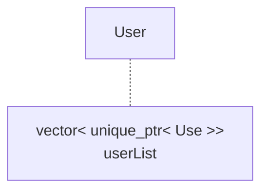

##### TypeSystem类型系统

> 为了便于决赛向量优化，IR类型系统提前支持向量类型

设计模式：采用单例static设计模式，并且使用shared_ptr包装裸指针进行内存管理


- 目的：用来支持IR的强类型语言的特性

- 支持类型：

  ```c++
  enum TypeSystem{
      IR_INT,IR_FLOAT,IR_VOID,IR_POINTER,IR_ARRAY,IR_VECTOR,IR_UNDEF
  };
  ```

  `IR_UNDEF` 仅用于表示前端源类型转换失败，不对应可实例化的 IR 类型

- 结构：

  ```mermaid
  graph TD
  	N1[IRType] -.- N2[TypeSystem Enum]
  	N1[IRType] -.- N3[size]
  	N1[IRType] --> N4[VOIDType]
  	N1[IRType] --> N6[INTType]
  	N1[IRType] --> N10[FLOATType]
  	N1[IRType] --> N14[POINTERType]
  	N14[POINTERType] --> N15[pointerType]
  	N1[IRType] --> N16[ARRAYType]
  	N16[ARRAYType] --> N17[elementType]
  	N1[IRType] --> N18[VECTORType]
  	N18[VECTORType] --> N19[elementType]
  ```

##### CFG

参考LLVM实现，但是对本项目做了精简与适配

采用侵入式链表进行组织

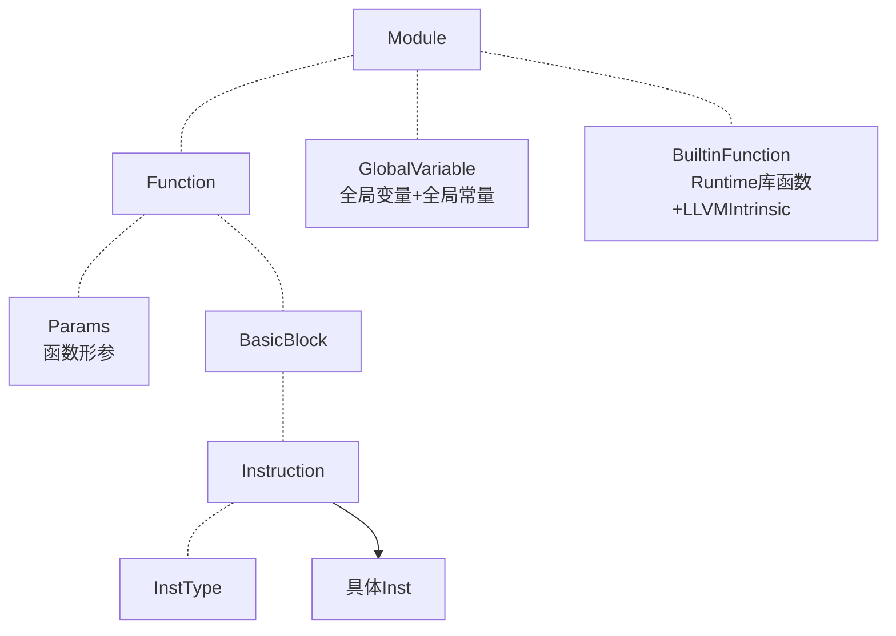

初始化相关

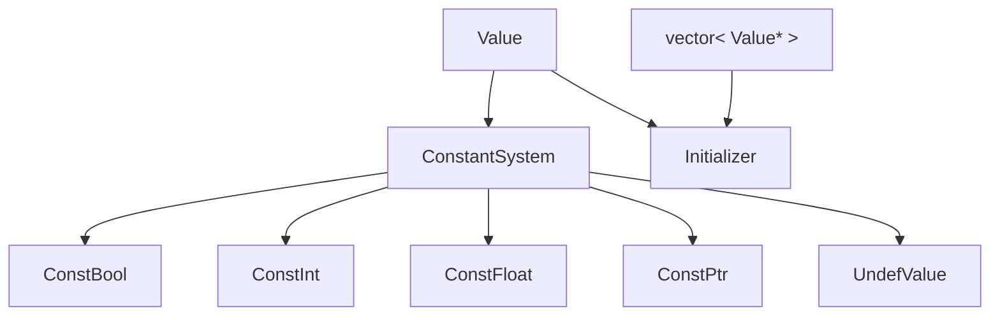

#### PassBuilder

参考LLVM实现，其中做了简化，仅保留AnalysisPass的宏展开注册功能，将Pipeline组织改为硬编码组织

因为Pass比较少，所以这种方式更适合我们的项目形式

- 作用:
  1. 注册AlalysisPass
  2. 组织不同优化层级的优化Pipeline

- Pass Pipeline：PassPipeline组织形式详情请看PassBuilder源码

- 注册AnalysisPass：以Function粒度为例

  ```c++
  void PassBuilder::registerFunctionAnalyses(FunctionAnalysisPassManager &FAM){
      // 1. 定义宏
      #define FUNCTION_ANALYSIS(NAME, CREATE_PASS)\
          FAM.registerPass([&] {return CREATE_PASS;});
      // 2. 引入数据源：将 .def 文件中的内容原封不动地贴在这里
      #include "./FunctionAnalysisPass.def"
      // 3. 销毁宏
      #undef FUNCTION_ANALYSIS
  }
  ```

  .def文件：

  ```c++
  //示例
  FUNCTION_ANALYSIS("DominatorTree", DominantAnalysis())
  FUNCTION_ANALYSIS("BasicAA", BasicAliasAnalysis())
  FUNCTION_ANALYSIS("LoopInfo", LoopAnalysis())
  ```

  在编译期早期阶段就进行了替换：替换后的函数如下：

  ```c++
  void PassBuilder::registerFunctionAnalyses(FunctionAnalysisPassManager &FAM){
      FAM.registerPass([&] {return DominatorTreeAnalysis();});
      FAM.registerPass([&] {return LoopInfoAnalysis();});
      FAM.registerPass([&] {return BasicAliasAnalysis();});
  }
  ```

  注册后，FAM内部大致形成

  ```c
  AnalysisPasses
  ├── DominantAnalysis::ID()     -> AnalysisPassWrapper<DominantAnalysis>
  └── PostDominantAnalysis::ID() -> AnalysisPassWrapper<PostDominantAnalysis>
  ```
  
  在TransformPass之中调用getResult时
  
  ```c
  getResult<DominantAnalysis>(F)
            │
            ├─ ResultCache 中已有结果
            │      └─ 直接返回 DominatorTree&
            │
            └─ 没有结果
                   ├─ 找到已注册的 DominantAnalysis
                   ├─ 调用 DominantAnalysis::run(F, FAM)
                   ├─ 得到 DominatorTree
                   ├─ 包装成 AnalysisResultWrapper
                   ├─ 放入 ResultCache
                   └─ 返回其中的 DominatorTree&
  ```

#### NewPassManager

该PassManager仅管理中端IR层级

参考LLVM实现，同样做了简化与适配

保留并简化CRTP设计模式，基于类型擦除(Type Erasure)的多态设计，AnalysisPass结果缓存

但对于失效机制的实现，摒弃了llvm源代码复杂的迭代器实现和自动失效的机制，采用手动失效的原理实现

参考博客：

[浅析 llvm::Analysis Pass and Manager](https://zhuanlan.zhihu.com/p/696028293)

执行流：

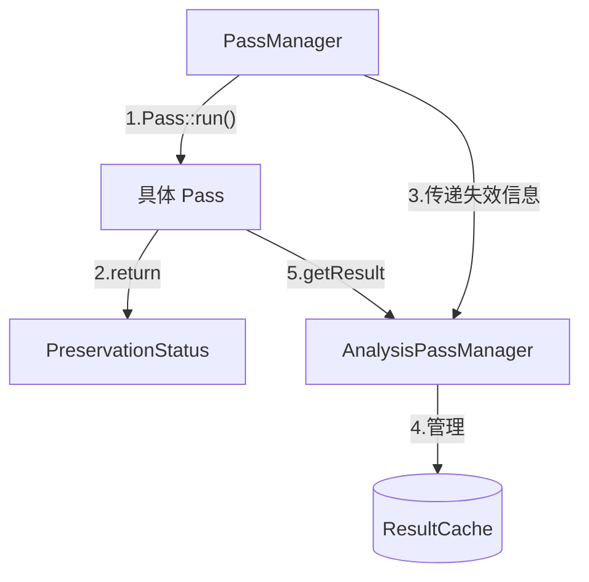

- CRTP解析：

  一个类继承一个以该类自身为模板参数的模板基类（一种将继承和静态多态结合的技术）--用来**高性能实现多态**

  参考博客：[CRTP解析](https://zhuanlan.zhihu.com/p/705630363)

  下图为llvm实现CRTP的相关模板：

  

  优势：

  传统实现多态是需要**继承和虚函数**实现，但是虚函数存在性能开销（会在运行时生成虚函数表），在性能敏感的地方（比如编译器中端优化部分），这么做就会造成性能损失，并且继承和虚函数**在运行期间起作用**，而上面CRTP模式**在编译期间起作用（由于模板的特性，模板类会在编译的时候确定模板参数并进行构建）**

  总结来说就是虚函数在编译的时候创建虚函数表，在运行的时候通过虚函数指针来**动态查找函数地址**->**造成性能损失**，而模板会在编译的时候就确定模板参数，从而在编译的时候就会创建相应的多态函数，在运行的时候**直接进行函数调用**

- TypeErasure类型擦除解析：

  目的：支持将任意类型的Pass类包装成标准Pass对象（而不是必须继承特定的基类），从而方便PassManager进行存储和管理

  具体实现方式：

  其中`Interface`类作为纯虚基类，设计意图为提供给`PassManager`一个统一的类型，方便存储在`vector`之中

  `Wrapper`作为模板类，通过`PassT`接收任意用户提供的具体`Pass`类，通过持有具体Pass的实例，负责该实例的生命周期管理

  `Wrapper`的`run`函数也是简单的调用具体Pass的`run`函数

  ```mermaid
  classDiagram
      %% 转换 Pass 架构
      class PassInterface~IRUnitT, AM_T~ {
          <<interface>>
          +run(IR, AM)* PreservationStatus
      }
      class PassWrapper~IRUnitT, PassT, AM_T~ {
          +PassT Pass
          +run(IR, AM) PreservationStatus
      }
      PassInterface <|-- PassWrapper

      %% 分析 Pass 架构
      class AnalysisPassInterface~IRUnitT~ {
          <<interface>>
          +run(IR, AM)* ResultInterfacePtr
      }
      class AnalysisPassWrapper~IRUnitT, PassT~ {
          +PassT Pass
          +run(IR, AM) ResultInterfacePtr
      }
      AnalysisPassInterface <|-- AnalysisPassWrapper

      %% 分析结果包装
      class AnalysisResultInterface~IRUnitT~ {
          <<interface>>
      }
      class AnalysisResultWrapper~IRUnitT, PassT, ResultT~ {
          +ResultT Result
      }
      AnalysisResultInterface <|-- AnalysisResultWrapper
  ```

  - 优势：

    非侵入性：编写的具体Pass只需要实现一个符合签名的run函数即可

    解耦：PassManager甚至不需要知道有哪些Pass，只需要实现run逻辑即可

    统一存储和管理

- 失效机制：

  在编写具体Pass的时候我们会利用下面所说的“黑白名单”的形式，手动编写是否保留某个AnalysisPass的分析结果

  形如下面这种，即显式分析哪个AnalysisPass的结果仍然有效，哪些已经失效需要重新计算

  ```c++
      PreservationStatus PA;
      PA.discard<DominantAnalysis>();
      PA.discard<LoopAnalysis>();
      return PA;
  ```

- AnalysisPassManager解析：

  - ResultCache缓存机制：采用`PassID（AnalysisPass地址）`和`IR层级（如Function）`作为Key进行存储

  - `getReult`：

    1. 当一个 Pass 请求分析结果时，它首先检查 `ResultCache`
    2. 如果命中，直接返回缓存对象
    3. 如果未命中，则即时运行对应的分析 Pass，并将结果存入缓存供后续使用

  - `invalidate`

    - 作用：`PassManager` 拿到上一步返回的 `PA` 状态后，立即调用此函数触发缓存清理。

    - 细节：
      a. 如果该 Pass 没有破坏任何东西，直接 `return`，终止清理流程，实现提速。
      b. 如果有破坏，则遍历底层的 `ResultCache`，针对每一个属于当前 IR 单元的缓存条目，提取其 `PassID`，并调用此函数询问该分析结果是否幸存

      - 细节：内部检查该 ID 是否在黑名单 `AbandonedIDs` 中，或者是否在白名单 `PreservedIDs` 中

      c.根据内部检查进行释放缓存，或者保留缓存

  - `registerPass`：PassBuilder宏展开函数内层核心实现

    通过`PassID`确定是否已经注册过，如果没有注册才会进行创建实例，换句话说，在main函数一开始就已经注册并创建，但是只有在`run`函数进行调用的时候才会延迟进行计算

- PassManager解析：

  - `run`：

    1. 从 `Passes` 向量中取出一个具体 Pass
    2. 执行 `Pass->run(IR, AM)`，并获取其返回的 `PreservationStatus`
    3. **关键动作**：立即调用 `AM.invalidate(IR, PassPA)` 。这保证了在下一个 Pass 开始之前，缓存中留下的都是完全正确的、未被破坏的分析结果
    4. 最后，将该 Pass 的失效信息合并到总状态中

  - `addPass`：PassBuilder编写pipeline的内层核心逻辑

    接收一个具体的TransformPass，将其类型擦除之后加入到`vector`之中，同理，在运行这个函数的时候具体TransformPass就已经创建实例了，但是只有在`run`的时候才开始进行计算，达到了延迟计算的效果


#### AnalysisPass

##### Dominant支配树

将从函数入口可达的CFG抽象成一棵直接支配树,使用**Semi-NCA算法**进行构建

支配：从函数入口到基本块B的每一条路径必须经过A，则A支配B

直接支配：除了B自身之外，离B最近的那个支配B的节点

半支配：从候选节点 `v` 到 `w` 存在一条路径；在到达 `w` 之前，这条路径不能先经过一个 DFS 编号比 `w` 更小的中间节点，那么**v就是w的一个半支配者**

- 支配树构建：

  1. 从入口基本块遍历CFG，只为可达块编号，从小到大分配DFS序号

  2. 求每个基本块的半支配者SDom和直接支配者IDom

     - 逆DFS序遍历当前节点所有CFG前驱：

       pre < i:前驱比当前节点更早被DFS访问,A(2) -> B(5),满足A是B的半支配者

       pre > i：前驱比当前节点更晚被DFS访问,A(2) -> ... -> X(7) -> B(3)

       由于逆DFS序，所以X先于B被处理，但是这里不能简单将X作为最佳SDom

       所以调用eval(pre)沿着并查集路径向上找到SDom最小的节点

     - 正DFS序：Semi-NCA

       > 正DFS序保证父结点的IDom先于子结点被计算，从而可以使后续子结点可以沿着IDom链向上跳

       从 `i` 的 DFS 父节点（IDom到i一定经过父结点）开始，沿着已经计算好的**真正IDom链**向上走，找到第一个 DFS 编号不大于 `sdom(i)` 的节点，这个节点是 `IDom(i)`

       > 之所以使用sdom作为上界，要理解sdom的含义，sdom代表我们找到的**最早一条**可以绕过DFS到达目标节点的路径，所以只要是当前节点还小于sdom就说明目前不能完全支配，**必须找到第一个在sdom上面的节点**

  3. 建树：使用FirstChild/NextSibling的形式组织多叉树

  4. 迭代支配边界构建(用于Mem2Reg，MemorySSA)：

     支配边界：X支配Y的某个前驱(可以是自己)，且X不严格支配Y，则说Y是X的支配边界

     > 下图中Merge是Then的支配边界，支配边界的含义就是Then块支配结束的位置，对应到下图就是支配结束在Then的最后一条指令
     >
     > 通俗理解支配边界就是**控制流汇聚的位置（直接看CFG图理解）**

     迭代支配边界：原始赋值会产生定义块，新插入的PHI指令也会产生定义块，所以需要不断处理新加入PHI的定义块，直到不再产生新PHI指令

     如果再加入LiveinBlocks就可以计算PrunedPHI版本的迭代支配边界（即去掉那些可以产生PHI指令但是PHI指令后续**不会被使用或在使用前会被重新定义**的基本块，这样的基本块不会创建PHI指令）

  5. 查询：不仅支持块级支配查询，还支持Value级/指令级支配查询

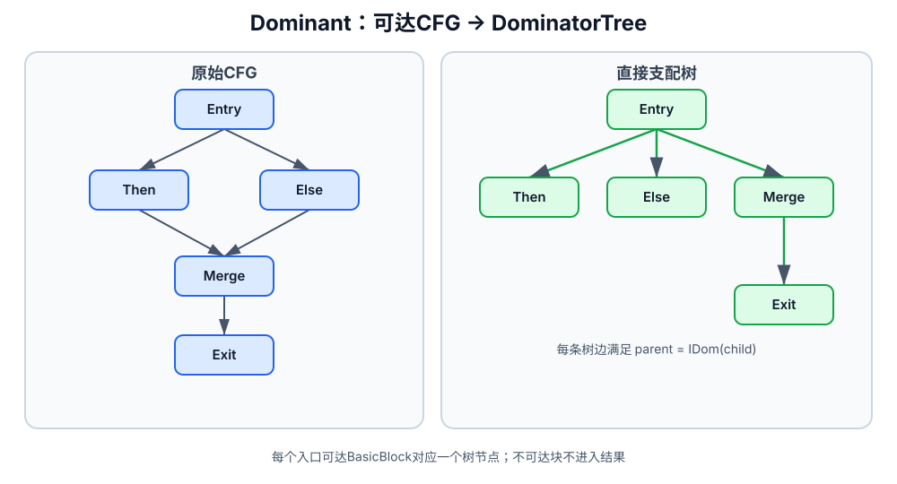

- 参考文献：
  1. [支配树构建算法及伪代码](https://zhuanlan.zhihu.com/p/365912693)
  2. [Semi-NCA论文](https://renatowerneck.wordpress.com/wp-content/uploads/2016/06/gtw06-dominators.pdf)
  3. https://oi-wiki.org/graph/dominator-tree/
  4. https://zhuanlan.zhihu.com/p/655369292
  5. https://zhuanlan.zhihu.com/p/365912693
  6. https://zhuanlan.zhihu.com/p/1955319335347290919

##### PostDominant后支配树

将入口可达CFG反向观察，并增加一个**无对应IR的VirtualExit**，构建单根的直接后支配树

> 把CFG的边反转，把出口当入口，然后计算普通支配

后支配：如果从B出发，到函数出口每条路径都经过A，则A后支配B

> 支配关注的是入口->当前块，后支配关注的是当前块->出口

- 后支配树构建：

  1. 获取真实可达出口块，以及反向CFG（边反转存储）
  2. 创建VirtualExit
  3. 对所有真实可达出口块反向DFS，编DFS序
  4. 无法到达真实出口的基本块（但是入口可达）**直接挂载**到虚拟根，为其分配编号（在刚才分配的DFS序号后面）
  5. 求每个基本块的半后支配者SDom和直接后支配者IDom -- **这一步和支配树算法（SemiNCA）和实现完全一样**
  6. 构建后支配树

  **和支配树的区别重点在于如何构建DFS序图**

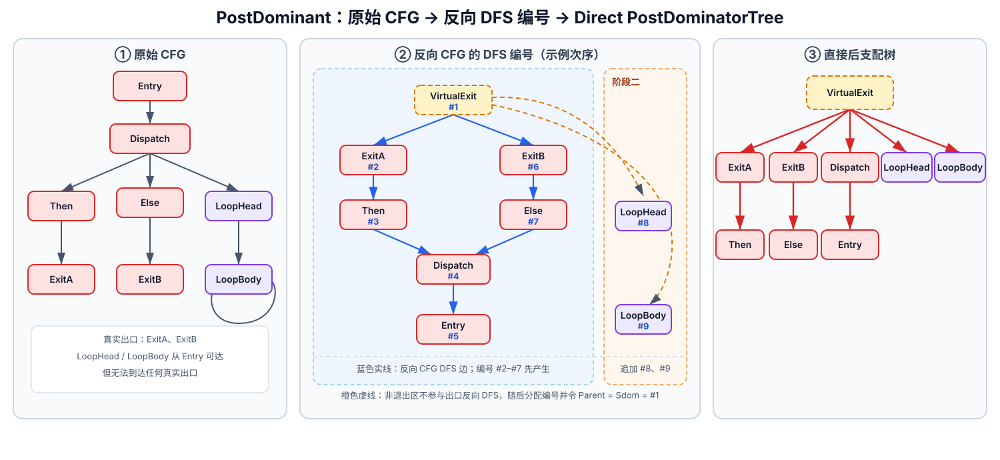

##### LoopInfo/LoopAnalysis循环分析

建立循环森林

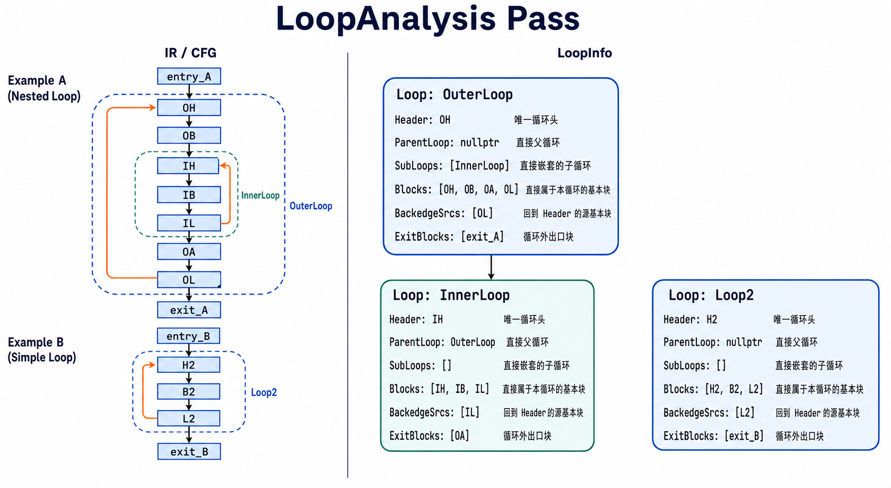

##### MemorySSA

将内存状态抽象成SSA风格定义链，标记每一处内存写入点和内存读取点，构建内存图

- 内存状态结点：

  - LiveOnEntry：函数入口时未知的初始内存状态，**无对应IR**，无任何对应，每个函数只创建一个

  - Phi：多个CFG前驱的内存状态汇合，**对应IR出现在迭代支配边界（没支持LiveInBlock，所以不是PrunedPHI）基本块入口**

    incoming:(PredBB1, PredBB1Status)记录每个前驱CFG的内存节点状态

  - Use：读取内存但不产生新内存版本,**对应IR：Load/只读Call**

  - Def：可能修改内存，产生新内存版本，**对应IR：Store/可能写内存的Call**

- 内存状态图：

  1. 每个函数入口对应一个LiveOnEntry
  2. 只在可达MemoryDef所在块的迭代支配边界MemoryPhi（和mem2reg算法差不多一样）
  3. 每个store/可能写内存的call产生一个新内存状态
  4. 每个load/只读call使用当前内存状态，**但不产生新状态,下一个节点还是挂载到当前内存状态（上一个节点产生的状态）**
  5. 纯调用（NoModRef）不创建MemoryAccess节点

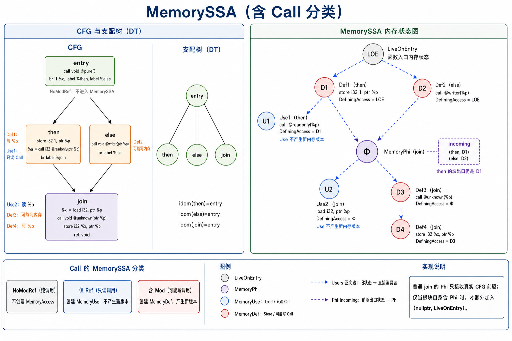

参考资料：https://zhuanlan.zhihu.com/p/715818784

##### SCEV

依赖AnalysisPass：Dominant，LoopAnalysis


##### BasicAliasAnalysis

采用**即时计算别名分析**实现

即时计算别名分析可以分析简单的含变量索引的数组指针

- 基址对象：

  在sysy之中，指针仅来源于数组作为参数传递，所以我们的指针的基址只能来自**Alloca/Param/GlobalVariable中的数组类型**

  - Alloca：在函数体中定义的局部数组/局部变量
  - Param：函数形参，传入的数组指针
  - Variable::GlobalVariable:全局变量/数组
  - Variable::GlobalConstant：全局常量

- 即时计算别名分析：

  > 如果想写的好一点可以实现一下aliasSelect，还有`a[2*i]` 和 `a[2*j+1]`这种的alias判定

  传入两个Value指针V1,V2

  1. 如果任一者访问的内存大小为0,直接判定为NoAlias

  2. 剥离BitCast

     整个循环可以采用visit数组进行循环条件判定，如果遇到了之前已经visited的循环那么就直接退出循环即可

     如果Value类型不是指针类型直接返回

     如果这一层是GEP，看一下是否所有索引全为零，如果不是那么就直接返回当前的GEP，如果是的话，那么就拿到GEP的基址指针

     如果这一层是BitCast，那么就拿到它的操作数，继续下一轮剥离

     如果这一层是只有一个输入源的PHI节点，拿到操作数继续向下剥离

     如果是其他指令那么就直接返回即可

  3. 如果V1/V2有是UndefValue的，那么直接判定为NoAlias

  4. 判断相等性并拦截跨迭代相等性的情况

     如果V1,V2不相等，那么直接返回false

     如果不是inst类型，那么直接返回true

     如果inst不在任何循环里，那么返回true

     如果inst在任何循环里面，那么人false

     true的可以直接判定为MustAlias

  5. **核心寻找基地址：O1,O2**

     继续可以用while循环+visited数组的方式来作为外层循环的条件

     如果是GEP指令，直接拿到它的基址指针，将V更新为基址指针

     如果是BitCast指令，直接拿到源操作数，更新V

     如果是Phi节点，如果只有一个输入，那么拿到操作数，更新V

     其余情况就直接返回V即可

  6. 快速判定：

     1. 如果底层对象不同O1!=O2

        如果二者都是Alloca（局部数组），那么NoAlias

        如果二者都是Variable::GlobalVariable，那么NoAlias

        如果一个是Param（函数参数）一个是Alloca（局部数组），那么NoAlias

        如果一个是Alloca一个是Variable::GlobalVariable，那么NoAlias

     2. 如果底层对象相同

        循环深度限制/加入一个visited数组

        循环查找：构造一个map，key是V1,V21,value是AliasResult，如果尝试将O1,O2（排除顺序），加入到map之中，如果缓存命中那么就可以直接返回

        如果是GEP（说明O1,O2指向同一个底层数组），那么aliasGEP

        如果是PHI，那么aliasPHI

        - aliasGEP

          将GEP拍平成一个一元线性方程：
          $$
          Base+ConstantOffset+∑(Value_i​×Stride_i​)
          $$
          解析GEP的所有索引+内层操作数，知道碰上最底层的基址

          1. 如果已经不是指令/操作符了。直接返回

          2. 如果BitCast，那么获取操作数

          3. 如果GEP，那么遍历获取GEP的所有索引

             如果索引是常数，那么获取当前维度把`常数索引 * 步长`累加到总的`ConstantOffset`之中

             如果索引是变量，直接`VarIndices[%i] += 1 * 当前维度步长`

          将GEP1和GEP2上面计算的一元线性方程做减法

          首先检查基址

          1. 如果减法化简之后所有的变量被抵消了，常量没有抵消，没有抵消如果大于数组元素的字节大小，可以返回NoAlias，如过小于数组元素的字节大小，返回MayAlias，如果常量也完全抵消了，那么MustAlias
          2. 如果变量无法抵消，直接返回MayAlias

        - aliasPHI:判断一个PHI节点和另一个指针O2是否有重叠情况

          > 总体思路就是比较这个PHI节点的所有输入值和另一个指针O2是否存在别名

          如果这个PHI没有任何输入，直接返回NoAlias

          如果O2也是一个PHI，并且两个PHI在同一个基本块之中，只需要做N-N的一对一比对输入值即可

          如果是常规情况，遍历PHI的所有输入，分别与O2比较，对每个输入和O2调用外层的aliasCheck函数，对所有AliasResult结果求交集

          > `NoAlias` + `NoAlias` = `NoAlias
          > MustAlias` + `MustAlias` = `MustAlias`
          >
          > 任何结果 + `MayAlias` = `MayAlias`
          >
          > `NoAlias` + `MustAlias` = `MayAlias`

##### SideEffect--副作用分析

实现**跨函数副作用分析**，支持指令级，函数级副作用分析

- 算法规则：

  1. 基址与基址传播

     基址规则：

      * 指针形参、全局变量和alloca的基址都是自身
      * 一个指针可以具有多个已知基址

     指令传播规则：

      * GEP：继承base pointer的基址
      * BitCast：继承操作数的基址
      * PHI：合并所有incoming指针的基址
      * Select：合并true和false指针的基址
      * 局部指针槽Load：合并所有曾Store进该槽的指针值的基址

  2. 指令副作用收集规则：处理Load、Store和Call三类指令

     Load/Store：

      * Load：将指针的所有外部基址（全局变量或形参）加入RefSet
      * Store：将指针的所有外部基址（全局变量或形参）加入ModSet
      * 局部alloca基址不加入RefSet或ModSet

     Call：

     函数最初的ModSet和RefSet由里面的load/store决定，或者由BulitinFunc决定

      * 普通直接调用：不动点迭代，Caller合并Callee的ModSet和RefSet
      * 内置函数调用：
         1. timer：不加入ModSet或RefSet，只标记可观察效果和顺序屏障
         2. memcpy/memmove：目标指针加入ModSet，源指针加入RefSet
         3.  memset：目标指针加入ModSet
         4.  数组输入：指针实参加入ModSet
         5. 数组输出：指针实参加入RefSet
         6. 标量输入输出：不加入ModSet或RefSet，只标记可观察效果

     

- 


#### TransformPass

##### DCE

依赖Side Effect

函数内级联（递归删除）死代码消除

- 算法流程：

  1. 遍历目标函数中的所有指令

     判断是否在工作队列之中（防止重复劳动），如果不在，调用下列的删除逻辑，然后开始处理工作队列里面的指令（直到处理完），调用下列的删除逻辑

  2. 具体消除逻辑：

     1. 检查：

        如果这条指令还被其他指令使用，不行

        如果是Terminator终结指令，不行

        副作用：store不行，call(访问callee，调用副作用分析这个函数是不是只读，如果不是就是含副作用)

        其他指令都可以

     2. 执行消除：

        遍历该指令所有操作数

        获取每个操作数将指令I的这个操作数置空，如果操作数还有指令在使用它/该操作数就是该指令（自我引用），就跳过该操作数

        检查该操作数是不是一条指令，如果是的话调用2.1的逻辑判断，如果满足判断条件就加入工作队列

        处理完操作数就删除该指令

##### TailRecursionElimination尾递归消除

依赖SideEffect

支持累加/累乘累加器，支持call与ret不紧挨的广义尾递归消除

- 算法流程：

  1. 处理普通尾调用(call调用的函数不是自身)：

     > 这一步不是为了尾递归消除，而是为了给后端机器码生成器提供优化提示(允许复用栈帧)

     简单逃逸分析：没有任何Alloca被call指令当作参数传走

     检查call与ret的返回值必须匹配

     ```
     %r = call @other_function(...)  // 不能是当前函数本身
     ret %r                          // ret 必须直接返回 call 的结果

     call @other_function(...)       // 调用的函数也必须是 void
     ret void
     ```

     call后紧跟ret，并且call调用的函数不是自身

  2. 处理尾递归(call调用的函数是自身)：

     遍历目标函数中所有基本块：

     1. 处理终结指令是无条件跳转的情况，并且无条件跳转目标块的PHI指令之后第一条指令必须是Ret（该块除了Ret没有其他逻辑）：

        找到该块中的Call Inst：从块末尾开始倒着向前找Call Inst，并检查Callee必须是函数自身--**不一定要求call与ret挨着**

        图合并操作：将目标块之中的Ret clone到该块的末尾，遍历新clone的Ret的操作数，如果是BitCast，clone之后插入到新Ret前面，并获取BitCast的操作数，如果是PHI，访问PHI拿到从该块传递来的值，直接接入到Ret的操作数上

        将目标块中的PHI中关于该块传递进来的值全部删掉

        将该块中的Br无条件指令删除

     2. 处理终结指令是Ret的情况：

        找到该块中的Call Inst：从块末尾开始倒着向前找Call Inst，并检查Callee必须是函数自身--**不一定要求call与ret挨着**

     3. 获得上面的Call Inst之后，开始进行真正的尾递归消除逻辑：

         遍历call和ret之间的所有指令：1，2条在这个循环里

        1. 查看这条指令是否可以移动到call指令之前：

           副作用不行：store不行，call(访问callee，调用副作用分析这个函数是不是只读，如果不是就是含副作用)

           如果指令是LOAD指令，拿到LOAD读取的地址，调用副作用getInstModRefInfo分析，如果Call Inst Mod这块地址，那么就不能移动

           检查该指令的操作数是否包含Call Inst的返回值，如果有不能移动

        2. 识别累加/累乘的伪尾递归，判定是否可以改成带有累加器的循环：

           检查该指令是否同时满足交换律和结合律：只能放行ADD和MUL指令

           如果有多条这种累加指令，不行

           检查这条指令的两个操作数，必须有一个且只能有一个是Call Inst的返回值

           检查这条指令只能被使用一次，且User是Ret指令

        处理：

        1. 创建循环头：

           拿到目标函数的入口块，创建一个新的基本块插入到入口块前面，在新基本块末尾插入无条件跳转指令让其可以直接跳转到入口块

           遍历原入口块，将所有Alloca指令搬到新基本块之中

           遍历函数所有形参，在原入口块最前面为每个形参创建一个PHI，将原来使用形参的地方全部替换成新创建的PHI，将形参作为输入值加入PHI

        2. 将这次尾递归传递的实参，添加到原入口块的PHI节点之中

        3. 如果含累加器指令：

           在原入口块节点插入一个PHI指令，如果是ADD初始值设置为0,如果是乘法初始值设置为1，将这个值加入到PHI之中，把原来使用call返回值的地方改成使用累加器指令

        4. 收尾：

           创建一条Br，代替原来的Ret，将旧的Ret和Call从内存中删掉

           将剩下的Ret之前创建BinaryInst，计算累加器与Ret原本的返回值，然后修改Ret的返回值


##### InstSimplify 指令简化

运行前需要运行一下CFGSimplify清除不可达块，运行后需要运行DCE

- 算法流程：

  遍历目标函数之中每个基本块之中每条指令（被人使用的）

  - 核心Simplify：拿到Simplify之后的Value

    Switch分发：

    1. Add/FAdd：

       常量情况：

       1. 如果LHS和RHS都是常量：常量折叠
       2. 如果LHS是常量，RHS不是常量，交换左右操作数的位置
       3. 其余情况返回nullptr

       UndefValue情况：如果LHS/RHS其中有一个是UndefValue，那么就返回UndefValue

       如果RHS是0,返回LHS

       如果LHS与RHS互为相反数，返回对应类型的0值

       如果一个操作数是X另一个操作数是一个减法表达式，这个减法表达式恰好是Y-X，那么返回Y

    2. Sub/FSub：

       常量情况：

       1. 如果LHS和RHS都是常量：常量折叠
       2. 其余情况直接返回

       UndefValue情况：如果LHS/RHS其中有一个是UndefValue，那么就返回UndefValue

       如果匹配X-0,那么直接返回X

       如果匹配X-X，那么直接返回0

    3. Mul/FMul：

       常量情况：

       1. 如果LHS和RHS都是常量：常量折叠
       2. 如果LHS是常量，RHS不是常量，交换左右操作数的位置
       3. 其余情况返回nullptr

       UndefValue情况：如果LHS/RHS其中有一个是UndefValue，那么就返回0

       如果RHS为0,那么返回0

       如果RHS为1,那么返回LHS

    4. SDiv/UDiv/FDiv：

       这一条仅适用于SDiv：如果两个数互为相反数，直接返回-1

       常量情况：

       1. 如果LHS和RHS都是常量：常量折叠
       2. 其余情况返回nullptr

       X/Undef：返回Undef

       Undef/X：返回0

       Undef / 0：返回Undef

       Undef/Undef：返回Undef

       X/0：返回Undef

       0/X：返回0

       X/X：返回1

       X/1：返回X

    5. SRem/URem/FRem：

       如果两个数互为相反数，直接返回0

       常量情况：

       1. 如果LHS和RHS都是常量：常量折叠
       2. 其余情况直接返回

       X % undef ：返回undef

       undef % X ：返回 0

       0 % X ：返回0

       X % 0 ：返回undef

       X % 1 ：返回0

       X % X ：返回0

    6. And：

       常量情况：

       1. 如果LHS和RHS都是常量：常量折叠
       2. 如果LHS是常量，RHS不是常量，交换左右操作数的位置
       3. 其余情况返回nullptr

       X & undef -> 0

       X & X = X

       X & 0 = 0

       X & -1 = X

    7. Or:

       常量情况：

       1. 如果LHS和RHS都是常量：常量折叠
       2. 如果LHS是常量，RHS不是常量，交换左右操作数的位置
       3. 其余情况返回nullptr

       X | undef -> -1

       X | -1 = -1

       X | X = X

       X | 0 = X

    8. Xor:

       常量情况：

       1. 如果LHS和RHS都是常量：常量折叠
       2. 如果LHS是常量，RHS不是常量，交换左右操作数的位置
       3. 其余情况返回nullptr

       A ^ undef -> undef

       A ^ 0 = A

       A ^ A = 0

    9. ICmp

       常量情况：常量折叠

       icmp X, X -> true/false--根据情况来定

    10. FCmp

        常量情况：常量折叠

        fcmp X, X -> true/false--根据情况来定

    11. Select

        常量情况：

        1. 如果Cond，TrueVal，FalseVal都是常量：常量折叠
        2. 如果Cond为UndefValue：选取TrueVal，FalseVal为常量的一个返回，如果都不是常量那么随便选一个
        3. 如果Cond为常量true，那么返回TrueVal
        4. 如果Cond为常量false，那么返回FalseVal

        模式匹配：

        1. select ?, X, X -> X
        2. select x, y, false = x & y
        3. select x, y, true = !x | y
        4. select x, false, y = !x & y
        5. select x, true, y = x | y
        6. select ?, undef,  X -> X
        7. select ?, X, undef  -> X
        8. select i1 x, i32 1, i32 0 = zext x
        9. select i1 x, i64 1, i64 0 = zext x
        10. select (x == y), x, y ->x
        11. select (X != Y), X, Y -> X
        12. select ((X | Y) == 0, X, 0) -> 0
        13. select ((X & Y) == -1, X, -1) -> -1

    12. PHI：平凡PHI消除

        跳过LCSSA形式的PHI

        遍历PHI之中所有输入值

        ​	如果遇到输入值是本身，那么直接跳过

        ​	如果遇到UndefValue，那么用HasUndef记录之后直接跳过

        ​	遇到第一个非 undef、非 self 的值，记为 CommonValue

        ​	如果找到CommonValue但是遇到了其余不一样的值，那么直接返回无法化简

        如果最后CommonValue还是Nullptr（说明PHI的所有输入要么全是它自己要么全是UndefValue），用RAUW替换所有使用该PHI的地方为UndefValue，然后删除

        当HasUndef True的时候，需要检查CommonValue是否支配该PHI节点（将），如果支配执行下面的逻辑，如果没有结束算法

        最后用RAUW替换所有使用该PHI的地方为CommonValue

    13. 其余没有提到的指令直接返回nullptr

  遍历当前指令的User，加入到WorkList之中，RAUW替换所有使用为Value

- 常量折叠：

  ConstantFoldBinaryInstruction函数


##### IfConversion

引入Select指令

优化前：

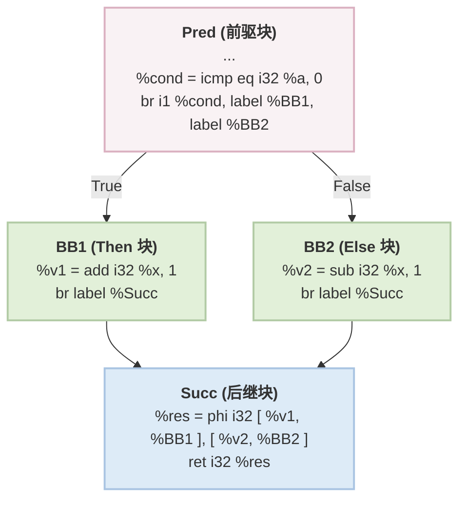

优化后

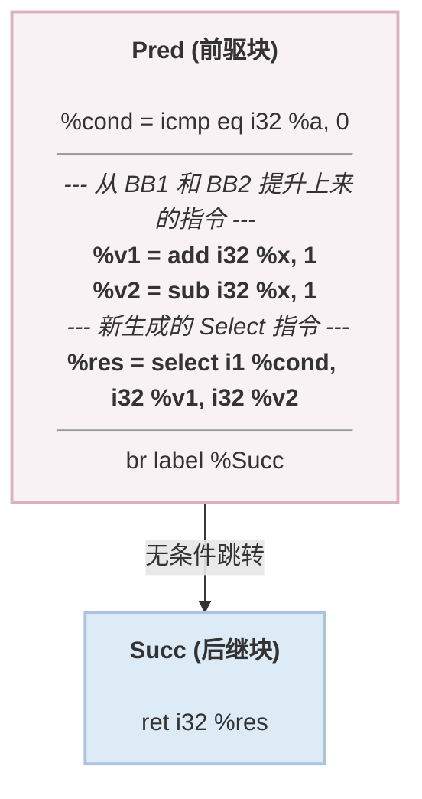

- 算法流程：

  1. 获取当前基本块True块

     只能有1个前驱和1个后继，前驱末尾是条件跳转（并且条件不是常量），获取该条件跳转指令

     获取两个跳转路径目标：Dest0,Dest1

     1. 如果Dest0和Dest1,其中有一个是当前块，一个是后继，那么标记没有else块
     2. 如果Dest0和Dest1，其中有一个是当前块，一个不是后继（记做else），并且这个else块只有一个前驱和后继，标记有else块

     如果该基本块和else块之中有Store，Load，Call，SDIV , UDIV , SREM, FDIV, FREM,不能IfConversion

     待转换的基本块和else块中指令总数<=4（如果只有True块，那么它之中的指令数<=4）

  2. 将该基本块和else块之中的指令除了终止指令全部移动到前驱块终止指令之前

  3. 遍历后继块中所有Phi，创建Select指令，根据条件真假选择Phi之前对应的两个值，将生成的Select插入到前驱块的末尾，RAUW替换所有使用PHI的地方变成使用Select，删除后继块中的PHI指令

  4. 修改前驱块的条件分支，变成无条件分支，指向后继块，删除当前块，如果有else块一并删除


##### GVNPRE

依赖AnalysisPass：Dominant，AliasAnalysis，SideEffect

运行之前先运行BCE和CFGSimplify，InstSimplify，DCE，SCCP

- 算法流程：

  1. GVN：

     外层：不动点循环

     清理哈希表

     > 核心数据结构：
     >
     > **`ValueNum` (值编号缓存表)**
     >
     > **`ExpressionTable` (表达式查重表)**
     >
     > **`LeaderTable` (领导者备忘录)**

     RPO逆后序遍历目标函数中每个基本块（如果发现在死块里面就直接跳过），遍历基本块中每一条指令（跳过PHI指令）

     1. 如果是LOAD指令：

        找到该LOAD在基本块中的位置，从该位置向前扫描每一条指令，直到入口块第一条指令，调用别名分析，找到和它使用同一个地址的最近的一条指令

        如果该指令是LOAD/STORE（MustAlias），那么RAUW将使用LOAD的全部换成上一次使用的值，然后删除LOAD

        如果STORE（MayAlias），放弃优化

        如果STORE（NoAlias）/LOAD（MayAlias/NoAlias），继续寻找

        如果CALL，调用getInstModRefInfo，如果结果包含Mod，那么放弃优化，如果Ref/NoModRef，继续寻找

        如果经过上面优化是True，那么就返回True处理下一条指令，如果经过上面优化是False（放弃优化），那么执行下面的逻辑

        记录：在ValueNum哈希表中进行寻找，如果编号过直接返回，如果没有，直接分配NextValueNum++一个新的编号，然后将{Num，LOADINST，该指令所在基本块}记录在InstTable之中

        返回false（只是记录，原本程序逻辑和代码结构没变）

     2. 如果是CALL指令：调用副作用分析发现只是Ref

        找到该CALL在基本块中的位置，从该位置向前扫描每一条指令，直到入口块第一条指令

        如果遇到STORE，调用Alias，如果不是NoAlias，放弃优化

        如果遇到CALL，调用getInstModRefInfo，如果遇到是一模一样的CALL，那么RAUW直接替换，删除该CALL，如果是其他CALL，如果计算出来是ModSet那么放弃优化

        如果优化失败了，执行下面的逻辑

        记录：和上面LOAD的一样

     3. 如果是Br条件跳转指令：

        如果发现Cond是常量，那么找到永远不会执行的那个分支，将这个分支里面的块收集到死块集合之中

     4. 如果指令没有返回值直接跳过

     5. 值编号：

        获取下一个编号NextNum

        获取Num编号

        Num编号逻辑：

        1. 如果ValueNum哈希表能查到，直接返回查到的

        2. 如果传入的不是一条具体的指令，那么就分配新号码ValueNum++

        3. 如果是普通运算指令

           记录这条指令的返回值类型和Opcode，然后获取当前指令的所有操作数的ValueNum，存入该指令的VarArgs

           如果是ADD/MUL/AND/OR/XOR这种满足交换律的，按照从小到大的ValueNum排序VarArgs

           如果是比较指令，同样满足上面的小ValueNum的原则，但是比较符号也要一同取反，然后将Opcode和具体比较符号通过`(C->getOpcode() << 8) | Predicate`位运算结合在一起作为唯一的Opcode

        4. 如果是LOAD/STORE：直接分配新号码

        5. 如果是GEP：

           依次对基地址和索引求哈希

        6. 如果是CALL：

           调用副作用分析

           如果NoModRef，处理方法同普通运算指令（提取表达式），算哈希，存入哈希表

           其他情况直接分配新号码

        7. 如果是PHI/ALLOCA/RET/BR这种指令，直接分配新号码

        如果Alloca/Ret/Br/PHI，将{Num，INST，该指令所在基本块}记录在InstTable之中，直接返回

        如果Num>=NextNum，那么将{Num，INST，该指令所在基本块}记录在InstTable之中，直接返回

        根据当前指令所在基本块和Num去找Leader，根据Num去找LeaderTable中到Leaders，遍历所有Leaders，查看Leader所在基本块是不是支配当前指令所在块，如果找到这么一条指令就存起来，如果这条指令是常量直接返回不用找了，循环结束之后返回指令

        如果没找到就将自己{Num，INST，该指令所在基本块}记录在LeaderTable之中

        如果查到自己直接false

        RAUW将使用当前指令的地方全部换成Leader，然后删除当前指令，返回即可

        > 这里的LeaderTable就是上面的InstTable

  2. PRE：

     处理死块：

     遍历死块中所有指令，调用分配ValueNum的函数分配Num，然后插入到LeaderTable之中

     外层：不动点循环

     DFS遍历当前函数所有基本块（函数入口块跳过），遍历当前基本块之中的每一条指令

     1. 如果是ALLOCA/RET/BR/PHI/无返回值的指令/比较指令/LOAD/STORE/CALL（经过SideEffect后不是NoModRef的纯函数的拒绝）

        > GEP提升，纯函数提升

     2. 前驱块分析：

        获取当前指令的ValueNum

        遍历当前指令所在块的前驱：

        如果前驱不可达放弃，如果前驱是循环回边放弃

        PHITranslate:

        查PHITranslateTable如果缓存之中有直接返回翻译出来的结果，如果没有执行下面的逻辑，执行完之后存入缓存，返回翻译后的新ValueNum

        1. 如果当前要翻译的编号本身是PHI节点：

           看这个PHI是不是在当前块之中如果不是，说明不受跨块影响，不用翻译

           遍历PHI输入值，找到属于目标前驱的那个输入值返回输入值编号

        2. 如果Num不是PHI，说明是普通算数指令：

           从表达式哈希之中拿到表达式

           遍历表达式中每一个操作数，调用PHITranslate

           如果是ADD/MUL/OR/XOR/AND这些满足交换律的，重新排序表达式的ValueNum值，从小到大

           如果全局表达式表中能查到NewNum，那么就返回

        3. 如果查不到就返回旧Num

        拿着翻译后的Num去找Leader

        如果没找到，那么记录这个前驱PREPred，NumWithout++，如果找到了自己说明是循环回边，NumWithout = 2，直接放弃，如果找到了真的，加入到PredMap之中，NumWith++

        只有NumWithout == 1 且 NumWith > 0的时候才能进行后面的逻辑

        如果要提升的是DIV/REM直接返回

        clone当前指令，插入到PREPred前驱块末尾（在终止指令之前），在当前块PHI指令最后插入PHI，遍历PredMap，如果以前就有那么就直接加入输入值，如果是刚才缺失的路径那么就把刚插入的那条指令加入输入值

        给新的PHI发和原指令一样的Num，然后RAUW进行替换，删除原指令，更新LeaderTable

  3. 清空哈希表等数据结构


##### Reassociate表达式重结合

利用代数中结合律和交换律重新排列表达式中的计算顺序，从而暴露更多的优化机会

排序的依据：排序的依据就是 Rank（秩），规则很简单：Rank 越小，在表达式树中越靠右（越容易被沉到底部折叠）；Rank 越大，越靠左

为SCCP，GVN，LICM铺路

运行之后运行DCE

- 算法流程：

  1. 创建RankMap

     初始化rank=2

     遍历函数的所有参数，为这些参数建立从3递增的rank（每个参数的rank都各不相同）

     逆后序遍历函数中的基本块，每个基本块的rank间隔为`++Rank << 16`，遍历块内指令，为每个符合条件（不标ADD, SUB,MUL,AND, OR, XOR其余都标）的指令在本基本块的rank基础上分配rank并递增rank

  2. 不动点循环：

     逆后序遍历函数中基本块，遍历基本块之中的所有指令

     如果是死指令，断开对子节点的Use，直接跳过（留给后续DCE），如果不是调用下面的逻辑optimizeInst（该函数运行期间会收集TodoList）

     While循环遍历TodoList：如果是死代码，断开它对子节点的Use，然后跳过（留给后续DCE），如果不是死代码，继续运行optimizeInst

  3. 保留CFG相关的分析结果

  4. optimizeInst：

     1. 规范化：

        如果不是ADD，MUL，AND，OR，XOR，SUB直接返回执行下一条指令

        如果本条指令是SUB A-B指令，直接优化成A + B×（-1），将新生成的指令加入TodoList，然后直接返回执行下一条指令

     2. 内部节点过滤：

        如果这条指令只有一个User，并且User的Opcode和这条指令的Opcode一样，并且User不是自己，并且User和这条指令在同一个基本块之内：

        将User的指令加入到TodoList之中，这条指令直接退出，不进行下面的优化步骤

     3. ReassociateExp：(走到这里传入的Inst一定是Root)

        1. Linearize：

           WorkList While循环：

           1. 遍历当前指令的操作数

              如果Opcode和Root Opcode一样，并且只有一个User，那么加入WorkList

              否则，压入最终的Ops数组之中

        2. 排序：Rank大的排在Ops前面，Rank小的排在Ops后面

        3. OptExp：

           1. 常量折叠：从Ops数组末尾开始循环，将常亮根据每步的Opcode直接做折叠，拿到最后的常量

           2. 如果Ops全空了，那么直接返回最后的常量

           3. 简化：

              如果总常量是0并且当前是加法/总常量是1并且当前是乘法，直接扔掉总常量

              如果当前是乘法并且总常量是0,直接返回0

           4. 如果Ops之中只有一个变量了，那么直接返回这个变量

           5. 高级优化：

              1. ADD：

                 遍历排好序的Ops数组

                 优化1：合并同类项，比如有C（C为常量）个Y，找到这C个Y，然后创建乘法C×Y，将原来的删掉，将新乘法加入到Ops数组之中

                 优化2：抵消相反数，一旦找到MUL（X，-1），就会找X是否同时存在，如果同时存在那么直接二者删掉

                 优化3：提取公因式，匹配模式：A* B + A* C -> A*(B+C)，具体来说遍历所有是乘法的操作数，统计他们的出现次数，找到出现次数最多的因子，如果出现次数>1，那么就去乘法项之中把这个因子提取出来，将剩下部分加起来

              2. MUL：分治思想

                 传入的Ops大小必须>=4

                 提取Ops之中重复的变量，从Ops之中删去，按照(X,指数)存储起来，如果找不到就放弃优化

                 合并相同指数的底数：$A^N$×$B^N$=$(A×B)^N$,具体来说就是先生成一条底数乘法指令然后删除已经被合并的因子

                 指数奇数：如果指数是奇数，把底数拿出来一份，放入外层乘积列表之中，所有因子的指数都必须统一右移 1 位（减半向下取整，`Power >>= 1`）

                 递归：处理偶数次幂，如果减半后最大的指数仍然大于 0，说明还需要继续算。直接递归调用自己，递归返回的结果（我们称之为 `SquareRoot`），需要被平方。所以它把 `SquareRoot` 往外层乘积列表里塞了两次

                 把当前层级 `OuterProduct` 里面收集到的所有东西（包括奇数剥离出来的底数，以及递归返回的平方项）统统乘起来

           6. 如果在刚才的高级优化之中数组长度发生改变，递归调用OptExp自己，直到数组长度不变

           如果OptExp算出一个结果Value，直接RAUW将使用当前指令的地方全部换成Value，将Root放入TodoList，完成优化

        4. 如果Ops大小为1了，直接RAUW将使用当前指令的地方全部换成Value，将Root放入TodoList，完成优化

        5. 重建表达式树：

           1. 取出最底层的两个叶子：从 `Ops` 数组的末尾（`back`）弹出两个元素，分别作为 `RHS` 和 `LHS`。此时这两个元素是整棵树中 Rank 最小的（通常是常量或最外层的变量）
           2. 生成底层指令：根据原 Root 指令的 Opcode（例如 `ADD` 或 `MUL`），生成一条新的二元指令 `ResultInst = Opcode(LHS, RHS)`
           3. 插入新指令：将 `ResultInst` 插入到原 Root 指令的物理位置之前（`insertBefore`），以保证新生成的指令绝对满足支配关系（Dominance）
           4. 新指令入队：将 `ResultInst` 加入 `TodoList`（因为它是一条全新生成的指令，下一轮也许还能触发别处的优化）
           5. While 循环挂载剩余节点：
              - 只要 `Ops` 数组还不为空，就继续从末尾弹出一个元素，记为 `NextVal`
              - 生成新的指令：`NewInst = Opcode(NextVal, ResultInst)`（即：把刚才生成的结果当做一边，新取出的变量当做另一边）
              - 将 `NewInst` 同样插入到原 Root 指令之前
              - 将 `NewInst` 压入 `TodoList`
              - 更新游标：`ResultInst = NewInst`
           6. 收尾与替换 (RAUW)：
              - 循环结束后，最后的 `ResultInst` 就是这棵新树的最顶层新根节点
              - 调用 `replaceAllUsesWith(RAUW)`，将所有引用了旧 Root 指令的地方，全部替换为 `ResultInst`
              - 将旧的 Root 指令压入 `TodoList`


##### LoopRotate循环旋转

依赖Dominant和LoopInfo两个AnalysisPass

目的：把一个传统的while结构转换成do-while结构

循环内部少了一次无条件跳转，对CPU流水线指令和分支预测提升巨大

- 算法流程：

  顶层遍历：遍历Top-Level Loops，然后利用逆后序遍历去遍历每个loop

  1. 循环可以Rotate条件1：

     1. 满足LoopSimplify形式：

        PreHeader：从Header的前驱中只能有一个来自循环外部的块（即PreHeader），并且这个PreHeader只能有一个后继就是Header（即无条件跳转）

        Latch：Latch必须唯一

        DedicatedExits：必须有，遍历所有从循环内部跳到循环外部的这些块，这些块的前驱只能来自循环内部

  2. 循环可以Rotate条件2：

     1. 循环只有1个/2个基本块，不进行Rotate
     2. **循环只能有一个Exit Block**
     3. Header必须以条件跳转结尾，并且Header是ExitingBlcok（一个分支跳到Exit Block）

  3. 将Header的两个后继，Body作为NewHeader，Exit Block依旧作为Exit Block

  4. 循环可以Rotate条件3：

     1. **Exit Block的前驱只能是Header，并且唯一**
     2. **Latch不能是ExitingBlock**，Latch后继必须是Header，并且只有一个后继
     3. Body（NewHeader）的前驱只能是Header，并且唯一

  5. Body（NewHeader）PHI折叠

     无User：直接删除

     **有LCSSA标记的不能删--这里需要更新LCSSA算法，看看怎样打上.lcssa标记**

     PHI的输入值全部一样（但不是自我引用）：删除

     RAUW删除

  6. 核心Rotate1:将Header中的指令**clone到**PreHeader，并更新Body的PHI节点

     1. 删除PreHeader中的无条件跳转指令

     2. 准备Map：

        Header->PreHeader->Body

        [Header中旧 Phi 节点] -> [来自 PreHeader 的初始值]->[Body新建立的PHI]

        [Header中普通指令] -> [存入PreHeader的指令]->[Body新建立的PHI]

        Body新建立的PHI：输入值来自Header和PreHeader

     3. 处理Header中的PHI节点

        处理Body:在Body中建立一个新PHI节点，在原PHI节点中提取来自PreHeader的初始值作为新PHI的输入边（来源为PreHeader），提取原PHI节点中来自Latch的迭代值作为新PHI的输入边（来源为Header），更新Map

     4. 处理Header的普通指令

        处理PreHeader：遍历Header的普通指令，然后进行clone，然后根据上面的Map去更新这条克隆指令的usee，Use关系（即操作数），然后插入到PreHeader

        处理Body：如果Body中用到了这个值，那么我们在Body中建立一个新PHI节点（后续步骤同3），更新Map，如果没用到就不用建立PHI了

  7. 核心Rotate2：更新所有普通指令的Use关系

     获取Map中所有来自Header的指令的Use，更新这些Use

     1. 如果UserBlock在Header

        普通指令不用管，PHI指令将Header的输入边替换为来自Body的输入边

     2. 如果UserBlock在Body

        如果这个User不是刚才Body建立的PHI，就将所有对Header的引用换成新建的这个PHI

     3. 如果UserBlock在循环外部

        更新ExitBlock：更新Exit中LCSSA PHI，添加来自PreHeader的输入边，如果不存在这么一个LCSSA，就重新建立一个PHI（输入来自PreHeader，和Header），重新建立需要去找这个Use替换成这个新PHI

     4. 更新ExitBlock中不来自Header定义的但是传递到这里的LCSSA PHI，给他们添加一个来自PreHeader的输入

  8. 核心Rotate3：CFG重连

     去除PreHeader和Header连接，添加PreHeader与Body，PreHeader与Exit Block连接

     更新Header的PHI：去除PreHeader的输入边

     因为Header前驱只有Latch了，所以折叠PHI（逻辑同第6步）

     **更新loopinfo的Header信息**

  9. 常量折叠与修复LoopSimplify形式：

     **修复PreHeader：**

     1. 常量折叠：尝试折叠PreHeader中的Br条件分支，如果100%就能进入Body，那么就换成无条件分支，切断与ExitBlock的分支，这时PreHeader还可以做PreHeader
     2. 如果不能进行折叠，直接在PreHeader和Body直接创建一个NewPreHeader，然后在这个NewPreHeader之中加入一个Br无条件跳转，修改PreHeader的Br分支--**这里好好读一读LoopSimplify相关逻辑**

     **修复Dedicated Exits（独占出口块）：**

     ExitBlock从只来自Header，变成来自PreHeader和Header，打破了Dedicated Exits的要求

     所以我们在ExitBlock和PreHeader，Header中加入一个Exit，然后再无条件转接Exit--**这里好好读一读LoopSimplify相关逻辑**

  10. 合并Header到Latch

      删除Latch中无条件跳转，将Header中所有指令搬到Latch末尾，将Header的后继作为Latch的后继（更新CFG），修复和Header相关的PHI

      删除Header

  11. 更新支配树和LoopInfo

- 图解

  ```mermaid
  graph TD
      PreHeader --> Header
      Header --> Body
      Header --> Exit
      Body --> Latch
      Latch --> Header
  ```

  ```mermaid
  graph TD
      PreHeader --> Body
      PreHeader --> Exit
      Body --> Latch
      Latch --> Header
      Header --> Body
      Header --> Exit
  ```

  ```mermaid
  graph TD
      PreHeader --> Body
      PreHeader --> Exit
      Body -->  Latch+Header
      Latch+Header --> Body
      Latch+Header --> Exit
  ```

##### LICM循环不变量代码外提

依赖AnalysisPass:Dominant,LoopInfo,BasicAliasAnalysis,SideEffect

- 算法流程：下沉Sink，外提Hoist

  最外层：依然是遍历顶层循环+后序遍历单棵循环树

  1. 前置检查：

     1. 是否符合LCSSA形式
     2. 是否符合LoopSimplify形式（PreHeader，Latch，Dedicated Exits）

  2. 下沉Sink：

     一条指令在**每次迭代中都在计算**，但是**结果只有在退出循环才被使用**

     Sink：将其沉到循环的ExitBlock，只在退出循环时执行一次

     后序遍历--从循环尾开始向上遍历到循环头，倒序遍历本层循环中基本块中所有指令：

     1. 检查：

        1. 检查是否存在DedicatedExits

        2. 检查指令--判断一条指令是否可以被安全的移出循环：--**需要使用别名分析**

           绝对不能移动：

           RET，BR，PHI，ALLOCA，Binary中的：SDIV，FDIV，SREM，FREM

           可以移动：

           排除上面之后的BinaryInst

           严格检查可以移动：LOAD，STORE，CALL

           CALL：

           调用副作用分析，分析是否含内置函数和Untracked标记，有的话直接false

           检查ModRefInfo，只有NoModRef/Ref可以

           调用ModRefInfo

           检查ModSet是否为空，untracked是否是未标记的

           如果RefSet依旧为空，那么直接true

           如果RefSet不为空，遍历Set中每一条指令，比对函数中中每一条指令，调用别名分析分析二者，只要一条会修改这块内存那么就直接false

           LOAD：遍历循环之中每一条其他指令，调用副作用分析`getInstModRefInfo`检查是否会影响LOAD读取的地址

           STORE：如果是激进外提直接否定，不提STORE

           遍历循环之中每一条其他指令，调用副作用分析`getInstModRefInfo`检查是否会影响STORE读取的地址，并用支配树证明，如果当前的Store是最后一次写入（覆盖掉之前所有的）其实是可以下沉到循环之外的

        3. 检查这条指令的所有User是否全在循环之外

        4. 判断循环不变量：

           循环不变量（一条指令的操作数都是循环不变量，即所有操作数的定义都在循环外/操作数是常量，递推：该变量的所有操作数的**可达定义只有一个（即定义是确定的，没有经过if条件），这个定义来自循环内，并且它本身也是循环不变量**）

     2. 下沉：

        遍历所有出口块，直接将指令I clone 到对应的 Exit Block（受指令I所在块支配） 中（PHI节点之后）

        遍历clone出来的指令I的操作数，如果操作数来自循环内部但没有创建LCSSA PHI的话，那我们就去创建PHI并替换指令I的操作数，如果已经创建，直接替换指令I的操作数即可

        遍历使用指令I的User，将这些User的Usee指令I换成我们新创建的指令，然后删除旧指令

  3. 外提Hoist：

     RPO遍历循环中所有基本块，正向遍历基本块中所有指令

     1. 条件：

        再次检查是否存在PreHeader

        检查激进Hoist：

        如果这条指令所在的基本块，支配该循环中所有的Exit出口块和所有的Latch回边块，标记为激进Hoist（该块后向支配PreHeader的逻辑，只不过用支配树的逻辑实现）

        检查指令：和sink第一条相同

        检查循环不变量：和sink第三条相同

     2. 外提：统一move到PreHeader块末尾


##### LoopDeletion循环删除

依赖AnalysisPass：Dominant，LoopInfo，BasicAliasAnalysis，SideEffect，SCEV

- 算法流程：

  1. 符合LCSSA形式

  2. 检查是否符合LoopSimplify形式，并获得PreHeader

  3. 获取循环的所有ExitBlock，必须是唯一ExitBlock

  4. 如果循环永远不会执行：

     1. 判断循环会不会进入：

        获取PreHeader，如果PreHeader是整个函数的EntryBlock，那么一定可以进入

        遍历PreHeader所有前驱块，找到这些前驱块的终止指令，如果是Br并且条件是常量，那么提取出两个目标基本块，如果条件不是常量那么直接返回可以进入，其他终止指令的情况直接保守可以进入，如果两个目标基本块中那个True的正好是PreHeader，那么可以进入，反之不可以进入

     2. 如果不可以进入

        1. 删掉PreHeader的旧分支指令，构建一条分支指令`br ExitBlock`
        2. 遍历ExitBlock中的PHI节点，强制将第0项的来源改为PreHeader，将后续所有项删除，值不变
        3. 遍历循环里的所有指令，如果循环外还有指令使用这些值，将这些Use全改成UndefValue
        4. 删除循环之中的所有指令（删除之前现在所有UseDef清除）所有基本块
        5. 更新支配树，LoopInfo，SCEV

  5. 如果是多出口的情况，直接返回

  6. 常规循环删除：

     1. 判断：

        取出这个唯一ExitBlock的所有PHI节点，逐个检查这个PHI是否是一个平凡PHI（所有输入值都是一样的），只要有一个输入值不一样的那么就返回，如果这个输入值是一个指令，如果还在循环内，直接返回

        遍历循环体内的所有指令，进行循环级副作用分析，如果有副作用直接返回

        DFS遍历这个循环

        经过上述检验的可以执行下述的删除

     2. 如果符合条件，执行删除，逻辑和4.2相同


##### LoopUnswitch

将循环内部依赖于**循环不变量**的分支移动到循环外

先运行LoopSimplify，LCSSA，LICM再运行LoopUnswitch

依赖AnalysisPass：DominatorTree，LoopInfo，SCEV，MemorySSA

实现了如下两种UnSwitch的形式

- Trivial Unswitch：目标分支的至少一个后继可以退出循环
- Non-trivial Unswitch：两个分支的后继都留在循环内

并且只做了Full Unswitch，即分支条件全是循环不变量

- 算法流程：

  1. 确认是loopsimplify，LCSSA形式

  2. 优先执行Trivial Unswitch，其次执行Non-trivial Unswitch（并且每个函数中二者只能执行其一）

  3. Full Trivial Unswitch：

     检查：从 LoopInfo::Header 开始向下检查每个必经的基本块，检查当前块的 MemoryDef 以及副作用。如果存在除 MemoryPhi 以外的 MemoryDef，或者存在具有副作用的指令，则停止扫描。

     获取当前块ParentBB的分支指令，必须是非常量条件分支

     核心：检查整个条件是不是全都是循环不变量，然后明确true和false哪个分支的successor是退出循环的，哪个是继续循环的（这里不接受两个successor都退出循环或两个successor都继续循环），该分支属于当前循环本身，而不是位于某个内层子循环中。

     检查离开分支的ExitBB中的PHI中的incoming value，这个incoming value必须也是循环不变量（不能在循环内被计算），否则不能被执行

     然后新建一个NewPreHeader插入在OldPreHeader以及Header之间，并且更新Header的PHI之中 incoming block由OldPreHeader->NewPreHeader

     如果ExitBB只有当前分支块 ParentBB这一个前驱，那么出口直接复用，如果ExitBB还有其他前驱，那么进行切分，旧的ExitBB保留全部PHI，并新增跳到NewBB的Br无条件分支指令，NewBB保留原来旧ExitBB所有其他指令

     然后删除OldPreHeader原来的无条件跳转，然后将ParentBB的分支指令从ParentBB移动到OldPreHeader，并根据true还是false更新这条分支指令successor（退出方向   -> ExitBB 或切分得到的 NewBB，继续方向   -> NewPreHeader）

     然后创建ParentBB的新分支指令Br无条件跳转到继续循环的那个块上

     对出口 PHI 进行修复：

     - 如果直接复用原来的 `ExitBB`，则将 PHI 中来自 `ParentBB` 的 incoming block 修改为来自 `OldPreHeader`，incoming value 保持不变。
     - 如果对ExitBB进行了切分，则不能简单地把原 PHI 的 incoming block 修改为OldPreHeader。需要在切分得到的NewBB中创建新的合流 PHI，用来合并：
       - 从 `OldPreHeader` 直接退出时使用的循环不变量值；
       - 从原 `ExitBB` 正常退出时得到的原 PHI 结果。

     最后替换循环内所有使用循环不变量的Use为确定的True/False常量

     变换完成后重新获取当前ParentBB的 terminator：

     - 如果当前terminator已经变成无条件 branch，则根据其唯一successor更新下一个必经基本块，并继续扫描。
     - 如果successor已经离开当前循环，或者该基本块已经被访问过，则停止扫描。

     

  4. Full Non-trivial Unswitch：

     获取当前块ParentBB，以及对应的分支指令。要求整个分支条件都是循环不变量，并且该分支属于当前循环本身，而不是位于某个内层子循环中。

     根据目前的分支指令确定两个分支的successor，根据支配树，确定我们每个分支具体需要clone的支配子树（如果某些基本块被其中一个 successor 支配，并且只能通过该 successor 到达，那么这些基本块只属于对应的专门化路径。在克隆某个循环版本时，由另一个 successor 独占支配的基本块不需要复制；这些块在当前专门化版本中不可达。）

     然后新建一个NewPreHeader插入在OldPreHeader以及Header之间，并且更新Header的PHI之中 incoming block由OldPreHeader->NewPreHeader--**这一部分和刚才Trivial Unswitch一样**

     克隆循环：克隆当前循环所需要的全部基本块，并且为克隆循环新建一个 ClonedPreHeader。在clone过程中建立原值到clone值的映射，clone每条指令的时候必须重新映射其操作数，然后克隆循环 Header 中的 PHI,并根据其映射修改相关的incoming，克隆循环内其他 PHI 时，也必须同时映射 incoming value 和 incoming block，如果根据支配子树裁剪了部分基本块，那么必须删除由未克隆基本块产生的 PHI incoming，并在 PHI 只剩一个 incoming value 时进一步简化 PHI，对于循环出口和 LCSSA PHI，需要为克隆循环建立对应的退出值。原循环退出产生的值和克隆循环退出产生的值，最终需要在循环外合流

     然后删除OldPreHeader原来的无条件跳转，然后将ParentBB的分支指令从ParentBB移动到OldPreHeader，并根据true还是false更新这条分支指令successor

     然后对原循环进行专门化，由于原循环负责 `Cond = false` 的版本，所以原循环中的 `ParentBB` 不再需要保留原条件分支，而是创建新的无条件 branch，删除原循环之中不需要保留的那条分支的CFG边，必须删除 `CloneSucc` 中所有来自 `ParentBB` 的 PHI incoming，

     然后对clone循环进行专门化，根据映射将克隆循环中的原条件 branch 替换为无条件 branch，同时删除克隆循环中指向另一个 successor 的 CFG 边，并删除对应 successor PHI 中来自 `ClonedParentBB` 的 incoming

     然后进行循环不变量的常量替换，并替换该循环内所有对该循环不变量的Use

     对于每个原循环 ExitBB：

     1. 保留原循环版本的退出 incoming。
     2. 增加克隆循环版本对应的退出 incoming。
     3. 如果原 ExitBB 不能直接同时承接两个循环版本，则切分或新建 ExitMergeBB。
     4. 在 ExitMergeBB 中建立合流 PHI。
     5. 所有循环外 Use 改为使用合流 PHI 的结果。

     


#### TransformPass

##### Mem2Reg

将入口块中标量alloca转换为Phi，删除相应的load/store/alloca

依赖AnalysisPass：Dominant

在运行之前先运行CFGSimplify清除不可达块，运行之后也需要

算法：使用LiveInBlock+IDF创建**PrunedPHI**，在Live裁剪之后的IDF处插入PHI

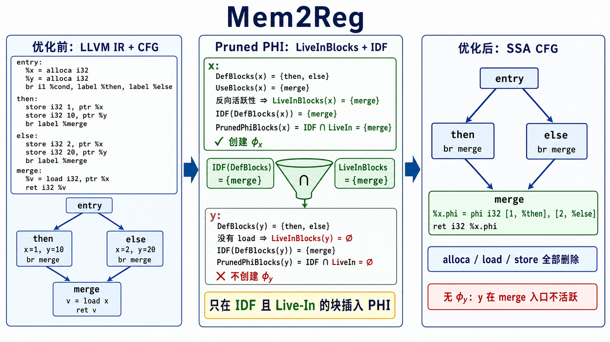

参考资料：
https://ustc-compiler-principles.github.io/2023/lab4/Mem2Reg%E4%BB%8B%E7%BB%8D.pdf

https://www.zhihu.com/question/41999500/answer/93243408

##### CFGSimplify

- 算法流程：**该pass内部使用不动点循环，因为子优化之间会互相创造优化机会**

  1. 消除死块：排除入口块之后，检查前驱块：没有/唯一的前驱是自己，满足条件删除，先维护后继块的PHI，然后再进行删除

     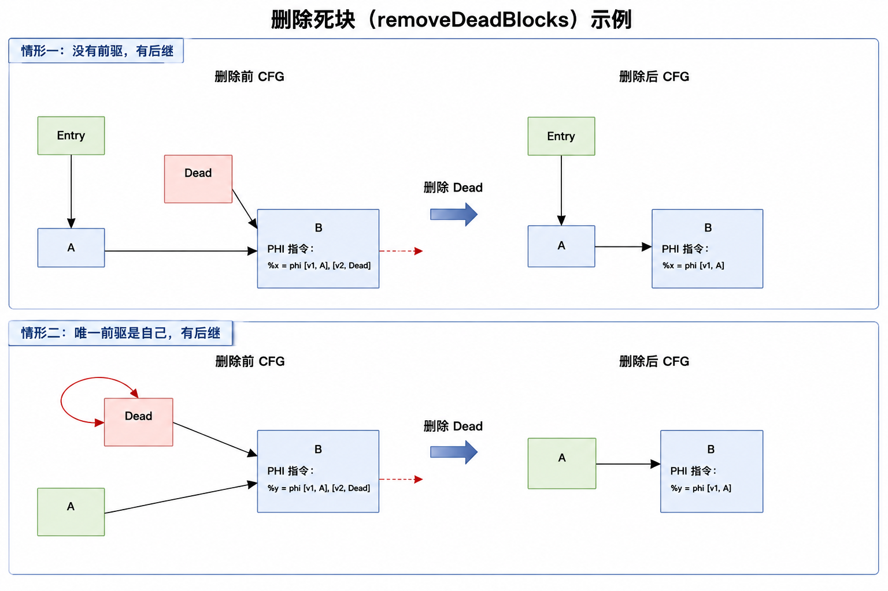

  2. 终结指令常量折叠：

     拿到终结指令，如果是条件跳转：

     1. 如果两个分支目标相同（平行边）：将该条件跳转改成无条件跳转，并在目标块的前驱列表中删除一个前驱边
     2. 如果条件分支的条件是常量，则根据常量值选择一条边，删除另一条边，改为无条件分支 -- **这种优化为上面消除子块创建优化机会**

     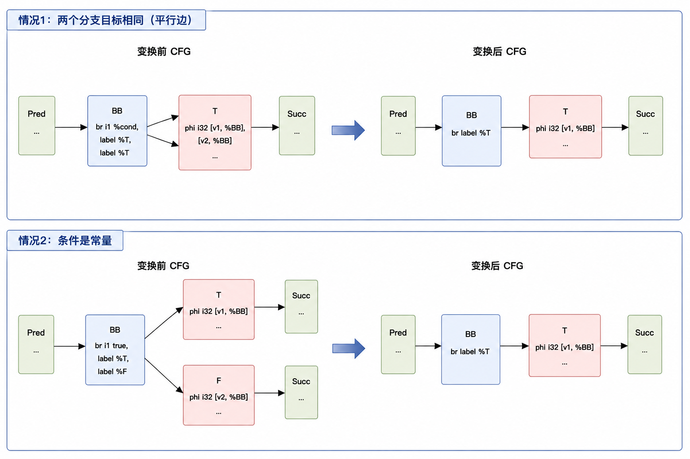

  3. **折叠已知分支条件 -- 编写较麻烦**

     > 和上面第二步区别：第二步要求条件是常量，这一步主要针对条件是变量的情况

     要求当前基本块含多个前驱，并且条件值本身不是常量，不能是自环（条件值不能正确推导），前驱必须也是条件分支，处理时，判断所有前驱是否都能从其Cond条件值推导出该块的Cond条件值（相同或相反），然后根据该块推导出的条件值删除一条分支，并维护后继块PHI

     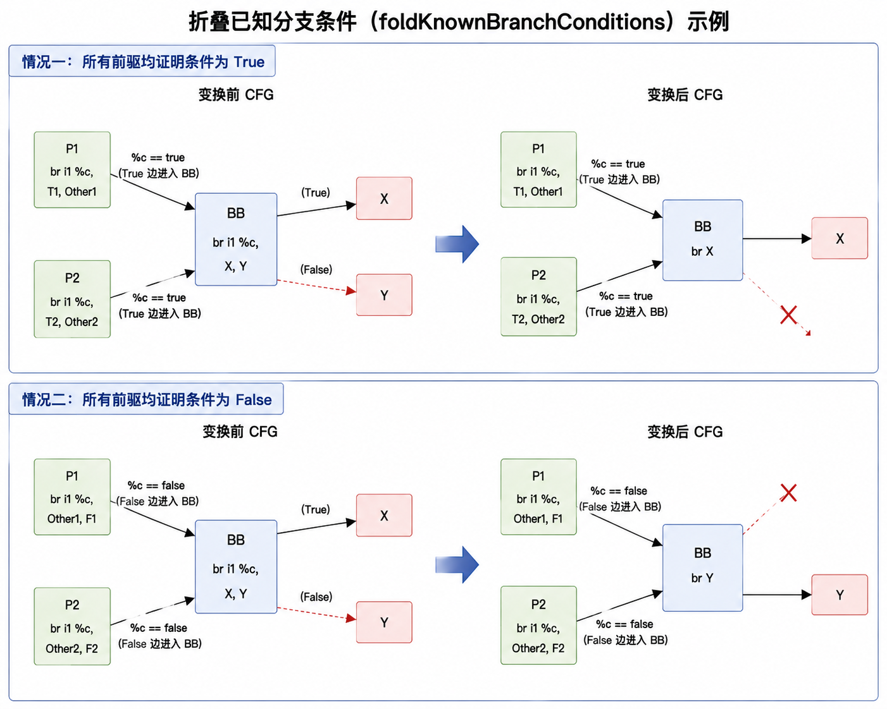

  4. 消除重复的PHI节点：-- **这个其实属于纯PHI化简了**

     满足前驱块数量相同，数据流来源完全一致的两个PHI可以删除其中一个

     基准指针遍历基本块开头的每一个PHI节点，候选指针从基准指针的下一个开始遍历，比较重复，如果重复了就替换候选指针中的所有使用，然后加入到Removed集合之中，然后打断两个指针从头开始再次遍历

     最后将Removed集合中的PHI节点全部删除即可

     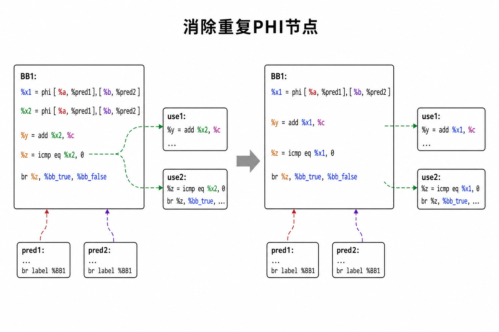

  5. 穿透分支条件PHI：

     当前块必须只含分支指令，XOR指令（可选），PHI指令，并且PHI形式满足分支条件PHI形式

     ```
         %cond = phi i1 [ true, %P0 ], [ false, %P1 ]
         br i1 %cond, label %T, label %F
     
         %cond = phi i1 [ true, %P0 ], [ false, %P1 ]
         %not = xor i1 %cond, true
         br i1 %not, label %T, label %F
     ```

     必须让条件PHI的incoming数量对应前驱块的数量

     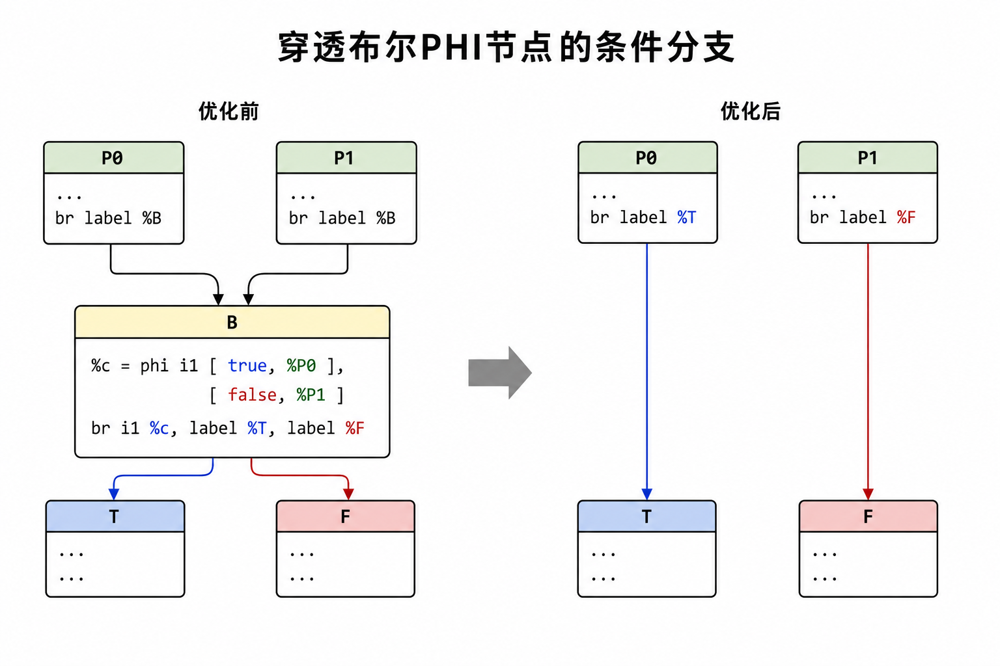

  6. 规范化分支条件PHI

  7. 基本块合并：

     检查：该基本块的前驱只有一个，保证前驱也只有该基本块这一个后继

     合并：

     1. 处理该基本块中的PHI节点（一定来自前驱，并且只有一个incoming），直接删除PHI拿值替换
     2. 修改后继块PHI的incoming block
     3. 将该基本块中的指令，全部搬到前驱的终结指令之前，删去前驱的原终结指令
     4. 删除该基本块

     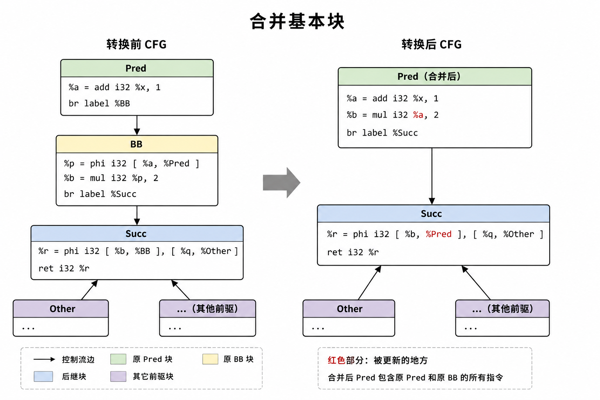

  8. simplifyBranch：处理无条件跳转

     1. simplifyUncond:该基本块末尾是一条无条件跳转指令

        1. 如果该基本块PHI指令之后就是终结指令，并且不是入口块：检查后继不是自身，检查该基本块的前驱和该基本块的后继的前驱没有重合的，检查该基本块中的PHI节点没有被除了该基本块后继的PHI之外任何其他使用

           修改该基本块后继的PHI，将来源改成该基本块的前驱（考虑多个前驱的情况）

           修改基本块前驱末尾的跳转指令

           删除该基本块中的指令，删除该基本块


##### BreakCriticalEdges打破关键边

GVN-PRE前置Pass，放置在LoopSimplify之前

关键边：一条边 `A -> B` 被称为**关键边（Critical Edge）**，当且仅当它**同时满足**以下两个条件：

1. 源基本块 A 有多个后继（SysY编译器只支持条件分支指令，所以只能是2个
2. 目标基本块 B 有多个前驱

打破关键边：在关键边的位置插入新的块

- 算法流程：

  1. 找到关键边：源块A两个后继，目标基本块多个前驱

  2. 创建新基本块，插入到函数之中，并创建新的Br无条件分支指令，指向目标块，修改源基本块A中的分支指令，让其指向新基本块，修复目标块B中的PHI节点，将来源为A的全部换成来源为新基本块

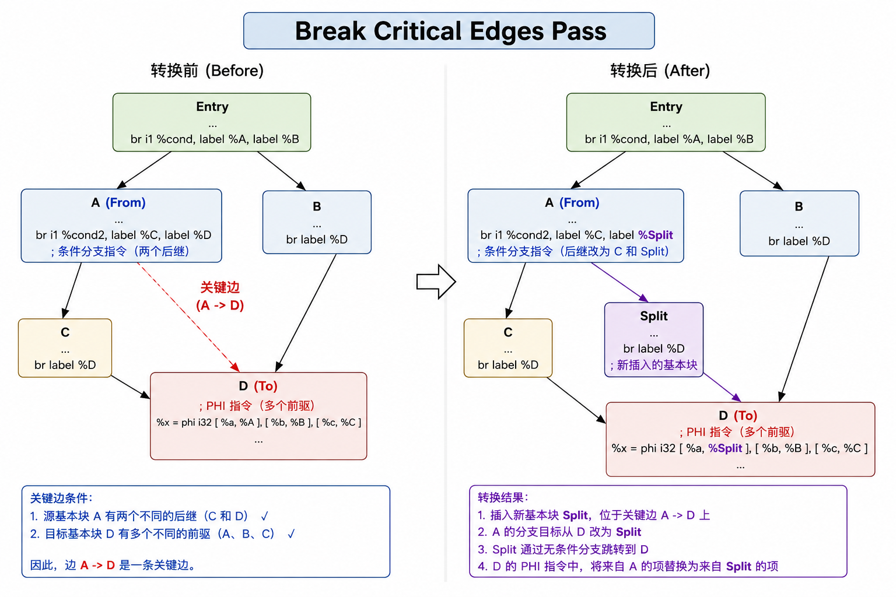

##### UnifyFuncExits统一函数出口

用在中端转入后端前PassPipeline收尾阶段

- 算法流程：将该函数中所有含Ret的基本块中的Ret换成无条件跳转Br，无条件跳转到新插入的UnifiedExit基本块，根据返回值类型创建PHI以及新的Ret指令

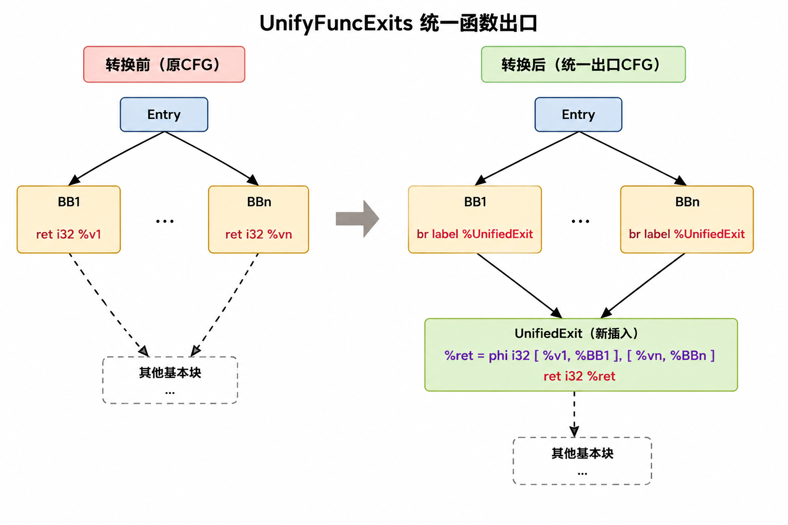

##### LoopSimplify

依赖AnalysisPass：Dominant和LoopInfo

- 目的：确保Loop满足规范形式

  - 唯一的 PreHeader（入口块）
  - 唯一的 Back Edge
  - Dedicated Exits （ 所有的 Exit Block 只能被**循环内部**的基本块指向）

- Loop规范形式

  PreHeader是用来汇聚外部块的进入的

  Latch块是用来汇聚回边的

  Dedicated Exits 是用来汇聚所有从Loop中Exit并和外部跳转进行分割的

- 图解：

  转换前

  ```mermaid
  graph TD
      %% 外部区域
      O1[Outside 1]
      O2[Outside 2]
      O3[Outside 3]
  
      %% 循环内部
      subgraph LoopArea [Loop]
          direction TB
          H[Header]
          B1[Body 1]
          B2[Body 2]
  
          H --> B1
          H --> B2
          B1 -->|回边 1| H
          B2 -->|回边 2| H
      end
  
      %% 出口区域
      E[ExitBlock]
  
      %% 跨区域连线
      O1 --> H
      O2 --> H
      B1 --> E
      O3 --> E
  
      %% 样式调整匹配你的手绘布局
      classDef default fill:#f8f9fa,stroke:#333,stroke-width:2px;
      classDef loopBox fill:#ffffff,stroke:#000,stroke-width:2px;
      class LoopArea loopBox;
  ```

  转换后

  ```mermaid
  graph TD
      %% 外部区域
      O1[Outside 1]
      O2[Outside 2]
      O3[Outside 3]
      PH["新块: PreHeader"]
  
      %% 循环内部
      subgraph LoopArea [Loop]
          direction TB
          H["Header<br>(PHI 被极大简化)"]
          B1[Body 1]
          B2[Body 2]
          L["新块: Latch"]
  
          H --> B1
          H --> B2
          B1 --> L
          B2 --> L
          L -->|③ 唯一回边| H
      end
  
      %% 出口区域
      DE["新块: Dedicated Exit"]
      E[ExitBlock]
  
      %% 跨区域连线
      O1 --> PH
      O2 --> PH
      PH -->|① 唯一入口| H
  
      B1 -->|② 拦截内部跳出| DE
      DE --> E
      O3 -->|外部连线保持原样| E
  
      %% 样式标注
      classDef default fill:#f8f9fa,stroke:#333,stroke-width:2px;
      classDef loopBox fill:#ffffff,stroke:#000,stroke-width:2px;
      classDef newBlock fill:#d1e7dd,stroke:#198754,stroke-width:2px,color:#0f5132;
      class LoopArea loopBox;
      class PH,L,DE newBlock;
  ```

##### LCSSA循环封闭的SSA形式

循环定义的值只能在循环内部使用，外部只能使用其LCSSA形式的PHI函数

执行前：

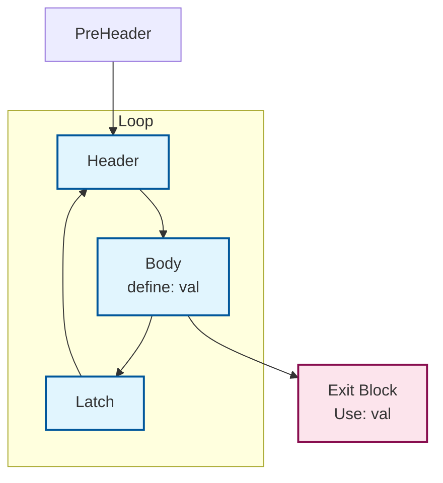

执行后

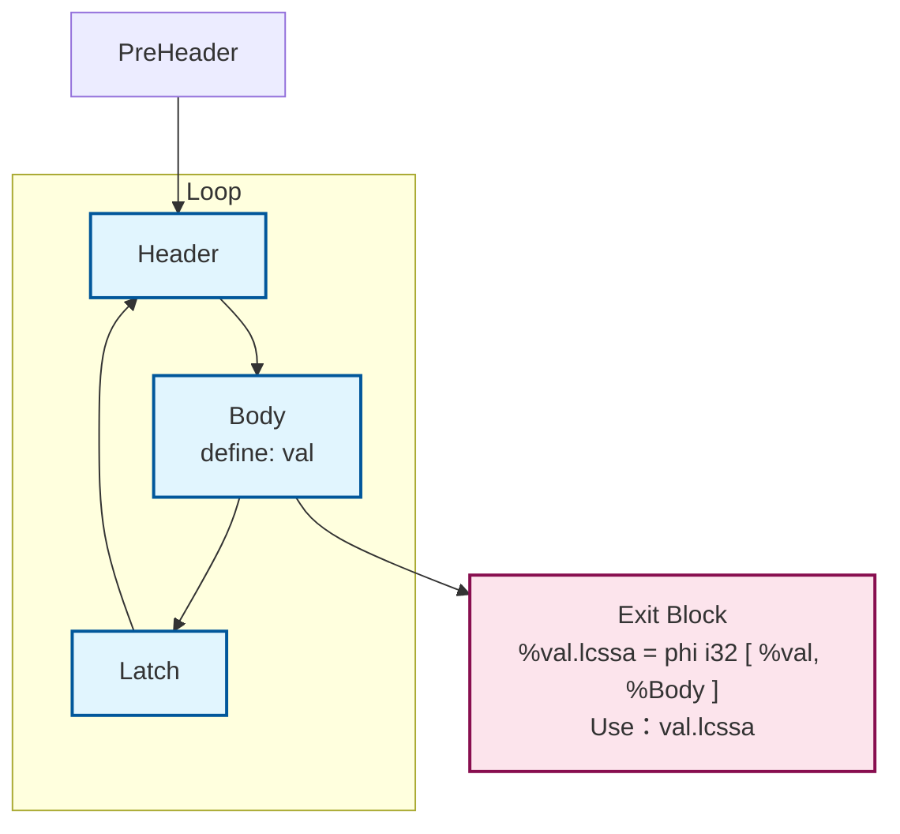

##### Global2Local

将全局变量Local到非递归Main函数的Alloca，从而在Mem2Reg可以将其提升为寄存器变量

阈值选取32字节：<=32字节的全局变量会被处理

- 算法流程：

  1. 


##### Local2Global

将非递归main函数中局部Alloca分配的大数组提升为全局变量，防止栈溢出

阈值选取1024：大于1024字节的数组会被提升

##### GlobalInitializerFold

主要在Local2Global后使用，当Local2Global将大尺寸对象的alloca提升为global之后，GlobalInitializerFold将memcpy消除，从而将初始化时间从运行期改到静态装载期

目标对象：全局变量对应的**初始化memcpy（初始化长度覆盖整个对象）**

完整变换流程：

```
前端：前端会引入memcpy
@template = constant [300 x i32] [...]
define i32 @main() {
entry:
  %a = alloca [300 x i32]       ; 1200 字节
  call @memcpy(%a, @template, 1200, false)
}

Local2Global：
@template = constant [300 x i32] [...]
@.G.a = global [300 x i32] zeroinitializer
define i32 @main() {
entry:
  call @memcpy(@.G.a, @template, 1200, false)
}

GlobalInitializerFold：
@template = constant [300 x i32] [...]
@.G.a = global [300 x i32] [...]

define i32 @main() {
entry:
  ; memcpy 已删除
}
```

##### DeadGlobalCleanup死全局消除

只用在中端快结束的位置，用于轻量级优化，比StoreOnlyGlobalElimination更加轻量，功能更弱

功能：删除只存在store无其他Use的global和store，删除无Use的global，只处理标量，不处理数组

##### GepEvaluate折叠GEP

功能：折叠掉空索引的GEP替换为基址，拆分GEP

```
%ptr = getelementptr [16 x [16 x i32]], ptr @A,
            		 i32 0, i32 %i, i32 %j
->
%row = getelementptr [16 x [16 x i32]], ptr @A,
                     i32 0, i32 %i

%ptr = getelementptr [16 x i32], ptr %row,
                     i32 0, i32 %j
```

##### GepCombine


##### DCE死代码消除

##### ADCE激进死代码消除

依赖AnalysisPass：PostDominant，SideEffect

先假定所有指令是死的，只把返回、存储、副作用调用等标活，再反向标活这些指令依赖的指令和控制条件，最后删除剩余其他的一切

- 算法流程：
  1. 一开始就活跃的根指令：Store，Ret，无条件Br，无法到达真实出口的条件Br，Call（纯函数/只读函数调用不活跃，其他标活）
  
  1. 迭代闭包：
  
     指令的操作数对应的指令也活跃
  
     标活必经块上的分支指令：从目标块到PostIDom沿着后支配树遍历，遇到的每个基本块的条件分支指令标活
  
     PHI指令（特殊）：不仅标活incoming value对应的指令，还标活incoming block的条件分支指令
  
  1. 执行清扫：
  
     收集所有未标活的条件分支指令，删除不是PostIDom的那一侧的分支边
  
     收集所有未标活的非终结指令进行删除

##### DAE死参数消除

注意要在Mem2Reg运行后运行

- 算法流程：

  1. 遍历所有函数

     跳过Runtime库函数，llvm intrinsic，main函数

     **形参常量特化**：遍历该函数每个形参，检查**调用该函数**的所有 `CallInst`。如果某个参数在所有调用点传入的都是**同一个常量/如果不是同一个常量，可以分组创建函数副本进行特化**，则在函数体内将该形参的所有 Use 替换为该常量（`RAUW`）

     ```
     define i32 @foo(i32 %x) {
     entry:
       %v = add i32 %x, 1
       ret i32 %v
     }
     call i32 @foo(i32 10)
     
     ->
     
     define i32 @foo(i32 %x) {
     entry:
       %v = add i32 10, 1
       ret i32 %v
     }
     ```

     **冗余参数合并**：检查调用该函数的所有 `CallInst`。如果某几个参数在所有调用点传入的**实参完全相同**（例如 arg2 永远等于 arg1），则在函数体内将 arg2 的所有 Use 替换为 arg1

     ```
     define i32 @foo(i32 %a, i32 %b) {
     entry:
       %x = add i32 %a, %b
       ret i32 %x
     }
     call i32 @foo(i32 %v1, i32 %v1)
     call i32 @foo(i32 %v2, i32 %v2)
     
     ->
     
     define i32 @foo(i32 %a, i32 %b) {
     entry:
       %x = add i32 %a, %a
       ret i32 %x
     }
     ```

  2. 遍历所有函数：找到死参数

     跳过sysylib，memcpy，main函数

     遍历该函数的参数列表，如果该参数Use=0,标注为Dead，如果Use!=0,遍历每个User，如果是CallInst就递归判断，在中途中还要记录已经判断过的函数，如有一个地方用到那么就是Live，否则Dead，其他情况标注为Live

  3. 遍历所有函数：清除死参数与函数重写

     跳过sysylib，memcpy，main函数

     删除掉函数中所有死参数，并进行更新基本块中的Use，找到调用旧函数的所有CallInst，创建新的CallInst，并根据新的形参列表决定传入的实参，删去旧的CallInst


##### DeadFunctionElimination死函数消除

目前在SysY2022之中，**函数只能通过Call指令进行调用**，没有其他调用方式，所以我们不需要考虑函数地址逃逸或者调用函数指针的情况

- 算法逻辑：main函数一定Live ，从main函数开始，收集函数中可达基本块中的Call指令，将被Call指令调用的函数标记为Live，然后删除剩下的死函数即可 -- **可达调用图遍历**

效果显著，把基本上全部死函数都消除掉了

##### LatePhiCleanup晚期PHI函数清理

一个在中端后期轻量级的PHI函数清理

功能：清除无Use的PHI，把所有incoming value相同的PHI退化成value

退化：PHI的value必须都是同一个相同的value，并且PHI所在基本块只有一个前驱/value的定义支配该PHI

##### FuncInline函数内联

将Callee的函数体拼接到Caller的相应位置

- 收益模型：对于满足以下条件的Callee被调函数进行内联

  有函数体

  递归函数：调用函数频次×单次函数指令数<=100

  非递归函数：调用函数频次<3 || 调用函数频次(>=3)×单次函数指令数<=200

  注意：**下面这种情况进行FuncMemoization函数记忆化**

  没有其他函数调用，没有副作用，并且自递归调用点数大于等于2

  形如`fib(n) = fib(n - 1) + fib(n - 2)`

- 算法流程：

  形参->实参，指令clone，替换Use，上提alloca到外层函数入口，在Call指令后切分基本块并修改克隆的基本块返回值为无条件跳转，把Call指令改为无条件跳转

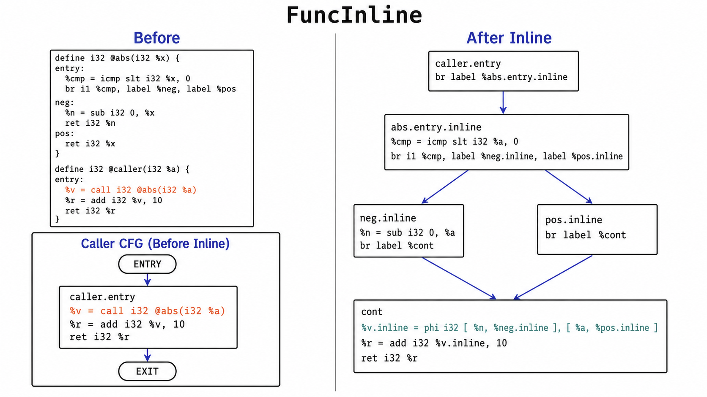


### 参考资料

