# 参赛文档

### 代码声明

**一、第三方 IP 借鉴声明**

1. 本项目的 IR 结构设计整体借鉴自LLVM的设计理念和架构组织，但做了本项目特化
2. 一些AnalysisPass和TransformPass借鉴LLVM的算法思想，但做了本项目特化

**二、人工智能辅助工具使用声明**

在本项目开发中，使用了人工智能辅助编程工具，生成的代码范围及使用方式说明如下：

- 本项目的大部分代码使用**Codex**在编辑器中以“编码—提示-补全”模式辅助编写；
- Codex生成某些pass以及中端架构的初版架构，然后由人工原创设计pass算法及实现，然后人工进行审查
- 人工审阅与修改：所有 AI 生成的代码，均由团队成员逐行审阅，针对项目接口规范、性能要求、安全检查等进行必要的补充、重构与单元测试，确保最终代码质量与一致性。

### 分工合作

- 刘烨嘉一：负责前端以及中端
- 宋科宏：负责RISCV后端和ARM后端

### 总体框架

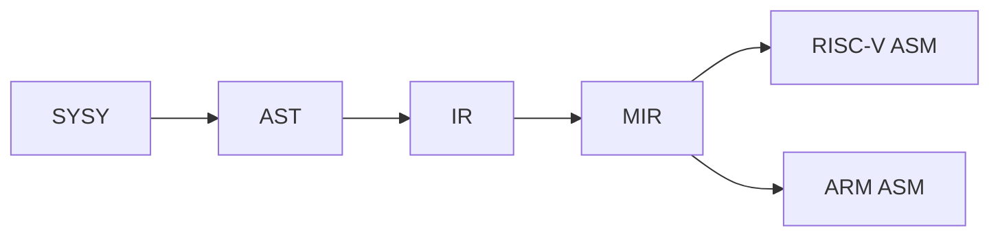

```
Compiler/
├── doc/                              # 竞赛文档
│
├── include/                          # .hpp文件
│   ├── yacc/                         # 词法、语法分析相关文件
│   ├── lib/                          # 编译器前端文件及中端基础结构文件
│   ├── ir/                           # 中端优化框架
│   │   ├── analysis/                 # 中端分析 Pass
│   │   └── opt/                	  # 中端变换与优化 Pass
│   ├── riscv/                        # RISC-V 后端
│   └── aarch64/                      # ARM 后端
│
├── src/                              # .cpp文件
│   ├── yacc/                         # 词法、语法分析相关文件
│   ├── lib/                          # 编译器前端文件及中端基础结构文件
│   ├── ir/                           # 中端优化框架
│   │   ├── analysis/                 # 中端分析 Pass
│   │   └── opt/                      # 中端变换与优化 Pass
│   ├── riscv/                        # RISC-V 后端
│   └── aarch64/                      # ARM 后端
│
├── runtime/                          # SysY 运行时库
├── main.cpp                          # 编译器入口
├── CMakeLists.txt                    # CMake 项目构建配置
└── README.md                         # 项目说明
```

### 前端

#### SysY2022及Runtime分析

> 这一部分是本人在阅读完相关文档的一些总结，目的为了便于后续开发前中端查阅需要

**Sysy2022**：

- .sy文件结构：全局变量声明，全局常量声明，函数定义，唯一的main函数定义

- 注释：单行和多行（遇到第一个*/就结束）

- 数值类型：int/float类型和元素为int/float类型且按**行优先存储**的多维数组类型

  隐式类型转换：编译器在需要是可自动转换float/int，不支持程序员 `(int)`、`(float)` 主动指定转换

  > 混合运算时，int先转float，再进行计算
  >
  > float隐式转换成int时，小数部分直接丢弃，float超出int范围，进行转换为未定义行为
  >
  > int隐式转换成float时，转换后值保持不变

- 函数：

  参数为 int/float 时，按值传递

  参数为数组类型时，实际传递的是数组的起始地址，并且**形参第一维的长度必须空缺**。

  ```c
  //示例1：
  //在如下例子传入的就是a[0]，并且实际修改的就是main中的data[0]
  void process(int a[]) {
      a[0] = 100;
  }
  int main() {
      int data[3] = {1, 2, 3};
      process(data);
  }
  //示例2：
  void process(int a[][3]) {
  }
  
  //示例3：支持多维数组降维传递
  //下图传递了data[1]这个[3][4]的二维数组
  void process_matrix(int a[][4]) {
      a[0][0] = 100;
  }
  
  int main() {
      int data[2][3][4];
      process_matrix(data[1]);
      return 0;
  }
  ```

- 数值常量：**忽略所有后缀**

  - 整数常量：

    - 十进制
    - 八进制：以0开头
    - 十六进制：以0x或0X开头

  - 浮点常量：均存在整数+小数/省略整数/省略小数三种形式，**忽略所有后缀**

    - 十进制：

      普通形式：3.14 / .5 / 1.

      十进制指数：

      **注意指数的底数为10**

      ```
      1e3      = 1 × 10³    = 1000
      2.E2     = 2. × 10²  = 200
      .14e-2   = 0.14 × 10⁻² = 0.0014
      ```

    - 十六进制：

      0x 十六进制数字 '.' 十六进制数字 p 十进制指数：

      **注意指数的底数为2**

      ```
      0x1.2p3 = 1.125 × 8 = 9
      	0x1.2 = 1 + 2 × 16⁻¹
          = 1 + 2/16
          = 1.125
      	2³ = 8
      ```

- 一些规则：

  - 常量必须初始化且不能再次赋值
  - 数组每一维定义必须显式给出
  - 未初始化局部变量值不确定
  - 未初始化全局变量/数组初始值为0
  - 初始化全局变量/数组初始值为常量表达式
  - 数组只能逐维赋值，不能整个赋值

- sysy其他未提到的参考C语言即可

**Runtime**：

> 由于putf在测试用例中并未出现，所以本人没有重点关注这一runtime函数在前中端的处理

读取函数：

- int getint()：从**标准输入**读取一个整数，并返回对应的 `int` 值

- float getfloat()：从**标准输入**读取一个浮点数，返回 32 位单精度浮点值

- int getch()：从**标准输入**中读取一个字符（将整数视为字符），并返回该字符的 ASCII 码值

  ```c
  12 34
  |
  |
  '1' → 49
  '2' → 50
  ' ' → 32
  '3' → 51
  '4' → 52
  '\n' → 10    
  ```

- int getarray(int[])：输入一串整数，第 1 个整数代表后续要输入的整数个数，该个数通过返回值返回；后续的整数通过传入的数组参数返回

  ```c
  4 10 20 30 40
  
  int main() {
      int a[10];
      int n = getarray(a);
  }
  
  /*
  n = 4
  a[0] = 10
  a[1] = 20
  a[2] = 30
  a[3] = 40
  */
  ```

- int getfarray(float[])：同上

输出函数：

- void putint(int)：向**标准输出**打印一个整数

- void putfloat(float)：向**标准输出**打印一个单精度浮点数

- void putch(int)：将整数参数解释成 ASCII 码，并输出对应字符

  ```c
  putch(65); -> A
  ```

- void putarray(int, int[])：第 1 个参数表示要输出的整数个数(假设为 N)，后面应该跟上要输出的 N个整数的数组。putarray 在输出时会在整数之间安插空格

  ```c
  示例：int n=2; inta[]={2,3}; putarray(n, a);
  输出：2:2 3
  ```

- void putfarray(int,float[])：同上

计时函数：

> 输出格式：
>
> Timer#编号@开启行号-停止行号: 时-分-秒-微秒
>
> TOTAL: 时-分-秒-微秒
>
> Timer#001@0010-0012: 0H-0M-3S-3860us

- void starttime()
- void stoptime()

#### 词法分析+语法分析

采用业界主流的Flex+Bison工具进行构建，由人工写好.l和.y文件之后通过Flex+Bison自行构建出相关hpp/cpp文件

#### AST

整个AST体系以 `BaseAST` 为根结点，派生出 `Stmt`（语句类型）和 `Expression`（表达式类型）

- 编译单元：`CompUnit`
- 声明与定义：`ConstDecl`,`VarDecl`,`ConstDefList`,`VarDefList`,`ConstDef`,`VarDef`
- 函数相关：`FuncDef`, `FuncParam`, `FuncParamList`
- 初始化相关：`InitValList`, `InitVal`
- 语句相关：`Block`, `BlockItemList`, `AssignStmt`, `ExpStmt`, `IfStmt`, `WhileStmt`, `BreakStmt`, `ContinueStmt`, `ReturnStmt`
-  表达式相关：`LVal`, `FuncCall`, `ArrayList`, `FuncRParamList`, `UnaryExp`, `MulExp`, `AddExp`, `RelExp`, `EqExp`, `LAndExp`, `LOrExp`, `ConValue`

##### 相关结构：

1. 编译单元及声明与定义结构：

   ```mermaid
   graph TD
   
   	N1[CompUnit] --> N3[FuncDef]
   	N1[CompUnit] --> N4[ConstDecl]
   	N1[CompUnit] --> N5[VarDecl]
   	N4[ConstDecl] --> N6[ConstDefList]
   	N5[VarDecl] --> N7[VarDefList]
   	N6[ConstDefList] --> N8[ConstDef]
   	N7[VarDefList] --> N9[VarDef]
   	N3[FuncDef] --> N10[FuncParamList]
   	N3[FuncDef] --> N11[Block]
   	N10[FuncParamList] --> N12[FuncParam]
   	N8[ConstDef] --> N13[ident]
   	N8[ConstDef] --> N14[ArrayList]
   	N8[ConstDef] --> N15[InitVal]
   	N9[VarDef] --> N13[ident]
   	N9[VarDef] --> N14[ArrayList]
   	N9[VarDef] --> N15[InitVal]
   	N3[FuncDef] --> N16[ident]
   	N3[FuncDef] --> N17[Type]
   
   	N12[FuncParam] --> N18[Type]
   	N12[FuncParam] --> N19[ident]
   	N12[FuncParam] --> N20[ArrayList]
   	N4[ConstDecl] --> N21[Type]
   	N5[VarDecl] --> N22[Type]
   ```


2. 语句相关结构：

   ```mermaid
   graph TD
   	N1[Block] --> N2[BlockItemList]
   	N2[BlockItemList] --> N3[Stmt]
   	N3[Stmt] --> N4[AssignStmt]
   	N4[AssignStmt] --> N5[LVal]
   	N4[AssignStmt] --> N6[AddExp]
   	N3[Stmt] --> N7[ExpStmt]
   	N7[ExpStmt] --> N8[AddExp]
   	N3[Stmt] --> N9[IfStmt]
   	N9[IfStmt] --> N10[LOrExp]
   	N9[IfStmt] --> N11[Stmt]
   	N3[Stmt] --> N12[WhileStmt]
   	N12[WhileStmt] --> N13[LOrExp]
   	N12[WhileStmt] --> N14[Stmt]
   	N3[Stmt] --> N15[BreakStmt]
   	N3[Stmt] --> N16[ContinueStmt]
   	N3[Stmt] --> N17[ReturnStmt]
   	N17[ReturnStmt] --> n18[AddExp]
   
   ```


3. 表达式相关结构：

   ```mermaid
   graph TD
       N1[LOrExp] --> N2[LAndExp]
       N2[LAndExp] --> N3[EqExp]
       N3[EqExp] --> N4[RelExp]
       N4[RelExp] --> N5[AddExp]
       N5[AddExp] --> N6[MulExp]
       N6[MulExp] --> N7[UnaryExp]
       N7[UnaryExp] --> N8[HasOperand]
   
       N8[HasOperand] --> N9[LVal]
       N8[HasOperand] --> N10[FuncCall]
       N8[HasOperand] --> N11[ConValue]
   
       N9[LVal] --> N12[ArrayList]
       N10[FuncCall] --> N13[FuncRParamList]
   
       N12[ArrayList] --> N5[AddExp]
       N13[FuncRParamList] --> N5[AddExp]
   ```

#### IR生成

使用Visitor设计模式，将IR生成相关逻辑与AST结构，IR结构解耦，实现了将AST转化为无SSA形式的，兼容LLVM格式的中间代码IR

- 纯栈驱动的上下文管理机制：

  为了保证Visitor接口的简洁性，我们将跨节点需要传递的信息统一用栈管理，基于这一实现，我们可以轻松解决遍历AST之中出现的递归传递参数的相关逻辑

#### 符号表

基于《编译器设计》一书中对符号表的解析上修改，设计而来

- 功能：主要用于IR生成阶段，便于建立中端Value与前端AST Ident映射的桥梁
  - 变量遮蔽：允许在内层作用域声明与外层同名的变量。在进入新作用域的时候能够及时屏蔽外层同名变量
  - 零内存碎片化：进入和退出作用域的时候，无任何new，delete操作
  - 时间复杂度低

- 结构：

  ```mermaid
  graph LR
      subgraph ScopeMarkers ["scope_markers (记录作用域边界的索引集合)"]
          direction TB
          sm0["[0]: 0 (第1层起点)"]
          sm1["[1]: 2 (第2层起点)"]
          sm2["[2]: 5 (第3层起点)"]
      end

      subgraph ActiveVars ["active_vars (按声明顺序记录变量栈的指针集合)"]
          direction TB
          av0["[0]: 指针"]
          av1["[1]: 指针"]
          av2["[2]: 指针"]
          av3["[3]: 指针"]
          av4["[4]: 指针"]
          av5["[5]: 指针"]
      end

      subgraph SymDict ["sym_dict (全局唯一的哈希字典与同名变量栈)"]
          direction TB
          dictA["Key: 'x' | vector: [Value_x1, Value_x2]"]
          dictB["Key: 'y' | vector: [Value_y1, Value_y2]"]
          dictC["Key: 'z' | vector: [Value_z1]"]
      end

      %% scope_markers 到 active_vars 的索引映射关系
      sm0 -. "索引 0" .-> av0
      sm1 -. "索引 2" .-> av2
      sm2 -. "索引 5" .-> av5

      %% active_vars 到 sym_dict 的指针映射关系
      av0 -- "指向 'x' 的栈" --> dictA
      av1 -- "指向 'y' 的栈" --> dictB

      av2 -- "指向 'x' 的栈 (同名遮蔽)" --> dictA
      av3 -- "指向 'z' 的栈" --> dictC
      av4 -- "指向 'x' 的栈 (同名遮蔽)" --> dictA

      av5 -- "指向 'y' 的栈 (同名遮蔽)" --> dictB
  ```

- 时间复杂度：

  - 查询：O(1)
  - 注册变量：O(1)
  - 进入作用域:O(1)
  - 退出作用域:O(K)

### 中端

#### IR

采用与LLVM IR兼容的IR，便于使用LLVM工具链LLI进行测试

##### 支持指令：

为LLVM IR的子集

```
终止与控制流指令：
Ret
Br
Call

内存操作指令：
Alloca
Store
Load
GetElementPtr (GEP)

二元与逻辑运算指令：
算术运算: Add, Fadd, Sub, Fsub, Mul, Fmul, Sdiv, Fdiv, Srem, Frem,Udiv,Urem
逻辑运算: And, Or, Xor
比较运算: Icmp, Fcmp
移位运算: Shl, Lshr, Ashr

类型转换指令：
FPTOSI
SITOFP
Zext
BitCast
Trunc
Sext

静态单赋值 (SSA) 与选择指令：
Phi
Select
```

##### Value/User/Use

仿照LLVM进行设计，但是做了精简与本项目的适配

Use--链表结点

设计特点：禁止被拷贝和移动，禁止被继承

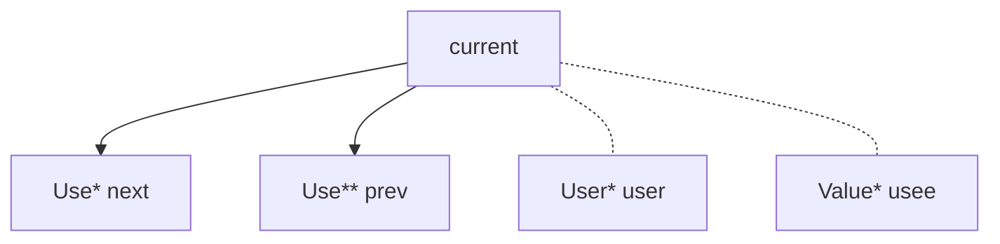


UseList --链表

设计特点：禁止被拷贝和移动，禁止被继承

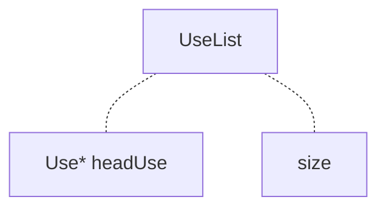

Value

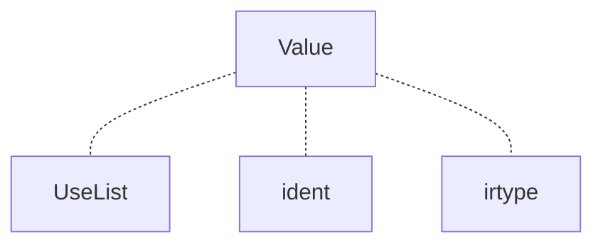

User

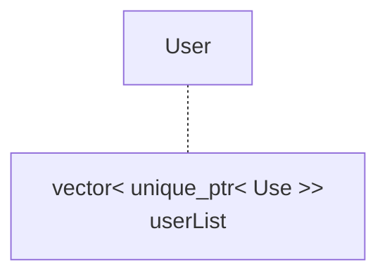

##### TypeSystem类型系统

> 目前初赛阶段，根据SysY2026的信息会引入向量类型，所以IR类型系统提前给出向量类型的架构

- 设计模式：采用单例static设计模式，并且使用shared_ptr包装裸指针进行内存管理


- 目的：用来支持IR的强类型语言的特性

- 支持类型：

  ```c++
  enum TypeSystem{
      IR_INT,IR_FLOAT,IR_VOID,IR_POINTER,IR_ARRAY,IR_VECTOR,IR_UNDEF
  };
  ```

  `IR_UNDEF` 仅用于表示前端源类型转换失败，不对应可实例化的 IR 类型

- 结构：

  ```mermaid
  graph TD
  	N1[IRType] -.- N2[TypeSystem Enum]
  	N1[IRType] -.- N3[size]
  	N1[IRType] --> N4[VOIDType]
  	N1[IRType] --> N6[INTType]
  	N1[IRType] --> N10[FLOATType]
  	N1[IRType] --> N14[POINTERType]
  	N14[POINTERType] --> N15[pointerType]
  	N1[IRType] --> N16[ARRAYType]
  	N16[ARRAYType] --> N17[elementType]
  	N1[IRType] --> N18[VECTORType]
  	N18[VECTORType] --> N19[elementType]
  ```

##### CFG

同样参考LLVM实现，但是对本项目做了精简与适配

采用侵入式链表进行组织

结构

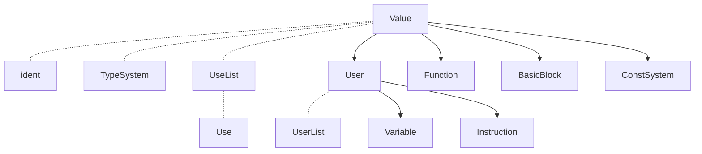

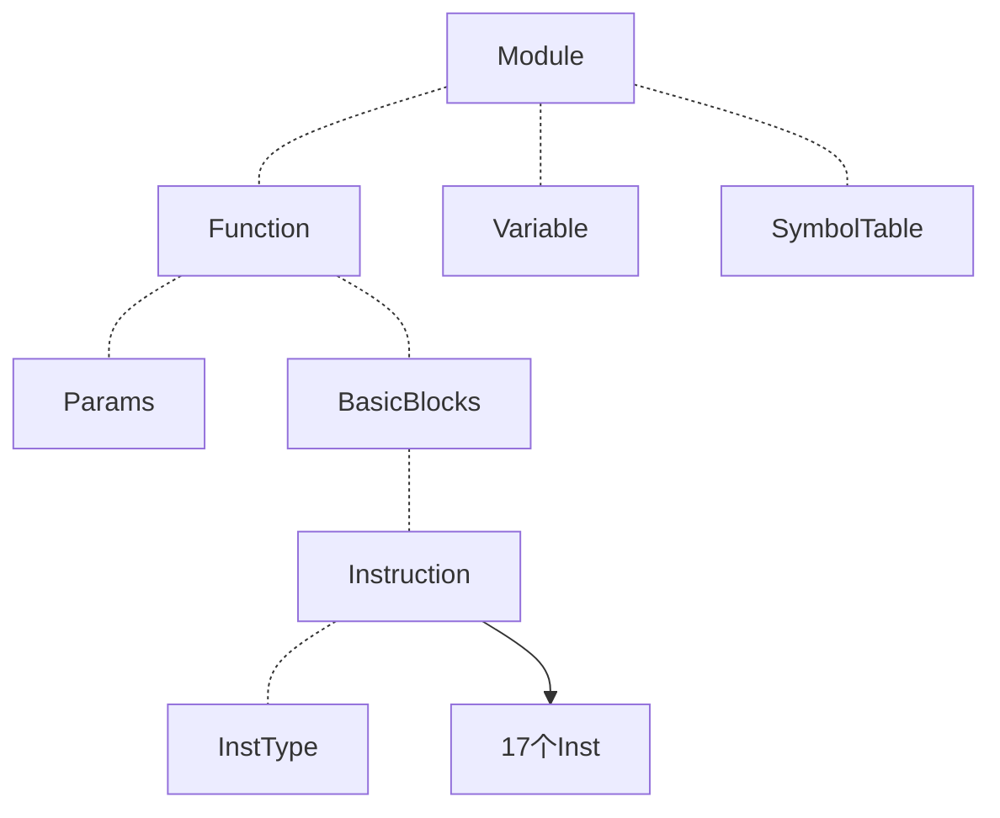

#### PassBuilder

参考LLVM实现，其中做了简化，仅保留AnalysisPass的宏展开注册功能，将Pipeline组织改为硬编码组织

因为Pass比较少，所以这种方式更适合我们的项目形式

- 作用:
  1. 注册AlalysisPass
  2. 组织不同优化层级的优化Pipeline

- Pipeline：

  我们的Pipeline组织如下

  ```

  ```

- 注册AnalysisPass：以Function粒度为例

  ```c++
  void PassBuilder::registerFunctionAnalyses(FunctionAnalysisPassManager &FAM){
      // 1. 定义宏
      #define FUNCTION_ANALYSIS(NAME, CREATE_PASS)\
          FAM.registerPass([&] {return CREATE_PASS;});
      // 2. 引入数据源：将 .def 文件中的内容原封不动地贴在这里
      #include "./FunctionAnalysisPass.def"
      // 3. 销毁宏
      #undef FUNCTION_ANALYSIS
  }
  ```

  .def文件：

  ```c++
  //示例
  FUNCTION_ANALYSIS("DominatorTree", DominantAnalysis())
  FUNCTION_ANALYSIS("BasicAA", BasicAliasAnalysis())
  FUNCTION_ANALYSIS("LoopInfo", LoopAnalysis())
  ```

  在编译期早期阶段就进行了替换：替换后的函数如下：

  ```c++
  void PassBuilder::registerFunctionAnalyses(FunctionAnalysisPassManager &FAM){
      FAM.registerPass([&] {return DominatorTreeAnalysis();});
      FAM.registerPass([&] {return LoopInfoAnalysis();});
      FAM.registerPass([&] {return BasicAliasAnalysis();});
  }
  ```

  好处：

  用来统一管理整个AnalysisPass，增加项目的可扩展性

#### NewPassManager

该PassManager仅管理中端IR层级

参考LLVM实现，同样做了简化与适配

保留并简化CRTP设计模式，基于类型擦除(Type Erasure)的多态设计，AnalysisPass结果缓存

但对于失效机制的实现，摒弃了llvm源代码复杂的迭代器实现和自动失效的机制，采用手动失效的原理实现

参考博客：

[浅析 llvm::Analysis Pass and Manager](https://zhuanlan.zhihu.com/p/696028293)

执行流：

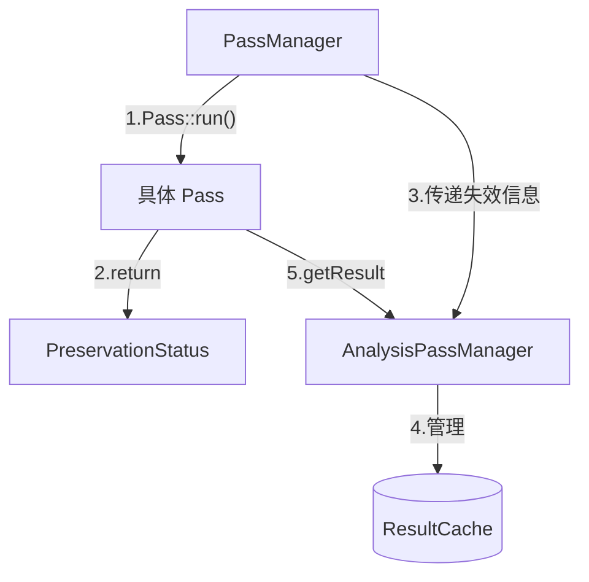

- CRTP解析：

  一个类继承一个以该类自身为模板参数的模板基类（一种将继承和静态多态结合的技术）--用来**高性能实现多态**

  参考博客：[CRTP解析](https://zhuanlan.zhihu.com/p/705630363)

  下图为llvm实现CRTP的相关模板：

  

  优势：

  传统实现多态是需要**继承和虚函数**实现，但是虚函数存在性能开销（会在运行时生成虚函数表），在性能敏感的地方（比如编译器中端优化部分），这么做就会造成性能损失，并且继承和虚函数**在运行期间起作用**，而上面CRTP模式**在编译期间起作用（由于模板的特性，模板类会在编译的时候确定模板参数并进行构建）**

  总结来说就是虚函数在编译的时候创建虚函数表，在运行的时候通过虚函数指针来**动态查找函数地址**->**造成性能损失**，而模板会在编译的时候就确定模板参数，从而在编译的时候就会创建相应的多态函数，在运行的时候**直接进行函数调用**

- TypeErasure类型擦除解析：

  目的：支持将任意类型的Pass类包装成标准Pass对象（而不是必须继承特定的基类），从而方便PassManager进行存储和管理

  具体实现方式：

  其中`Interface`类作为纯虚基类，设计意图为提供给`PassManager`一个统一的类型，方便存储在`vector`之中

  `Wrapper`作为模板类，通过`PassT`接收任意用户提供的具体`Pass`类，通过持有具体Pass的实例，负责该实例的生命周期管理

  `Wrapper`的`run`函数也是简单的调用具体Pass的`run`函数

  ```mermaid
  classDiagram
      %% 转换 Pass 架构
      class PassInterface~IRUnitT, AM_T~ {
          <<interface>>
          +run(IR, AM)* PreservationStatus
      }
      class PassWrapper~IRUnitT, PassT, AM_T~ {
          +PassT Pass
          +run(IR, AM) PreservationStatus
      }
      PassInterface <|-- PassWrapper

      %% 分析 Pass 架构
      class AnalysisPassInterface~IRUnitT~ {
          <<interface>>
          +run(IR, AM)* ResultInterfacePtr
      }
      class AnalysisPassWrapper~IRUnitT, PassT~ {
          +PassT Pass
          +run(IR, AM) ResultInterfacePtr
      }
      AnalysisPassInterface <|-- AnalysisPassWrapper

      %% 分析结果包装
      class AnalysisResultInterface~IRUnitT~ {
          <<interface>>
      }
      class AnalysisResultWrapper~IRUnitT, PassT, ResultT~ {
          +ResultT Result
      }
      AnalysisResultInterface <|-- AnalysisResultWrapper
  ```

  - 优势：

    非侵入性：编写的具体Pass只需要实现一个符合签名的run函数即可

    解耦：PassManager甚至不需要知道有哪些Pass，只需要实现run逻辑即可

    统一存储和管理

- 失效机制：

  在编写具体Pass的时候我们会利用下面所说的“黑白名单”的形式，手动编写是否保留某个AnalysisPass的分析结果

  形如下面这种，即显式分析哪个AnalysisPass的结果仍然有效，哪些已经失效需要重新计算

  ```c++
      PreservationStatus PA;
      PA.discard<DominantAnalysis>();
      PA.discard<LoopAnalysis>();
      return PA;
  ```

- AnalysisPassManager解析：

  - ResultCache缓存机制：采用`PassID（AnalysisPass地址）`和`IR层级（如Function）`作为Key进行存储

  - `getReult`：

    1. 当一个 Pass 请求分析结果时，它首先检查 `ResultCache`
    2. 如果命中，直接返回缓存对象
    3. 如果未命中，则即时运行对应的分析 Pass，并将结果存入缓存供后续使用

  - `invalidate`

    - 作用：`PassManager` 拿到上一步返回的 `PA` 状态后，立即调用此函数触发缓存清理。

    - 细节：
      a. 如果该 Pass 没有破坏任何东西，直接 `return`，终止清理流程，实现提速。
      b. 如果有破坏，则遍历底层的 `ResultCache`，针对每一个属于当前 IR 单元的缓存条目，提取其 `PassID`，并调用此函数询问该分析结果是否幸存

      - 细节：内部检查该 ID 是否在黑名单 `AbandonedIDs` 中，或者是否在白名单 `PreservedIDs` 中

      c.根据内部检查进行释放缓存，或者保留缓存

  - `registerPass`：PassBuilder宏展开函数内层核心实现

    通过`PassID`确定是否已经注册过，如果没有注册才会进行创建实例，换句话说，在main函数一开始就已经注册并创建，但是只有在`run`函数进行调用的时候才会延迟进行计算

- PassManager解析：

  - `run`：

    1. 从 `Passes` 向量中取出一个具体 Pass
    2. 执行 `Pass->run(IR, AM)`，并获取其返回的 `PreservationStatus`
    3. **关键动作**：立即调用 `AM.invalidate(IR, PassPA)` 。这保证了在下一个 Pass 开始之前，缓存中留下的都是完全正确的、未被破坏的分析结果
    4. 最后，将该 Pass 的失效信息合并到总状态中

  - `addPass`：PassBuilder编写pipeline的内层核心逻辑

    接收一个具体的TransformPass，将其类型擦除之后加入到`vector`之中，同理，在运行这个函数的时候具体TransformPass就已经创建实例了，但是只有在`run`的时候才开始进行计算，达到了延迟计算的效果


#### AnalysisPass

##### Dominant Analysis

- 支配树：

  参考文献：

  [支配树构建算法及伪代码](https://zhuanlan.zhihu.com/p/365912693)

  [Semi-NCA论文](https://renatowerneck.wordpress.com/wp-content/uploads/2016/06/gtw06-dominators.pdf)

  应用：

  1. 计算支配边界，构造SSA
  2. 循环不变量提升

  基本概念：

  1. DFS树：

     对CFG控制流图按照**先序遍历（深度优先遍历）**得到的一棵树

     实线：树的边

     虚线：CFG中其他边

     红色数字：DFS序

     红色字母：该节点的**半支配结点(Semi-Dominator)**

     

  2. DFS树中的概念：

     - 树边与非树边

     - 祖先与完全祖先（完全祖先不包括自身）--针对DFS树来说

     - 横跨边：右子树的节点指向左子树的边

       横跨边的**起点永远大于终点编号**，因为DFS树中右子树的编号永远大于左子树的编号

     - 返祖边：子节点到其完全祖先的边

  3. 半支配路径与半支配节点

     - 半支配路径：这条路径中（不包括起点和终点）的**每一个点的编号都大于终点的编号**，则该路径为一条半支配路径

       树边半支配路径：只能包含两个点（起点和终点），因为树边一定编号都小于终点的编号

       非树边半支配路径：路径上**指向终点的边（只要求指向终点的边）**为非树边，还需要保证中间节点的序号也要大于终点

       非树边半支配路径只能是**横跨边或返祖边**

       例子：黄色为树边半支配路径，绿色和紫色为非树边半支配路径

       

     - **半支配节点（sdom）**：在所有以V为终点的半支配路径中，**起点值最小**的那一个

       

  4. 支配节点与支配树

     - 支配结点：在求半支配结点的基础上求**支配节点（idom）**

       1. SLT算法：

          

          情况1：idom(w) = sdom(w)

          

          情况2：idom(w) = idom(u)

          

       2. **Semi-NCA算法：**

          **虽然算法时间复杂度比上面的大，但是实际使用比SLT快很多**

          解读1：从根节点到W的**父结点**这条路径上找到第一个**小于**sdom(W)的结点，这个节点就是W的**idom**

          解读2：

          

          

     - 支配树：由支配节点（**idom**）组成的树

  通过上面的分析，我们可以总结出如下求支配树的步骤

  

- 支配树相关伪代码实现：

  [支配树伪代码](https://blog.csdn.net/dashuniuniu/article/details/103462147)

  1. 计算半支配结点伪代码

     

     要点：逆DFS序进行分析，遍历所有前驱节点，

  2. eval并查集伪代码

     

  3. 计算idom--SemiNCA

     

参考资料：
https://oi-wiki.org/graph/dominator-tree/
https://zhuanlan.zhihu.com/p/655369292
https://zhuanlan.zhihu.com/p/365912693
https://zhuanlan.zhihu.com/p/1955319335347290919

##### LoopInfo

**我们在进行LoopInfoAnlysis的时候，得到的分析结果是Loop森林，即Loop是按照森林的形式存储的**

参考LLVM经典算法--即**Tarjan 自然循环识别算法**实现，但对LLVM算法做了一些修改

与llvm算法的区别主要在第三次遍历，在llvm中使用的是针对Loop局部遍历（后序遍历+反转），我这里使用的是全局RPO遍历

相比llvm算法，这个改进更加清晰，并且实现简单，并且能达到同样的遍历效果

并且我们在第一步就直接计算出RPO顺序供第三步使用，进一步降低了工作量，简化了代码

- 算法流程

  1. 获取支配树分析结果

  2. 循环1：**后序遍历支配树**，找到所有循环头和回边

     回边的判定：某个节点被循环头支配，同时这个结点在BasicBlock中又是循环头的前驱

     循环头的判定：循环头一定有回边指向它

     循环流程：先假设目前节点是循环头，然后检查是否存在回边，然后判定是不是循环头

     **主要目的：确定循环头，建立循环Loop对象**

  3. 循环2：**反向遍历CFG**--即从循环尾向上遍历CFG中的每个结点--**建立循环树的过程**

     在每个循环中，从每个循环的回边起点开始在CFG中反向遍历

     对于遇到的每个BasicBlock：

     ​    如果该块没有被任何Loop认领：

     ​       a) 如果块是新的，将其分配给当前循环L

     ​       b) 如果块是循环头，停止向前遍历（否则会跑到循环外面）（循环头一定是该循环在CFG反向中的最后一站了）

     ​    如果该块已经被其他Loop认领：

     ​	说明遇到了更加内层的循环（为什么内层：因为我们第一步是后序遍历的，永远是处理最内层的循环再向外遍历）

     ​	 那么我们将内层循环所有BasicBlock与外层循环建立联系

     **主要目的：建立子循环与父循环的连接**

  4. 循环3：**RPO遍历**（CFG后序遍历结果反转之后得到的序列）：--**填补循环树的过程**

     **主要目的：建立父循环与子循环的连接**

##### BasicAliasAnalysis

采用**即时计算别名分析**实现

即时计算别名分析可以分析简单的含变量索引的数组指针

- 基址对象：

  在sysy之中，指针仅来源于数组作为参数传递，所以我们的指针的基址只能来自**Alloca/Param/GlobalVariable中的数组类型**

  - Alloca：在函数体中定义的局部数组/局部变量
  - Variable::Param：函数形参，传入的数组指针
  - Variable::GlobalVariable:全局变量/数组
  - Variable::Constant:全局常量

- 即时计算别名分析：

  > 如果想写的好一点可以实现一下aliasSelect，还有`a[2*i]` 和 `a[2*j+1]`这种的alias判定

  传入两个Value指针V1,V2

  1. 如果任一者访问的内存大小为0,直接判定为NoAlias

  2. 剥离BitCast

     整个循环可以采用visit数组进行循环条件判定，如果遇到了之前已经visited的循环那么就直接退出循环即可

     如果Value类型不是指针类型直接返回

     如果这一层是GEP，看一下是否所有索引全为零，如果不是那么就直接返回当前的GEP，如果是的话，那么就拿到GEP的基址指针

     如果这一层是BitCast，那么就拿到它的操作数，继续下一轮剥离

     如果这一层是只有一个输入源的PHI节点，拿到操作数继续向下剥离

     如果是其他指令那么就直接返回即可

  3. 如果V1/V2有是UndefValue的，那么直接判定为NoAlias

  4. 判断相等性并拦截跨迭代相等性的情况

     如果V1,V2不相等，那么直接返回false

     如果不是inst类型，那么直接返回true

     如果inst不在任何循环里，那么返回true

     如果inst在任何循环里面，那么人false

     true的可以直接判定为MustAlias

  5. **核心寻找基地址：O1,O2**

     继续可以用while循环+visited数组的方式来作为外层循环的条件

     如果是GEP指令，直接拿到它的基址指针，将V更新为基址指针

     如果是BitCast指令，直接拿到源操作数，更新V

     如果是Phi节点，如果只有一个输入，那么拿到操作数，更新V

     其余情况就直接返回V即可

  6. 快速判定：

     1. 如果底层对象不同O1!=O2

        如果二者都是Alloca（局部数组），那么NoAlias

        如果二者都是Variable::GlobalVariable，那么NoAlias

        如果一个是Variable::Param（函数参数）一个是Alloca（局部数组），那么NoAlias

        如果一个是Alloca一个是Variable::GlobalVariable，那么NoAlias

     2. 如果底层对象相同

        循环深度限制/加入一个visited数组

        循环查找：构造一个map，key是V1,V21,value是AliasResult，如果尝试将O1,O2（排除顺序），加入到map之中，如果缓存命中那么就可以直接返回

        如果是GEP（说明O1,O2指向同一个底层数组），那么aliasGEP

        如果是PHI，那么aliasPHI

        - aliasGEP

          将GEP拍平成一个一元线性方程：
          $$
          Base+ConstantOffset+∑(Value_i​×Stride_i​)
          $$
          解析GEP的所有索引+内层操作数，知道碰上最底层的基址

          1. 如果已经不是指令/操作符了。直接返回

          2. 如果BitCast，那么获取操作数

          3. 如果GEP，那么遍历获取GEP的所有索引

             如果索引是常数，那么获取当前维度把`常数索引 * 步长`累加到总的`ConstantOffset`之中

             如果索引是变量，直接`VarIndices[%i] += 1 * 当前维度步长`

          将GEP1和GEP2上面计算的一元线性方程做减法

          首先检查基址

          1. 如果减法化简之后所有的变量被抵消了，常量没有抵消，没有抵消如果大于数组元素的字节大小，可以返回NoAlias，如过小于数组元素的字节大小，返回MayAlias，如果常量也完全抵消了，那么MustAlias
          2. 如果变量无法抵消，直接返回MayAlias

        - aliasPHI:判断一个PHI节点和另一个指针O2是否有重叠情况

          > 总体思路就是比较这个PHI节点的所有输入值和另一个指针O2是否存在别名

          如果这个PHI没有任何输入，直接返回NoAlias

          如果O2也是一个PHI，并且两个PHI在同一个基本块之中，只需要做N-N的一对一比对输入值即可

          如果是常规情况，遍历PHI的所有输入，分别与O2比较，对每个输入和O2调用外层的aliasCheck函数，对所有AliasResult结果求交集

          > `NoAlias` + `NoAlias` = `NoAlias
          > MustAlias` + `MustAlias` = `MustAlias`
          >
          > 任何结果 + `MayAlias` = `MayAlias`
          >
          > `NoAlias` + `MustAlias` = `MayAlias`

##### SideEffect--副作用分析

实现**跨函数副作用分析**

> 拓展：实现Select的支持

- Sylib:sysy运行时库函数：

  ```c
  getint
  getch
  getfloat
  getarray
  getfarray
  putint
  putch
  putarray
  putfloat
  putfarray
  putf
  starttime
  stoptime
  before_main
  after_main
  _sysy_starttime
  _sysy_stoptime
  ```

  LLVM内置函数：

  ```
  memcpy
  ```

- 算法流程：

  1. 构建基地址集合

     1. 遍历函数所有形参中的指针，收集它们的基地址--就是他们自己

     2. 遍历函数中所有Alloca，收集他们的基地址--就是他们自己

     3. 不动点迭代，遍历函数中所有指令

        GEP，BitCast：获取他们的源指针，加入到该指令的基地址集合

        Phi：获取所有输入值的源指针，加入到该指令的基地址集合

  2. 遍历函数中每一条指令，收集函数级ModSet和RefSet

     LOAD：先拿到他的基地址，遍历基地址，如果基地址是全局变量或者是形参，那么加入RefSet

     STORE：先拿到他的基地址，遍历基地址，如果基地址是全局变量或者形参，那么标记为ModSet

     CALL：先拿到它调用的目标函数Callee

     - 如果Callee是Function（用户定义的）

       - 遍历Callee的Mod集合

         如果这个函数写了一个全局变量，将这个写到Call指令的Mod集合之中

         如果这个函数写了一个形式参数，拿到Call中的实际的参数，然后遍历这个实际参数的Mod集合，将其加入到Call指令的Mod集合之中

       - 遍历Callee的Ref集合

         如果这个函数读了一个全局变量，将这个写到Call指令的Ref集合之中

         如果这个函数写了一个形式参数，拿到Call中的实际参数，然后遍历这个实际参数的Ref集合，将其加入到Call指令的Ref集合之中

       - 如果Callee之中有内置函数标志和Untracked标志，该Call指令的标记也立起来

     - 如果Callee是BuildinFunction（syslib内置库函数）

       ```
       NoMemWrite：_sysy_starttime , _sysy_stoptime, getint, getch, getfloat, putint, putch, putfloat
       MemWriteOnly (只写内存)：getarray, getfarray
       MemReadOnly (只读内存)：putarray, putfarray, putf
       MemReadWrite (既读又写)：memcpy
       ```

       - 如果Callee是Sysy的标准运行时库，将内置函数标志立起来

       - 如果是Memcpy：获取它的第0个参数目标地址和第1个参数源地址

         查出目标地址的基地址，如果是全局变量/形参那么就写入Mod集合里面

         查出源地址的基地址，如果是全局变量/形参那么就写入Mod集合里面

       - 如果函数被标记为Ref：将其实参传入的全局变量/形参加入到当前函数的Ref之中

       - 如果函数被标记为Mod：将其实参传入的全局变量/形参加入到当前函数的Mod之中

       - 没有进入上面任何一个分支，标注为Untracked

- 接口：

  1. 指令级副作用查询接口`getInstModRefInfo`

     传入一个Value，一个Inst

     如果LOAD指令，调用别名分析分析二者别名，如果无别名就是`NoModRef`,如果有别名就是`Ref`

     如果STORE指令，调用别名分析分析二者别名，如果无别名就是`NoModRef`,如果有别名就是`Mod`

     如果CALL指令，取出Callee和实参

     1. 如果调用的是内置函数

        如果是memcpy，计算第0个实参和Value的别名分析，重叠就是`Mod`，计算第1个实参和Value的别名分析，重叠就是`Ref`

        如果是常规内置函数，如果函数属性是sylib那么NoModRef，如果有特定读写的内置函数，遍历它所有实参，调用别名分析计算实参与Value，如果重叠，贴上相应标签

     2. 如果是普通函数

        获取被调用函数的SideEffectInfo

        如果有系统调用（**hasBuiltin == true**），直接`ModRef`

        分别遍历Mod和Ref集合

        1. 如果是全局变量，计算全局变量和Value别名分析
        2. 如果是形参，找到对应的实参，计算实参与Value别名分析

     3. 如果Untracked，返回`ModRef`

     在上述过程中使用短路优化，即只要累计的副作用已经达到ModRef状态那么没必要继续遍历了，直接return即可

  2. 函数级副作用查询接口`getFunctionModRefInfo`

     如果存在系统调用(hasBuiltin == true)，直接返回`ModRef`

     检查`RefSet`和`ModSet`，遍历里面的内容，如果含有一个不是常量的Value，那么就标记对应的`Mod`/`Ref`

     最后合并`Mod Ref`标签即可

  3. 循环级副作用分析&基本块级副作用分析：

     循环级：遍历循环中所有基本块，每个进行副作用分析

     基本块级：遍历基本块中所有指令，如果RET/ALLOCA直接副作用，如果CALL指令，拿到Callee，如果是内置函数/Untracked直接副作用，检查这个函数的ModSet/RefSet，如果Mod` 或 `ModRef直接副作用，如果STORE指令，如果被写入的指针是写的全局变量/形参的话直接副作用（换句话说只能写局部变量），然后检查ModRefInfo，沿着当前的CFG向下寻找指令，`getInstModRefInfo`检查，如果有任何指令Ref/ModRef这个指针，那么副作用

  4.


##### PostDominant--后支配树分析

后支配树用于控制依赖、ADCE的terminator保活判定、DSE的exit可达性判断。

设计思路：

不真实修改 CFG 插入 VIRTUAL_EXIT_NODE，而是在预计算的**反向 CFG 视图**上直接跑 Semi-NCA。虚拟根节点的 `Block` 字段设为 `nullptr`，多出口通过"每个出口以虚拟根为父节点做反向 DFS"合并。反向 CFG 用一次 O(V+E) 扫描建邻接表，避免反复调用 O(|F|) 的 `getPredecessors()`。

- 名词约定：

  - 后支配：B postdom A ⟺ 从 A 到任一 exit 的所有路径都经过 B
  - ipostdom(B)：后支配树上 B 的直接父节点
  - exit-reachable：entry 可达且能到达某个 exit 的块（能到达 RetInst）
  - reverse-unreachable：entry 可达但到不了任何 exit 的块（纯无限循环里的块）

- 整体流程：

  ```mermaid
  flowchart TD
      A["1.收集 entry 可达块<br/>collectForwardReachable"] --> B["2.找 exit 块<br/>findExitBlocks"]
      B --> C["3.预计算反向 CFG<br/>precomputeReverseCFG"]
      C --> D["4.分配虚拟根 DFS#1<br/>Block = nullptr"]
      D --> E["5.从每个 exit 块反向 DFS<br/>parent = 虚拟根"]
      E --> F["6.reverse-unreachable 块<br/>直接挂虚拟根下"]
      F --> G["7.runSemiNCA"]
      G --> H["8.构建 PostDominatorTree<br/>+ DFS in/out 时间戳"]
  ```

- 核心伪代码（Semi-NCA 部分从前向 Dominant 复用，只操作 DFS 编号数组 `Infos`）：

  ```
  function runSemiNCA():
      // Phase A: 逆 DFS 序计算半支配节点
      for i in [lastNum, 2]:
          for pre in Infos[i].Predecessors:
              u = eval(pre)
              if Infos[u].SdomNum < Infos[i].SdomNum:
                  Infos[i].SdomNum = Infos[u].SdomNum
          link(Infos[i].Parent, i)

      // Phase B: 正 DFS 序计算直接支配节点
      for i in [2, lastNum]:
          runner = Infos[i].Parent
          while runner > Infos[i].SdomNum:
              runner = Infos[runner].IDomNum
          Infos[i].IDomNum = runner
  ```

- 关键设计点：

  1. **虚拟根 Block = nullptr**，上层查询接口 `getIPostDom(BB)` 若返回的 idom 节点是虚拟根，向外返回 `nullptr`。消费者（ADCE/DSE）用 `isReachableToExit(BB)` 过滤真正不可信任的块（reverse-unreachable）

  2. **反向 CFG 一次性建**：`reverseCFG[succ].push_back(BB)` 对每条原 CFG 边建一次反向条目，后续反向 DFS 只从 map 里取邻居

  3. **reverse-unreachable 块挂虚拟根**：不继续沿反向图 DFS（因为它们到不了 exit，半支配路径定义不成立），直接分配 DFS 序号、父节点设为虚拟根。`Predecessors` 留空 → `runSemiNCA` 中 sdom 不会进一步更新

  4. **DFS in/out 时间戳**用于 O(1) 的 `postDominates(A, B)` 查询：A postdom B ⟺ `A.DFSNumIn <= B.DFSNumIn && A.DFSNumOut >= B.DFSNumOut`

- 接口：

  1. `getIPostDom(BB)`：返回 BB 的直接后支配块（虚拟根对应 nullptr）
  2. `postDominates(A, B)`：A 是否后支配 B（O(1)）
  3. `isReachableToExit(BB)`：BB 是否能到达某个 exit（区分 reverse-unreachable）
  4. `getNode(BB)`：返回树节点（nullptr 表示虚拟根）


##### RangeAnalysis--整数/浮点范围分析 + KnownBits

基于 SCCP 的 worklist 不动点框架扩展的值范围分析，**同时产出两套独立但联动的 lattice**：

- `IntRange` —— signed [min, max] 区间
- `KnownBits` —— 32 位级别的 known-zero/known-one 双掩码

以及一套独立的 `FloatRange`（float 的 `[min, max]`）。整套分析供 RangeAwareSimplify、ConstraintElimination 等化简 pass 消费。

设计思路：

复用 SCCP 的 worklist / ExecutableBlocks / FeasibleEdges 三元组基础设施。整数 lattice 从 SCCP 的 `{Top, Constant, Bottom}` 扩展到 `{Top, [min,max], Bottom}`，常量退化为 `[c, c]` 单值区间。KnownBits 独立一路，位级事实（典型：`and/or/shl/lshr/ashr` 操作后的对齐 / 符号位）比区间更精细，二者通过 `KnownBits::toIntRange()` 反推 + 写入前 intersect 的"联动桥"汇合。

- IntRange / FloatRange 定义：

  ```
  struct IntRange {
      int64_t min;   // I32_MIN 表 -∞
      int64_t max;   // I32_MAX 表 +∞
      int knownTrailingZeros;  // LSB 对齐 hint，add/sub/mul/shl 传播
  };

  struct FloatRange {
      double min;    // -∞ 表无下界
      double max;    // +∞ 表无上界
      bool isNaN;    // 遇 NaN 污染 → Top
  };
  ```

  `isTop()` 只看 `min/max` 是否是 i32 全范围（**不再**掺 knownTrailingZeros —— 此前混合判定让有 align 但 range 宽的值被当"非 Top"走无意义端点比较）。`isBottom()` 是 `min > max`（空区间），`isSingleValue()` 是 `min == max`。

  整数用 int64 backing 避免 i32 中间溢出（例如 `(-2^31) / (-1) = 2^31` 在 i32 装不下），最后查询时再 cast 回 i32。

- KnownBits lattice：

  ```
  struct KnownBits {
      uint32_t zero;  // bit i = 1 → 原值第 i 位确定是 0
      uint32_t one;   // bit i = 1 → 原值第 i 位确定是 1
      // 不变量：zero & one == 0（否则是 bottom = 不可达）
  };
  ```

  算子：`shl / lshr / ashr`（`k==0` 保 identity，`k ∈ [1, 31]` 按位迁移，越界退 Top）；`band / bor / bxor`；`add / sub / mul`（trailing-zero 传播，其余位退 unknown —— 进位会污染）。`unionWith` 用于 PHI 合流（bit 同时 known 且同值才保留），`intersectWith` 用于 narrowing（冲突 bit 同时丢掉避免污染）。

  **toIntRange()**：把 KB 反推成一条 IntRange —— 冲突 → bottom；符号位已知 → 给 signed 的紧 [min, max]；符号位未知但有 trailing zeros → 全 i32 范围 + 保留 align 信息。solver 在写 `updateRange` 前调用 `tightenWithBits` 把这条 IntRange 和直接算出来的 IntRange intersect，让 KB 的位级事实自动反哺到区间层。

- 三阶段整体流程：

  ```mermaid
  flowchart TD
      A[Step 1: Forward widening<br/>worklist 不动点迭代<br/>EnqueueCount ≥ 32 widen 到 Top] --> B[Step 2: Narrowing<br/>backward constraint propagation<br/>intersect-only 语义<br/>ADD/SUB 反推操作数]
      B --> C[Step 3: publishReturnRange<br/>把本函数所有 RetInst 操作数 union<br/>写入 InterprocCache.RetRanges]
      C --> D[下次分析 H 调 F 时<br/>visitCall 从 cache 拿 F.RetRange<br/>替代 Top]
  ```

  单阶段 worklist 循环：

  ```mermaid
  flowchart TD
      A[初始化: 常量 → 单值区间<br/>其他 → Top] --> B[worklist 取指令 I]
      B --> C{I 的类型}
      C -->|二元运算| D[visitBinary<br/>整数/浮点分派]
      C -->|PHI| E[visitPhi<br/>取所有可达 incoming 并集]
      C -->|条件分支| F[visitBranch<br/>单前驱时收窄]
      C -->|CallInst 用户函数| F2[visitCall<br/>查 InterprocCache RetRange]
      C -->|其他| G[result = Top]
      D --> H{range 是否变化?}
      E --> H
      F --> H
      F2 --> H
      G --> H
      H -->|否| B
      H -->|是| I{Forward 模式<br/>& EnqueueCount &gt; MAX_ENQUEUE?}
      I -->|是| J[widen → Top<br/>锁入 Widened 集合]
      I -->|否 / Narrowing 模式| K[更新 range<br/>把所有 user 推入 worklist]
      J --> B
      K --> B
  ```

- 二元运算 transfer function：

  整数（IntRange 和 KnownBits 两路并行）：
  - ADD/SUB/MUL：四端点组合取 min/max，遇 i32 范围溢出饱和到 Top；KB 只保留 trailing-zero（add/sub 取两侧 tz 的 min，mul 取 tz 之和）
  - SDIV：按被除数正负/除数跨 0 做 case 分析，避免除零
  - SREM：结果符号取决于被除数，`|result| < |divisor|`
  - **SHL 常量 k**：IntRange 按 `(uint64)min * 2^k` / `max * 2^k` 算，**任一端点越过 I32_MAX 退 Top**（不走饱和截断——i32 wrap 语义下 `1 << 31 = INT32_MIN`，截断会报成 `INT32_MAX` 污染下游）；负数左移直接退 Top 兼避 C++ UB；KB 低 k 位填 known-zero，高位向上迁移
  - **ASHR / LSHR 常量 k**：IntRange 端点按 `>> k` 单调推；lshr 负数退 Top（signed 区间无法表 uint 高位填 0 后的大正数）；KB 高位按算术/逻辑填
  - **AND**：双非负时 `[0, min(lMax, rMax)]` + 常量掩码时 `[0, c]`；KB 用 `lKB.zero | rKB.zero` 聚合已知零位、`lKB.one & rKB.one` 聚合同时已知一位
  - **OR**：双非负时 `[max(lMin, rMin), I32_MAX]`；KB 对偶 AND
  - **XOR**：IntRange 保守 Top；KB 对双侧都 known 的 bit 按异或算

  浮点：
  - ADD/SUB/MUL/FDIV：四端点组合取 min/max
  - `inf * 0 = NaN` 退 Top，`0 / 0 = NaN` 退 Top
  - ±0 归一化避免端点比较抖动

  Select / Cast：
  - **Select**：整数浮点分别 union true/false 支的 range；不尝试靠 cond 收窄（分支推理已在 visitBranch 做）
  - **ZExt i1 → i32**：IntRange `[0, 1]`；KB 高 31 位 known-zero
  - **SExt i1 → i32**：IntRange `[-1, 0]`；KB 因 "值只能是 0x00000000 或 0xFFFFFFFF" 无法用单一 KB 刻画，留 Top
  - **Trunc i32 → i1**：IntRange `[0, 1]`；KB 高 31 位 known-zero + bit0 继承源的 bit0
  - **SITOFP i32 → f32**：整数端点直接转 double
  - **FPTOSI f32 → i32**：端点向零截断；**任一端点超出 i32 可表示范围或是 ±inf/NaN 直接退 Top**（不再夹到 INT_MIN/INT_MAX——上游会把单值区间错折成常量）

- 条件分支收窄（IntRange + KnownBits 双路）：

  仅在目标块**单前驱**时才对分支条件施加约束（多前驱块条件不是所有路径都满足，over-constrain 会错）：

  IntRange 收窄：
  ```
  if terminator(fromBB) is "br (cmp op x rhs) trueBB falseBB":
      if trueBB.preds.size() == 1:
          记录 contextualRanges[trueBB][x]  = x 落在 [x op rhs] 的区间
      if falseBB.preds.size() == 1:
          记录 contextualRanges[falseBB][x] = x 落在 [x !op rhs] 的区间
  ```

  rhs 是 ConstInt 直接取值做边界，非常量 rhs 查其当前 range 取端点。整数和浮点分派：操作数类型 IR_INT 走 IntRange 边界 ±1（紧邻前/后一个整数），IR_FLOAT 走 FloatRange 端点（浮点没有"紧邻前一个"概念）。浮点非 Top 时假定不含 NaN（NaN 已被吸收到 Top），按 olt/ole/ogt/oge/oeq 端点比较。

  **KnownBits 边敏感 contextual**（新）：
  - `x == c` 的 true 边 / `x != c` 的 false 边：把 KB(c) 写入目标块的 `ContextualBits[x]`
  - `x < 0` / `x >= 0` 的 true/false 边：写符号位 KB（sign=1 or sign=0），对应"sign-bit-narrowing"的常见路径
  - 所有写入同样受"目标块单前驱" guard

- GEP 索引约束：

  SysY 程序（假设无 UB）若执行到 `gep arr, 0, i` 且 arr 是 `[N × T]` 类型，索引 i 必在 `[0, N-1]`。`visitGEP` 按 updateType 的逻辑走类型链，每个 ARRAYType 维度给对应索引加 contextual 约束 `[0, count-1]` 在 GEP 块。

  ```
  function visitGEP(GEP):
      currentType = GEP.base.type
      for i in [1, GEP.operands.size):
          if currentType is ARRAYType:
              narrowed = [0, count - 1] ∩ (旧 contextual or Top)
              updateContextual(idx[i], GEP_block, narrowed)
              currentType = array.elementType
          elif currentType is POINTERType:
              currentType = ptr.pointerType    // 指针算术，无边界
  ```

  SSA 保证：同一 Value 在不同点值相同。约束通过支配关系传播到被 GEP 块支配的所有使用。

- widening（收敛保障）：

  Forward 阶段不动点迭代中某个值的 range 变化达到 `MAX_ENQUEUE = 32` 次，直接 widen 到 Top 并写入 `Widened` 集合，后续此值的 forward transfer 不再更新。这是为了保证分析一定收敛——循环累加 `sum += i` 这种没有 SCEV 支持时的递增模式，靠 widening 保守收敛。

  整数浮点共享同一个 `EnqueueCount` 和 `Widened` 集合。**浮点路径必须同样 widen**，否则 `a += 0.1` 这种循环累加在 COUNT=500000 的浮点 bench 上永远不收敛直接跑死。

- Narrowing（backward constraint propagation）：

  Forward widen 到 Top 的值本身是保守 over-approx，Narrowing 阶段在 forward 收敛后用 **intersect-only 语义**重跑一轮把它们收回来：

  1. `NarrowingMode = true`，`updateRange` 改为 `cur = cur.intersectWith(new)`，不再 widen（`Widened` 锁失效，但不主动清除）
  2. 所有可达指令重新入 worklist；对 ADD/SUB 做 **backward 推导**：`z = x + y ⟹ x = z - y, y = z - x`；`z = x - y ⟹ x = z + y, y = x - z`
  3. 硬预算 `O(instCount × 4 + 64)` 防止病态函数跑飞；预算耗尽清空 worklist 保守结束

  ```
  function narrowBinaryBackward(BI, lhs, rhs, lRange, rRange):
      // 整数 + 浮点同构成立
      zR = getRange(BI)
      switch BI.op:
          case ADD:   // z = x + y
              x -= rRange; y -= lRange
          case SUB:   // z = x - y
              x += rRange; y = lRange - zR
          // 弱 backward（仅符号）：MUL/DIV/MOD 的端点反推非单调，只推符号
          case MUL:   // z = x * y 且 z 非负
              if zR 非负:
                  if rRange.min > 0: x ∩= [0, INT_MAX]
                  if lRange.min > 0: y ∩= [0, INT_MAX]
          case DIV:   // z = x / y, z 非负, y > 0 ⟹ x 非负
              if zR 非负 and rRange.min > 0: x ∩= [0, INT_MAX]
          case MOD:   // srem: z 的符号 = 被除数的符号
              if zR 非负 and rRange 非 Top: x ∩= [0, INT_MAX]
  ```

  浮点（FADD/FSUB）和整数 ADD/SUB 同构成立（假定非 NaN；NaN 已被吸收到 Top 不进 narrowing）。narrowing 是单调收缩的，ranges 只会变窄，bounded 就一定终止。

- 跨函数 Return Range 传播：

  RangeAnalysis 是 Function-level pass，但用一个文件内 `static InterprocCache` 做跨函数 return range 传播：

  ```
  struct InterprocCache {
      unordered_map<Function*, IntRange> RetRanges;
      unordered_map<Function*, FloatRange> FloatRetRanges;
      // 参数 range 传播未启用（见下方设计权衡）
  };
  ```

  机制：
  1. 分析 F 时参数**保持 Top**（不从 cache seed），走 forward + narrowing
  2. `publishReturnRange(F)` 扫所有 RetInst 操作数，union 作为 F 的返回值 range 写 cache
  3. 后续分析 H 时若 `call F`，`visitCall` 从 cache 查 F 的 RetRange（没 cache 就 Top）

  设计权衡：**不 seed 参数**是有意为之。如果把"所有 call site 实参的 union"作为参数初值，会让 F 被偏紧的参数分析，导致 return range 被低估 → 其他 caller 拿到低估的返回值 → RangeAwareSimplify 基于错误 range 做常量折叠 → WA（实际已验证）。安全的参数传播需要 pipeline 级多轮不动点迭代，当前版本先保守不做。

- contextual range 查询：

  `RI.query(Value *v, BasicBlock *BB, DominatorTree &DT)` 沿支配树往上找离 BB 最近的 block-level 约束，没找到就返回全局 range：

  ```
  function query(v, BB, DT):
      range = globalRanges[v]
      cur = BB
      for depth in [0, 8) while cur:
          if contextualRanges[cur].count(v):
              range = range.intersectWith(contextualRanges[cur][v])
          cur = DT.idom(cur)
      return range
  ```

- 接口：

  1. `IntRange query(Value *v, BasicBlock *BB, DominatorTree &DT)`：整数 range contextual 查询
  2. `FloatRange queryFloat(Value *v, BasicBlock *BB, DominatorTree &DT)`：浮点 range contextual 查询
  3. `LoopInductionInfo`：预留 SCEV 接口（`getInductionStart/Step/Count`），当前未实现，供后续 SCEV pass 填

- 特殊输入推断：

  前端 `getch()` 直接推断为 `[0, 127]`（ASCII），避免调用边界 Top 污染后续分析。

- 留待后续：

  - 循环归纳变量的 AddRec 推断：需要 SCEV 分析 pass，接口已留
  - 跨函数**参数** range 传播：需要 pipeline 级多轮不动点迭代才能安全实现
  - per-edge contextual range：目前只有 per-block，edge 级对多前驱块的 PHI 精度更高，结构改动较大
  - PHI sign-preserving widening：曾尝试实现（widen 时若 newRange 非负则退到 `[0, INT_MAX]` 而非 Top），但会与 narrowing + GEP backward 组合产生 over-narrowing，将 `while (i > 0)` 这类出口条件被 foldComparisons 折叠为恒 true 的 bug（73_int_io 复现）。已回滚到直接 widen Top


#### TransformPass

##### Mem2Reg

运行前后都需要运行一遍CFGSimplify

- 算法流程：

  外层：不动点循环（直到找不到可以提升的变量才能退出）

  1. 筛选可以提升的变量

     获取函数入口块，遍历除了Ret之外的每一条指令，如果是Alloca，判断是否isAllocaPromotable，如果可以那么收集到Allocas数组之中

     `isAllocaPromotable`：

     遍历Alloca的所有User

     1. 如果是Load指令，直接跳过

     2. 如果是Store指令：

        如果Store存入的值是Alloca（值的地址）（指针逃逸），如果存入值的类型和Alloca分配时声明的类型不一致（类型不匹配），那么不是Promotable的

     3. 如果是其他User直接拒绝，不是Promotable

  2. 遍历Allocas之中所有的Alloca

     1. 简单优化1：删除无用Alloca

        如果没有被使用过，那么直接删除（从内存中，从Allocas中）

     2. AnalyzeAlloca：扫描Alloca，收集Store与Load信息

        遍历Alloca所有User

        如果是Store指令，收集其所在的BasicBlock到StoreBlock之中，并记录OnlyStore为当前Store

        如果是Load指令，收集其所在的BasicBlock到LoadBlock之中

        单基本块快速优化：如果所有遇到的 Load 和 Store 都在同一个基本块里，`OnlyUsedInOneBlock` 保持为 true；一旦遇到一个 User 属于不同的基本块，就把这个标志位置为 false

     3. 简单优化2：如果仅存在一个BasicBlock被Store（Size（StoreBlock）==1）

     4. 简单优化3：如果只在一个基本块内被使用`OnlyUsedInOneBlock`==True

     5. 标准流程构建Pruned SSA：

        1. 建立map反向映射Alloca->Allocas数组当中的索引

        2. 建立DefSet：将刚才的StoreBlock去重之后存入DefSet

        3. 变量活性分析，记录LiveInBlock：

           WorkList：初始加入LoadBlock之中所有块

           遍历WorkList之中所有块：

           1. 如果块内没有Store，那么在入口处一定存活，直接跳过
           2. 否则那么就是块内既有Store又有Load，遍历该块内所有Inst，如果发现Store在Load之前发生，从WorkList之中移除，如果Load在Store之前，保留

           While循环直到WorkList之中为空：

           1. 如果已经在最终LiveInBlock之中那么说明已经处理过了直接跳过
           2. 遍历该块之中的所有前驱，如果前驱之中含Store，那么活跃性传播截止，直接跳过，否则将前驱块加入到WorkList之中

        4. 计算迭代支配边界IDF

           传入刚才计算的DefSet，LiveInBlock，传入PHIBlockVector数组（结果数组）

           计算过程：

           1. 定义优先级队列，排序依据是支配树的层级从大到小（Level），层级越深（数值越大）的节点优先级越高

           2. 定义WorkList，VisitedWorkList（记录哪些块已经进入过扫描逻辑了），VisitedPHI（记录哪些块决定要插入PHI），并预先分配大小

           3. 遍历DefSet，获取支配树结点加入优先级队列，VisitWorkList

           4. While遍历优先级队列，直到优先级队列为空

              每轮之中从优先级队列top上面取出一个结点，使用WorkList While循环遍历所有子孙结点

              获取该轮节点所在块

              检查支配边界：如果后继结点Level>该结点Level,说明后继结点依然被该结点严格支配，反之说明后继结点是该结点的支配边界必须插入PHI结点，并检查VisitedWorkList没有访问过，并检查该后继块在LiveInBlock之中，如果满足上述条件加入结果数组之中，如果这个结果块不在DefSet之中，那么加入到优先级队列之中

              对于这个结果块，遍历它在CFG上的后继，递归调用上面这个检查支配边界的函数

              把结果块在支配树上的子结点加入到WorkList之中

        5. 插入PHI结点：

           遍历结果数组，创建并插入PHI结点，维护一个PhiToAlloca

  3. 变量重命名：

     创建IncomingVals数组，遍历Allocas，初始化每个值为Alloca对应类型的UndefValue

     利用Vistied和WorkList（初始化传入函数入口块）进行While遍历

     递归调用Rename：

     1. 遍历该块内所有新插入的PHI结点，检查PhiToAlloca确保是我们刚插入的PHI，遍历该PHI的所有操作数，利用IncomingVal填入输入值和输入块，IncomingVal更新PHI为对应Alloca的最新定义

     2. 如果Visited有这个那么就直接退出

     3. 替换Load&Store：

        遍历函数所有指令

        如果是Load指令，如果他的操作数是Alloca，如果在Allocas之中，通过IncomingVals获取Value，RAUW替换所有用到Load结果的地方替换成Value，删掉这个Load

        如果是Store指令，如果他的操作数是Alloca，如果在Allocas之中，更新IncomingVals[Alloca]下的这个值，删掉Store

     4. 将当前块在支配树之中所有后继加入到WorkList，并更新Visited数组

  4. 遍历Allocas指令进行删除


参考资料：
https://ustc-compiler-principles.github.io/2023/lab4/Mem2Reg%E4%BB%8B%E7%BB%8D.pdf

https://www.zhihu.com/question/41999500/answer/93243408

##### DAE死参数消除

注意要在Mem2Reg运行后运行

- 算法流程：

  1. 遍历所有函数

     跳过sysylib，memcpy，main函数

     **常量特化检查**：遍历每个参数，检查调用该函数的所有 `CallInst`。如果某个参数在所有调用点传入的都是**同一个常量**，则在函数体内将该形参的所有 Use 替换为该常量（`RAUW`）

     **冗余合并检查**：检查所有 `CallInst`。如果某几个参数在所有调用点传入的**实参完全相同**（例如 arg2 永远等于 arg1），则在函数体内将 arg2 的所有 Use 替换为 arg1

  2. 遍历所有函数：找到死参数

     跳过sysylib，memcpy，main函数

     遍历该函数的参数列表，如果该参数Use=0,标注为Dead，如果Use!=0,遍历每个User，如果是CallInst就递归判断，在中途中还要记录已经判断过的函数，如有一个地方用到那么就是Live，否则Dead，其他情况标注为Live

  3. 遍历所有函数：清除死参数与函数重写

     跳过sysylib，memcpy，main函数

     删除掉函数中所有死参数，并进行更新基本块中的Use，找到调用旧函数的所有CallInst，创建新的CallInst，并根据新的形参列表决定传入的实参，删去旧的CallInst


##### DCE

依赖Side Effect

函数内级联（递归删除）死代码消除

- 算法流程：

  1. 遍历目标函数中的所有指令

     判断是否在工作队列之中（防止重复劳动），如果不在，调用下列的删除逻辑，然后开始处理工作队列里面的指令（直到处理完），调用下列的删除逻辑

  2. 具体消除逻辑：

     1. 检查：

        如果这条指令还被其他指令使用，不行

        如果是Terminator终结指令，不行

        副作用：store不行，call(访问callee，调用副作用分析这个函数是不是只读，如果不是就是含副作用)

        其他指令都可以

     2. 执行消除：

        遍历该指令所有操作数

        获取每个操作数将指令I的这个操作数置空，如果操作数还有指令在使用它/该操作数就是该指令（自我引用），就跳过该操作数

        检查该操作数是不是一条指令，如果是的话调用2.1的逻辑判断，如果满足判断条件就加入工作队列

        处理完操作数就删除该指令

##### TailRecursionElimination尾递归消除

依赖SideEffect

支持累加/累乘累加器，支持call与ret不紧挨的广义尾递归消除

- 算法流程：

  1. 处理普通尾调用(call调用的函数不是自身)：

     > 这一步不是为了尾递归消除，而是为了给后端机器码生成器提供优化提示(允许复用栈帧)

     简单逃逸分析：没有任何Alloca被call指令当作参数传走

     检查call与ret的返回值必须匹配

     ```
     %r = call @other_function(...)  // 不能是当前函数本身
     ret %r                          // ret 必须直接返回 call 的结果

     call @other_function(...)       // 调用的函数也必须是 void
     ret void
     ```

     call后紧跟ret，并且call调用的函数不是自身

  2. 处理尾递归(call调用的函数是自身)：

     遍历目标函数中所有基本块：

     1. 处理终结指令是无条件跳转的情况，并且无条件跳转目标块的PHI指令之后第一条指令必须是Ret（该块除了Ret没有其他逻辑）：

        找到该块中的Call Inst：从块末尾开始倒着向前找Call Inst，并检查Callee必须是函数自身--**不一定要求call与ret挨着**

        图合并操作：将目标块之中的Ret clone到该块的末尾，遍历新clone的Ret的操作数，如果是BitCast，clone之后插入到新Ret前面，并获取BitCast的操作数，如果是PHI，访问PHI拿到从该块传递来的值，直接接入到Ret的操作数上

        将目标块中的PHI中关于该块传递进来的值全部删掉

        将该块中的Br无条件指令删除

     2. 处理终结指令是Ret的情况：

        找到该块中的Call Inst：从块末尾开始倒着向前找Call Inst，并检查Callee必须是函数自身--**不一定要求call与ret挨着**

     3. 获得上面的Call Inst之后，开始进行真正的尾递归消除逻辑：

         遍历call和ret之间的所有指令：1，2条在这个循环里

        1. 查看这条指令是否可以移动到call指令之前：

           副作用不行：store不行，call(访问callee，调用副作用分析这个函数是不是只读，如果不是就是含副作用)

           如果指令是LOAD指令，拿到LOAD读取的地址，调用副作用getInstModRefInfo分析，如果Call Inst Mod这块地址，那么就不能移动

           检查该指令的操作数是否包含Call Inst的返回值，如果有不能移动

        2. 识别累加/累乘的伪尾递归，判定是否可以改成带有累加器的循环：

           检查该指令是否同时满足交换律和结合律：只能放行ADD和MUL指令

           如果有多条这种累加指令，不行

           检查这条指令的两个操作数，必须有一个且只能有一个是Call Inst的返回值

           检查这条指令只能被使用一次，且User是Ret指令

        处理：

        1. 创建循环头：

           拿到目标函数的入口块，创建一个新的基本块插入到入口块前面，在新基本块末尾插入无条件跳转指令让其可以直接跳转到入口块

           遍历原入口块，将所有Alloca指令搬到新基本块之中

           遍历函数所有形参，在原入口块最前面为每个形参创建一个PHI，将原来使用形参的地方全部替换成新创建的PHI，将形参作为输入值加入PHI

        2. 将这次尾递归传递的实参，添加到原入口块的PHI节点之中

        3. 如果含累加器指令：

           在原入口块节点插入一个PHI指令，如果是ADD初始值设置为0,如果是乘法初始值设置为1，将这个值加入到PHI之中，把原来使用call返回值的地方改成使用累加器指令

        4. 收尾：

           创建一条Br，代替原来的Ret，将旧的Ret和Call从内存中删掉

           将剩下的Ret之前创建BinaryInst，计算累加器与Ret原本的返回值，然后修改Ret的返回值


##### FuncInline函数内联

将Callee的函数体拼接到Caller的相应位置

- 外层决策：

  遍历当前函数中所有Call Inst，Callee必须存在函数体

  内联条件：

  1. Callee内部不能调用任何其他函数

     调用副作用分析，判断Callee中STORE，LOAD的Base中只能有局部变量

     Callee函数体内部自递归调用点必须<2--树状递归不可以内联

  2. 如果不是自己调用自己的递归函数不内联

  3. 自己调用自己的递归检查：

     递归函数展开一层总指令增加100条就放弃内联

  4. 如果一个函数在当前Caller中被调用的次数小于3次那么就会进行内联

  5. 非递归函数展开总指令增加200条就放弃内联

- 算法流程：

  1. 获取Call Inst，调用者函数Caller，被调用者函数Callee

  2. 创建哈希表：遍历并记录形参和实参的映射（后续clone的时候也要一边更新这里面的内容）

  3. clone Callee：

     将Callee中所有基本块clone到Caller之中

     clone：检查该块是否被clone过了（防止图中环的出现），如果没有就创建一个新基本块插入到Caller之中，然后逐个clone指令，插入进新的基本块，利用刚才的哈希表去将这条指令的操作数（形参）替换成实参，如果是Callee内部的指令产生的值，同样进行替换

     遍历并收集clone Callee中所有的PHI节点

     处理终结指令，所有的终结指令跳转的时候只能跳转到新clone的基本块之中

     将PHI节点中的输入值和输入基本块全换成新clone的

     收集新clone中的所有Ret指令

  4. 遍历新clone中的入口基本块，将所有alloca移动到Caller入口基本块的最前面

  5. CFG重构：

     将Call指令所在的基本块进行Spilt，一个基本块包含Call Inst之前的内容A1，一个基本块包含Call Inst之后的内容A2，在A1末尾加上一个无条件跳转，跳入到新clone函数的入口块

     判断刚才第3步收集的返回值，如果返回值多个，如果Call Inst指令的返回值有人用，在A2头部创建一个PHI节点，将所有使用Call Inst返回值的地方替换成该PHI节点，遍历收集的Ret，将Ret的值插入到该PHI之中，在这些Ret的位置插入Br无条件跳转指令，跳转到A2，删除Ret

     如果返回值1个，不需要创建PHI节点，直接用这个返回值替换掉所有使用Call Inst的地方，然后将这个Ret换成跳向A2的Br，然后删掉Ret

     清理Call Inst

  6. 如果clone后的标记有tail，直接删除该标记


##### CFGSimplify

- 算法流程：

  1. 消除死块：排除入口块之后，检查前驱块：没有/唯一的前驱是自己，满足条件删除

  2. 终结指令常量折叠：

     拿到终结指令，如果是条件跳转：

     1. 如果两个分支目标相同：将该条件跳转改成无条件跳转，并在目标块的前驱列表中删除一个前驱边
     2. 如果分支条件是确定的常量：确定真正要去的目标块，和去不了的块，更新去不了的块之中的PHI节点（将来自本块的输入值去掉），创建一个新的无条件跳转，删掉原来的条件跳转指令

  3. 消除重复的PHI节点：

     满足前驱块数量相同，数据流来源完全一致的两个PHI可以删除其中一个

     基准指针遍历基本块开头的每一个PHI节点，候选指针从基准指针的下一个开始遍历，比较重复，如果重复了就替换候选指针中的所有使用，然后加入到Removed集合之中，然后打断两个指针从头开始再次遍历

     最后将Removed集合中的PHI节点全部删除即可

  4. 基本块合并：

     检查：该基本块的前驱只有一个，并且不是自己，保证前驱也只有该基本块这一个后继，该基本块之中的PHI节点不存在自我引用的情况

     合并：

     1. 处理该基本块中的PHI节点：检查当前PHI的输入值是不是来自前驱，如果是的话那么就用PHI中的输入值替换所有的使用PHI的地方，然后删除该PHI
     2. 将该基本块中的指令，全部搬到前驱的终结指令之前，删去前驱的原终结指令，修改该基本块中后继的PHI节点来源，改成来自前驱
     3. 删除该基本块

  5. simplifyBranch：处理条件和无条件跳转

     1. simplifyUncond:该基本块末尾是一条无条件跳转指令

        1. 如果该基本块PHI指令之后就是终结指令，并且不是入口块：检查后继不是自身，检查该基本块的前驱和该基本块的后继的前驱没有重合的，检查该基本块中的PHI节点没有被除了该基本块后继的PHI之外任何其他使用

           修改该基本块后继的PHI，将来源改成该基本块的前驱（考虑多个前驱的情况）

           修改基本块前驱末尾的跳转指令

           删除该基本块中的指令，删除该基本块


##### InstSimplify 指令简化

运行前需要运行一下CFGSimplify清除不可达块，运行后需要运行DCE

- 算法流程：

  遍历目标函数之中每个基本块之中每条指令（被人使用的）

  - 核心Simplify：拿到Simplify之后的Value

    Switch分发：

    1. Add/FAdd：

       常量情况：

       1. 如果LHS和RHS都是常量：常量折叠
       2. 如果LHS是常量，RHS不是常量，交换左右操作数的位置
       3. 其余情况返回nullptr

       UndefValue情况：如果LHS/RHS其中有一个是UndefValue，那么就返回UndefValue

       如果RHS是0,返回LHS

       如果LHS与RHS互为相反数，返回对应类型的0值

       如果一个操作数是X另一个操作数是一个减法表达式，这个减法表达式恰好是Y-X，那么返回Y

    2. Sub/FSub：

       常量情况：

       1. 如果LHS和RHS都是常量：常量折叠
       2. 其余情况直接返回

       UndefValue情况：如果LHS/RHS其中有一个是UndefValue，那么就返回UndefValue

       如果匹配X-0,那么直接返回X

       如果匹配X-X，那么直接返回0

    3. Mul/FMul：

       常量情况：

       1. 如果LHS和RHS都是常量：常量折叠
       2. 如果LHS是常量，RHS不是常量，交换左右操作数的位置
       3. 其余情况返回nullptr

       UndefValue情况：如果LHS/RHS其中有一个是UndefValue，那么就返回0

       如果RHS为0,那么返回0

       如果RHS为1,那么返回LHS

    4. SDiv/UDiv/FDiv：

       这一条仅适用于SDiv：如果两个数互为相反数，直接返回-1

       常量情况：

       1. 如果LHS和RHS都是常量：常量折叠
       2. 其余情况返回nullptr

       X/Undef：返回Undef

       Undef/X：返回0

       Undef / 0：返回Undef

       Undef/Undef：返回Undef

       X/0：返回Undef

       0/X：返回0

       X/X：返回1

       X/1：返回X

    5. SRem/URem/FRem：

       如果两个数互为相反数，直接返回0

       常量情况：

       1. 如果LHS和RHS都是常量：常量折叠
       2. 其余情况直接返回

       X % undef ：返回undef

       undef % X ：返回 0

       0 % X ：返回0

       X % 0 ：返回undef

       X % 1 ：返回0

       X % X ：返回0

    6. And：

       常量情况：

       1. 如果LHS和RHS都是常量：常量折叠
       2. 如果LHS是常量，RHS不是常量，交换左右操作数的位置
       3. 其余情况返回nullptr

       X & undef -> 0

       X & X = X

       X & 0 = 0

       X & -1 = X

    7. Or:

       常量情况：

       1. 如果LHS和RHS都是常量：常量折叠
       2. 如果LHS是常量，RHS不是常量，交换左右操作数的位置
       3. 其余情况返回nullptr

       X | undef -> -1

       X | -1 = -1

       X | X = X

       X | 0 = X

    8. Xor:

       常量情况：

       1. 如果LHS和RHS都是常量：常量折叠
       2. 如果LHS是常量，RHS不是常量，交换左右操作数的位置
       3. 其余情况返回nullptr

       A ^ undef -> undef

       A ^ 0 = A

       A ^ A = 0

    9. ICmp

       常量情况：常量折叠

       icmp X, X -> true/false--根据情况来定

    10. FCmp

        常量情况：常量折叠

        fcmp X, X -> true/false--根据情况来定

    11. Select

        常量情况：

        1. 如果Cond，TrueVal，FalseVal都是常量：常量折叠
        2. 如果Cond为UndefValue：选取TrueVal，FalseVal为常量的一个返回，如果都不是常量那么随便选一个
        3. 如果Cond为常量true，那么返回TrueVal
        4. 如果Cond为常量false，那么返回FalseVal

        模式匹配：

        1. select ?, X, X -> X
        2. select x, y, false = x & y
        3. select x, y, true = !x | y
        4. select x, false, y = !x & y
        5. select x, true, y = x | y
        6. select ?, undef,  X -> X
        7. select ?, X, undef  -> X
        8. select i1 x, i32 1, i32 0 = zext x
        9. select i1 x, i64 1, i64 0 = zext x
        10. select (x == y), x, y ->x
        11. select (X != Y), X, Y -> X
        12. select ((X | Y) == 0, X, 0) -> 0
        13. select ((X & Y) == -1, X, -1) -> -1

    12. PHI：平凡PHI消除

        跳过LCSSA形式的PHI

        遍历PHI之中所有输入值

        ​	如果遇到输入值是本身，那么直接跳过

        ​	如果遇到UndefValue，那么用HasUndef记录之后直接跳过

        ​	遇到第一个非 undef、非 self 的值，记为 CommonValue

        ​	如果找到CommonValue但是遇到了其余不一样的值，那么直接返回无法化简

        如果最后CommonValue还是Nullptr（说明PHI的所有输入要么全是它自己要么全是UndefValue），用RAUW替换所有使用该PHI的地方为UndefValue，然后删除

        当HasUndef True的时候，需要检查CommonValue是否支配该PHI节点（将），如果支配执行下面的逻辑，如果没有结束算法

        最后用RAUW替换所有使用该PHI的地方为CommonValue

    13. 其余没有提到的指令直接返回nullptr

  遍历当前指令的User，加入到WorkList之中，RAUW替换所有使用为Value

- 常量折叠：

  ConstantFoldBinaryInstruction函数


##### IfConversion

引入Select指令

优化前：

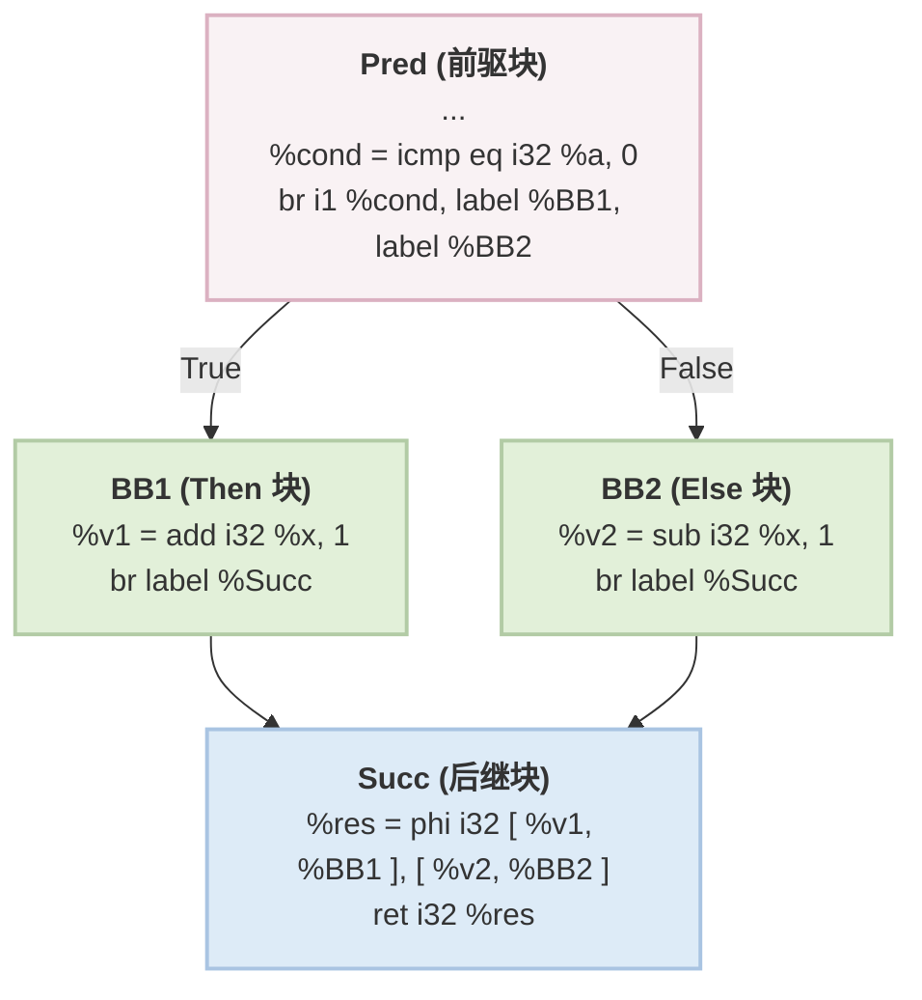

优化后

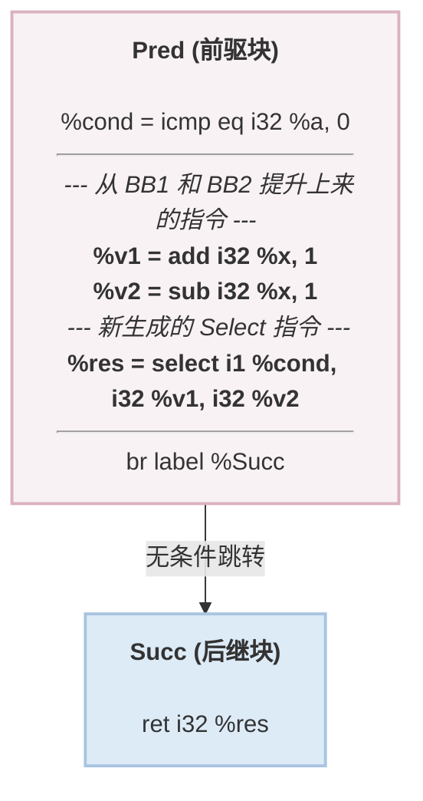

- 算法流程：

  1. 获取当前基本块True块

     只能有1个前驱和1个后继，前驱末尾是条件跳转（并且条件不是常量），获取该条件跳转指令

     获取两个跳转路径目标：Dest0,Dest1

     1. 如果Dest0和Dest1,其中有一个是当前块，一个是后继，那么标记没有else块
     2. 如果Dest0和Dest1，其中有一个是当前块，一个不是后继（记做else），并且这个else块只有一个前驱和后继，标记有else块

     如果该基本块和else块之中有Store，Load，Call，SDIV , UDIV , SREM, FDIV, FREM,不能IfConversion

     待转换的基本块和else块中指令总数<=4（如果只有True块，那么它之中的指令数<=4）

  2. 将该基本块和else块之中的指令除了终止指令全部移动到前驱块终止指令之前

  3. 遍历后继块中所有Phi，创建Select指令，根据条件真假选择Phi之前对应的两个值，将生成的Select插入到前驱块的末尾，RAUW替换所有使用PHI的地方变成使用Select，删除后继块中的PHI指令

  4. 修改前驱块的条件分支，变成无条件分支，指向后继块，删除当前块，如果有else块一并删除


##### Local2Global

将局部Alloca分配的大数组提升为全局变量

- 算法流程：
  1. 遍历Module之下所有函数所有指令，找到Alloca，计算其分配的变量占用的字节数，如果大于阈值（1024 size_t），那么加入工作队列之中
  2. 创建全局变量，提取原Alloca的底层类型，并复用原变量名字，RAUW替换alloca为该全局变量，清理Alloca


##### Global2Local

将全局变量Local到Main函数，从而在Mem2Reg可以将其提升为寄存器变量

- 算法流程：

  1. Local地点：Main，RISCV阈值32 size_t

  2. 遍历模块中所有全局变量：

     如果没人使用它，跳过

     如果这个全局变量大于阈值，跳过

     遍历使用该全局变量的所有指令，获取该指令所在函数，如果User不是当前函数，并且当前函数可以调用到所在函数，不进行优化，如果User是当前函数并且没有被当作参数传递给了Memcpy，才可以进行优化

     创建Alloca指令，将当前函数内所有用到该全局变量的地方全部替换成Alloca，插入到当前函数入口块PHI后面

     初始化：分为数组类型和标量类型进行初始化

##### Local&Global策略：

将极小变量提升到局部，变成寄存器变量，将极大变量提升为全局变量防止栈溢出


##### SCCP稀疏化常量传播

函数内稀疏化常量传播

> 没有支持向量化的相关支持


##### UnifyFuncExits统一函数出口

用在后支配树搭建前，以及中端转入后端时，以及清理类pass之中

- 算法流程：

  遍历函数中所有基本块，找到所有含Ret的基本块，如果含Ret的基本块<=1，直接返回，创建一个新基本块，如果函数返回值为void，那么直接在新基本块之中插入ret void，如果有具体返回值，那么创建一个PHI，插入到新基本块，创建新Ret PHI，插入到新基本块，将旧基本块中的返回值作为输入值插入PHI，然后删除旧基本块中的Ret，替换成无条件跳转指令，跳转到新基本块


##### BreakCriticalEdges打破关键边

GVN-PRE前置Pass，放置在LoopSimplify之前

关键边：一条边 `A -> B` 被称为**关键边（Critical Edge）**，当且仅当它**同时满足**以下两个条件：

1. 源基本块 A 有多个后继。 这通常意味着 A 的末尾是一个条件分支指令
2. 目标基本块 B 有多个前驱。 这通常意味着 B 是一个控制流的汇聚点

打破关键边：在关键边的位置插入新的块

- 算法流程：

  1. 找到关键边：

     源块A多个后继，目标基本块多个前驱

  2. 创建新基本块，插入到函数之中，并创建新的Br无条件分支指令，指向目标块，修改源基本块A中的分支指令，让其指向新基本块，修复目标块B中的PHI节点，将来源为A的全部换成来源为新基本块


##### GVNPRE

依赖AnalysisPass：Dominant，AliasAnalysis，SideEffect

运行之前先运行BCE和CFGSimplify，InstSimplify，DCE，SCCP

- 算法流程：

  1. GVN：

     外层：不动点循环

     清理哈希表

     > 核心数据结构：
     >
     > **`ValueNum` (值编号缓存表)**
     >
     > **`ExpressionTable` (表达式查重表)**
     >
     > **`LeaderTable` (领导者备忘录)**

     RPO逆后序遍历目标函数中每个基本块（如果发现在死块里面就直接跳过），遍历基本块中每一条指令（跳过PHI指令）

     1. 如果是LOAD指令：

        找到该LOAD在基本块中的位置，从该位置向前扫描每一条指令，直到入口块第一条指令，调用别名分析，找到和它使用同一个地址的最近的一条指令

        如果该指令是LOAD/STORE（MustAlias），那么RAUW将使用LOAD的全部换成上一次使用的值，然后删除LOAD

        如果STORE（MayAlias），放弃优化

        如果STORE（NoAlias）/LOAD（MayAlias/NoAlias），继续寻找

        如果CALL，调用getInstModRefInfo，如果结果包含Mod，那么放弃优化，如果Ref/NoModRef，继续寻找

        如果经过上面优化是True，那么就返回True处理下一条指令，如果经过上面优化是False（放弃优化），那么执行下面的逻辑

        记录：在ValueNum哈希表中进行寻找，如果编号过直接返回，如果没有，直接分配NextValueNum++一个新的编号，然后将{Num，LOADINST，该指令所在基本块}记录在InstTable之中

        返回false（只是记录，原本程序逻辑和代码结构没变）

     2. 如果是CALL指令：调用副作用分析发现只是Ref

        找到该CALL在基本块中的位置，从该位置向前扫描每一条指令，直到入口块第一条指令

        如果遇到STORE，调用Alias，如果不是NoAlias，放弃优化

        如果遇到CALL，调用getInstModRefInfo，如果遇到是一模一样的CALL，那么RAUW直接替换，删除该CALL，如果是其他CALL，如果计算出来是ModSet那么放弃优化

        如果优化失败了，执行下面的逻辑

        记录：和上面LOAD的一样

     3. 如果是Br条件跳转指令：

        如果发现Cond是常量，那么找到永远不会执行的那个分支，将这个分支里面的块收集到死块集合之中

     4. 如果指令没有返回值直接跳过

     5. 值编号：

        获取下一个编号NextNum

        获取Num编号

        Num编号逻辑：

        1. 如果ValueNum哈希表能查到，直接返回查到的

        2. 如果传入的不是一条具体的指令，那么就分配新号码ValueNum++

        3. 如果是普通运算指令

           记录这条指令的返回值类型和Opcode，然后获取当前指令的所有操作数的ValueNum，存入该指令的VarArgs

           如果是ADD/MUL/AND/OR/XOR这种满足交换律的，按照从小到大的ValueNum排序VarArgs

           如果是比较指令，同样满足上面的小ValueNum的原则，但是比较符号也要一同取反，然后将Opcode和具体比较符号通过`(C->getOpcode() << 8) | Predicate`位运算结合在一起作为唯一的Opcode

        4. 如果是LOAD/STORE：直接分配新号码

        5. 如果是GEP：

           依次对基地址和索引求哈希

        6. 如果是CALL：

           调用副作用分析

           如果NoModRef，处理方法同普通运算指令（提取表达式），算哈希，存入哈希表

           其他情况直接分配新号码

        7. 如果是PHI/ALLOCA/RET/BR这种指令，直接分配新号码

        如果Alloca/Ret/Br/PHI，将{Num，INST，该指令所在基本块}记录在InstTable之中，直接返回

        如果Num>=NextNum，那么将{Num，INST，该指令所在基本块}记录在InstTable之中，直接返回

        根据当前指令所在基本块和Num去找Leader，根据Num去找LeaderTable中到Leaders，遍历所有Leaders，查看Leader所在基本块是不是支配当前指令所在块，如果找到这么一条指令就存起来，如果这条指令是常量直接返回不用找了，循环结束之后返回指令

        如果没找到就将自己{Num，INST，该指令所在基本块}记录在LeaderTable之中

        如果查到自己直接false

        RAUW将使用当前指令的地方全部换成Leader，然后删除当前指令，返回即可

        > 这里的LeaderTable就是上面的InstTable

  2. PRE：

     处理死块：

     遍历死块中所有指令，调用分配ValueNum的函数分配Num，然后插入到LeaderTable之中

     外层：不动点循环

     DFS遍历当前函数所有基本块（函数入口块跳过），遍历当前基本块之中的每一条指令

     1. 如果是ALLOCA/RET/BR/PHI/无返回值的指令/比较指令/LOAD/STORE/CALL（经过SideEffect后不是NoModRef的纯函数的拒绝）

        > GEP提升，纯函数提升

     2. 前驱块分析：

        获取当前指令的ValueNum

        遍历当前指令所在块的前驱：

        如果前驱不可达放弃，如果前驱是循环回边放弃

        PHITranslate:

        查PHITranslateTable如果缓存之中有直接返回翻译出来的结果，如果没有执行下面的逻辑，执行完之后存入缓存，返回翻译后的新ValueNum

        1. 如果当前要翻译的编号本身是PHI节点：

           看这个PHI是不是在当前块之中如果不是，说明不受跨块影响，不用翻译

           遍历PHI输入值，找到属于目标前驱的那个输入值返回输入值编号

        2. 如果Num不是PHI，说明是普通算数指令：

           从表达式哈希之中拿到表达式

           遍历表达式中每一个操作数，调用PHITranslate

           如果是ADD/MUL/OR/XOR/AND这些满足交换律的，重新排序表达式的ValueNum值，从小到大

           如果全局表达式表中能查到NewNum，那么就返回

        3. 如果查不到就返回旧Num

        拿着翻译后的Num去找Leader

        如果没找到，那么记录这个前驱PREPred，NumWithout++，如果找到了自己说明是循环回边，NumWithout = 2，直接放弃，如果找到了真的，加入到PredMap之中，NumWith++

        只有NumWithout == 1 且 NumWith > 0的时候才能进行后面的逻辑

        如果要提升的是DIV/REM直接返回

        clone当前指令，插入到PREPred前驱块末尾（在终止指令之前），在当前块PHI指令最后插入PHI，遍历PredMap，如果以前就有那么就直接加入输入值，如果是刚才缺失的路径那么就把刚插入的那条指令加入输入值

        给新的PHI发和原指令一样的Num，然后RAUW进行替换，删除原指令，更新LeaderTable

  3. 清空哈希表等数据结构


##### Select2Branch

在退出中端之前将Select退出（RISCV不支持Select指令）

- 算法流程：
  1. 遍历该函数中所有指令，收集Select指令
  2. 提取操作数，定位当前基本块，把当前基本块在Select的位置切分，后半段基本块作为MergeBlock，创建一个TrueBlock，创建无条件跳转指令，跳转到MergeBlock，并插入到TrueBlock之中，在前半段基本块之中插入新条件分支指令，为真跳入TrueBlock，为假跳入MergeBlock，在MergeBlock中插入新PHI，将外部使用Select的地方替换成PHI，分别将来自Select的两个值和新创建的两个块作为输入值加入PHI之中，销毁Select


##### Reassociate表达式重结合

利用代数中结合律和交换律重新排列表达式中的计算顺序，从而暴露更多的优化机会

排序的依据：排序的依据就是 Rank（秩），规则很简单：Rank 越小，在表达式树中越靠右（越容易被沉到底部折叠）；Rank 越大，越靠左

为SCCP，GVN，LICM铺路

运行之后运行DCE

- 算法流程：

  1. 创建RankMap

     初始化rank=2

     遍历函数的所有参数，为这些参数建立从3递增的rank（每个参数的rank都各不相同）

     逆后序遍历函数中的基本块，每个基本块的rank间隔为`++Rank << 16`，遍历块内指令，为每个符合条件（不标ADD, SUB,MUL,AND, OR, XOR其余都标）的指令在本基本块的rank基础上分配rank并递增rank

  2. 不动点循环：

     逆后序遍历函数中基本块，遍历基本块之中的所有指令

     如果是死指令，断开对子节点的Use，直接跳过（留给后续DCE），如果不是调用下面的逻辑optimizeInst（该函数运行期间会收集TodoList）

     While循环遍历TodoList：如果是死代码，断开它对子节点的Use，然后跳过（留给后续DCE），如果不是死代码，继续运行optimizeInst

  3. 保留CFG相关的分析结果

  4. optimizeInst：

     1. 规范化：

        如果不是ADD，MUL，AND，OR，XOR，SUB直接返回执行下一条指令

        如果本条指令是SUB A-B指令，直接优化成A + B×（-1），将新生成的指令加入TodoList，然后直接返回执行下一条指令

     2. 内部节点过滤：

        如果这条指令只有一个User，并且User的Opcode和这条指令的Opcode一样，并且User不是自己，并且User和这条指令在同一个基本块之内：

        将User的指令加入到TodoList之中，这条指令直接退出，不进行下面的优化步骤

     3. ReassociateExp：(走到这里传入的Inst一定是Root)

        1. Linearize：

           WorkList While循环：

           1. 遍历当前指令的操作数

              如果Opcode和Root Opcode一样，并且只有一个User，那么加入WorkList

              否则，压入最终的Ops数组之中

        2. 排序：Rank大的排在Ops前面，Rank小的排在Ops后面

        3. OptExp：

           1. 常量折叠：从Ops数组末尾开始循环，将常亮根据每步的Opcode直接做折叠，拿到最后的常量

           2. 如果Ops全空了，那么直接返回最后的常量

           3. 简化：

              如果总常量是0并且当前是加法/总常量是1并且当前是乘法，直接扔掉总常量

              如果当前是乘法并且总常量是0,直接返回0

           4. 如果Ops之中只有一个变量了，那么直接返回这个变量

           5. 高级优化：

              1. ADD：

                 遍历排好序的Ops数组

                 优化1：合并同类项，比如有C（C为常量）个Y，找到这C个Y，然后创建乘法C×Y，将原来的删掉，将新乘法加入到Ops数组之中

                 优化2：抵消相反数，一旦找到MUL（X，-1），就会找X是否同时存在，如果同时存在那么直接二者删掉

                 优化3：提取公因式，匹配模式：A* B + A* C -> A*(B+C)，具体来说遍历所有是乘法的操作数，统计他们的出现次数，找到出现次数最多的因子，如果出现次数>1，那么就去乘法项之中把这个因子提取出来，将剩下部分加起来

              2. MUL：分治思想

                 传入的Ops大小必须>=4

                 提取Ops之中重复的变量，从Ops之中删去，按照(X,指数)存储起来，如果找不到就放弃优化

                 合并相同指数的底数：$A^N$×$B^N$=$(A×B)^N$,具体来说就是先生成一条底数乘法指令然后删除已经被合并的因子

                 指数奇数：如果指数是奇数，把底数拿出来一份，放入外层乘积列表之中，所有因子的指数都必须统一右移 1 位（减半向下取整，`Power >>= 1`）

                 递归：处理偶数次幂，如果减半后最大的指数仍然大于 0，说明还需要继续算。直接递归调用自己，递归返回的结果（我们称之为 `SquareRoot`），需要被平方。所以它把 `SquareRoot` 往外层乘积列表里塞了两次

                 把当前层级 `OuterProduct` 里面收集到的所有东西（包括奇数剥离出来的底数，以及递归返回的平方项）统统乘起来

           6. 如果在刚才的高级优化之中数组长度发生改变，递归调用OptExp自己，直到数组长度不变

           如果OptExp算出一个结果Value，直接RAUW将使用当前指令的地方全部换成Value，将Root放入TodoList，完成优化

        4. 如果Ops大小为1了，直接RAUW将使用当前指令的地方全部换成Value，将Root放入TodoList，完成优化

        5. 重建表达式树：

           1. 取出最底层的两个叶子：从 `Ops` 数组的末尾（`back`）弹出两个元素，分别作为 `RHS` 和 `LHS`。此时这两个元素是整棵树中 Rank 最小的（通常是常量或最外层的变量）
           2. 生成底层指令：根据原 Root 指令的 Opcode（例如 `ADD` 或 `MUL`），生成一条新的二元指令 `ResultInst = Opcode(LHS, RHS)`
           3. 插入新指令：将 `ResultInst` 插入到原 Root 指令的物理位置之前（`insertBefore`），以保证新生成的指令绝对满足支配关系（Dominance）
           4. 新指令入队：将 `ResultInst` 加入 `TodoList`（因为它是一条全新生成的指令，下一轮也许还能触发别处的优化）
           5. While 循环挂载剩余节点：
              - 只要 `Ops` 数组还不为空，就继续从末尾弹出一个元素，记为 `NextVal`
              - 生成新的指令：`NewInst = Opcode(NextVal, ResultInst)`（即：把刚才生成的结果当做一边，新取出的变量当做另一边）
              - 将 `NewInst` 同样插入到原 Root 指令之前
              - 将 `NewInst` 压入 `TodoList`
              - 更新游标：`ResultInst = NewInst`
           6. 收尾与替换 (RAUW)：
              - 循环结束后，最后的 `ResultInst` 就是这棵新树的最顶层新根节点
              - 调用 `replaceAllUsesWith(RAUW)`，将所有引用了旧 Root 指令的地方，全部替换为 `ResultInst`
              - 将旧的 Root 指令压入 `TodoList`


##### LoopSimplify

依赖Dominant和LoopInfo两个AnalysisPass

- 目的：确保Loop满足规范形式
  - 唯一的 PreHeader（入口块）
  - 唯一的 Back Edge
  - Dedicated Exits （ 所有的 Exit Block 只能被**循环内部**的基本块指向）

- 算法流程：

  PreHeader是用来汇聚外部块的进入的

  Latch块是用来汇聚回边的

  Dedicated Exits 是用来汇聚所有从Loop中Exit并和外部跳转进行分割的

  1. 插入PreHeader唯一入口块

     得到原Header，遍历Header的所有前驱，筛选出那些来自循环外部的块，然后将这些块先去指向PreHeader

     创建PreHeader的后，改动Value/User/Use（其实也是改动Br），改动Br跳转指令，改动Phi指令

     ```
     // ================= 转换前 =================
     Header:
         phi [ 1, pre, 2, pre, 3, x, 4, y ]


     // ================= 转换后 =================
     preHeader:
         Mergephi [ 1, pre, 2, pre ]
    
     Header:
         phi [ Mergephi, preHeader, 3, x, 4, y ]
     ```

  2. 构造Dedicated Exits 专用出口块

     当一个出口块（Exit BB）同时接收**循环内**和**循环外**的跳转时

     把所有来自**循环内部**的边拦截住，让它们先跳到一个新创建的中间块，然后再由这个新块跳向原来的 Exit BB。

     同样要创建好之后：改动Value/User/Use（其实也是改动Br），改动Br跳转指令，改动Phi指令

  3. 构造唯一回边--添加Latch块

     将多条跳转回Header的边汇聚到唯一的Latch块中

     同样要创建好之后：改动Value/User/Use（其实也是改动Br），改动Br跳转指令，改动Phi指令

  4. 简化Header中的PHI节点

     为什么要简化：在LoopSimplify这个pass进行之后，Header中PHI最多只有两个入口（PreHeader，Latch）

     如果只有一个来源直接进行替换，替换死循环PHI--**替换这两类PHI**

- 图解：

  转换前

  ```mermaid
  graph TD
      %% 外部区域
      O1[Outside 1]
      O2[Outside 2]
      O3[Outside 3]
  
      %% 循环内部
      subgraph LoopArea [Loop]
          direction TB
          H[Header]
          B1[Body 1]
          B2[Body 2]
  
          H --> B1
          H --> B2
          B1 -->|回边 1| H
          B2 -->|回边 2| H
      end
  
      %% 出口区域
      E[ExitingBlock]
  
      %% 跨区域连线
      O1 --> H
      O2 --> H
      B1 --> E
      O3 --> E
  
      %% 样式调整匹配你的手绘布局
      classDef default fill:#f8f9fa,stroke:#333,stroke-width:2px;
      classDef loopBox fill:#ffffff,stroke:#000,stroke-width:2px;
      class LoopArea loopBox;
  ```

  转换后

  ```mermaid
  graph TD
      %% 外部区域
      O1[Outside 1]
      O2[Outside 2]
      O3[Outside 3]
  
      %% 循环内部
      subgraph LoopArea [Loop]
          direction TB
          PH["新块: PreHeader"]
          H["Header<br>(PHI 被极大简化)"]
          B1[Body 1]
          B2[Body 2]
          L["新块: Latch"]
  
          PH -->|① 唯一入口| H
          H --> B1
          H --> B2
          B1 --> L
          B2 --> L
          L -->|③ 唯一回边| H
      end
  
      %% 出口区域
      DE["新块: Dedicated Exit"]
      E[ExitingBlock]
  
      %% 跨区域连线
      O1 --> PH
      O2 --> PH
  
      B1 -->|② 拦截内部跳出| DE
      DE --> E
      O3 -->|外部连线保持原样| E
  
      %% 样式标注
      classDef default fill:#f8f9fa,stroke:#333,stroke-width:2px;
      classDef loopBox fill:#ffffff,stroke:#000,stroke-width:2px;
      classDef newBlock fill:#d1e7dd,stroke:#198754,stroke-width:2px,color:#0f5132;
      class LoopArea loopBox;
      class PH,L,DE newBlock;
  ```

##### LcSSA--闭环SSA形式

依赖Dominant和LoopInfo两个AnalysisPass

标准SSA：每个变量只被赋值一次，且使用该变量的地方必须被其定义所支配

LCSSA附加规则：如果一个变量是在**循环内部**定义的，但它在**循环外部**被使用了，那么这个跨越循环边界的数据流，**必须**通过在循环退出块（Exit Block）中的 PHI 节点来传递。

- 算法流程：

  外层：**基于自然循环后序遍历的同时，然后基于支配树找出直接支配ExitingBlock的,并且在循环内的这些Block，然后搜集这些块中的指令**

  1. 处理每一条**在循环内定义的**指令，如果是死循环（ExitingBlock没有）就不处理

     如果存在ExitingBlock，进行下面的内容

  2. 寻找**这条指令在循环外部的Uses**：

     遍历这条指令被Use的所有地方

     如果发生在永远执行不到的死代码块中，直接将Use替换为UndefValue

     如果User**是一个Phi**，那么其实在控制流的角度看所对应的Use其实是发生**在Phi对应的前驱基本块之中**

     如果User普通情况，那我们的Use其实就是这条User所在的基本块

     如果这两个情况的基本块在循环之外，这个也就是**一个循环边界，记录下来**

  3. 插入LCSSA PHI：

     确定指令在支配树上的起点：本BasicBlock

     **遍历所有ExitingBlock：**

     1. 如果指令所在块不支配ExitingBlock，跳过
     2. 如果已经为ExitingBlock插入过值了，跳过

     下面这几条默认指令所在块支配ExitingBlock：

     1. 如果指令所在块支配ExitingBlock，插入LCSSA，添加指令I为输入值

     2. 如果ExitingBlock的某个前驱不在循环之内，但是指令所在块又支配ExitingBlock：

        说明执行流先从其他出口跳转出去，然后回到了ExitingBlock

     3. 如果该ExitingBlock是其他不相交的循环的循环头：

        这时我们插入LCSSA可能会破坏另一个循环的LCSSA形式，但是还是插入这个LCSSA

        后两条直接把刚生成的LCSSA加入队列等待下一轮算法运行即可

  4. 重写外部Use:利用支配树实现**（Minimal SSA）**

     **遍历第二条说的循环边界，并在同时倒序爬支配树，寻找UserBlock的IDOM**

     1. 循环只有一个ExitingBlock：IDOM一定会落在这个ExitingBlock上面（即IDOM落在循环外面）

        这时其实还是线性的，那么我们递归找IDOM（ExitingBlock）要值即可

     2. 循环有多个ExitingBlock，但UserBlock仅仅出现在某个ExitingBlock下游：

        同样沿着IDOM就会落在该ExitingBlock下面，同1（IDOM落在循环外面）

     3. 循环有多个ExitingBlock，且UserBlock落在ExitingBlock的汇合处：

        **（IDOM落在循环里面）（理解：同时支配ExitingBlock的地方只能是在循环内部）**

        同样我们递归，朝这多个ExitingBlock要值

- 图解：

  优化前：存在一个在循环内部定义，但是在循环外部被使用的变量

  那我们就说这样的变量是跨越循环边界的数据流

  ```mermaid
  graph TD
      %% 定义节点样式类，保持清晰度
      classDef loopBlock fill:#e1f5fe,stroke:#01579b,stroke-width:2px;
      classDef exitBlock fill:#fce4ec,stroke:#880e4f,stroke-width:2px;
  
      %% 外部节点
      PreHeader[PreHeader]
  
      %% 循环内部结构
      subgraph Loop
          direction TB
          Header[Header]
          %% 在 Body 节点中明确标注文本内容
          Body["Body<br/>define: val"]
          Latch[Latch]
      end
  
      %% 控制流
      PreHeader --> Header
      Header --> Body
      Body --> Latch
      Latch --> Header
  
      %% 外部节点
      %% 在 Exiting Block 节点中明确标注文本内容
      ExitingBlock["Exiting Block<br/>Use: val"]
  
      %% 指向退出块的连线
      %% 捕捉草图中从 Body 到 Exiting Block 的直接连接
      Body --> ExitingBlock
  
      %% 应用样式类
      class Header,Body,Latch loopBlock;
      class ExitingBlock exitBlock;
  ```

  优化后：

  那我们引入这种只有一个输入值的Phi，外面的Use都只能使用这个Phi，不能使用里面的原变量

  ```mermaid
  graph TD
      %% 定义节点样式类，保持清晰度
      classDef loopBlock fill:#e1f5fe,stroke:#01579b,stroke-width:2px;
      classDef exitBlock fill:#fce4ec,stroke:#880e4f,stroke-width:2px;
  
      %% 外部节点
      PreHeader[PreHeader]
  
      %% 循环内部结构
      subgraph Loop
          direction TB
          Header[Header]
          %% 在 Body 节点中明确标注文本内容
          Body["Body<br/>define: val"]
          Latch[Latch]
      end
  
      %% 控制流
      PreHeader --> Header
      Header --> Body
      Body --> Latch
      Latch --> Header
  
      %% 外部节点
      %% 在 Exiting Block 节点中明确标注文本内容
      ExitingBlock["Exiting Block<br/>%val.lcssa = phi i32 [ %val, %Body ]<br/>Use：val.lcssa"]
  
      %% 指向退出块的连线
      %% 捕捉草图中从 Body 到 Exiting Block 的直接连接
      Body --> ExitingBlock
  
      %% 应用样式类
      class Header,Body,Latch loopBlock;
      class ExitingBlock exitBlock;
  ```

##### LoopRotate循环旋转

依赖Dominant和LoopInfo两个AnalysisPass

目的：把一个传统的while结构转换成do-while结构

循环内部少了一次无条件跳转，对CPU流水线指令和分支预测提升巨大

- 算法流程：

  顶层遍历：遍历Top-Level Loops，然后利用逆后序遍历去遍历每个loop

  1. 循环可以Rotate条件1：

     1. 满足LoopSimplify形式：

        PreHeader：从Header的前驱中只能有一个来自循环外部的块（即PreHeader），并且这个PreHeader只能有一个后继就是Header（即无条件跳转）

        Latch：Latch必须唯一

        DedicatedExits：必须有，遍历所有从循环内部跳到循环外部的这些块，这些块的前驱只能来自循环内部

  2. 循环可以Rotate条件2：

     1. 循环只有1个/2个基本块，不进行Rotate
     2. **循环只能有一个Exit Block**
     3. Header必须以条件跳转结尾，并且Header是ExitingBlcok（一个分支跳到Exit Block）

  3. 将Header的两个后继，Body作为NewHeader，Exit Block依旧作为Exit Block

  4. 循环可以Rotate条件3：

     1. **Exit Block的前驱只能是Header，并且唯一**
     2. **Latch不能是ExitingBlock**，Latch后继必须是Header，并且只有一个后继
     3. Body（NewHeader）的前驱只能是Header，并且唯一

  5. Body（NewHeader）PHI折叠

     无User：直接删除

     **有LCSSA标记的不能删--这里需要更新LCSSA算法，看看怎样打上.lcssa标记**

     PHI的输入值全部一样（但不是自我引用）：删除

     RAUW删除

  6. 核心Rotate1:将Header中的指令**clone到**PreHeader，并更新Body的PHI节点

     1. 删除PreHeader中的无条件跳转指令

     2. 准备Map：

        Header->PreHeader->Body

        [Header中旧 Phi 节点] -> [来自 PreHeader 的初始值]->[Body新建立的PHI]

        [Header中普通指令] -> [存入PreHeader的指令]->[Body新建立的PHI]

        Body新建立的PHI：输入值来自Header和PreHeader

     3. 处理Header中的PHI节点

        处理Body:在Body中建立一个新PHI节点，在原PHI节点中提取来自PreHeader的初始值作为新PHI的输入边（来源为PreHeader），提取原PHI节点中来自Latch的迭代值作为新PHI的输入边（来源为Header），更新Map

     4. 处理Header的普通指令

        处理PreHeader：遍历Header的普通指令，然后进行clone，然后根据上面的Map去更新这条克隆指令的usee，Use关系（即操作数），然后插入到PreHeader

        处理Body：如果Body中用到了这个值，那么我们在Body中建立一个新PHI节点（后续步骤同3），更新Map，如果没用到就不用建立PHI了

  7. 核心Rotate2：更新所有普通指令的Use关系

     获取Map中所有来自Header的指令的Use，更新这些Use

     1. 如果UserBlock在Header

        普通指令不用管，PHI指令将Header的输入边替换为来自Body的输入边

     2. 如果UserBlock在Body

        如果这个User不是刚才Body建立的PHI，就将所有对Header的引用换成新建的这个PHI

     3. 如果UserBlock在循环外部

        更新ExitBlock：更新Exit中LCSSA PHI，添加来自PreHeader的输入边，如果不存在这么一个LCSSA，就重新建立一个PHI（输入来自PreHeader，和Header），重新建立需要去找这个Use替换成这个新PHI

     4. 更新ExitBlock中不来自Header定义的但是传递到这里的LCSSA PHI，给他们添加一个来自PreHeader的输入

  8. 核心Rotate3：CFG重连

     去除PreHeader和Header连接，添加PreHeader与Body，PreHeader与Exit Block连接

     更新Header的PHI：去除PreHeader的输入边

     因为Header前驱只有Latch了，所以折叠PHI（逻辑同第6步）

     **更新loopinfo的Header信息**

  9. 常量折叠与修复LoopSimplify形式：

     **修复PreHeader：**

     1. 常量折叠：尝试折叠PreHeader中的Br条件分支，如果100%就能进入Body，那么就换成无条件分支，切断与ExitBlock的分支，这时PreHeader还可以做PreHeader
     2. 如果不能进行折叠，直接在PreHeader和Body直接创建一个NewPreHeader，然后在这个NewPreHeader之中加入一个Br无条件跳转，修改PreHeader的Br分支--**这里好好读一读LoopSimplify相关逻辑**

     **修复Dedicated Exits（独占出口块）：**

     ExitBlock从只来自Header，变成来自PreHeader和Header，打破了Dedicated Exits的要求

     所以我们在ExitBlock和PreHeader，Header中加入一个Exit，然后再无条件转接Exit--**这里好好读一读LoopSimplify相关逻辑**

  10. 合并Header到Latch

      删除Latch中无条件跳转，将Header中所有指令搬到Latch末尾，将Header的后继作为Latch的后继（更新CFG），修复和Header相关的PHI

      删除Header

  11. 更新支配树和LoopInfo

- 图解

  ```mermaid
  graph TD
      PreHeader --> Header
      Header --> Body
      Header --> Exit
      Body --> Latch
      Latch --> Header
  ```

  ```mermaid
  graph TD
      PreHeader --> Body
      PreHeader --> Exit
      Body --> Latch
      Latch --> Header
      Header --> Body
      Header --> Exit
  ```

  ```mermaid
  graph TD
      PreHeader --> Body
      PreHeader --> Exit
      Body -->  Latch+Header
      Latch+Header --> Body
      Latch+Header --> Exit
  ```

##### LICM循环不变量代码外提

依赖AnalysisPass:Dominant,LoopInfo,BasicAliasAnalysis,SideEffect

- 算法流程：下沉Sink，外提Hoist

  最外层：依然是遍历顶层循环+后序遍历单棵循环树

  1. 前置检查：

     1. 是否符合LCSSA形式
     2. 是否符合LoopSimplify形式（PreHeader，Latch，Dedicated Exits）

  2. 下沉Sink：

     一条指令在**每次迭代中都在计算**，但是**结果只有在退出循环才被使用**

     Sink：将其沉到循环的ExitBlock，只在退出循环时执行一次

     后序遍历--从循环尾开始向上遍历到循环头，倒序遍历本层循环中基本块中所有指令：

     1. 检查：

        1. 检查是否存在DedicatedExits

        2. 检查指令--判断一条指令是否可以被安全的移出循环：--**需要使用别名分析**

           绝对不能移动：

           RET，BR，PHI，ALLOCA，Binary中的：SDIV，FDIV，SREM，FREM

           可以移动：

           排除上面之后的BinaryInst

           严格检查可以移动：LOAD，STORE，CALL

           CALL：

           调用副作用分析，分析是否含内置函数和Untracked标记，有的话直接false

           检查ModRefInfo，只有NoModRef/Ref可以

           调用ModRefInfo

           检查ModSet是否为空，untracked是否是未标记的

           如果RefSet依旧为空，那么直接true

           如果RefSet不为空，遍历Set中每一条指令，比对函数中中每一条指令，调用别名分析分析二者，只要一条会修改这块内存那么就直接false

           LOAD：遍历循环之中每一条其他指令，调用副作用分析`getInstModRefInfo`检查是否会影响LOAD读取的地址

           STORE：如果是激进外提直接否定，不提STORE

           遍历循环之中每一条其他指令，调用副作用分析`getInstModRefInfo`检查是否会影响STORE读取的地址，并用支配树证明，如果当前的Store是最后一次写入（覆盖掉之前所有的）其实是可以下沉到循环之外的

        3. 检查这条指令的所有User是否全在循环之外

        4. 判断循环不变量：

           循环不变量（一条指令的操作数都是循环不变量，即所有操作数的定义都在循环外/操作数是常量，递推：该变量的所有操作数的**可达定义只有一个（即定义是确定的，没有经过if条件），这个定义来自循环内，并且它本身也是循环不变量**）

     2. 下沉：

        遍历所有出口块，直接将指令I clone 到对应的 Exit Block（受指令I所在块支配） 中（PHI节点之后）

        遍历clone出来的指令I的操作数，如果操作数来自循环内部但没有创建LCSSA PHI的话，那我们就去创建PHI并替换指令I的操作数，如果已经创建，直接替换指令I的操作数即可

        遍历使用指令I的User，将这些User的Usee指令I换成我们新创建的指令，然后删除旧指令

  3. 外提Hoist：

     RPO遍历循环中所有基本块，正向遍历基本块中所有指令

     1. 条件：

        再次检查是否存在PreHeader

        检查激进Hoist：

        如果这条指令所在的基本块，支配该循环中所有的Exit出口块和所有的Latch回边块，标记为激进Hoist（该块后向支配PreHeader的逻辑，只不过用支配树的逻辑实现）

        检查指令：和sink第一条相同

        检查循环不变量：和sink第三条相同

     2. 外提：统一move到PreHeader块末尾


##### LoopDeletion循环删除

依赖AnalysisPass：Dominant，LoopInfo，BasicAliasAnalysis，SideEffect，SCEV

- 算法流程：

  1. 符合LCSSA形式

  2. 检查是否符合LoopSimplify形式，并获得PreHeader

  3. 获取循环的所有ExitBlock，必须是唯一ExitBlock

  4. 如果循环永远不会执行：

     1. 判断循环会不会进入：

        获取PreHeader，如果PreHeader是整个函数的EntryBlock，那么一定可以进入

        遍历PreHeader所有前驱块，找到这些前驱块的终止指令，如果是Br并且条件是常量，那么提取出两个目标基本块，如果条件不是常量那么直接返回可以进入，其他终止指令的情况直接保守可以进入，如果两个目标基本块中那个True的正好是PreHeader，那么可以进入，反之不可以进入

     2. 如果不可以进入

        1. 删掉PreHeader的旧分支指令，构建一条分支指令`br ExitBlock`
        2. 遍历ExitBlock中的PHI节点，强制将第0项的来源改为PreHeader，将后续所有项删除，值不变
        3. 遍历循环里的所有指令，如果循环外还有指令使用这些值，将这些Use全改成UndefValue
        4. 删除循环之中的所有指令（删除之前现在所有UseDef清除）所有基本块
        5. 更新支配树，LoopInfo，SCEV

  5. 如果是多出口的情况，直接返回

  6. 常规循环删除：

     1. 判断：

        取出这个唯一ExitBlock的所有PHI节点，逐个检查这个PHI是否是一个平凡PHI（所有输入值都是一样的），只要有一个输入值不一样的那么就返回，如果这个输入值是一个指令，如果还在循环内，直接返回

        遍历循环体内的所有指令，进行循环级副作用分析，如果有副作用直接返回

        DFS遍历这个循环

        经过上述检验的可以执行下述的删除

     2. 如果符合条件，执行删除，逻辑和4.2相同


##### LoopUnswitch

将循环内部依赖于**循环不变量**的分支移动到循环外

先运行LoopSimplify，LCSSA，LICM再运行LoopUnswitch

依赖AnalysisPass：DominatorTree，LoopInfo，SCEV，MemorySSA

实现了如下两种UnSwitch的形式

- Trivial Unswitch：目标分支的至少一个后继可以退出循环
- Non-trivial Unswitch：两个分支的后继都留在循环内

并且只做了Full Unswitch，即分支条件全是循环不变量

- 算法流程：

  1. 确认是loopsimplify，LCSSA形式

  2. 优先执行Trivial Unswitch，其次执行Non-trivial Unswitch（并且每个函数中二者只能执行其一）

  3. Full Trivial Unswitch：

     检查：从 LoopInfo::Header 开始向下检查每个必经的基本块，检查当前块的 MemoryDef 以及副作用。如果存在除 MemoryPhi 以外的 MemoryDef，或者存在具有副作用的指令，则停止扫描。

     获取当前块ParentBB的分支指令，必须是非常量条件分支

     核心：检查整个条件是不是全都是循环不变量，然后明确true和false哪个分支的successor是退出循环的，哪个是继续循环的（这里不接受两个successor都退出循环或两个successor都继续循环），该分支属于当前循环本身，而不是位于某个内层子循环中。

     检查离开分支的ExitBB中的PHI中的incoming value，这个incoming value必须也是循环不变量（不能在循环内被计算），否则不能被执行

     然后新建一个NewPreHeader插入在OldPreHeader以及Header之间，并且更新Header的PHI之中 incoming block由OldPreHeader->NewPreHeader

     如果ExitBB只有当前分支块 ParentBB这一个前驱，那么出口直接复用，如果ExitBB还有其他前驱，那么进行切分，旧的ExitBB保留全部PHI，并新增跳到NewBB的Br无条件分支指令，NewBB保留原来旧ExitBB所有其他指令

     然后删除OldPreHeader原来的无条件跳转，然后将ParentBB的分支指令从ParentBB移动到OldPreHeader，并根据true还是false更新这条分支指令successor（退出方向   -> ExitBB 或切分得到的 NewBB，继续方向   -> NewPreHeader）

     然后创建ParentBB的新分支指令Br无条件跳转到继续循环的那个块上

     对出口 PHI 进行修复：

     - 如果直接复用原来的 `ExitBB`，则将 PHI 中来自 `ParentBB` 的 incoming block 修改为来自 `OldPreHeader`，incoming value 保持不变。
     - 如果对ExitBB进行了切分，则不能简单地把原 PHI 的 incoming block 修改为OldPreHeader。需要在切分得到的NewBB中创建新的合流 PHI，用来合并：
       - 从 `OldPreHeader` 直接退出时使用的循环不变量值；
       - 从原 `ExitBB` 正常退出时得到的原 PHI 结果。

     最后替换循环内所有使用循环不变量的Use为确定的True/False常量

     变换完成后重新获取当前ParentBB的 terminator：

     - 如果当前terminator已经变成无条件 branch，则根据其唯一successor更新下一个必经基本块，并继续扫描。
     - 如果successor已经离开当前循环，或者该基本块已经被访问过，则停止扫描。

     

  4. Full Non-trivial Unswitch：

     获取当前块ParentBB，以及对应的分支指令。要求整个分支条件都是循环不变量，并且该分支属于当前循环本身，而不是位于某个内层子循环中。

     根据目前的分支指令确定两个分支的successor，根据支配树，确定我们每个分支具体需要clone的支配子树（如果某些基本块被其中一个 successor 支配，并且只能通过该 successor 到达，那么这些基本块只属于对应的专门化路径。在克隆某个循环版本时，由另一个 successor 独占支配的基本块不需要复制；这些块在当前专门化版本中不可达。）

     然后新建一个NewPreHeader插入在OldPreHeader以及Header之间，并且更新Header的PHI之中 incoming block由OldPreHeader->NewPreHeader--**这一部分和刚才Trivial Unswitch一样**

     克隆循环：克隆当前循环所需要的全部基本块，并且为克隆循环新建一个 ClonedPreHeader。在clone过程中建立原值到clone值的映射，clone每条指令的时候必须重新映射其操作数，然后克隆循环 Header 中的 PHI,并根据其映射修改相关的incoming，克隆循环内其他 PHI 时，也必须同时映射 incoming value 和 incoming block，如果根据支配子树裁剪了部分基本块，那么必须删除由未克隆基本块产生的 PHI incoming，并在 PHI 只剩一个 incoming value 时进一步简化 PHI，对于循环出口和 LCSSA PHI，需要为克隆循环建立对应的退出值。原循环退出产生的值和克隆循环退出产生的值，最终需要在循环外合流

     然后删除OldPreHeader原来的无条件跳转，然后将ParentBB的分支指令从ParentBB移动到OldPreHeader，并根据true还是false更新这条分支指令successor

     然后对原循环进行专门化，由于原循环负责 `Cond = false` 的版本，所以原循环中的 `ParentBB` 不再需要保留原条件分支，而是创建新的无条件 branch，删除原循环之中不需要保留的那条分支的CFG边，必须删除 `CloneSucc` 中所有来自 `ParentBB` 的 PHI incoming，

     然后对clone循环进行专门化，根据映射将克隆循环中的原条件 branch 替换为无条件 branch，同时删除克隆循环中指向另一个 successor 的 CFG 边，并删除对应 successor PHI 中来自 `ClonedParentBB` 的 incoming

     然后进行循环不变量的常量替换，并替换该循环内所有对该循环不变量的Use

     对于每个原循环 ExitBB：

     1. 保留原循环版本的退出 incoming。
     2. 增加克隆循环版本对应的退出 incoming。
     3. 如果原 ExitBB 不能直接同时承接两个循环版本，则切分或新建 ExitMergeBB。
     4. 在 ExitMergeBB 中建立合流 PHI。
     5. 所有循环外 Use 改为使用合流 PHI 的结果。

     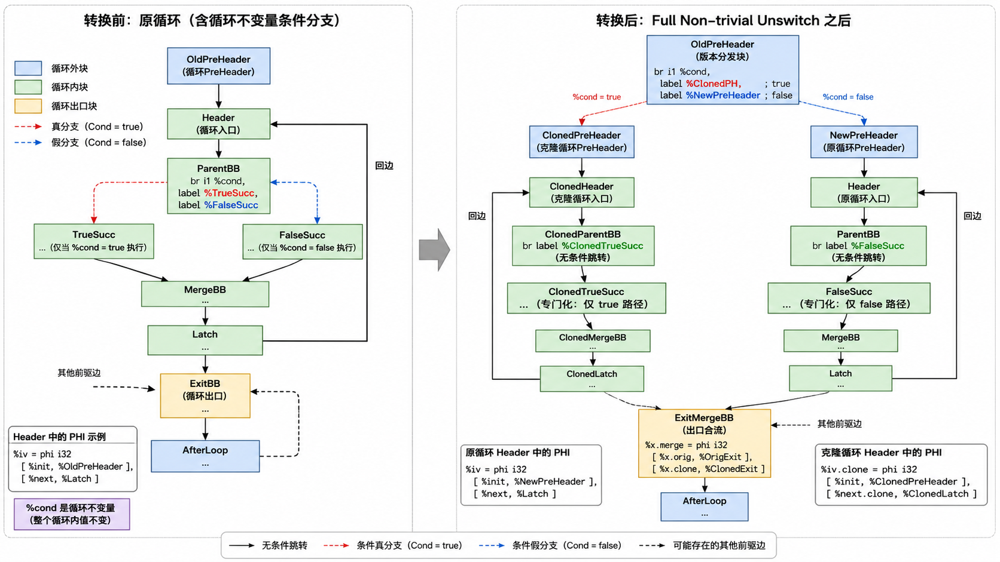


##### LoopUnroll循环展开

依赖的AnalysisPass：LoopInfo，SCEV

实现了四种展开形式：

1. Fully Unroll完全展开
2. Partial Unroll部分展开
3. Runtime Unroll运行时展开
4. Peeling循环剥离

本来还想实现Bounded Unroll，但是发现测试样例中没有和其匹配的循环形式，所以就直接放弃了

- 算法流程：函数级Pass

  1. 先拿到LoopInfo，如果拿不到就直接返回（没LoopInfo就是没循环）
  2. 前置需要运行的Transform Pass：需要在LoopSimplify，LCSSA后面进行运行，即检查是否符合LoopSimplify以及LCSSA形式
  3. 主循环：对每个Loop进行while(!Worklist.empty())循环
  4. 最后按照pass具体执行情况决定保留哪些AnalysisPass

  - 主循环：

    1. 收益模型

    2. #### 1. 外层循环：按照展开因子复制循环体

       对于展开因子为 `Count` 的循环，原始循环体本身可以看作第 0 份，因此执行层只需要额外复制 `Count - 1` 份循环体。外层循环从第 1 份开始，到第 `Count - 1` 份结束。

       其整体流程如下：

       ```
       for i = 1 to Count - 1:
           创建当前展开副本的 BasicBlock 映射表
           创建当前展开副本的 Instruction / Value 映射表
           遍历原循环中的所有 BasicBlock
           复制当前 BasicBlock
           复制其中的指令
           记录旧 BasicBlock 到新 BasicBlock 的映射
           记录旧 Instruction 到新 Instruction 的映射
           修复当前副本中的 PHI 和操作数引用
           记录当前副本的 Header 和 Latch
           记录当前副本中可能跳出循环的 ExitingBlock
       ```

       这里从 `1` 开始复制，是因为第 0 份循环体就是原循环本身。例如展开因子为 4 时，最终执行效果相当于：

       ```
       原循环体       -> 第 0 份
       复制出的副本 1 -> 第 1 份
       复制出的副本 2 -> 第 2 份
       复制出的副本 3 -> 第 3 份
       ```

       复制完成后，执行层会将每一份循环体串联起来，使第 0 份的 latch 跳到第 1 份的 header，第 1 份的 latch 跳到第 2 份的 header，直到最后一份 latch 再跳回原 header，形成新的部分展开循环结构。

       #### 2. 内层循环：复制当前副本中的 BasicBlock

       在每一轮外层循环中，内层循环会按照循环块的 CFG 顺序遍历原循环中的所有 BasicBlock，并为当前展开副本复制对应的新 BasicBlock。

       其主要流程如下：

       ```
       for BB in LoopBlocks:
           NewBB = cloneBasicBlock(BB)
           将 NewBB 插入到函数中
           记录 BMap[BB][i] = NewBB
        
           for Inst in BB:
               NewInst = cloneInstruction(Inst)
               将 NewInst 插入 NewBB
               记录 IMap[Inst][i] = NewInst
       ```

       其中，`BMap` 用于记录原基本块和新基本块之间的映射关系，`IMap` 用于记录原指令和新指令之间的映射关系。后续修复 CFG 边、PHI 节点和指令操作数时，都需要依赖这两个映射表。

       复制 basic block 时，不能只简单复制指令，还需要处理 SSA 关系。因为 clone 出来的指令一开始可能仍然引用原循环中的值，需要在复制完成后将这些 operand 替换成当前展开副本中对应的新值。

       #### 3. Header PHI 的特殊处理

       循环 header 中通常包含归纳变量或 loop-carried value 的 PHI 节点，例如：

       ```
       i = phi [init, preheader], [i.next, latch]
       ```

       在展开后的第 1 份、第 2 份等副本中，header 的 PHI 不能直接保留。原因是每个 clone 出来的 header 实际上只会从上一份循环体的 latch 进入，因此这些 PHI 可以被上一份循环体计算出的回边值替代。

       因此，对于 clone 出来的 header block，需要执行以下处理：

       ```
       如果当前复制的是 Header:
           遍历原 Header 中的所有 PHI
           找到该 PHI 从原 Latch 传入的 incoming value
           如果当前不是第 1 份副本，则将 incoming value 替换成上一份副本中的对应值
           在当前副本中，用这个 incoming value 替换 clone 出来的 PHI
           删除 clone 出来的 PHI
       ```

       例如部分展开 4 倍时，原本的回边值是：

       ```
       i.next
       ```

       展开后，最后回到原 header 的值应该变成：

       ```
       i.next.3
       ```

       也就是第 3 份展开副本中计算出的归纳变量更新值。

       因此，Header PHI 修复是循环展开中最核心的 SSA 修复步骤之一。

       #### 4. 操作数重映射

       复制完当前展开副本的所有 BasicBlock 和 Instruction 后，需要统一修复 clone 指令中的操作数引用。

       其流程如下：

       ```
       for NewInst in 当前展开副本:
           for Operand in NewInst:
               如果 Operand 是原循环中的值:
                   将 Operand 替换为当前副本或上一副本中的对应新值
       ```

       例如原循环中有：

       ```
       x = add i, 1
       ```

       复制到第 1 份副本后，应该变成：

       ```
       x.1 = add i.1, 1
       ```

       而不是继续引用原来的 `i`。这个过程依赖前面维护的 `IMap` 或 `LastValueMap`。

       其中，`LastValueMap` 的作用是记录“某个原始值目前最新的一份展开副本中的对应值”。它对于多份展开副本之间传递 loop-carried value 非常重要。

       #### 5. Exit PHI 的修复

       如果原循环中的某个 basic block 会跳出循环，那么它的 clone 版本也可能跳出循环。此时，exit block 中的 PHI 节点需要新增来自 clone block 的 incoming value。

       其流程如下：

       ```
       for Succ in BB.successors:
           if Succ 不在当前循环中:
               for Phi in Succ.phis:
                   找到 Phi 中原来来自 BB 的 incoming value
                   如果该 incoming value 在当前副本中有新值，则替换为新值
                   给 Phi 添加 [new incoming value, NewBB]
       ```

       例如原来 exit block 中有：

       ```
       x.lcssa = phi [x, exiting]
       ```

       展开后需要变成：

       ```
       x.lcssa = phi [x, exiting],
                     [x.1, exiting.1],
                     [x.2, exiting.2],
                     [x.3, exiting.3]
       ```

       如果不修复 exit PHI，循环外使用循环内定义值时，SSA 形式就会被破坏。

       #### 6. 记录 Header、Latch 和 ExitingBlock

       在复制每一份循环体时，需要记录当前副本中的 header、latch 和 exiting block：

       ```
       如果当前复制的是 Header:
           Headers.push_back(NewBB)
        
       如果当前复制的是 Latch:
           Latches.push_back(NewBB)
        
       如果当前复制的是 ExitingBlock:
           ExitingBlocks.push_back(NewBB)
       ```

       这些信息用于后续修复 CFG：

       ```
       Latch[0] -> Header[1]
       Latch[1] -> Header[2]
       ...
       Latch[Count - 2] -> Header[Count - 1]
       Latch[Count - 1] -> Header[0]
       ```

       也就是说，展开后的多份循环体会被串联成一个更大的循环体，最后一份 latch 再跳回原 header，继续下一轮展开后的循环迭代。

       #### 7. 修复原 Header PHI

       当所有副本复制完成后，还需要修复原 header 中的 PHI 节点。对于部分展开来说，原 header 仍然存在，但它的回边来源不再是原 latch，而是最后一份展开副本的 latch。

       因此需要执行：

       ```
       for Phi in 原 Header.phis:
           删除 Phi 中来自原 Latch 的 incoming
           找到该 incoming value 在最后一份副本中的对应值
           添加新的 incoming：
               [最后一份副本中的对应值, 最后一份 Latch]
       ```

       例如：

       ```
       原来：
       i = phi [0, preheader], [i.next, latch]
        
       展开 4 倍后：
       i = phi [0, preheader], [i.next.3, latch.3]
       ```

       这样才能保证下一轮展开后的循环迭代从正确的归纳变量值继续执行。

  #### 1. Full Unroll

  Full Unroll 用于 Trip Count 是较小常量，并且循环可以被完全展开的情况。它会调用公共执行核心复制循环体，但在复制完成后不再保留原循环回边。

  整体流程如下：

  ```
  executeFullUnroll:
      1. 获取展开因子 Count，通常 Count 等于常量 Trip Count。
      2. 调用 cloneUnrolledBodyCore(L, Count)，复制 Count - 1 份循环体。
      3. 将第 0 份 latch 连接到第 1 份 header。
      4. 将第 1 份 latch 连接到第 2 份 header。
      5. 依次连接所有展开副本。
      6. 最后一份 latch 不再跳回原 header，而是跳向原 exit block。
      7. 删除原 header 中的 PHI。
      8. 用来自 preheader 的初始值替换 header PHI 的所有使用。
      9. 删除原循环回边。
      10. 删除不可达循环控制块，或交给后续 SimplifyCFG / DCE 清理。
      11. 标记 LoopInfo、DominatorTree、SCEV 等分析失效。
      12. 返回 FullyUnrolled。
  ```

  Full Unroll 的关键特化点是：

  ```
  1. 最后一份 latch 不回到原 header。
  2. 原 header PHI 被删除。
  3. 原循环控制结构被消除。
  4. 返回结果是 FullyUnrolled。
  ```

  #### 2. Partial Unroll

  Partial Unroll 用于 Trip Count 可以被展开因子整除，或者至少当前策略决定不需要单独生成 remainder loop 的情况。它会调用公共执行核心复制循环体，并保留原循环结构。

  整体流程如下：

  ```
  executePartialUnroll:
      1. 获取展开因子 Count。
      2. 调用 cloneUnrolledBodyCore(L, Count)，复制 Count - 1 份循环体。
      3. 将第 0 份 latch 的回边从 Header0 改为 Header1。
      4. 将第 1 份 latch 的回边从 Header1 改为 Header2。
      5. 依次连接所有展开副本。
      6. 将最后一份 latch 的回边改为 Header0。
      7. 修复原 header 中的 PHI。
      8. 删除原 header PHI 中来自原 latch 的 incoming。
      9. 找到该 incoming value 在最后一份副本中的对应值。
      10. 添加新的 incoming：[最后一份副本中的值, 最后一份 latch]。
      11. 标记 LoopInfo、DominatorTree、SCEV 等分析失效。
      12. 返回 PartiallyUnrolled。
  ```

  Partial Unroll 的关键特化点是：

  ```
  1. 最后一份 latch 仍然回到原 header。
  2. 原 header PHI 保留。
  3. 原 header PHI 的回边 incoming 改成最后一份副本产生的值。
  4. 原循环仍然存在，只是循环体变大。
  ```

  例如：

  ```
  原来：
  i = phi [0, preheader], [i.next, latch]

  展开 4 倍后：
  i = phi [0, preheader], [i.next.3, latch.3]
  ```

  #### 3. Partial With Remainder

  Partial With Remainder 用于 Trip Count 是常量，但不能被展开因子整除的情况。它会调用公共执行核心展开主循环，同时额外生成 remainder loop 处理剩余迭代。

  整体流程如下：

  ```
  executePartialWithRemainder:
      1. 获取展开因子 Count。
      2. 通过 SCEV 获取 remainder 信息。
      3. 计算 Remainder = TripCount % Count。
      4. 计算 MainTripCount = TripCount - Remainder。
      5. 修改主循环退出条件，使主循环只执行 MainTripCount 次。
      6. 调用 cloneUnrolledBodyCore(L, Count)，复制主循环中的 Count - 1 份循环体。
      7. 按 Partial Unroll 的方式连接主循环内部的 headers 和 latches。
      8. 修复主循环原 header PHI，使其回边来自最后一份主循环副本。
      9. 生成 remainder loop。
      10. remainder loop 的初始归纳变量使用主循环结束后的归纳变量值。
      11. remainder loop 使用原始循环边界作为退出条件。
      12. 将主展开循环的 exit 连接到 remainder loop。
      13. 将 remainder loop 的 exit 连接到原 exit block。
      14. 修复 main loop、remainder loop 和原 exit block 之间的 PHI。
      15. 标记 LoopInfo、DominatorTree、SCEV 等分析失效。
      16. 返回 PartiallyUnrolled。
  ```

  Partial With Remainder 的关键特化点是：

  ```
  1. 公共核心只用于展开主循环。
  2. 主循环执行 TripCount - Remainder 次。
  3. 额外生成 remainder loop 执行剩余 Remainder 次。
  4. 需要修复 main loop -> remainder loop -> exit 之间的 PHI。
  ```

  #### 4. Runtime Unroll

  Runtime Unroll 用于 Trip Count 不是编译期常量，但 SCEV 能够表示运行时 Trip Count 的情况。它会先生成运行时主循环边界和 remainder 逻辑，然后调用公共执行核心展开主循环。

  整体流程如下：

  ```
  executeRuntimeUnroll:
      1. 获取展开因子 Count。
      2. 通过 SCEV 获取运行时 TripCount 表达式。
      3. 将 TripCount 表达式物化为 IR Value。
      4. 生成 Remainder = TripCount % Count。
      5. 生成 MainTripCount = TripCount - Remainder。
      6. 生成 runtime guard：
           如果 TripCount < Count，则直接跳到 remainder loop；
           否则进入主展开循环。
      7. 修改主循环退出条件，使主循环只执行 MainTripCount 次。
      8. 调用 cloneUnrolledBodyCore(L, Count)，复制主循环中的 Count - 1 份循环体。
      9. 按 Partial Unroll 的方式连接主循环内部的 headers 和 latches。
      10. 修复主循环原 header PHI，使其回边来自最后一份主循环副本。
      11. 生成 runtime remainder loop。
      12. remainder loop 从主循环结束后的归纳变量值开始执行。
      13. remainder loop 使用原始循环边界作为退出条件。
      14. 将主循环 exit 连接到 remainder loop。
      15. 将 remainder loop exit 连接到原 exit block。
      16. 修复 guard、main loop、remainder loop 和 exit block 之间的 PHI。
      17. 标记 LoopInfo、DominatorTree、SCEV 等分析失效。
      18. 返回 PartiallyUnrolled。
  ```

  Runtime Unroll 的关键特化点是：

  ```
  1. 公共核心只用于展开主循环。
  2. TripCount、Remainder、MainTripCount 都需要在运行时生成 IR 计算。
  3. 需要额外生成 runtime guard。
  4. 需要生成 runtime remainder loop。
  5. 返回结果仍然是 PartiallyUnrolled。
  ```

  #### 5. 调用关系总结

  ```
  executeFullUnroll
      -> cloneUnrolledBodyCore
      -> full CFG 收尾

  executePartialUnroll
      -> cloneUnrolledBodyCore
      -> partial CFG 收尾

  executePartialWithRemainder
      -> 修改主循环边界
      -> cloneUnrolledBodyCore
      -> 生成 remainder loop
      -> 修复 PHI

  executeRuntimeUnroll
      -> 物化 runtime TripCount
      -> 生成 runtime guard
      -> 修改主循环边界
      -> cloneUnrolledBodyCore
      -> 生成 runtime remainder loop
      -> 修复 PHI
  ```

- 运行完之后需要运行我们的清理类pipeline进行深度清理


##### ADCE--激进死代码消除

依赖 AnalysisPass：PostDominant，SideEffect

Mark-Sweep 算法，数据依赖用 worklist 反向传播活性，控制依赖用 postdom 链回溯保活条件分支。死条件分支改为无条件跳转（不做 PHI repair，由后续 CFGSimplify 清理不可达块）。

- 整体流程：

  ```mermaid
  flowchart TD
      A[Initialize<br/>收集 root-live 指令] --> B[Mark worklist]
      B --> C{取出 I}
      C --> D[数据依赖:<br/>保活所有 Instruction 型操作数]
      C --> E["控制依赖:<br/>markControlDependences(I.block)"]
      C --> F{I 是 PhiInst?}
      F -->|是| G[对每个 incoming block<br/>做 markControlDependences]
      F -->|否| H
      D --> H{worklist 空?}
      E --> H
      G --> H
      H -->|否| C
      H -->|是| I[Sweep Phase 1:<br/>死条件分支 → 无条件跳转]
      I --> J[Sweep Phase 2:<br/>删除死的非 terminator 指令]
  ```

- Root-live 判定（`isRootLive`）：

  ```
  function isRootLive(I, F, PDT, FAM):
      if I is StoreInst: return true              // store 永远保活
      if I is RetInst:   return true              // return 永远保活
      if I is CallInst:
          return callHasObservableSideEffect(I)    // 看副作用
      if I is BrInst:
          if 无条件 br: return true
          if not PDT.isReachableToExit(I.block):
              return true     // reverse-unreachable 块的 terminator 不可删
          return false         // 条件分支等控制依赖判定
      return false
  ```

  用户函数 call 一律 root-live（`callHasObservableSideEffect` 对用户函数返 true），理由：SideEffectAnalysis 对自递归调用跳过，`getFunctionModRefInfo` 不证明可终止，保守保活。只有明确标记 `NoModRef` 的 builtin 才可删。

  reverse-unreachable 块（无限循环里的块）的 terminator 强制 root-live，因为它们到不了 exit，postdom 关系不可靠。

- 控制依赖回溯（`markControlDependences`）：

  控制依赖(B) ≈ postdom frontier(B) 的反向定义。从 B 的每个前驱 P 开始，沿 ipostdom 链走到 ipostdom(B)，路径上每个条件分支都控制 B 的执行 → 保活：

  ```
  function markControlDependences(B, PDT):
      if B in CDProcessed: return
      CDProcessed.insert(B)
      if not PDT.isReachableToExit(B): return   // reverse-unreachable 跳过

      stop = PDT.getIPostDom(B)                  // 可能是 null (虚拟根)

      for P in B.predecessors:
          runner = P
          while runner != stop:
              if runner == null: break
              if not PDT.isReachableToExit(runner): break
              term = runner.terminator
              if term is 条件分支:
                  markLive(term)
              runner = PDT.getIPostDom(runner)
  ```

- 死分支改写（`pickSurvivorSuccessor`）：

  **始终从原始两个后继中选一个**（不跳到任意 postdom，这样不需要 PHI repair）：

  ```
  function pickSurvivorSuccessor(BB, PDT):
      br = BB.terminator
      (trueBB, falseBB) = br.successors

      if trueBB == falseBB: return trueBB    // 同目标直接选

      ipd = PDT.getIPostDom(BB)
      if ipd == trueBB:  return trueBB        // 优先选 ipostdom 如果它是后继
      if ipd == falseBB: return falseBB

      if PDT.postDominates(trueBB, falseBB):  return trueBB    // 更接近 exit
      if PDT.postDominates(falseBB, trueBB):  return falseBB

      return trueBB                           // 都不后支配对方，任选
  ```

  死分支改写后，从被丢弃的后继视角看当前块消失，需要调用 `removePhiIncoming(BB, dropped)` 清理该后继块中 PHI 的 BB incoming（复用 CFGSimplifyPass 的逻辑）。

- Sweep：

  1. Phase 1 死条件分支改写：对每个 terminator 非 live 的块，`pickSurvivorSuccessor` 选一条边，`genUnCondInst(survivor)` 换无条件跳转
  2. Phase 2 删死非 terminator：`replaceAllUsesWith(Undef)` 然后 delete

-


##### DSE--死存储消除

依赖 AnalysisPass：BasicAliasAnalysis，LoopInfo，SideEffect（间接通过 `getInstModRefInfo`）

**Forward Kill Coverage 模型**：对每个 store S1 出发前向 BFS 染色，S1 死当且仅当所有 BFS 路径都被 KILL（后续完整覆盖 store）挡住，没有任何路径落到 CLOBBER 或非局部 exit。

天然支持分支联合覆盖：`if-else` 两边都写同一地址 `%p` 时，BFS 两条路径都被 KILL 挡住，自动判定 S1 dead。不需要单个 store 后支配 S1（不依赖 postdom 单点覆盖）。

- 块染色定义：

  对目标指针 P 在块 BB 内扫描第一个相关事件：

  | 颜色 | 判定条件 |
  |---|---|
  | KILL | 块内首个 P 相关事件是 MustAlias store（完整覆盖） |
  | CLOBBER | 块内存在可能读 P（Ref）或不可证完整覆盖的写（MayAlias store / Call with Mod） |
  | TRANSPARENT | 块内无 P 相关事件 |

  MustAlias 隐含完整覆盖（同类型同宽度）的假设对当前 IR 成立；若后续 IR 引入不同宽度切片 store 需额外加大小比较。

- 整体流程：

  ```mermaid
  flowchart TD
      A[Phase 1 块内 DSE:<br/>逆序扫描，MustAlias 连续 store 保留最后一个] --> B[Phase 2 全局 DSE]
      B --> C[对每个 store S1]
      C --> D[Phase A: classifyBlockPartial<br/>扫 S1 之后的指令]
      D --> E{tailColor?}
      E -->|KILL| F[S1 dead ✓]
      E -->|CLOBBER| G[S1 alive ✗]
      E -->|TRANSPARENT| H{B1 是 exit?}
      H -->|是| I{P 是 local?}
      I -->|是| F
      I -->|否| G
      H -->|否| J[Phase B: 前向 BFS]
      J --> K[取 BB = 队首]
      K --> L{visited &#124;&#124; 回到 B1?}
      L -->|回到 B1| G
      L -->|新块| M[classifyBlock]
      M --> N{color?}
      N -->|KILL| K2[这条路径挡住, 不再推后继]
      N -->|CLOBBER| G
      N -->|TRANSPARENT| O{有后继?}
      O -->|否, exit| I
      O -->|是| P[推入后继]
      K2 --> Q{队空?}
      P --> Q
      Q -->|否| K
      Q -->|是| F
  ```

- 关键辅助：

  `callMayAliasPointer(CI, P)` 作为 `getInstModRefInfo` 的安全网，保守检查 CallInst 是否传了任何 alias P 的指针参数。原因：SideEffectAnalysis 对自递归调用会跳过，`getInstModRefInfo` 可能对递归调用返回 `NoModRef`，但实际上调用会修改 P。

  ```
  function callMayAliasPointer(CI, P, AA, LI):
      for arg in CI.args:
          if arg.type != IR_POINTER: continue
          if AA.alias(P, arg, LI) != NoAlias:
              return true
      return false
  ```

  `isLocalPointer(P)` 判断 P 是否最终指向栈上 alloca（返回后对 caller 不可见），只做 GEP/BitCast 链的保守追溯：

  ```
  function isLocalPointer(P):
      base = P
      while base:
          if base is AllocaInst: return true
          if base is GetElementPtrInst: base = base.baseOperand
          elif base is BitCastInst:     base = base.source
          else: return false            // Global / Param / 其他不可确定
      return false
  ```

- BFS 的关键保险：

  - `blockBudget = 100` 超预算保守放弃（大函数兜底）
  - **visited 包括 B1 起始块**，BFS 若沿循环回边走回到 B1 → 返回 false（下一次迭代可能读到 S1 的值）
  - 走到 exit（`succs.empty()`）时：P 是 local → continue（这条路径 OK）；P 是 global/param → return false（caller 可能读）

- Phase 1（块内 DSE）：

  ```
  function eliminateInBlock(BB):
      pendingStores = {}                  // ptr → 最近的 store
      for I in reversed(BB.instructions):
          if I is LoadInst:
              pendingStores.erase(I.ptr)  // 后续 load 破坏 pending
          elif I is StoreInst:
              if I.ptr in pendingStores:
                  delete I                 // 被后面的 store 覆盖
              else:
                  pendingStores[I.ptr] = I
          elif I is CallInst:
              pendingStores.clear()       // call 保守清空
  ```


##### LoadElimination--可用内存值前传

依赖 AnalysisPass：Dominant，BasicAliasAnalysis，LoopInfo，PostDominant（通过 `getInstModRefInfo` 间接）

**Available Memory Value Forwarding**：对每个 load P，回答"所有到达此 load 的路径上，P 的最近相关内存事件各给出什么值？"。所有路径一致 → 直接替换；各前驱已知但值不同 → 在块头造 PHI；任一路径上出现 Clobber → 保守不动。

和 DSE 的关键区别：纯 Ref（只读）**不阻断** load forwarding，只有 Mod（写操作）才破坏已知值。

- QueryResult lattice：

  ```
  enum Kind {
      KNOWN,              // 所有路径值相同 → value
      PHI_NEEDED,         // 各前驱已知但值不同 → predMap 有效
      CLOBBERED,          // 某路径上无法证明
      UNKNOWN,            // 预算耗尽 / 环依赖
      NEED_PREDECESSORS   // 块内没找到定义，要继续查前驱（内部用）
  };
  ```

- 整体流程：

  ```mermaid
  flowchart TD
      A["processLoad(load I, P)"] --> B["Step 1: scanBlockBackward<br/>从 load 位置向前扫本块"]
      B --> C{结果?}
      C -->|KNOWN v| D[replace I with v]
      C -->|CLOBBERED| E[放弃]
      C -->|NEED_PREDECESSORS| F[Step 2: 查每个前驱]
      F --> G["queryAvailableValue(pred, depth=1)"]
      G --> H{所有前驱 KNOWN?}
      H -->|否| E
      H -->|是 & allSame| I[replace I with firstVal]
      H -->|是 & 不同| J[Step 3: PHI synthesis<br/>创建新 PhiInst]
  ```

- 块内扫描（`scanBlockBackward`）：

  ```
  function scanBlockBackward(BB, P, stopBefore, targetLoad):
      cur = stopBefore ? stopBefore.prev : BB.back()
      while cur:
          if cur is StoreInst:
              ai = AA.alias(P, cur.ptr)
              if ai == MustAlias and typeCompatible(cur.val, targetLoad):
                  return KNOWN(cur.val)           // store-load forwarding
              if ai != NoAlias:
                  return CLOBBERED                // MayAlias store
          elif cur is LoadInst and cur != targetLoad:
              if AA.alias(P, cur.ptr) == MustAlias and typeCompatible(cur, targetLoad):
                  return KNOWN(cur)               // load-load 复用
          elif cur is CallInst:
              MR = getInstModRefInfo(P, cur)
              if isModSet(MR): return CLOBBERED
              if isNoModRef(MR) and callMayAliasPointer(cur, P):
                  return CLOBBERED                 // 安全网
              // 纯 Ref → 不阻断，继续
          else:
              MR = getInstModRefInfo(P, cur)
              if isModSet(MR): return CLOBBERED
          cur = cur.prev
      return NEED_PREDECESSORS
  ```

- 跨块递归查询（`queryAvailableValue`）：

  ```
  MAX_DEPTH = 8
  function queryAvailableValue(P, BB, targetLoad, depth, onStack, memo):
      if depth > MAX_DEPTH:       return UNKNOWN
      if BB in onStack:            return UNKNOWN       // 真实 CFG 环
      if BB in memo:               return memo[BB]       // 钻石图共享祖先
      onStack.insert(BB)

      result = scanBlockBackward(BB, P, null, targetLoad)
      if result in {KNOWN, CLOBBERED}:
          memo[BB] = result; onStack.erase(BB); return result

      // NEED_PREDECESSORS
      preds = BB.predecessors
      if preds.empty():
          memo[BB] = CLOBBERED     // 函数入口，初始值未知
          return CLOBBERED

      predValues = []
      allSame = true
      firstVal = null
      for pred in preds:
          pr = queryAvailableValue(P, pred, targetLoad, depth+1, onStack, memo)
          if pr is CLOBBERED or UNKNOWN:
              memo[BB] = CLOBBERED; return CLOBBERED
          if pr is KNOWN:
              predValues.append((pred, pr.value))
              if firstVal == null: firstVal = pr.value
              elif pr.value != firstVal: allSame = false
          if pr is PHI_NEEDED:
              memo[BB] = CLOBBERED  // 第一版不处理嵌套 PHI
              return CLOBBERED

      final = allSame ? KNOWN(firstVal) : PHI_NEEDED(predValues)
      memo[BB] = final; onStack.erase(BB)
      return final
  ```

- PHI synthesis：

  ```
  phi = new PhiInst(loadInst.type)
  for (pred, val) in predValues:
      phi.addIncoming(val, pred)
  BB.push_front(phi)
  loadInst.replaceAllUsesWith(phi)
  delete loadInst
  ```

- 遍历顺序：

  外层 `processFunction` 沿**支配树前序**遍历（`DominatorTree DFS`），保证处理一个 load 时其支配前驱的 load 已经被可能地消除，最大化前传机会


##### GepEvaluate--GEP 单条指令化简

依赖 AnalysisPass：Dominant，LoopInfo

当前 IR 使用 **typed pointer**（不是 opaque pointer），GEP 的零索引会改变结果指针类型，因此"全零索引消除""尾零裁剪"之类依赖 opaque pointer 语义的规则不安全，不做。只保留不涉及类型裁剪的规则：

- 规则列表：

  | 规则 | 条件 | 变换 |
  |---|---|---|
  | 无索引退化 | `gep(p)` 没有索引 | 替换为 `p` 本身 |
  | Undef 基址传播 | `gep(undef, ...)` | 替换为 `undef`（结果类型） |
  | 多非零索引拆分 | 非零索引数 ≥ 2 | 在第二个非零索引处拆成两条串联 GEP |

- 多非零索引拆分示意：

  ```
  // 变换前
  %p = gep %arr, 0, i, j, k     // 3 个非零索引
  // 变换后
  %front = gep %arr, 0, i         // 前半：到第一个非零索引
  %p     = gep %front, 0, j, k    // 后半：补首 0，继续剩余索引
  ```

  拆分不改变地址计算语义（两个 GEP 串联的偏移等价于原始单个 GEP），但让别名分析更容易区分不同数组元素、后端指令选择更灵活。

- 伪代码：

  ```
  for GEP in F.instructions:
      base = GEP.operand[0]
      numIndices = GEP.operands.size - 1
  
      if numIndices == 0:
          GEP.replaceAllUsesWith(base); delete GEP; continue
  
      if base is UndefValue:
          GEP.replaceAllUsesWith(Undef(GEP.type)); delete GEP; continue
  
      // 扫描非零索引
      nonZeroCount = 0
      splitPoint = 0
      for i in [1, UL.size):
          if i == 1 and UL[i] == const(0): continue   // 首部 0 不算
          if UL[i] != const(0):
              nonZeroCount += 1
              if nonZeroCount == 2:
                  splitPoint = i; break
  
      if splitPoint > 0:
          frontIndices = UL[1 .. splitPoint-1]
          frontGEP = new GetElementPtrInst(base, frontIndices)
          frontGEP.updateType()
          insertBefore(GEP, frontGEP)
  
          backIndices = [const(0)] + UL[splitPoint .. end]
          GEP.operands.clear()
          GEP.addUse(frontGEP)
          for idx in backIndices: GEP.addUse(idx)
          GEP.updateType()
  ```


##### GepCombine--跨 GEP 优化

依赖 AnalysisPass：Dominant，LoopInfo

三个子优化：**链式 GEP 合并**、**PHI 中 GEP 提取**、**循环内相邻 GEP 合并**。pass 内部对链式合并做最多 4 轮迭代（合并后可能暴露新的合并机会），然后一次 PHI 提取、一次相邻合并。

- **Part 1: 链式 GEP 合并**

  当一个 GEP 的基址是另一个 GEP 的结果时，两个 GEP 的索引序列可以拼接成一个，减少一条指令，也让后续别名分析更容易看到真实基址。base GEP 必须**单 use**，否则它不能删、合并不减指令。

  三种合并场景：

  | 场景 | 条件 | 示例 |
  |---|---|---|
  | 首索引为 0（类型穿越） | 当前 GEP 首索引是 `const 0` | `gep(gep(arr, i1, i2), 0, i3) → gep(arr, i1, i2, i3)` |
  | base 末索引为 0 | base 的末索引是 `const 0` | `gep(gep(arr, i1, 0), i2, i3) → gep(arr, i1, i2, i3)` |
  | 交界处双常量相加 | 交界处两个索引都是常量 | `gep(gep(arr, i1, 3), 2, i3) → gep(arr, i1, 5, i3)` |

  交界处相加后要额外检查：**合并后非零索引数 ≤ 1**（首部零索引不算），超过就不合并，防止合并后 GEP 比合并前更复杂。

  实现用**延迟删除集合**（`deleted`、`toDelete`）避免遍历中 delete 导致悬空指针。

  ```
  for GEP in F.geps:    if GEP in deleted: continue    base = GEP.operand[0]    if base not GetElementPt找出SCEV一共实现了几种rInst: continue    if base in deleted: continue    if countUses(base) > 1: continue        // 单 use 检查    firstIdx     = GEP.operand[1]    baseLastIdx  = base.operands.back()    if firstIdx is const(0):        newIndices = base.indices + GEP.indices[1:]        replaceGEPOperands(GEP, base.baseOp, newIndices)        toDelete.append(base); deleted.insert(base)    elif baseLastIdx is const(0):        newIndices = base.indices[:-1] + GEP.indices        replaceGEPOperands(...)    elif firstIdx is const(c1) and baseLastIdx is const(c2):        combined = base.indices[:-1] + [const(c1+c2)] + GEP.indices[1:]        if nonZeroCount(combined) <= 1:            replaceGEPOperands(...)
  ```

- **Part 2: PHI 中 GEP 提取**

  如果 PHI 的所有 incoming value 都是结构相同的 GEP（共享同一个 base，只在一个索引位置不同），把 GEP 提到 merge 块，不同的索引位置换成新 PHI：

  ```
  // 变换前
  merge:
      %p = phi [%gep1, bb1], [%gep2, bb2]
      where %gep1 = gep %base, 0, %i1
            %gep2 = gep %base, 0, %i2

  // 变换后
  merge:
      %idx = phi [%i1, bb1], [%i2, bb2]
      %p   = gep %base, 0, %idx
  ```

  限制：
  - 只允许**一个索引位置不同**（多了不值得）
  - PHI 必须**单 use**
  - 不折叠通过循环回边指向自身的 GEP（避免寄存器压力增大）
  - 若所有 incoming GEP **完全相同**，不能直接用某个 incoming 替换 PHI（它定义在前驱块，不支配当前块的所有 uses），必须 clone 一份 GEP 到当前块（修这个 bug 后全量脚本运行时间反而快了 5s）

  ```
  for Phi in BB.phis:
      if countUses(Phi) > 1 or not Phi.type == IR_POINTER: continue

      firstGEP = asGEP(Phi.incoming[0].value)
      if not firstGEP: continue
      if 任一 incoming 指向 Phi 自身: continue    // self-ref 跳过

      diffIdx = -1
      for i in [1, Phi.incoming.size):
          otherGEP = asGEP(Phi.incoming[i].value)
          if otherGEP.operands.size != firstGEP.operands.size: bail
          if otherGEP.base != firstGEP.base: bail
          for j in [1, firstGEP.operands.size):
              if otherGEP.operand[j] != firstGEP.operand[j]:
                  if diffIdx == -1: diffIdx = j
                  elif diffIdx != j: bail

      if diffIdx == -1:
          // 所有 incoming 完全相同 → clone 到当前块
          cloned = new GetElementPtrInst(firstGEP.base, firstGEP.indices)
          insertBeforeFirstNonPhi(BB, cloned)
          Phi.replaceAllUsesWith(cloned); delete Phi
      else:
          // 在 diffIdx 位置造新 PHI
          newPhi = new PhiInst(firstGEP.operand[diffIdx].type)
          for (pred, val) in Phi.incoming:
              newPhi.addIncoming(asGEP(val).operand[diffIdx], pred)
          BB.push_front(newPhi)
          newIndices = firstGEP.indices with diffIdx replaced by newPhi
          newGEP = new GetElementPtrInst(firstGEP.base, newIndices)
          insertBeforeFirstNonPhi(BB, newGEP)
          Phi.replaceAllUsesWith(newGEP); delete Phi
  ```

- **Part 3: 循环内相邻 GEP 合并**

  同一个块内如果有两个 GEP 除末索引外完全相同、末索引差一个常量，后一个改为从前一个结果出发加偏移：

  ```
  // 变换前
  %a = gep %arr, 0, %i
  %b = gep %arr, 0, %i.plus.1    // %i.plus.1 = add %i, 1

  // 变换后
  %a = gep %arr, 0, %i
  %b = gep %a, 1                  // 从 %a 出发偏移 1
  ```

  通过 hash 索引前缀将同一块内 GEP 分组（除末索引外的前缀相同），组内相邻对尝试合并。处理两种末索引 pattern：
  - `curLast = add(prevLast, const)` → 直接从 prevGEP 偏移 `const`
  - `prevLast = add(base, c1)` 和 `curLast = add(base, c2)` 同 base → 从 prevGEP 偏移 `c2 - c1`

- 整体 pass 入口：

  ```mermaid
  flowchart LR
      A[Part 1 链式合并<br/>最多 4 轮] --> B[Part 2 PHI GEP 提取]
      B --> C[Part 3 循环内相邻合并]
  ```


##### RangeAwareSimplify--基于范围的指令化简

依赖 AnalysisPass：Dominant，RangeAnalysis

消费 RangeAnalysis 的结果（IntRange + KnownBits 两套 lattice）对多种 pattern 做化简。七个 phase 顺序执行：单值/全位常量折叠、比较折叠、select 相关三组模式、强度削减、srem→urem 占位。

- 整体流程：

  ```mermaid
  flowchart LR
      A[RangeAnalysis 结果<br/>IntRange + KnownBits] --> B[foldConstants<br/>单值区间 or KB 全锁定 → ConstInt]
      B --> C[foldComparisons<br/>不重叠区间 → ConstBool<br/>KB 位级互斥 → eq/ne]
      C --> D1[foldIcmpOfSelect<br/>icmp/select 下推折叠]
      D1 --> D2[foldAbsViaSelect<br/>手写 abs 在 x≥0 时折回 x]
      D2 --> D3[foldMinMaxViaSelect<br/>手写 smax/smin range dominate 时折单边]
      D3 --> E[strengthReduce<br/>div/mod 2^n → ashr/and<br/>前提 x 非负]
      E --> F[convertSignedToUnsigned<br/>srem→urem 占位]
  ```

- **Phase 1: foldConstants--单值范围 + 全位锁定折叠**

  IntRange 单值折 ConstInt 是基本路径；KB 全 32 位锁定是**补位路径**，专门捕捉 range 没收敛到单值但 bit 级已经被位运算锁死的情形（典型：`(x & 0) | c`、`(x ^ x) + c` 等）。IntRange 和 KnownBits 是独立 lattice，它们能判的集合不完全重叠。

  ```
  function foldConstants():
      toFold = []
      for I in F.instructions:
          if I 已是 ConstInt: continue
          if I.type != IR_INT: continue
          if I 有副作用（Call / Load / Store）: continue
          range = RI.query(I, I.block, DT)
          if range.isSingleValue():
              toFold.append(I); continue
          kb = RI.queryBits(I, I.block, DT)
          if kb.isFullyKnown():
              toFold.append(I)

      for I in toFold:
          range = RI.query(I, I.block, DT)
          cval = range.isSingleValue() ? (int)range.min
                                        : RI.queryBits(I, I.block, DT).getConstant()
          I.replaceAllUsesWith(ConstInt(cval))
          delete I
  ```

- **Phase 2: foldComparisons--比较结果折叠**

  扫所有比较操作（L/LE/G/GE/E/NE），双通道：IntRange 端点判定 + KnownBits 位级互斥判 eq/ne。

  **类型守卫（必须）**：我们 IR 的 `BinaryInst::Operation` 里 L/LE/G/GE/E/NE 是整数浮点共用的，只能靠操作数类型区分（`fcmp ueq` 和 `icmp eq` 在 dumpIR 里看 LHS 是 IR_INT 还是 IR_FLOAT 分支）。进入 phase 前必须 guard `lhs->getIRType()->getTypeSystem() == IR_INT` 和 `rhs->getIRType()->getTypeSystem() == IR_INT`，浮点直接跳过。否则把 fcmp 当 icmp 推理会在 FFT / 浮点密集用例全线 WA。

  **IntRange 端点判定表**：

  | op | true 当 | false 当 |
  |---|---|---|
  | `L`  (lhs < rhs)  | `lRange.max < rRange.min`  | `lRange.min >= rRange.max` |
  | `LE` (lhs ≤ rhs)  | `lRange.max <= rRange.min` | `lRange.min > rRange.max`  |
  | `G`  (lhs > rhs)  | `lRange.min > rRange.max`  | `lRange.max <= rRange.min` |
  | `GE` (lhs ≥ rhs)  | `lRange.min >= rRange.max` | `lRange.max < rRange.min`  |
  | `E`  (lhs == rhs) | 都单值且相等              | 范围不重叠                |
  | `NE` (lhs != rhs) | 范围不重叠                | 都单值且相等              |

  **KB 位级互斥（仅 eq/ne）**：lhs 和 rhs 的 KnownBits 在某位上"一侧 zero=1 而另一侧 one=1" → 该位必然不同 → 两个值必然不相等 → `eq` 折为 false、`ne` 折为 true。规则：

  ```
  conflict = (lKB.zero & rKB.one) | (lKB.one & rKB.zero)
  if conflict != 0:
      eq → false, ne → true
  ```

  折叠为 `ConstBool::newConstBool(result)`，死分支由后续 CFGSimplify 清理。

- **Phase 3a: foldIcmpOfSelect--icmp(select) 下推折叠**

  `icmp(select(c, a, b), x)` 把 cmp 推到 select 的两个分支，让每个分支用更紧的 range 判定。只处理"两侧 cmp 结果都能被 range 定住"的强情形，弱情形（只一侧能折）会引入新 select 导致指令增多，不做。

  ```
  function foldIcmpOfSelect():
      for cmp in integer icmps:
          if cmp.lhs is not SelectInst: continue
          sel = cmp.lhs; (c, tv, fv) = sel.operands
          resT = evalIntCmp(cmp.op, range(tv), range(rhs))
          resF = evalIntCmp(cmp.op, range(fv), range(rhs))
          if resT == -1 or resF == -1: continue

          if resT == resF:
              cmp.replaceAllUsesWith(ConstBool(resT))
          else if resT == 1 && resF == 0:
              cmp.replaceAllUsesWith(c)          // cmp ≡ select 的 cond
          // resT==0 && resF==1 情形：cmp ≡ !cond，需要新建 xor，跳过
  ```

- **Phase 3b: foldAbsViaSelect--手写 abs 在 x 非负时折回 x**

  识别：

  ```
  select(cmp(x, 0, L|LE), 0 - x, x)     // if x < 0 then -x else x
  select(cmp(x, 0, GE|G), x, 0 - x)     // if x >= 0 then x else -x
  ```

  当 `RI.query(x, block, DT).isNonNegative()` 时，两种写法的 abs 都等价于 x，直接 `select.replaceAllUsesWith(x)`。

- **Phase 3c: foldMinMaxViaSelect--手写 smax/smin 在 range dominate 时折单边**

  识别：`select(cmp(a, b, op), tv, fv)` 其中 tv/fv 必须来自 {a, b} 的排列（直或互换）。

  **严格/非严格必须区分**（曾踩坑：`a==b==5` 时 `select(a>b, a, b)` 原语义走 false 分支返 b，若用 `ra.min >= rb.max` 统一判定会错折成 a，而 a 和 b 是不同 SSA 值时就是实打实的错变换）：

  | cmp op | 恒 true 当 | 恒 false 当 |
  |---|---|---|
  | `G`  (a > b)  | `ra.min > rb.max`  | `ra.max <= rb.min` |
  | `GE` (a ≥ b)  | `ra.min >= rb.max` | `ra.max < rb.min`  |
  | `L`  (a < b)  | `ra.max < rb.min`  | `ra.min >= rb.max` |
  | `LE` (a ≤ b)  | `ra.max <= rb.min` | `ra.min > rb.max`  |

  cmp 恒定后 select 选哪支直接取 `cmp==1 ? tv : fv`，整体折成单边。

- **Phase 4: strengthReduce--强度削减**

  条件：`x` 经 RangeAnalysis 判定非负 + 除数是 2^n 常量。

  - `sdiv x, 2^n → ashr x, n`：sdiv 对负被除数"向零取整"，ashr 是"向下取整"，负数语义不同，**必须依赖 RangeAnalysis 的非负前提**才能安全用 ashr
  - `srem x, 2^n → and x, 2^n - 1`：srem 保留被除数符号，AND 是无符号语义，同样依赖 x 非负

  历史踩坑（现已修）：旧版本用 `BinaryInst::Operation(Instruction::ASHR)` 强制 cast —— `Instruction::InstType::ASHR` 和 `BinaryInst::Operation::ASHR` 在两个独立枚举里索引不同（前者 26，后者 12），这个 cast 生成非法 op 的 BinaryInst。前端把 `SHL/LSHR/ASHR` 加入 `BinaryInst::Operation` 后，直接用 `BinaryInst::ASHR` 构造即可。

  插入点用 `BasicBlock::Iterator(BI)` 直接构造 O(1)，不再 `BB->begin()` 线性扫描（之前 O(n) per-insert 的 hot path）。

- **Phase 5: convertSignedToUnsigned--srem→urem 占位**

  若被除数非负且除数为正，signed rem 等价于 unsigned rem，某些后端 urem 更快（无需处理符号位）。当前 IR 没有独立的 UREM 指令，此 phase 是 placeholder，等后端区分 srem/urem 后再实装。


##### ConstraintElimination--约束传播消除冗余分支

依赖 AnalysisPass：Dominant，RangeAnalysis

沿支配树 DFS 维护约束栈，消除被已知约束**蕴含**或**矛盾**的条件分支。

约束来源两路：
- **控制流**：BB 单前驱且前驱是条件分支 → 从 icmp 提取约束（按 true/false 支取反）
- **RangeAnalysis seed**：对 br 条件的 target val 临时注入 `[vr.min, vr.max]` 一对 GE/LE 约束，判定完 pop 回去不污染子树记账

和 RangeAwareSimplify 的分工：RangeAwareSimplify 用"值的全局范围"做点式化简，ConstraintElimination 用"路径上的已知事实 + RangeAnalysis seed"做路径敏感的判定，两者互补。

- 约束结构：

  ```
  struct Constraint {
      Value *val;               // 被约束的值
      BinaryInst::Operation op; // L, LE, G, GE, E, NE
      Value *bound;             // 比较目标
      bool boundIsConst;        // bound 是否是 ConstInt
      int64_t boundVal;         // bound 的常量值（boundIsConst 时有效）
  };
  ```

- 整体流程：

  ```mermaid
  flowchart TD
      A[从 Root 开始 DFS 支配树] --> B[进入 BB<br/>恢复约束栈到 constraintsBefore]
      B --> C{BB 单前驱 &<br/>前驱是条件分支?}
      C -->|是| D[从前驱 icmp 提取约束<br/>根据 BB=trueBB/falseBB 决定取反<br/>push 到约束栈]
      C -->|否| E[继续]
      D --> E
      E --> F{BB 的 terminator<br/>是条件分支?}
      F -->|是| G[提取 target 约束]
      F -->|否| J[递归子节点]
      G --> H{蕴含 target?}
      H -->|是| I1[toFold: cmp → true]
      H -->|否| K{矛盾 target?}
      K -->|是| I2[toFold: cmp → false]
      K -->|否| J
      I1 --> J
      I2 --> J
      J --> L[子节点逆序入栈<br/>记录当前约束栈深度]
      L --> M{还有节点?}
      M -->|是| B
      M -->|否| N[遍历 toFold:<br/>replaceAllUsesWith ConstBool]
  ```

- 约束提取（含仿射归一化）：

  若 terminator 是 `br (icmp op lhs rhs) trueBB falseBB`：
  - 进入 `trueBB` 时施加约束 `(lhs op rhs)`
  - 进入 `falseBB` 时施加约束 `(lhs !op rhs)`（`!op` 即 L↔GE, LE↔G, E↔NE）

  `extractConstraint` 会做**仿射归一化**（轻量的 expression normalization）：

  | 原始形式 | 归一化后 |
  |---|---|
  | `(x + c1) op c2`  | `x op (c2 - c1)`  |
  | `(c1 + x) op c2`  | `x op (c2 - c1)`  |
  | `(x - c1) op c2`  | `x op (c2 + c1)`  |
  | `(c1 - x) op c2`  | `x (flipped op) (c1 - c2)` |

  归一化只在 RHS 是 ConstInt + LHS 是 `add/sub` 且另一侧常量时生效，溢出一律退回原始形式。归一化后的 bound 用 **interned ConstInt** 存（`ConstInt::newConstInt(val)`）—— 之前用 `nullptr` 曾让 `sameBound` 快速路径把 "x >= 0" 和 "x >= 100" 都判成"同 bound" 直接蕴含，是个 WA blocker。

  **类型守卫（必须）**：和 RangeAwareSimplify 同样的坑，`extractConstraint` 必须 guard lhs/rhs 的 IR_INT 类型，浮点比较直接跳过，否则会把 fcmp 当 icmp 推理。

- 蕴含判定：单跳 + 两跳传递链

  **`implies(known, target)`**：两约束必须 val 相同，bound 相同或都是常量可数值比较。常量 bound 情况下的 15 条规则：

  | 已知 | 蕴含 `x < tB` | 蕴含 `x <= tB` | 蕴含 `x != tB` |
  |---|---|---|---|
  | `x < kB`  | `kB <= tB`     | `kB <= tB + 1` | `kB <= tB` |
  | `x <= kB` | `kB < tB`      | `kB <= tB`     | `kB < tB`  |
  | `x > kB`  | —              | —              | `kB >= tB` |
  | `x >= kB` | —              | —              | `kB > tB`  |

  （`x > kB` / `x >= kB` 的对称行蕴含 `x > tB` / `x >= tB`；`x == kB` 蕴含任何由等式直接推出的关系。）

  `sameBound` 的语义（修过的 WA 点）：两端都是常量时按 `boundVal` 数值相等判定；非常量看 `Value*` 指针相等。不要只靠指针 —— 归一化时可能构造出不同 pointer 但同 value 的 ConstInt，或指针是 nullptr。

  **`impliesTransitive(stack, target)`**（两跳传递链）：如果栈里有 `val op1 m` 和 `m op2 C`（C 为常量），复合后得到 `val (op1∘op2) C` 再走单跳判定。组合表覆盖同向不等号（`<, <=` / `>, >=`）和等号。O(stack^2) 上限，栈深受支配树深度约束，实际很小。

  **综合**：`isImpliedChained = isImplied || impliesTransitive`。

  **矛盾判定**：把目标约束的 op 取反，再走一遍 `isImpliedChained`。

  非常量 bound 只判完全相同的约束（保守）。

- 伪代码：

  ```
  function run(F):
      DT = FAM.getResult<DominantAnalysis>(F)
      RI = FAM.getResult<RangeAnalysis>(F)
      toFold = []
      constraintStack = []
      dfsStack = [(DT.Root, 0)]

      while dfsStack not empty:
          (node, before) = dfsStack.pop()
          BB = node.block
          constraintStack.resize(before)

          // 从唯一前驱的条件分支提取约束
          if BB.preds.size() == 1:
              pred = BB.preds[0]
              if pred.terminator is 条件分支 br (icmp ...) t f:
                  negate = (BB == f)
                  if extractConstraint(icmp, negate, c):
                      constraintStack.push(c)

          // 仅在 constraintStack 非空时处理（空栈 + 某些块 back() 组合曾触发 SIGSEGV，
          // 保留 guard；range-seed-only 路径由 RangeAwareSimplify 兜底）
          if constraintStack not empty and BB.terminator is 条件分支 br (icmp ...):
              if extractConstraint(icmp, false, target):
                  // 临时 seed: 从 RangeAnalysis 注入 target.val 的 [min, max]
                  savedSize = constraintStack.size()
                  vr = RI.query(target.val, BB, DT)
                  if not vr.isTop() and not vr.isBottom() and target.val is i32:
                      constraintStack.push({val:target.val, op:GE, bound:ConstInt(vr.min)})
                      constraintStack.push({val:target.val, op:LE, bound:ConstInt(vr.max)})

                  if isImpliedChained(constraintStack, target):
                      toFold.append((icmp, true))
                  else if isContradicted(constraintStack, target):
                      toFold.append((icmp, false))

                  constraintStack.resize(savedSize)    // pop 掉 seed

          // 子节点入栈（逆序，保证先序遍历）
          curSize = constraintStack.size()
          for child in reversed(node.children):
              dfsStack.push((child, curSize))

      for (cmp, result) in toFold:
          cmp.replaceAllUsesWith(ConstBool(result))
          delete cmp
  ```

- 当前不做的事（留给后续迭代）：

  1. 三跳及以上传递链（当前只有 single-hop + two-hop；完整闭包需要真正的约束求解器）
  2. 值替换式约束（`x = y + 1` 时把 `x` 的约束搬成 `y` 的，已部分通过 `extractConstraint` 的仿射归一化覆盖，但仅限 RHS 是常量场景）
  3. 浮点约束推理


##### StoreOnlyGlobalElimination--全局变量优化

模块级（Module-level）pass，挂在 MPM 上。对齐 LLVM GlobalOpt 的核心能力：不仅删除"只写不读"的 global 的 store，还做**索引精确追踪**、**SideEffect 集成判定**、**常量初值传播**、**死 global 物理删除**。

依赖：`SideEffectAnalysis`（复用其 RefSet 和 classifyBuiltin），构造时通过 `FunctionAnalysisPassManager` 引用注入。

- 整体四阶段流程：

  ```mermaid
  flowchart TD
      A[Pass 1: 读取收集<br/>按 global + 常量索引追踪] --> B[Pass 2: 删除无效 store<br/>粒度: 每个 const-idx]
      B --> C[Pass 3: 常量初值传播<br/>无 store 的标量 global<br/>load 替换为 init 值]
      C --> D[Pass 4: 死 global 移除<br/>useList 空 → 从 Module erase]
  ```

- Pass 1：读取收集（per-global，per-常量索引）

  每个 global 维护 `ReadInfo`：
  ```
  struct ReadInfo {
      bool anyIndexRead;                  // 有变量索引读 / 不可追踪
      unordered_set<int64_t> constIdx;    // 被读到的常量索引集合
  };
  ```

  扫所有指令：

  **LoadInst**：对 load 的指针 `ptr` 做 `traceBaseAndIndex`，提取 `(base, constPath[])` 或标记 `hasVarIdx`/`unresolved`：
  - 单 base 精确路径（全常量索引）→ 把 `constPath[1]`（数组首维下标）加入 `constIdx`
  - 变量索引 / 多 base / unresolved → 走 `collectReachableBases` 收集所有可能 base，每个都设 `anyIndexRead = true`
  - 指针逃逸（Load/Call 返回值/参数） → 所有候选 `anyIndexRead = true`（**不** bail 整个 pass）

  **CallInst**：复用 SideEffectAnalysis 精确判定
  - **内置函数**（`BuildInFunction`）：查 `classifyBuiltin(BIF)`；`Sylib`/`MemReadOnly`/`ReadWrite`/`Untracked` 才遍历实参标记；`MemWriteOnly`（如 `putint`）直接跳过
  - **用户函数**：`FAM.getResult<SideEffectAnalysis>(callee)`
    - `SEI.hasBuiltin = true` → 保守（callee 内部有不可预测的 sylib 调用）
    - 检查 `SEI.RefSet`：若 RefSet 含某 Variable → 该 global 被直接读
    - 对每个 param：若 param ∈ `SEI.RefSet` → 该位置的实参基址被读

- Pass 2：按粒度删 store

  ```
  对每个 StoreInst SI:
      (base, constPath) = traceBaseAndIndex(SI.ptr)
      G = base as Variable, must be global candidate
      info = reads[G]

      情形 A: G ∉ reads          → 删（从没人读 G）
      情形 B: info.anyIndexRead  → 不删
      情形 C: store 也是全常量索引:
          key = constPath[1] if array else 0
          key ∉ info.constIdx  → 删
          否则                   → 不删
      情形 D: store 用变量索引   → 不删（不知影响哪个常量索引）
  ```

- Pass 3：常量初值传播（LLVM GlobalOpt 经典模式）

  对每个**标量** global（`IR_INT` / `IR_FLOAT` 指针），经过 Pass 2 后若**仍无 store** 写它：

  ```
  initVal = G.getUsee()  // userList[0] 是显式初值，无则 zero-init
  constRepl = initVal as ConstInt/ConstFloat, 或 ConstInt(0)/ConstFloat(0)
  for each LoadInst loading G:
      if GEP path 是标量形态（constPath={0} 或空）:
          LI.replaceAllUsesWith(constRepl)
          delete LI
  ```

  数组 global 不处理（SysY 里数组 init 通常是 `Initializer`，后续 pass 会展开成 per-element store，此时 Pass 2 已处理）。

- Pass 4：死 global 物理移除

  ```
  for each Variable G in M.globalvars:
      if G.useList.is_empty():   // 经过 Pass 2/3 后没人再引用它
          erase from M.globalvars  // unique_ptr 析构 Variable
  ```

  `Value::~Value` 遇到空 useList 不做级联，安全。

- 指针追溯的双路设计：

  单一 base 精确路径（用于 store 删除决策）：
  ```
  function traceBaseAndIndex(ptr):
      idx = []
      while ptr and depth < 32:
          if ptr is Variable:
              return {base: ptr, constPath: reverse(idx)}
          if ptr is GEP:
              for each index 操作数:
                  if ConstInt → idx.append(val)
                  else → hasVarIdx = true
              ptr = gep.base
          elif ptr is BitCast: ptr = bc.source
          else: unresolved = true; return
  ```

  PHI / Select 多 base 收集（用于读集合保守标记）：
  ```
  function collectReachableBases(ptr, out_bases, escape):
      递归访问 PHI 所有 incoming、Select 的两分支
      叶子 Variable 加入 bases
      遇到 Load/Call/Param → escape = true（整体所有 global 标 anyIndexRead）
  ```


- Pipeline 位置：

  挂在 `buildLightCleanupPipeline` 第二轮之后、`IfConversion` 之前。此时 Promote/SCCP/InstSimplify 已清掉大部分冗余，Load/Store 的指针形态稳定，适合做精确基址/索引追踪。后续 `buildHeavyMemoryPipeline` 的 GVNPRE/DSE 能继续清理被暴露出的死计算链。


##### ConstantHoist--大整数常量提升

依赖 AnalysisPass：Dominant、LoopInfo

RISC-V / ARM 的 sign-ext **imm12** 范围是 `[-2048, 2047]`，超出这个范围的整数常量每个 use 都要 `lui + addi` 两条指令材料化。ConstantHoist 把"跨 use 共享的大整数常量"抽成一个 SSA 值，组内相近值再用 `add base, offset` rebase 共享 base，以此压缩常量材料化指令数、降寄存器压力。浮点路径做一个 `fadd -0.0, fv` 的 wrapper，让跨 use 的同值常量暴露一个 SSA 活值给后端寄存器分配看到。

- 整体五阶段流程：

  ```mermaid
  flowchart TD
      A[Step1: collectCandidates<br/>扫所有非-PHI 指令的 operand<br/>按 int32 数值 / float bit-pattern 分桶] --> B[Step2: sort + sliding window<br/>int 桶按 value 升序<br/>diff < IMM_THRESHOLD 归一组]
      B --> C[Step3: 每组挑 base<br/>uses 最多者]
      C --> D[Step4: foldCommonDominator<br/>+ pickInsertionBlock<br/>NCA 所在最外层循环则上爬 preheader]
      D --> E[Step5: materializeGroup<br/>插 baseSSA、offset=0 直接替换<br/>offset≠0 按 block 聚合 rebase]
  ```

- 候选收集与门槛：

  `collectCandidates` 扫所有非-PHI 指令的 operand（PHI 的 incoming 定义点必须在 incoming block 末尾，物化指令插在非 PHI 位置无法满足这个规约，直接跳过）。按值分两桶：

  ```
  intBuckets:   unordered_map<int32_t, Candidate>     // key = ConstInt 数值
  floatBuckets: unordered_map<uint32_t, Candidate>    // key = float bit pattern (memcpy)
  ```

  过滤门槛：
  - 整数：`|v| < IMM_THRESHOLD = 2048`（imm12 能直接带）直接不入桶
  - 每个 UseSite 同时记 `loopDepth`（为 cost filter 用）

- Base+Offset 滑动窗口（仅整数）：

  把 int 候选按 value 升序扫，滑动窗口：

  ```
  Group cur; cur.push_back(sorted[0]); windowMin = sorted[0].value
  for i = 1 .. n-1:
      diff = sorted[i].value - windowMin
      if diff < IMM_THRESHOLD:
          cur.push_back(sorted[i])
      else:
          closeGroup(cur, groups)  // 选 uses 最多者做 base
          cur = new Group([sorted[i]])
          windowMin = sorted[i].value
  closeGroup(cur, groups)
  ```

  **不变式**：窗口条件 `diff < 2048` 保证组内 `max - min ≤ 2047`；base 无论选谁，`|v - base| ≤ max - min ≤ 2047`，每个 member 的 offset 都落在 imm12 内、可以一条 `addi` 带。

  base 选策略：组内 uses 最多的 member 做 base，这样"直接替换为 baseSSA"（offset = 0 路径）的 use 最多，rebase 条数最少。

- 插入点（NCA + loop-aware）：

  ```
  common = foldCommonDominator(DT, allUses)    // NCA of all use blocks
  insertBB = pickInsertionBlock(common, entry, LI):
      若 common 不在循环内 → 直接用 common
      若 common 在循环内 → 爬到最外层循环的 preheader（LoopSimplify 保证存在）
      若爬不到 preheader → 退 function entry
  ```

  `foldCommonDominator` 用 accumulator + ancestor-set 均摊：只在 `acc` 发生变化时才重建 `acc` 的祖先链集合，大多数 use 直接撞到已缓存的链上 O(1) 判出。

- Cost filter：

  ```
  对每个 Group:
      maxDepth = max over members of m.maxDepth
      totalUses = sum of m.uses.size()
      if maxDepth == 0 && totalUses < STRAIGHT_LINE_USE_THRESHOLD(3):
          skip   // 纯直线代码下 hoist 净增一条 base add 不划算
  ```

  循环内（`maxDepth > 0`）任意 uses 数都做；纯直线代码（`maxDepth == 0`）要至少 3 个 use 才做。

- Per-block 聚合（整数 offset ≠ 0 的 rebase）：

  同一个 member value 若在同一个 block 有 K 个 use，只生成**一条** `matInst = add baseSSA, offset`，插在块内**最早的**那个 use 之前；块内所有该 value 的 use 全指向这一条。

  ```
  byBlock: BasicBlock* → vector<UseSite*>
  for each (B, useList):
      userSet = { us.inst for us in useList }
      earliest = 扫 B 的指令流，第一个落在 userSet 里的 Instruction
      matInst = new BinaryInst(baseSSA, ADD, ConstInt(offset))
      insertBeforeInst(B, earliest, matInst)
      for us in useList: us.u->replaceUseeWith(matInst)
  ```

  支配性：`baseSSA` 在 `insertBB` 的 PHI-after 位置，`insertBB` dominates 所有 use block（NCA 的语义保证），所以 `baseSSA` dominates 所有块内插入的 `matInst`。✓

- `insertBeforeInst` 兜底：

  查找时若 `before` 不在 `BB` 里（集合不一致，理论不应发生），不做 `push_back`（那会把 inst 扔到 terminator 之后破坏 IR 合法性），而是退到 "在 terminator 之前插入"。若 block 根本没有 terminator 才最终 `push_back`（块本身已经非法了，无需再保护）。

- 浮点路径（wrapper 不做 base/offset）：

  ```
  materializeFloatCandidate(C, insertBB):
      fv = memcpy bit-pattern 还原 float
      baseSSA = fadd -0.0, fv     // IEEE 754: -0.0 + x = x 对所有 x（含 ±0.0）严格成立
      插在 insertBB PHI-after 位置
      for us in C.uses: us.u->replaceUseeWith(baseSSA)
  ```

todo：浮点 wrapper 的实际收益依赖后端对 `ConstFloat` use 的 lowering 策略 —— 若后端 per-use 发射常量装载，IR 层 wrapper 让这些 load 合并为一条；若后端已按 `ConstFloat` 指针做全局 dedup，本 pass 的 wrapper 是净增一条 fadd，反而 regress。IR 层 `ConstFloat` 本身已经 interning（`ConstFloat::newConstFloat` 用静态 `std::map<float, ConstFloat*>`），所以**dedup 不是目的**，暴露"跨 use 活的 SSA 值"给后端寄存器分配才是。


https://gemini.google.com/app/2937246d3292e3d5


### 参考博客
