# 参赛文档

### 代码声明

**一、第三方 IP 借鉴声明**

1. 本项目的 IR 结构设计整体借鉴自LLVM的设计理念和架构组织，但做了本项目特化
2. 一些AnalysisPass和TransformPass借鉴LLVM的算法思想，但做了本项目特化

**二、人工智能辅助工具使用声明**

在本项目开发中，使用了人工智能辅助编程工具，生成的代码范围及使用方式说明如下：

- 本项目的大部分代码使用**Codex**在编辑器中以“编码—提示-补全”模式辅助编写；
- Codex生成某些pass以及中端架构的初版架构，然后由人工原创设计pass算法及实现，然后人工进行审查
- 使用了AI大模型ChatGPT生成该文档中某些图，用来更好的说明一些优化流程
- 人工审阅与修改：所有 AI 生成的代码，均由团队成员逐行审阅，针对项目接口规范、性能要求、安全检查等进行必要的补充、重构与单元测试，确保最终代码质量与一致性。

### 分工合作

- 刘烨嘉一：负责前端以及中端
- 宋科宏：负责RISCV后端和ARM后端

### 总体框架

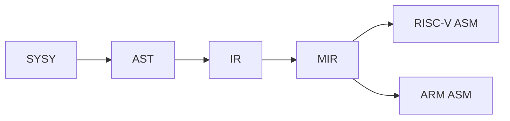

```
Compiler/
├── doc/                              # 竞赛文档
│
├── include/                          # .hpp文件
│   ├── yacc/                         # 词法、语法分析相关文件
│   ├── lib/                          # 编译器前端文件及中端基础结构文件
│   ├── ir/                           # 中端优化框架
│   │   ├── analysis/                 # 中端分析 Pass
│   │   └── opt/                	  # 中端变换与优化 Pass
│   ├── riscv/                        # RISC-V 后端
│   └── aarch64/                      # ARM 后端
│
├── src/                              # .cpp文件
│   ├── yacc/                         # 词法、语法分析相关文件
│   ├── lib/                          # 编译器前端文件及中端基础结构文件
│   ├── ir/                           # 中端优化框架
│   │   ├── analysis/                 # 中端分析 Pass
│   │   └── opt/                      # 中端变换与优化 Pass
│   ├── riscv/                        # RISC-V 后端
│   └── aarch64/                      # ARM 后端
│
├── runtime/                          # SysY 运行时库
├── main.cpp                          # 编译器入口
├── CMakeLists.txt                    # CMake 项目构建配置
└── README.md                         # 项目说明
```

### 前端

#### SysY2022及Runtime分析

> 这一部分是本人在阅读完相关文档的一些总结，目的为了便于后续开发前中端查阅需要

**Sysy2022**

- .sy文件结构：全局变量声明，全局常量声明，函数定义，唯一的main函数定义

- 注释：单行和多行（遇到第一个*/就结束）

- 数值类型：int/float类型和元素为int/float类型且按**行优先存储**的多维数组类型

  隐式类型转换：编译器在需要是可自动转换float/int，不支持程序员 `(int)`、`(float)` 主动指定转换

  > 混合运算时，int先转float，再进行计算
  >
  > float隐式转换成int时，小数部分直接丢弃，float超出int范围，进行转换为未定义行为
  >
  > int隐式转换成float时，转换后值保持不变

- 函数：

  参数为 int/float 时，按值传递

  参数为数组类型时，实际传递的是数组的起始地址，并且**形参第一维的长度必须空缺**。

  ```c
  //示例1：
  //在如下例子传入的就是a[0]，并且实际修改的就是main中的data[0]
  void process(int a[]) {
      a[0] = 100;
  }
  int main() {
      int data[3] = {1, 2, 3};
      process(data);
  }
  //示例2：
  void process(int a[][3]) {
  }
  
  //示例3：支持多维数组降维传递
  //下图传递了data[1]这个[3][4]的二维数组
  void process_matrix(int a[][4]) {
      a[0][0] = 100;
  }
  
  int main() {
      int data[2][3][4];
      process_matrix(data[1]);
      return 0;
  }
  ```

- 数值常量：**忽略所有后缀**

  - 整数常量：

    - 十进制
    - 八进制：以0开头
    - 十六进制：以0x或0X开头

  - 浮点常量：均存在整数+小数/省略整数/省略小数三种形式，**忽略所有后缀**

    - 十进制：

      普通形式：3.14 / .5 / 1.

      十进制指数：

      **注意指数的底数为10**

      ```
      1e3      = 1 × 10³    = 1000
      2.E2     = 2. × 10²  = 200
      .14e-2   = 0.14 × 10⁻² = 0.0014
      ```

    - 十六进制：

      0x 十六进制数字 '.' 十六进制数字 p 十进制指数：

      **注意指数的底数为2**

      ```
      0x1.2p3 = 1.125 × 8 = 9
      	0x1.2 = 1 + 2 × 16⁻¹
          = 1 + 2/16
          = 1.125
      	2³ = 8
      ```

- 一些规则：

  - 常量必须初始化且不能再次赋值
  - 数组每一维定义必须显式给出
  - 未初始化局部变量值不确定
  - 未初始化全局变量/数组初始值为0
  - 初始化全局变量/数组初始值为常量表达式
  - 数组只能逐维赋值，不能整个赋值

- sysy其他未提到的参考C语言即可

**Runtime**

> 由于putf在测试用例中并未出现，所以本人没有实现这一runtime函数在前中端的处理

读取函数：

- int getint()：从**标准输入**读取一个整数，并返回对应的 `int` 值

- float getfloat()：从**标准输入**读取一个浮点数，返回 32 位单精度浮点值

- int getch()：从**标准输入**中读取一个字符（将整数视为字符），并返回该字符的 ASCII 码值

  ```c
  12 34
  |
  |
  '1' → 49
  '2' → 50
  ' ' → 32
  '3' → 51
  '4' → 52
  '\n' → 10    
  ```

- int getarray(int[])：输入一串整数，第 1 个整数代表后续要输入的整数个数，该个数通过返回值返回；后续的整数通过传入的数组参数返回

  ```c
  4 10 20 30 40
  
  int main() {
      int a[10];
      int n = getarray(a);
  }
  
  /*
  n = 4
  a[0] = 10
  a[1] = 20
  a[2] = 30
  a[3] = 40
  */
  ```

- int getfarray(float[])：同上

输出函数：

- void putint(int)：向**标准输出**打印一个整数

- void putfloat(float)：向**标准输出**打印一个单精度浮点数

- void putch(int)：将整数参数解释成 ASCII 码，并输出对应字符

  ```c
  putch(65); -> A
  ```

- void putarray(int, int[])：第 1 个参数表示要输出的整数个数(假设为 N)，后面应该跟上要输出的 N个整数的数组。putarray 在输出时会在整数之间安插空格

  ```c
  示例：int n=2; inta[]={2,3}; putarray(n, a);
  输出：2:2 3
  ```

- void putfarray(int,float[])：同上

计时函数：

> 输出格式：
>
> Timer#编号@开启行号-停止行号: 时-分-秒-微秒
>
> TOTAL: 时-分-秒-微秒
>
> Timer#001@0010-0012: 0H-0M-3S-3860us

- void starttime()
- void stoptime()

**llvm intrinsic  **

在中端还引入了llvm.memcpy / llvm.memset / llvm.memmove，引入主要为了便于优化，在后端生成asm前已经替换掉

```
memcpy：从源地址 src 开始，复制 len 个字节到目标地址 dest。（不允许重叠）
@llvm.memcpy.p0.p0.i32(ptr %dest, ptr %src, i32 %len, i1 %isvolatile)

memmove：从源地址 src 开始，复制 len 个字节到目标地址 dest。（允许重叠）
@llvm.memmove.p0.p0.i32(ptr %dest, ptr %src, i32 %len, i1 %isvolatile)

memset：从目标地址 dest 开始，将连续 len 个字节全部设置为同一个字节值 value。
@llvm.memset.p0.i32(ptr %dest, i8 %value, i32 %len, i1 %isvolatile)
```

#### 词法分析+语法分析

采用业界主流的Flex+Bison工具进行构建，由人工写好.l和.y文件之后通过Flex+Bison自行构建出相关hpp/cpp文件

#### AST

整个 AST 体系以 `BaseAST` 为唯一多态根节点。具体节点直接继承`BaseAST`（表达式链节点经 `BaseExp<T>` 间接继承）

- 编译单元：`CompUnit`
- 声明与定义：`ConstDecl`,`VarDecl`,`ConstDefList`,`VarDefList`,`ConstDef`,`VarDef`
- 函数相关：`FuncDef`, `FuncParam`, `FuncParamList`
- 初始化相关：`InitValList`, `InitVal`
- 语句相关：`Block`, `BlockItemList`, `AssignStmt`, `ExpStmt`, `IfStmt`, `WhileStmt`, `BreakStmt`, `ContinueStmt`, `ReturnStmt`
-  表达式相关：`LVal`, `FuncCall`, `ArrayList`, `FuncRParamList`, `UnaryExp`, `MulExp`, `AddExp`, `RelExp`, `EqExp`, `LAndExp`, `LOrExp`, `ConValue`

##### 相关结构：

1. 编译单元及声明与定义结构：

   ```mermaid
   graph TD
   
   	N1[CompUnit] --> N3[FuncDef]
   	N1[CompUnit] --> N4[ConstDecl]
   	N1[CompUnit] --> N5[VarDecl]
   	N4[ConstDecl] --> N6[ConstDefList]
   	N5[VarDecl] --> N7[VarDefList]
   	N6[ConstDefList] --> N8[ConstDef]
   	N7[VarDefList] --> N9[VarDef]
   	N3[FuncDef] --> N10[FuncParamList]
   	N3[FuncDef] --> N11[Block]
   	N10[FuncParamList] --> N12[FuncParam]
   	N8[ConstDef] --> N13[ident]
   	N8[ConstDef] --> N14[ArrayList]
   	N8[ConstDef] --> N15[InitVal]
   	N9[VarDef] --> N13[ident]
   	N9[VarDef] --> N14[ArrayList]
   	N9[VarDef] --> N15[InitVal]
   	N3[FuncDef] --> N16[ident]
   	N3[FuncDef] --> N17[Type]
   
   	N12[FuncParam] --> N18[Type]
   	N12[FuncParam] --> N19[ident]
   	N12[FuncParam] --> N20[ArrayList]
   	N4[ConstDecl] --> N21[Type]
   	N5[VarDecl] --> N22[Type]
   ```


2. 语句相关结构：

   ```mermaid
   graph TD
   	N1[Block] --> N2[BlockItemList]
       N2[BlockItemList] --> N3[BlockItem（文法分类）]
       N3 --> N19[ConstDecl]
       N3 --> N20[VarDecl]
       N3 --> N4[AssignStmt]
   	N4[AssignStmt] --> N5[LVal]
   	N4[AssignStmt] --> N6[AddExp]
       N3 --> N7[ExpStmt]
   	N7[ExpStmt] --> N8[AddExp]
       N3 --> N9[IfStmt]
   	N9[IfStmt] --> N10[LOrExp]
       N9[IfStmt] --> N11[then/else 分支]
       N3 --> N12[WhileStmt]
   	N12[WhileStmt] --> N13[LOrExp]
       N12[WhileStmt] --> N14[循环体]
       N3 --> N15[BreakStmt]
       N3 --> N16[ContinueStmt]
       N3 --> N17[ReturnStmt]
   	N17[ReturnStmt] --> n18[AddExp]
   
   ```


3. 表达式相关结构：

   ```mermaid
   graph TD
       N1[LOrExp] --> N2[LAndExp]
       N2[LAndExp] --> N3[EqExp]
       N3[EqExp] --> N4[RelExp]
       N4[RelExp] --> N5[AddExp]
       N5[AddExp] --> N6[MulExp]
       N6[MulExp] --> N7[UnaryExp]
       N7[UnaryExp] --> N8[PrimaryExp（文法分类）]
   
       N8 --> N9[LVal]
       N8 --> N10[FuncCall]
       N8 --> N11[ConValue]
       N8 --> N5
   
       N9[LVal] --> N12[ArrayList]
       N10[FuncCall] --> N13[FuncRParamList]
   
       N12[ArrayList] --> N5[AddExp]
       N13[FuncRParamList] --> N5[AddExp]
   ```

#### IR生成

使用Visitor设计模式，将IR生成相关逻辑与AST结构，IR结构解耦，实现了将AST转化为无SSA形式的，兼容LLVM格式的中间代码IR

#### 符号表

基于《编译器设计》一书中对符号表的解析上修改，设计而来

- 功能：主要用于IR生成阶段，便于建立中端Value与前端AST Ident映射的桥梁
  - 变量遮蔽：允许在内层作用域声明与外层同名的变量。在进入新作用域的时候能够及时屏蔽外层同名变量

### 中端

#### IR

> 为方便决赛拓展向量优化，IR提前拓展向量指令

采用与LLVM IR兼容的IR，便于使用LLVM工具链LLI/LLC进行测试

##### 支持指令：为LLVM IR的子集，目前一共38条指令

```
终止与控制流指令：
Ret
Br
Call

内存操作指令：
Alloca(分配局部变量的内存，返回地址指针)
Store
Load
GetElementPtr (GEP)（根据类型和下标计算地址）

二元运算指令：
算术运算: Add, Fadd, Sub, Fsub, Mul, Fmul
Sdiv, Fdiv,Udiv -- Udiv目前仍未使用
Srem, Frem,Urem -- Frem目前仍未使用,Urem中端优化引入
逻辑运算: And, Or, Xor --中端优化时引入（这里是按位运算指令，前端逻辑判断IR生成为基本块级）
移位运算: Shl逻辑左移, Lshr逻辑右移, Ashr算术右移 -- 中端优化引入
比较运算: Icmp, Fcmp
/*
icmp eq    // 整数相等：lhs == rhs
icmp ne    // 整数不等：lhs != rhs
icmp sgt   // 有符号大于：signed(lhs) > signed(rhs)
icmp sge   // 有符号大于等于：signed(lhs) >= signed(rhs)
icmp slt   // 有符号小于：signed(lhs) < signed(rhs)
icmp sle   // 有符号小于等于：signed(lhs) <= signed(rhs)
fcmp oeq   // 有序相等：两者都不是 NaN，并且 lhs == rhs
fcmp une   // 无序不等：至少一个是 NaN，或者 lhs != rhs
fcmp ogt   // 有序大于：两者都不是 NaN，并且 lhs > rhs
fcmp oge   // 有序大于等于：两者都不是 NaN，并且 lhs >= rhs
fcmp olt   // 有序小于：两者都不是 NaN，并且 lhs < rhs
fcmp ole   // 有序小于等于：两者都不是 NaN，并且 lhs <= rhs
无序指的是NaN，只要NaN存在就无法进行比较（除了不等之外）
*/


类型转换指令：
FPTOSI
SITOFP //用于隐式类型转换
Zext零扩展
Sext符号扩展
Trunc整数截断
BitCast将指针解释成另一种类型指针 -- 中端优化引入


静态单赋值 (SSA) 与选择指令：
Phi    -- 中端优化引入
Select -- 中端优化引入

向量运算指令：
extractelement 从固定长度向量中提取一个标量元素
insertelement  把一个标量元素插入到固定长度向量
shufflevector  按照常量mask将两个输入向量进行重排
```

> IR格式：
>
> ret：`ret i32 %result` / `ret void`
>
> br：`br label %destination` / `br i1 %condition, label %true_block, label %false_block`
>
> call：`%result = call i32 @function(i32 %arg1, float %arg2)` / `call void @function(i32 %arg)` / `%result = tail call i32 @function(i32 %arg)`
>
> alloca：`%ptr = alloca i32` / `%array = alloca [10 x i32]`
>
> store：`store i32 %value, i32* %ptr` / `store float %value, float* %ptr`
>
> load：`%value = load i32, i32* %ptr` / `%value = load float, float* %ptr`
>
> getelementptr（GEP）：`%element_ptr = getelementptr inbounds [10 x i32], [10 x i32]* %array, i64 0, i64 3`（**跨过0个数组长度，访问数组中第3号（第四个）元素array[3]**）
>
> add：`%result = add i32 %lhs, %rhs`
>
> fadd：`%result = fadd float %lhs, %rhs`
>
> sub：`%result = sub i32 %lhs, %rhs`
>
> fsub：`%result = fsub float %lhs, %rhs`
>
> mul：`%result = mul i32 %lhs, %rhs`
>
> fmul：`%result = fmul float %lhs, %rhs`
>
> and：`%result = and i32 %lhs, %rhs` / `%result = and i1 %condition1, %condition2`
>
> or：`%result = or i32 %lhs, %rhs` / `%result = or i1 %condition1, %condition2`
>
> xor：`%result = xor i32 %lhs, %rhs` / `%not = xor i1 %condition, true`
>
> icmp：`%result = icmp slt i32 %lhs, %rhs` / `%result = icmp eq i32 %lhs, %rhs`
>
> fcmp：`%result = fcmp olt float %lhs, %rhs` / `%result = fcmp oeq float %lhs, %rhs`
>
> sdiv：`%result = sdiv i32 %lhs, %rhs`
>
> fdiv：`%result = fdiv float %lhs, %rhs`
>
> srem：`%result = srem i32 %lhs, %rhs`
>
> frem：`%result = frem float %lhs, %rhs`
>
> udiv：`%result = udiv i32 %lhs, %rhs`
>
> urem：`%result = urem i32 %lhs, %rhs`
>
> shl：`%result = shl i32 %value, %shift` / `%result = shl i32 %value, 3`
>
> lshr：`%result = lshr i32 %value, %shift` / `%result = lshr i32 %value, 3`
>
> ashr：`%result = ashr i32 %value, %shift` / `%result = ashr i32 %value, 3`
>
> fptosi：`%result = fptosi float %value to i32`
>
> sitofp：`%result = sitofp i32 %value to float`
>
> zext：`%result = zext i1 %value to i32` / `%result = zext i8 %value to i32`
>
> bitcast：`%result = bitcast i32* %ptr to float*`
>
> trunc：`%result = trunc i32 %value to i1` / `%result = trunc i32 %value to i8`
>
> sext：`%result = sext i8 %value to i32` / `%result = sext i1 %value to i32`
>
> phi：`%result = phi i32 [ %value1, %block1 ], [ %value2, %block2 ]`
>
> select：`%result = select i1 %condition, i32 %true_value, i32 %false_value`
>
> extractelement：`%x = extractelement <4 x i32> %v, i32 %index`
>
> insertelement：`%r = insertelement <4 x i32> %v, i32 %x, i32 %index`
>
> shufflevector：`%result = shufflevector <4 x i32> %v1,<4 x i32> %v2,<4 x i32> <i32 0, i32 4, i32 1, i32 5>`

##### Value/User/Use

仿照LLVM进行设计，但是做了精简与本项目的适配

Use--链表结点

设计特点：禁止被拷贝和移动，禁止被继承

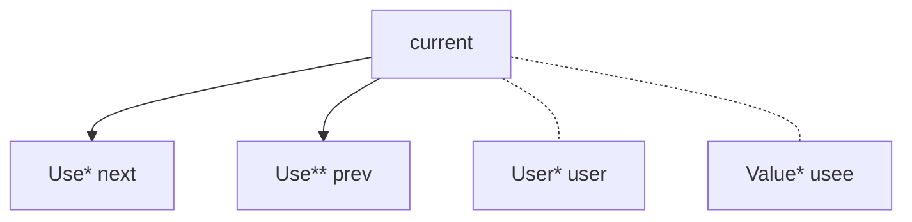


UseList --链表

设计特点：禁止被拷贝和移动，禁止被继承

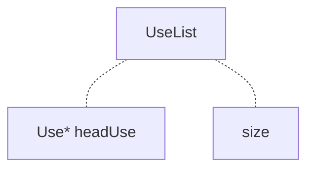

Value

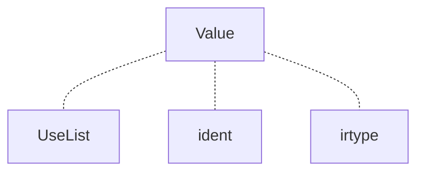

User

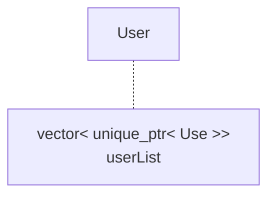

##### TypeSystem类型系统

> 为了便于决赛向量优化，IR类型系统提前支持向量类型

设计模式：采用单例static设计模式，并且使用shared_ptr包装裸指针进行内存管理


- 目的：用来支持IR的强类型语言的特性

- 支持类型：

  ```c++
  enum TypeSystem{
      IR_INT,IR_FLOAT,IR_VOID,IR_POINTER,IR_ARRAY,IR_VECTOR,IR_UNDEF
  };
  ```

  `IR_UNDEF` 仅用于表示前端源类型转换失败，不对应可实例化的 IR 类型

- 结构：

  ```mermaid
  graph TD
  	N1[IRType] -.- N2[TypeSystem Enum]
  	N1[IRType] -.- N3[size]
  	N1[IRType] --> N4[VOIDType]
  	N1[IRType] --> N6[INTType]
  	N1[IRType] --> N10[FLOATType]
  	N1[IRType] --> N14[POINTERType]
  	N14[POINTERType] --> N15[pointerType]
  	N1[IRType] --> N16[ARRAYType]
  	N16[ARRAYType] --> N17[elementType]
  	N1[IRType] --> N18[VECTORType]
  	N18[VECTORType] --> N19[elementType]
  ```

##### CFG

参考LLVM实现，但是对本项目做了精简与适配

采用侵入式链表进行组织

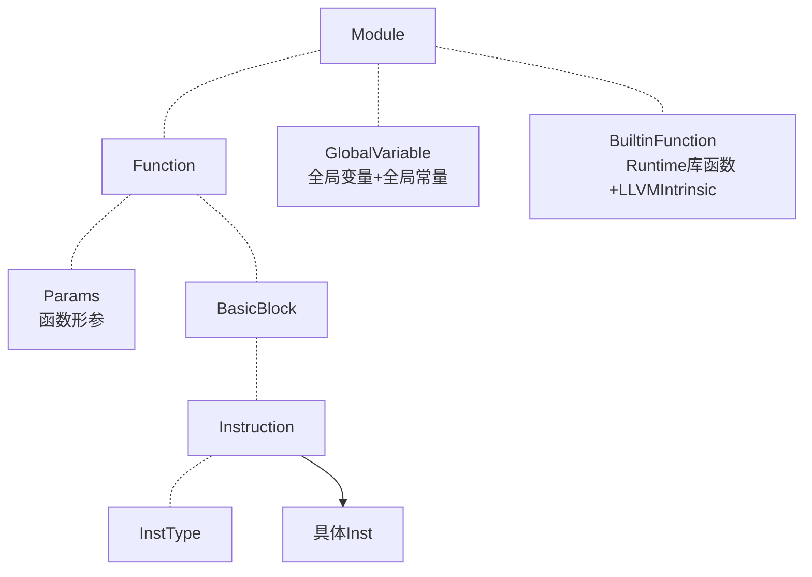

初始化相关

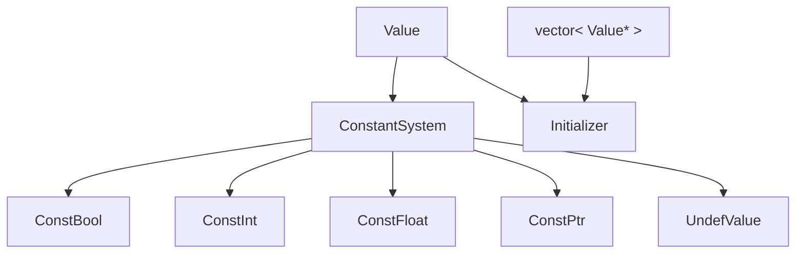

#### PassBuilder

参考LLVM实现，其中做了简化，仅保留AnalysisPass的宏展开注册功能，将Pipeline组织改为硬编码组织

因为Pass比较少，所以这种方式更适合我们的项目形式

- 作用:
  1. 注册AlalysisPass
  2. 组织不同优化层级的优化Pipeline

- Pass Pipeline：PassPipeline组织形式详情请看PassBuilder源码

- 注册AnalysisPass：以Function粒度为例

  ```c++
  void PassBuilder::registerFunctionAnalyses(FunctionAnalysisPassManager &FAM){
      // 1. 定义宏
      #define FUNCTION_ANALYSIS(NAME, CREATE_PASS)\
          FAM.registerPass([&] {return CREATE_PASS;});
      // 2. 引入数据源：将 .def 文件中的内容原封不动地贴在这里
      #include "./FunctionAnalysisPass.def"
      // 3. 销毁宏
      #undef FUNCTION_ANALYSIS
  }
  ```

  .def文件：

  ```c++
  //示例
  FUNCTION_ANALYSIS("DominatorTree", DominantAnalysis())
  FUNCTION_ANALYSIS("BasicAA", BasicAliasAnalysis())
  FUNCTION_ANALYSIS("LoopInfo", LoopAnalysis())
  ```

  在编译期早期阶段就进行了替换：替换后的函数如下：

  ```c++
  void PassBuilder::registerFunctionAnalyses(FunctionAnalysisPassManager &FAM){
      FAM.registerPass([&] {return DominatorTreeAnalysis();});
      FAM.registerPass([&] {return LoopInfoAnalysis();});
      FAM.registerPass([&] {return BasicAliasAnalysis();});
  }
  ```

  注册后，FAM内部大致形成

  ```c
  AnalysisPasses
  ├── DominantAnalysis::ID()     -> AnalysisPassWrapper<DominantAnalysis>
  └── PostDominantAnalysis::ID() -> AnalysisPassWrapper<PostDominantAnalysis>
  ```
  
  在TransformPass之中调用getResult时
  
  ```c
  getResult<DominantAnalysis>(F)
            │
            ├─ ResultCache 中已有结果
            │      └─ 直接返回 DominatorTree&
            │
            └─ 没有结果
                   ├─ 找到已注册的 DominantAnalysis
                   ├─ 调用 DominantAnalysis::run(F, FAM)
                   ├─ 得到 DominatorTree
                   ├─ 包装成 AnalysisResultWrapper
                   ├─ 放入 ResultCache
                   └─ 返回其中的 DominatorTree&
  ```

#### NewPassManager

该PassManager仅管理中端IR层级

参考LLVM实现，同样做了简化与适配

保留并简化CRTP设计模式，基于类型擦除(Type Erasure)的多态设计，AnalysisPass结果缓存

但对于失效机制的实现，摒弃了llvm源代码复杂的迭代器实现和自动失效的机制，采用手动失效的原理实现

参考博客：

[浅析 llvm::Analysis Pass and Manager](https://zhuanlan.zhihu.com/p/696028293)

执行流：

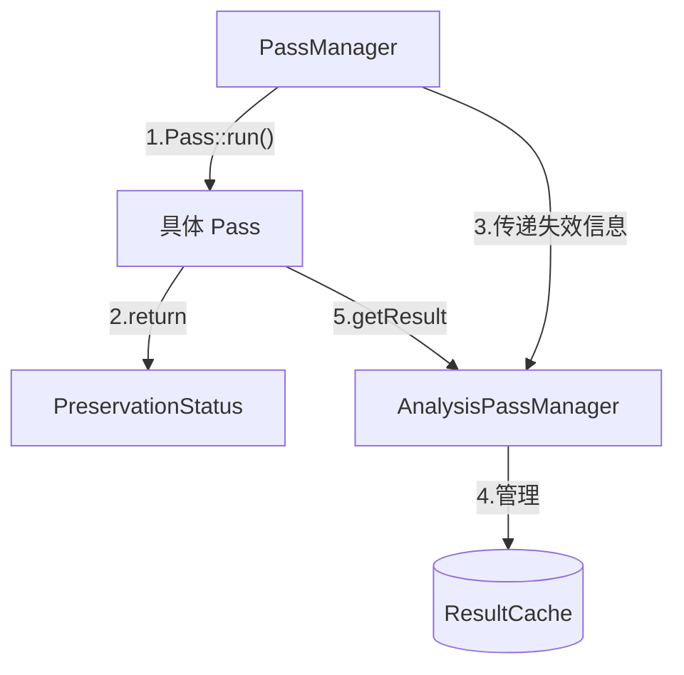

- CRTP解析：

  一个类继承一个以该类自身为模板参数的模板基类（一种将继承和静态多态结合的技术）--用来**高性能实现多态**

  参考博客：[CRTP解析](https://zhuanlan.zhihu.com/p/705630363)

  下图为llvm实现CRTP的相关模板：

  

  优势：

  传统实现多态是需要**继承和虚函数**实现，但是虚函数存在性能开销（会在运行时生成虚函数表），在性能敏感的地方（比如编译器中端优化部分），这么做就会造成性能损失，并且继承和虚函数**在运行期间起作用**，而上面CRTP模式**在编译期间起作用（由于模板的特性，模板类会在编译的时候确定模板参数并进行构建）**

  总结来说就是虚函数在编译的时候创建虚函数表，在运行的时候通过虚函数指针来**动态查找函数地址**->**造成性能损失**，而模板会在编译的时候就确定模板参数，从而在编译的时候就会创建相应的多态函数，在运行的时候**直接进行函数调用**

- TypeErasure类型擦除解析：

  目的：支持将任意类型的Pass类包装成标准Pass对象（而不是必须继承特定的基类），从而方便PassManager进行存储和管理

  具体实现方式：

  其中`Interface`类作为纯虚基类，设计意图为提供给`PassManager`一个统一的类型，方便存储在`vector`之中

  `Wrapper`作为模板类，通过`PassT`接收任意用户提供的具体`Pass`类，通过持有具体Pass的实例，负责该实例的生命周期管理

  `Wrapper`的`run`函数也是简单的调用具体Pass的`run`函数

  ```mermaid
  classDiagram
      %% 转换 Pass 架构
      class PassInterface~IRUnitT, AM_T~ {
          <<interface>>
          +run(IR, AM)* PreservationStatus
      }
      class PassWrapper~IRUnitT, PassT, AM_T~ {
          +PassT Pass
          +run(IR, AM) PreservationStatus
      }
      PassInterface <|-- PassWrapper

      %% 分析 Pass 架构
      class AnalysisPassInterface~IRUnitT~ {
          <<interface>>
          +run(IR, AM)* ResultInterfacePtr
      }
      class AnalysisPassWrapper~IRUnitT, PassT~ {
          +PassT Pass
          +run(IR, AM) ResultInterfacePtr
      }
      AnalysisPassInterface <|-- AnalysisPassWrapper

      %% 分析结果包装
      class AnalysisResultInterface~IRUnitT~ {
          <<interface>>
      }
      class AnalysisResultWrapper~IRUnitT, PassT, ResultT~ {
          +ResultT Result
      }
      AnalysisResultInterface <|-- AnalysisResultWrapper
  ```

  - 优势：

    非侵入性：编写的具体Pass只需要实现一个符合签名的run函数即可

    解耦：PassManager甚至不需要知道有哪些Pass，只需要实现run逻辑即可

    统一存储和管理

- 失效机制：

  在编写具体Pass的时候我们会利用下面所说的“黑白名单”的形式，手动编写是否保留某个AnalysisPass的分析结果

  形如下面这种，即显式分析哪个AnalysisPass的结果仍然有效，哪些已经失效需要重新计算

  ```c++
      PreservationStatus PA;
      PA.discard<DominantAnalysis>();
      PA.discard<LoopAnalysis>();
      return PA;
  ```

- AnalysisPassManager解析：

  - ResultCache缓存机制：采用`PassID（AnalysisPass地址）`和`IR层级（如Function）`作为Key进行存储

  - `getReult`：

    1. 当一个 Pass 请求分析结果时，它首先检查 `ResultCache`
    2. 如果命中，直接返回缓存对象
    3. 如果未命中，则即时运行对应的分析 Pass，并将结果存入缓存供后续使用

  - `invalidate`

    - 作用：`PassManager` 拿到上一步返回的 `PA` 状态后，立即调用此函数触发缓存清理。

    - 细节：
      a. 如果该 Pass 没有破坏任何东西，直接 `return`，终止清理流程，实现提速。
      b. 如果有破坏，则遍历底层的 `ResultCache`，针对每一个属于当前 IR 单元的缓存条目，提取其 `PassID`，并调用此函数询问该分析结果是否幸存

      - 细节：内部检查该 ID 是否在黑名单 `AbandonedIDs` 中，或者是否在白名单 `PreservedIDs` 中

      c.根据内部检查进行释放缓存，或者保留缓存

  - `registerPass`：PassBuilder宏展开函数内层核心实现

    通过`PassID`确定是否已经注册过，如果没有注册才会进行创建实例，换句话说，在main函数一开始就已经注册并创建，但是只有在`run`函数进行调用的时候才会延迟进行计算

- PassManager解析：

  - `run`：

    1. 从 `Passes` 向量中取出一个具体 Pass
    2. 执行 `Pass->run(IR, AM)`，并获取其返回的 `PreservationStatus`
    3. **关键动作**：立即调用 `AM.invalidate(IR, PassPA)` 。这保证了在下一个 Pass 开始之前，缓存中留下的都是完全正确的、未被破坏的分析结果
    4. 最后，将该 Pass 的失效信息合并到总状态中

  - `addPass`：PassBuilder编写pipeline的内层核心逻辑

    接收一个具体的TransformPass，将其类型擦除之后加入到`vector`之中，同理，在运行这个函数的时候具体TransformPass就已经创建实例了，但是只有在`run`的时候才开始进行计算，达到了延迟计算的效果


#### AnalysisPass

##### Dominant支配树

将从函数入口可达的CFG抽象成一棵直接支配树,使用**Semi-NCA算法**进行构建

支配：从函数入口到基本块B的每一条路径必须经过A，则A支配B

直接支配：除了B自身之外，离B最近的那个支配B的节点

半支配：从候选节点 `v` 到 `w` 存在一条路径；在到达 `w` 之前，这条路径不能先经过一个 DFS 编号比 `w` 更小的中间节点，那么**v就是w的一个半支配者**

- 支配树构建：

  1. 从入口基本块遍历CFG，只为可达块编号，从小到大分配DFS序号

  2. 求每个基本块的半支配者SDom和直接支配者IDom

     - 逆DFS序遍历当前节点所有CFG前驱：

       pre < i:前驱比当前节点更早被DFS访问,A(2) -> B(5),满足A是B的半支配者

       pre > i：前驱比当前节点更晚被DFS访问,A(2) -> ... -> X(7) -> B(3)

       由于逆DFS序，所以X先于B被处理，但是这里不能简单将X作为最佳SDom

       所以调用eval(pre)沿着并查集路径向上找到SDom最小的节点

     - 正DFS序：Semi-NCA

       > 正DFS序保证父结点的IDom先于子结点被计算，从而可以使后续子结点可以沿着IDom链向上跳

       从 `i` 的 DFS 父节点（IDom到i一定经过父结点）开始，沿着已经计算好的**真正IDom链**向上走，找到第一个 DFS 编号不大于 `sdom(i)` 的节点，这个节点是 `IDom(i)`

       > 之所以使用sdom作为上界，要理解sdom的含义，sdom代表我们找到的**最早一条**可以绕过DFS到达目标节点的路径，所以只要是当前节点还小于sdom就说明目前不能完全支配，**必须找到第一个在sdom上面的节点**

  3. 建树：使用FirstChild/NextSibling的形式组织多叉树

  4. 迭代支配边界构建(用于Mem2Reg，MemorySSA)：

     支配边界：X支配Y的某个前驱(可以是自己)，且X不严格支配Y，则说Y是X的支配边界

     > 下图中Merge是Then的支配边界，支配边界的含义就是Then块支配结束的位置，对应到下图就是支配结束在Then的最后一条指令
     >
     > 通俗理解支配边界就是**控制流汇聚的位置（直接看CFG图理解）**

     迭代支配边界：原始赋值会产生定义块，新插入的PHI指令也会产生定义块，所以需要不断处理新加入PHI的定义块，直到不再产生新PHI指令

     如果再加入LiveinBlocks就可以计算PrunedPHI版本的迭代支配边界（即去掉那些可以产生PHI指令但是PHI指令后续**不会被使用或在使用前会被重新定义**的基本块，这样的基本块不会创建PHI指令）

  5. 查询：不仅支持块级支配查询，还支持Value级/指令级支配查询


- 参考文献：
  1. [支配树构建算法及伪代码](https://zhuanlan.zhihu.com/p/365912693)
  2. [Semi-NCA论文](https://renatowerneck.wordpress.com/wp-content/uploads/2016/06/gtw06-dominators.pdf)
  3. https://oi-wiki.org/graph/dominator-tree/
  4. https://zhuanlan.zhihu.com/p/655369292
  5. https://zhuanlan.zhihu.com/p/365912693
  6. https://zhuanlan.zhihu.com/p/1955319335347290919

##### PostDominant后支配树

将入口可达CFG反向观察，并增加一个**无对应IR的VirtualExit**，构建单根的直接后支配树

> 把CFG的边反转，把出口当入口，然后计算普通支配

后支配：如果从B出发，到函数出口每条路径都经过A，则A后支配B

> 支配关注的是入口->当前块，后支配关注的是当前块->出口

- 后支配树构建：

  1. 获取真实可达出口块，以及反向CFG（边反转存储）
  2. 创建VirtualExit
  3. 对所有真实可达出口块反向DFS，编DFS序
  4. 无法到达真实出口的基本块（但是入口可达）**直接挂载**到虚拟根，为其分配编号（在刚才分配的DFS序号后面）
  5. 求每个基本块的半后支配者SDom和直接后支配者IDom -- **这一步和支配树算法（SemiNCA）和实现完全一样**
  6. 构建后支配树

  **和支配树的区别重点在于如何构建DFS序图**


##### LoopInfo/LoopAnalysis循环分析

建立循环森林


##### MemorySSA

将内存状态抽象成SSA风格定义链，标记每一处内存写入点和内存读取点，构建内存图

- 内存状态结点：

  - LiveOnEntry：函数入口时未知的初始内存状态，**无对应IR**，无任何对应，每个函数只创建一个

  - Phi：多个CFG前驱的内存状态汇合，**对应IR出现在迭代支配边界（没支持LiveInBlock，所以不是PrunedPHI）基本块入口**

    incoming:(PredBB1, PredBB1Status)记录每个前驱CFG的内存节点状态

  - Use：读取内存但不产生新内存版本,**对应IR：Load/只读Call**

  - Def：可能修改内存，产生新内存版本，**对应IR：Store/可能写内存的Call**

- 内存状态图：

  1. 每个函数入口对应一个LiveOnEntry
  2. 只在可达MemoryDef所在块的迭代支配边界MemoryPhi（和mem2reg算法差不多一样）
  3. 每个store/可能写内存的call产生一个新内存状态
  4. 每个load/只读call使用当前内存状态，**但不产生新状态,下一个节点还是挂载到当前内存状态（上一个节点产生的状态）**
  5. 纯调用（NoModRef）不创建MemoryAccess节点


参考资料：https://zhuanlan.zhihu.com/p/715818784

##### SCEV

依赖AnalysisPass：Dominant，LoopAnalysis


##### BasicAliasAnalysis

采用**即时计算别名分析**实现

即时计算别名分析可以分析简单的含变量索引的数组指针

- 基址对象：

  在sysy之中，指针仅来源于数组作为参数传递，所以我们的指针的基址只能来自**Alloca/Param/GlobalVariable中的数组类型**

  - Alloca：在函数体中定义的局部数组/局部变量
  - Param：函数形参，传入的数组指针
  - Variable::GlobalVariable:全局变量/数组
  - Variable::GlobalConstant：全局常量

- 即时计算别名分析：

  > 如果想写的好一点可以实现一下aliasSelect，还有`a[2*i]` 和 `a[2*j+1]`这种的alias判定

  传入两个Value指针V1,V2

  1. 如果任一者访问的内存大小为0,直接判定为NoAlias

  2. 剥离BitCast

     整个循环可以采用visit数组进行循环条件判定，如果遇到了之前已经visited的循环那么就直接退出循环即可

     如果Value类型不是指针类型直接返回

     如果这一层是GEP，看一下是否所有索引全为零，如果不是那么就直接返回当前的GEP，如果是的话，那么就拿到GEP的基址指针

     如果这一层是BitCast，那么就拿到它的操作数，继续下一轮剥离

     如果这一层是只有一个输入源的PHI节点，拿到操作数继续向下剥离

     如果是其他指令那么就直接返回即可

  3. 如果V1/V2有是UndefValue的，那么直接判定为NoAlias

  4. 判断相等性并拦截跨迭代相等性的情况

     如果V1,V2不相等，那么直接返回false

     如果不是inst类型，那么直接返回true

     如果inst不在任何循环里，那么返回true

     如果inst在任何循环里面，那么人false

     true的可以直接判定为MustAlias

  5. **核心寻找基地址：O1,O2**

     继续可以用while循环+visited数组的方式来作为外层循环的条件

     如果是GEP指令，直接拿到它的基址指针，将V更新为基址指针

     如果是BitCast指令，直接拿到源操作数，更新V

     如果是Phi节点，如果只有一个输入，那么拿到操作数，更新V

     其余情况就直接返回V即可

  6. 快速判定：

     1. 如果底层对象不同O1!=O2

        如果二者都是Alloca（局部数组），那么NoAlias

        如果二者都是Variable::GlobalVariable，那么NoAlias

        如果一个是Param（函数参数）一个是Alloca（局部数组），那么NoAlias

        如果一个是Alloca一个是Variable::GlobalVariable，那么NoAlias

     2. 如果底层对象相同

        循环深度限制/加入一个visited数组

        循环查找：构造一个map，key是V1,V21,value是AliasResult，如果尝试将O1,O2（排除顺序），加入到map之中，如果缓存命中那么就可以直接返回

        如果是GEP（说明O1,O2指向同一个底层数组），那么aliasGEP

        如果是PHI，那么aliasPHI

        - aliasGEP

          将GEP拍平成一个一元线性方程：
          $$
          Base+ConstantOffset+∑(Value_i​×Stride_i​)
          $$
          解析GEP的所有索引+内层操作数，知道碰上最底层的基址

          1. 如果已经不是指令/操作符了。直接返回

          2. 如果BitCast，那么获取操作数

          3. 如果GEP，那么遍历获取GEP的所有索引

             如果索引是常数，那么获取当前维度把`常数索引 * 步长`累加到总的`ConstantOffset`之中

             如果索引是变量，直接`VarIndices[%i] += 1 * 当前维度步长`

          将GEP1和GEP2上面计算的一元线性方程做减法

          首先检查基址

          1. 如果减法化简之后所有的变量被抵消了，常量没有抵消，没有抵消如果大于数组元素的字节大小，可以返回NoAlias，如过小于数组元素的字节大小，返回MayAlias，如果常量也完全抵消了，那么MustAlias
          2. 如果变量无法抵消，直接返回MayAlias

        - aliasPHI:判断一个PHI节点和另一个指针O2是否有重叠情况

          > 总体思路就是比较这个PHI节点的所有输入值和另一个指针O2是否存在别名

          如果这个PHI没有任何输入，直接返回NoAlias

          如果O2也是一个PHI，并且两个PHI在同一个基本块之中，只需要做N-N的一对一比对输入值即可

          如果是常规情况，遍历PHI的所有输入，分别与O2比较，对每个输入和O2调用外层的aliasCheck函数，对所有AliasResult结果求交集

          > `NoAlias` + `NoAlias` = `NoAlias
          > MustAlias` + `MustAlias` = `MustAlias`
          >
          > 任何结果 + `MayAlias` = `MayAlias`
          >
          > `NoAlias` + `MustAlias` = `MayAlias`

##### SideEffect--副作用分析

实现**跨函数副作用分析**，支持指令级，函数级副作用分析

- 算法规则：

  1. 基址与基址传播

     基址规则：

      * 指针形参、全局变量和alloca的基址都是自身
      * 一个指针可以具有多个已知基址

     指令传播规则：

      * GEP：继承base pointer的基址
      * BitCast：继承操作数的基址
      * PHI：合并所有incoming指针的基址
      * Select：合并true和false指针的基址
      * 局部指针槽Load：合并所有曾Store进该槽的指针值的基址

  2. 指令副作用收集规则：处理Load、Store和Call三类指令

     Load/Store：

      * Load：将指针的所有外部基址（全局变量或形参）加入RefSet
      * Store：将指针的所有外部基址（全局变量或形参）加入ModSet
      * 局部alloca基址不加入RefSet或ModSet

     Call：

     函数最初的ModSet和RefSet由里面的load/store决定，或者由BulitinFunc决定

      * 普通直接调用：不动点迭代，Caller合并Callee的ModSet和RefSet
      * 内置函数调用：
         1. timer：不加入ModSet或RefSet，只标记可观察效果和顺序屏障
         2. memcpy/memmove：目标指针加入ModSet，源指针加入RefSet
         3.  memset：目标指针加入ModSet
         4.  数组输入：指针实参加入ModSet
         5. 数组输出：指针实参加入RefSet
         6. 标量输入输出：不加入ModSet或RefSet，只标记可观察效果

     

- 


#### TransformPass

##### TailRecursionElimination尾递归消除

依赖SideEffect

支持累加/累乘累加器，支持call与ret不紧挨的广义尾递归消除

- 算法流程：

  1. 处理普通尾调用(call调用的函数不是自身)：

     > 这一步不是为了尾递归消除，而是为了给后端机器码生成器提供优化提示(允许复用栈帧)

     简单逃逸分析：没有任何Alloca被call指令当作参数传走

     检查call与ret的返回值必须匹配

     ```
     %r = call @other_function(...)  // 不能是当前函数本身
     ret %r                          // ret 必须直接返回 call 的结果

     call @other_function(...)       // 调用的函数也必须是 void
     ret void
     ```

     call后紧跟ret，并且call调用的函数不是自身

  2. 处理尾递归(call调用的函数是自身)：

     遍历目标函数中所有基本块：

     1. 处理终结指令是无条件跳转的情况，并且无条件跳转目标块的PHI指令之后第一条指令必须是Ret（该块除了Ret没有其他逻辑）：

        找到该块中的Call Inst：从块末尾开始倒着向前找Call Inst，并检查Callee必须是函数自身--**不一定要求call与ret挨着**

        图合并操作：将目标块之中的Ret clone到该块的末尾，遍历新clone的Ret的操作数，如果是BitCast，clone之后插入到新Ret前面，并获取BitCast的操作数，如果是PHI，访问PHI拿到从该块传递来的值，直接接入到Ret的操作数上

        将目标块中的PHI中关于该块传递进来的值全部删掉

        将该块中的Br无条件指令删除

     2. 处理终结指令是Ret的情况：

        找到该块中的Call Inst：从块末尾开始倒着向前找Call Inst，并检查Callee必须是函数自身--**不一定要求call与ret挨着**

     3. 获得上面的Call Inst之后，开始进行真正的尾递归消除逻辑：

         遍历call和ret之间的所有指令：1，2条在这个循环里

        1. 查看这条指令是否可以移动到call指令之前：

           副作用不行：store不行，call(访问callee，调用副作用分析这个函数是不是只读，如果不是就是含副作用)

           如果指令是LOAD指令，拿到LOAD读取的地址，调用副作用getInstModRefInfo分析，如果Call Inst Mod这块地址，那么就不能移动

           检查该指令的操作数是否包含Call Inst的返回值，如果有不能移动

        2. 识别累加/累乘的伪尾递归，判定是否可以改成带有累加器的循环：

           检查该指令是否同时满足交换律和结合律：只能放行ADD和MUL指令

           如果有多条这种累加指令，不行

           检查这条指令的两个操作数，必须有一个且只能有一个是Call Inst的返回值

           检查这条指令只能被使用一次，且User是Ret指令

        处理：

        1. 创建循环头：

           拿到目标函数的入口块，创建一个新的基本块插入到入口块前面，在新基本块末尾插入无条件跳转指令让其可以直接跳转到入口块

           遍历原入口块，将所有Alloca指令搬到新基本块之中

           遍历函数所有形参，在原入口块最前面为每个形参创建一个PHI，将原来使用形参的地方全部替换成新创建的PHI，将形参作为输入值加入PHI

        2. 将这次尾递归传递的实参，添加到原入口块的PHI节点之中

        3. 如果含累加器指令：

           在原入口块节点插入一个PHI指令，如果是ADD初始值设置为0,如果是乘法初始值设置为1，将这个值加入到PHI之中，把原来使用call返回值的地方改成使用累加器指令

        4. 收尾：

           创建一条Br，代替原来的Ret，将旧的Ret和Call从内存中删掉

           将剩下的Ret之前创建BinaryInst，计算累加器与Ret原本的返回值，然后修改Ret的返回值


##### InstSimplify 指令简化

运行前需要运行一下CFGSimplify清除不可达块，运行后需要运行DCE

- 算法流程：

  遍历目标函数之中每个基本块之中每条指令（被人使用的）

  - 核心Simplify：拿到Simplify之后的Value

    Switch分发：

    1. Add/FAdd：

       常量情况：

       1. 如果LHS和RHS都是常量：常量折叠
       2. 如果LHS是常量，RHS不是常量，交换左右操作数的位置
       3. 其余情况返回nullptr

       UndefValue情况：如果LHS/RHS其中有一个是UndefValue，那么就返回UndefValue

       如果RHS是0,返回LHS

       如果LHS与RHS互为相反数，返回对应类型的0值

       如果一个操作数是X另一个操作数是一个减法表达式，这个减法表达式恰好是Y-X，那么返回Y

    2. Sub/FSub：

       常量情况：

       1. 如果LHS和RHS都是常量：常量折叠
       2. 其余情况直接返回

       UndefValue情况：如果LHS/RHS其中有一个是UndefValue，那么就返回UndefValue

       如果匹配X-0,那么直接返回X

       如果匹配X-X，那么直接返回0

    3. Mul/FMul：

       常量情况：

       1. 如果LHS和RHS都是常量：常量折叠
       2. 如果LHS是常量，RHS不是常量，交换左右操作数的位置
       3. 其余情况返回nullptr

       UndefValue情况：如果LHS/RHS其中有一个是UndefValue，那么就返回0

       如果RHS为0,那么返回0

       如果RHS为1,那么返回LHS

    4. SDiv/UDiv/FDiv：

       这一条仅适用于SDiv：如果两个数互为相反数，直接返回-1

       常量情况：

       1. 如果LHS和RHS都是常量：常量折叠
       2. 其余情况返回nullptr

       X/Undef：返回Undef

       Undef/X：返回0

       Undef / 0：返回Undef

       Undef/Undef：返回Undef

       X/0：返回Undef

       0/X：返回0

       X/X：返回1

       X/1：返回X

    5. SRem/URem/FRem：

       如果两个数互为相反数，直接返回0

       常量情况：

       1. 如果LHS和RHS都是常量：常量折叠
       2. 其余情况直接返回

       X % undef ：返回undef

       undef % X ：返回 0

       0 % X ：返回0

       X % 0 ：返回undef

       X % 1 ：返回0

       X % X ：返回0

    6. And：

       常量情况：

       1. 如果LHS和RHS都是常量：常量折叠
       2. 如果LHS是常量，RHS不是常量，交换左右操作数的位置
       3. 其余情况返回nullptr

       X & undef -> 0

       X & X = X

       X & 0 = 0

       X & -1 = X

    7. Or:

       常量情况：

       1. 如果LHS和RHS都是常量：常量折叠
       2. 如果LHS是常量，RHS不是常量，交换左右操作数的位置
       3. 其余情况返回nullptr

       X | undef -> -1

       X | -1 = -1

       X | X = X

       X | 0 = X

    8. Xor:

       常量情况：

       1. 如果LHS和RHS都是常量：常量折叠
       2. 如果LHS是常量，RHS不是常量，交换左右操作数的位置
       3. 其余情况返回nullptr

       A ^ undef -> undef

       A ^ 0 = A

       A ^ A = 0

    9. ICmp

       常量情况：常量折叠

       icmp X, X -> true/false--根据情况来定

    10. FCmp

        常量情况：常量折叠

        fcmp X, X -> true/false--根据情况来定

    11. Select

        常量情况：

        1. 如果Cond，TrueVal，FalseVal都是常量：常量折叠
        2. 如果Cond为UndefValue：选取TrueVal，FalseVal为常量的一个返回，如果都不是常量那么随便选一个
        3. 如果Cond为常量true，那么返回TrueVal
        4. 如果Cond为常量false，那么返回FalseVal

        模式匹配：

        1. select ?, X, X -> X
        2. select x, y, false = x & y
        3. select x, y, true = !x | y
        4. select x, false, y = !x & y
        5. select x, true, y = x | y
        6. select ?, undef,  X -> X
        7. select ?, X, undef  -> X
        8. select i1 x, i32 1, i32 0 = zext x
        9. select i1 x, i64 1, i64 0 = zext x
        10. select (x == y), x, y ->x
        11. select (X != Y), X, Y -> X
        12. select ((X | Y) == 0, X, 0) -> 0
        13. select ((X & Y) == -1, X, -1) -> -1

    12. PHI：平凡PHI消除

        跳过LCSSA形式的PHI

        遍历PHI之中所有输入值

        ​	如果遇到输入值是本身，那么直接跳过

        ​	如果遇到UndefValue，那么用HasUndef记录之后直接跳过

        ​	遇到第一个非 undef、非 self 的值，记为 CommonValue

        ​	如果找到CommonValue但是遇到了其余不一样的值，那么直接返回无法化简

        如果最后CommonValue还是Nullptr（说明PHI的所有输入要么全是它自己要么全是UndefValue），用RAUW替换所有使用该PHI的地方为UndefValue，然后删除

        当HasUndef True的时候，需要检查CommonValue是否支配该PHI节点（将），如果支配执行下面的逻辑，如果没有结束算法

        最后用RAUW替换所有使用该PHI的地方为CommonValue

    13. 其余没有提到的指令直接返回nullptr

  遍历当前指令的User，加入到WorkList之中，RAUW替换所有使用为Value

- 常量折叠：

  ConstantFoldBinaryInstruction函数


##### GVNPRE

依赖AnalysisPass：Dominant，AliasAnalysis，SideEffect

运行之前先运行BCE和CFGSimplify，InstSimplify，DCE，SCCP

- 算法流程：

  1. GVN：

     外层：不动点循环

     清理哈希表

     > 核心数据结构：
     >
     > **`ValueNum` (值编号缓存表)**
     >
     > **`ExpressionTable` (表达式查重表)**
     >
     > **`LeaderTable` (领导者备忘录)**

     RPO逆后序遍历目标函数中每个基本块（如果发现在死块里面就直接跳过），遍历基本块中每一条指令（跳过PHI指令）

     1. 如果是LOAD指令：

        找到该LOAD在基本块中的位置，从该位置向前扫描每一条指令，直到入口块第一条指令，调用别名分析，找到和它使用同一个地址的最近的一条指令

        如果该指令是LOAD/STORE（MustAlias），那么RAUW将使用LOAD的全部换成上一次使用的值，然后删除LOAD

        如果STORE（MayAlias），放弃优化

        如果STORE（NoAlias）/LOAD（MayAlias/NoAlias），继续寻找

        如果CALL，调用getInstModRefInfo，如果结果包含Mod，那么放弃优化，如果Ref/NoModRef，继续寻找

        如果经过上面优化是True，那么就返回True处理下一条指令，如果经过上面优化是False（放弃优化），那么执行下面的逻辑

        记录：在ValueNum哈希表中进行寻找，如果编号过直接返回，如果没有，直接分配NextValueNum++一个新的编号，然后将{Num，LOADINST，该指令所在基本块}记录在InstTable之中

        返回false（只是记录，原本程序逻辑和代码结构没变）

     2. 如果是CALL指令：调用副作用分析发现只是Ref

        找到该CALL在基本块中的位置，从该位置向前扫描每一条指令，直到入口块第一条指令

        如果遇到STORE，调用Alias，如果不是NoAlias，放弃优化

        如果遇到CALL，调用getInstModRefInfo，如果遇到是一模一样的CALL，那么RAUW直接替换，删除该CALL，如果是其他CALL，如果计算出来是ModSet那么放弃优化

        如果优化失败了，执行下面的逻辑

        记录：和上面LOAD的一样

     3. 如果是Br条件跳转指令：

        如果发现Cond是常量，那么找到永远不会执行的那个分支，将这个分支里面的块收集到死块集合之中

     4. 如果指令没有返回值直接跳过

     5. 值编号：

        获取下一个编号NextNum

        获取Num编号

        Num编号逻辑：

        1. 如果ValueNum哈希表能查到，直接返回查到的

        2. 如果传入的不是一条具体的指令，那么就分配新号码ValueNum++

        3. 如果是普通运算指令

           记录这条指令的返回值类型和Opcode，然后获取当前指令的所有操作数的ValueNum，存入该指令的VarArgs

           如果是ADD/MUL/AND/OR/XOR这种满足交换律的，按照从小到大的ValueNum排序VarArgs

           如果是比较指令，同样满足上面的小ValueNum的原则，但是比较符号也要一同取反，然后将Opcode和具体比较符号通过`(C->getOpcode() << 8) | Predicate`位运算结合在一起作为唯一的Opcode

        4. 如果是LOAD/STORE：直接分配新号码

        5. 如果是GEP：

           依次对基地址和索引求哈希

        6. 如果是CALL：

           调用副作用分析

           如果NoModRef，处理方法同普通运算指令（提取表达式），算哈希，存入哈希表

           其他情况直接分配新号码

        7. 如果是PHI/ALLOCA/RET/BR这种指令，直接分配新号码

        如果Alloca/Ret/Br/PHI，将{Num，INST，该指令所在基本块}记录在InstTable之中，直接返回

        如果Num>=NextNum，那么将{Num，INST，该指令所在基本块}记录在InstTable之中，直接返回

        根据当前指令所在基本块和Num去找Leader，根据Num去找LeaderTable中到Leaders，遍历所有Leaders，查看Leader所在基本块是不是支配当前指令所在块，如果找到这么一条指令就存起来，如果这条指令是常量直接返回不用找了，循环结束之后返回指令

        如果没找到就将自己{Num，INST，该指令所在基本块}记录在LeaderTable之中

        如果查到自己直接false

        RAUW将使用当前指令的地方全部换成Leader，然后删除当前指令，返回即可

        > 这里的LeaderTable就是上面的InstTable

  2. PRE：

     处理死块：

     遍历死块中所有指令，调用分配ValueNum的函数分配Num，然后插入到LeaderTable之中

     外层：不动点循环

     DFS遍历当前函数所有基本块（函数入口块跳过），遍历当前基本块之中的每一条指令

     1. 如果是ALLOCA/RET/BR/PHI/无返回值的指令/比较指令/LOAD/STORE/CALL（经过SideEffect后不是NoModRef的纯函数的拒绝）

        > GEP提升，纯函数提升

     2. 前驱块分析：

        获取当前指令的ValueNum

        遍历当前指令所在块的前驱：

        如果前驱不可达放弃，如果前驱是循环回边放弃

        PHITranslate:

        查PHITranslateTable如果缓存之中有直接返回翻译出来的结果，如果没有执行下面的逻辑，执行完之后存入缓存，返回翻译后的新ValueNum

        1. 如果当前要翻译的编号本身是PHI节点：

           看这个PHI是不是在当前块之中如果不是，说明不受跨块影响，不用翻译

           遍历PHI输入值，找到属于目标前驱的那个输入值返回输入值编号

        2. 如果Num不是PHI，说明是普通算数指令：

           从表达式哈希之中拿到表达式

           遍历表达式中每一个操作数，调用PHITranslate

           如果是ADD/MUL/OR/XOR/AND这些满足交换律的，重新排序表达式的ValueNum值，从小到大

           如果全局表达式表中能查到NewNum，那么就返回

        3. 如果查不到就返回旧Num

        拿着翻译后的Num去找Leader

        如果没找到，那么记录这个前驱PREPred，NumWithout++，如果找到了自己说明是循环回边，NumWithout = 2，直接放弃，如果找到了真的，加入到PredMap之中，NumWith++

        只有NumWithout == 1 且 NumWith > 0的时候才能进行后面的逻辑

        如果要提升的是DIV/REM直接返回

        clone当前指令，插入到PREPred前驱块末尾（在终止指令之前），在当前块PHI指令最后插入PHI，遍历PredMap，如果以前就有那么就直接加入输入值，如果是刚才缺失的路径那么就把刚插入的那条指令加入输入值

        给新的PHI发和原指令一样的Num，然后RAUW进行替换，删除原指令，更新LeaderTable

  3. 清空哈希表等数据结构


##### Reassociate表达式重结合

利用代数中结合律和交换律重新排列表达式中的计算顺序，从而暴露更多的优化机会

排序的依据：排序的依据就是 Rank（秩），规则很简单：Rank 越小，在表达式树中越靠右（越容易被沉到底部折叠）；Rank 越大，越靠左

为SCCP，GVN，LICM铺路

运行之后运行DCE

- 算法流程：

  1. 创建RankMap

     初始化rank=2

     遍历函数的所有参数，为这些参数建立从3递增的rank（每个参数的rank都各不相同）

     逆后序遍历函数中的基本块，每个基本块的rank间隔为`++Rank << 16`，遍历块内指令，为每个符合条件（不标ADD, SUB,MUL,AND, OR, XOR其余都标）的指令在本基本块的rank基础上分配rank并递增rank

  2. 不动点循环：

     逆后序遍历函数中基本块，遍历基本块之中的所有指令

     如果是死指令，断开对子节点的Use，直接跳过（留给后续DCE），如果不是调用下面的逻辑optimizeInst（该函数运行期间会收集TodoList）

     While循环遍历TodoList：如果是死代码，断开它对子节点的Use，然后跳过（留给后续DCE），如果不是死代码，继续运行optimizeInst

  3. 保留CFG相关的分析结果

  4. optimizeInst：

     1. 规范化：

        如果不是ADD，MUL，AND，OR，XOR，SUB直接返回执行下一条指令

        如果本条指令是SUB A-B指令，直接优化成A + B×（-1），将新生成的指令加入TodoList，然后直接返回执行下一条指令

     2. 内部节点过滤：

        如果这条指令只有一个User，并且User的Opcode和这条指令的Opcode一样，并且User不是自己，并且User和这条指令在同一个基本块之内：

        将User的指令加入到TodoList之中，这条指令直接退出，不进行下面的优化步骤

     3. ReassociateExp：(走到这里传入的Inst一定是Root)

        1. Linearize：

           WorkList While循环：

           1. 遍历当前指令的操作数

              如果Opcode和Root Opcode一样，并且只有一个User，那么加入WorkList

              否则，压入最终的Ops数组之中

        2. 排序：Rank大的排在Ops前面，Rank小的排在Ops后面

        3. OptExp：

           1. 常量折叠：从Ops数组末尾开始循环，将常亮根据每步的Opcode直接做折叠，拿到最后的常量

           2. 如果Ops全空了，那么直接返回最后的常量

           3. 简化：

              如果总常量是0并且当前是加法/总常量是1并且当前是乘法，直接扔掉总常量

              如果当前是乘法并且总常量是0,直接返回0

           4. 如果Ops之中只有一个变量了，那么直接返回这个变量

           5. 高级优化：

              1. ADD：

                 遍历排好序的Ops数组

                 优化1：合并同类项，比如有C（C为常量）个Y，找到这C个Y，然后创建乘法C×Y，将原来的删掉，将新乘法加入到Ops数组之中

                 优化2：抵消相反数，一旦找到MUL（X，-1），就会找X是否同时存在，如果同时存在那么直接二者删掉

                 优化3：提取公因式，匹配模式：A* B + A* C -> A*(B+C)，具体来说遍历所有是乘法的操作数，统计他们的出现次数，找到出现次数最多的因子，如果出现次数>1，那么就去乘法项之中把这个因子提取出来，将剩下部分加起来

              2. MUL：分治思想

                 传入的Ops大小必须>=4

                 提取Ops之中重复的变量，从Ops之中删去，按照(X,指数)存储起来，如果找不到就放弃优化

                 合并相同指数的底数：$A^N$×$B^N$=$(A×B)^N$,具体来说就是先生成一条底数乘法指令然后删除已经被合并的因子

                 指数奇数：如果指数是奇数，把底数拿出来一份，放入外层乘积列表之中，所有因子的指数都必须统一右移 1 位（减半向下取整，`Power >>= 1`）

                 递归：处理偶数次幂，如果减半后最大的指数仍然大于 0，说明还需要继续算。直接递归调用自己，递归返回的结果（我们称之为 `SquareRoot`），需要被平方。所以它把 `SquareRoot` 往外层乘积列表里塞了两次

                 把当前层级 `OuterProduct` 里面收集到的所有东西（包括奇数剥离出来的底数，以及递归返回的平方项）统统乘起来

           6. 如果在刚才的高级优化之中数组长度发生改变，递归调用OptExp自己，直到数组长度不变

           如果OptExp算出一个结果Value，直接RAUW将使用当前指令的地方全部换成Value，将Root放入TodoList，完成优化

        4. 如果Ops大小为1了，直接RAUW将使用当前指令的地方全部换成Value，将Root放入TodoList，完成优化

        5. 重建表达式树：

           1. 取出最底层的两个叶子：从 `Ops` 数组的末尾（`back`）弹出两个元素，分别作为 `RHS` 和 `LHS`。此时这两个元素是整棵树中 Rank 最小的（通常是常量或最外层的变量）
           2. 生成底层指令：根据原 Root 指令的 Opcode（例如 `ADD` 或 `MUL`），生成一条新的二元指令 `ResultInst = Opcode(LHS, RHS)`
           3. 插入新指令：将 `ResultInst` 插入到原 Root 指令的物理位置之前（`insertBefore`），以保证新生成的指令绝对满足支配关系（Dominance）
           4. 新指令入队：将 `ResultInst` 加入 `TodoList`（因为它是一条全新生成的指令，下一轮也许还能触发别处的优化）
           5. While 循环挂载剩余节点：
              - 只要 `Ops` 数组还不为空，就继续从末尾弹出一个元素，记为 `NextVal`
              - 生成新的指令：`NewInst = Opcode(NextVal, ResultInst)`（即：把刚才生成的结果当做一边，新取出的变量当做另一边）
              - 将 `NewInst` 同样插入到原 Root 指令之前
              - 将 `NewInst` 压入 `TodoList`
              - 更新游标：`ResultInst = NewInst`
           6. 收尾与替换 (RAUW)：
              - 循环结束后，最后的 `ResultInst` 就是这棵新树的最顶层新根节点
              - 调用 `replaceAllUsesWith(RAUW)`，将所有引用了旧 Root 指令的地方，全部替换为 `ResultInst`
              - 将旧的 Root 指令压入 `TodoList`


##### LICM循环不变量代码外提

依赖AnalysisPass:Dominant,LoopInfo,BasicAliasAnalysis,SideEffect

- 算法流程：下沉Sink，外提Hoist

  最外层：依然是遍历顶层循环+后序遍历单棵循环树

  1. 前置检查：

     1. 是否符合LCSSA形式
     2. 是否符合LoopSimplify形式（PreHeader，Latch，Dedicated Exits）

  2. 下沉Sink：

     一条指令在**每次迭代中都在计算**，但是**结果只有在退出循环才被使用**

     Sink：将其沉到循环的ExitBlock，只在退出循环时执行一次

     后序遍历--从循环尾开始向上遍历到循环头，倒序遍历本层循环中基本块中所有指令：

     1. 检查：

        1. 检查是否存在DedicatedExits

        2. 检查指令--判断一条指令是否可以被安全的移出循环：--**需要使用别名分析**

           绝对不能移动：

           RET，BR，PHI，ALLOCA，Binary中的：SDIV，FDIV，SREM，FREM

           可以移动：

           排除上面之后的BinaryInst

           严格检查可以移动：LOAD，STORE，CALL

           CALL：

           调用副作用分析，分析是否含内置函数和Untracked标记，有的话直接false

           检查ModRefInfo，只有NoModRef/Ref可以

           调用ModRefInfo

           检查ModSet是否为空，untracked是否是未标记的

           如果RefSet依旧为空，那么直接true

           如果RefSet不为空，遍历Set中每一条指令，比对函数中中每一条指令，调用别名分析分析二者，只要一条会修改这块内存那么就直接false

           LOAD：遍历循环之中每一条其他指令，调用副作用分析`getInstModRefInfo`检查是否会影响LOAD读取的地址

           STORE：如果是激进外提直接否定，不提STORE

           遍历循环之中每一条其他指令，调用副作用分析`getInstModRefInfo`检查是否会影响STORE读取的地址，并用支配树证明，如果当前的Store是最后一次写入（覆盖掉之前所有的）其实是可以下沉到循环之外的

        3. 检查这条指令的所有User是否全在循环之外

        4. 判断循环不变量：

           循环不变量（一条指令的操作数都是循环不变量，即所有操作数的定义都在循环外/操作数是常量，递推：该变量的所有操作数的**可达定义只有一个（即定义是确定的，没有经过if条件），这个定义来自循环内，并且它本身也是循环不变量**）

     2. 下沉：

        遍历所有出口块，直接将指令I clone 到对应的 Exit Block（受指令I所在块支配） 中（PHI节点之后）

        遍历clone出来的指令I的操作数，如果操作数来自循环内部但没有创建LCSSA PHI的话，那我们就去创建PHI并替换指令I的操作数，如果已经创建，直接替换指令I的操作数即可

        遍历使用指令I的User，将这些User的Usee指令I换成我们新创建的指令，然后删除旧指令

  3. 外提Hoist：

     RPO遍历循环中所有基本块，正向遍历基本块中所有指令

     1. 条件：

        再次检查是否存在PreHeader

        检查激进Hoist：

        如果这条指令所在的基本块，支配该循环中所有的Exit出口块和所有的Latch回边块，标记为激进Hoist（该块后向支配PreHeader的逻辑，只不过用支配树的逻辑实现）

        检查指令：和sink第一条相同

        检查循环不变量：和sink第三条相同

     2. 外提：统一move到PreHeader块末尾


##### LoopDeletion循环删除

依赖AnalysisPass：Dominant，LoopInfo，BasicAliasAnalysis，SideEffect，SCEV

- 算法流程：

  1. 符合LCSSA形式

  2. 检查是否符合LoopSimplify形式，并获得PreHeader

  3. 获取循环的所有ExitBlock，必须是唯一ExitBlock

  4. 如果循环永远不会执行：

     1. 判断循环会不会进入：

        获取PreHeader，如果PreHeader是整个函数的EntryBlock，那么一定可以进入

        遍历PreHeader所有前驱块，找到这些前驱块的终止指令，如果是Br并且条件是常量，那么提取出两个目标基本块，如果条件不是常量那么直接返回可以进入，其他终止指令的情况直接保守可以进入，如果两个目标基本块中那个True的正好是PreHeader，那么可以进入，反之不可以进入

     2. 如果不可以进入

        1. 删掉PreHeader的旧分支指令，构建一条分支指令`br ExitBlock`
        2. 遍历ExitBlock中的PHI节点，强制将第0项的来源改为PreHeader，将后续所有项删除，值不变
        3. 遍历循环里的所有指令，如果循环外还有指令使用这些值，将这些Use全改成UndefValue
        4. 删除循环之中的所有指令（删除之前现在所有UseDef清除）所有基本块
        5. 更新支配树，LoopInfo，SCEV

  5. 如果是多出口的情况，直接返回

  6. 常规循环删除：

     1. 判断：

        取出这个唯一ExitBlock的所有PHI节点，逐个检查这个PHI是否是一个平凡PHI（所有输入值都是一样的），只要有一个输入值不一样的那么就返回，如果这个输入值是一个指令，如果还在循环内，直接返回

        遍历循环体内的所有指令，进行循环级副作用分析，如果有副作用直接返回

        DFS遍历这个循环

        经过上述检验的可以执行下述的删除

     2. 如果符合条件，执行删除，逻辑和4.2相同


##### LoopUnswitch

将循环内部依赖于**循环不变量**的分支移动到循环外

先运行LoopSimplify，LCSSA，LICM再运行LoopUnswitch

依赖AnalysisPass：DominatorTree，LoopInfo，SCEV，MemorySSA

实现了如下两种UnSwitch的形式

- Trivial Unswitch：目标分支的至少一个后继可以退出循环
- Non-trivial Unswitch：两个分支的后继都留在循环内

并且只做了Full Unswitch，即分支条件全是循环不变量

- 算法流程：

  1. 确认是loopsimplify，LCSSA形式

  2. 优先执行Trivial Unswitch，其次执行Non-trivial Unswitch（并且每个函数中二者只能执行其一）

  3. Full Trivial Unswitch：

     检查：从 LoopInfo::Header 开始向下检查每个必经的基本块，检查当前块的 MemoryDef 以及副作用。如果存在除 MemoryPhi 以外的 MemoryDef，或者存在具有副作用的指令，则停止扫描。

     获取当前块ParentBB的分支指令，必须是非常量条件分支

     核心：检查整个条件是不是全都是循环不变量，然后明确true和false哪个分支的successor是退出循环的，哪个是继续循环的（这里不接受两个successor都退出循环或两个successor都继续循环），该分支属于当前循环本身，而不是位于某个内层子循环中。

     检查离开分支的ExitBB中的PHI中的incoming value，这个incoming value必须也是循环不变量（不能在循环内被计算），否则不能被执行

     然后新建一个NewPreHeader插入在OldPreHeader以及Header之间，并且更新Header的PHI之中 incoming block由OldPreHeader->NewPreHeader

     如果ExitBB只有当前分支块 ParentBB这一个前驱，那么出口直接复用，如果ExitBB还有其他前驱，那么进行切分，旧的ExitBB保留全部PHI，并新增跳到NewBB的Br无条件分支指令，NewBB保留原来旧ExitBB所有其他指令

     然后删除OldPreHeader原来的无条件跳转，然后将ParentBB的分支指令从ParentBB移动到OldPreHeader，并根据true还是false更新这条分支指令successor（退出方向   -> ExitBB 或切分得到的 NewBB，继续方向   -> NewPreHeader）

     然后创建ParentBB的新分支指令Br无条件跳转到继续循环的那个块上

     对出口 PHI 进行修复：

     - 如果直接复用原来的 `ExitBB`，则将 PHI 中来自 `ParentBB` 的 incoming block 修改为来自 `OldPreHeader`，incoming value 保持不变。
     - 如果对ExitBB进行了切分，则不能简单地把原 PHI 的 incoming block 修改为OldPreHeader。需要在切分得到的NewBB中创建新的合流 PHI，用来合并：
       - 从 `OldPreHeader` 直接退出时使用的循环不变量值；
       - 从原 `ExitBB` 正常退出时得到的原 PHI 结果。

     最后替换循环内所有使用循环不变量的Use为确定的True/False常量

     变换完成后重新获取当前ParentBB的 terminator：

     - 如果当前terminator已经变成无条件 branch，则根据其唯一successor更新下一个必经基本块，并继续扫描。
     - 如果successor已经离开当前循环，或者该基本块已经被访问过，则停止扫描。

     

  4. Full Non-trivial Unswitch：

     获取当前块ParentBB，以及对应的分支指令。要求整个分支条件都是循环不变量，并且该分支属于当前循环本身，而不是位于某个内层子循环中。

     根据目前的分支指令确定两个分支的successor，根据支配树，确定我们每个分支具体需要clone的支配子树（如果某些基本块被其中一个 successor 支配，并且只能通过该 successor 到达，那么这些基本块只属于对应的专门化路径。在克隆某个循环版本时，由另一个 successor 独占支配的基本块不需要复制；这些块在当前专门化版本中不可达。）

     然后新建一个NewPreHeader插入在OldPreHeader以及Header之间，并且更新Header的PHI之中 incoming block由OldPreHeader->NewPreHeader--**这一部分和刚才Trivial Unswitch一样**

     克隆循环：克隆当前循环所需要的全部基本块，并且为克隆循环新建一个 ClonedPreHeader。在clone过程中建立原值到clone值的映射，clone每条指令的时候必须重新映射其操作数，然后克隆循环 Header 中的 PHI,并根据其映射修改相关的incoming，克隆循环内其他 PHI 时，也必须同时映射 incoming value 和 incoming block，如果根据支配子树裁剪了部分基本块，那么必须删除由未克隆基本块产生的 PHI incoming，并在 PHI 只剩一个 incoming value 时进一步简化 PHI，对于循环出口和 LCSSA PHI，需要为克隆循环建立对应的退出值。原循环退出产生的值和克隆循环退出产生的值，最终需要在循环外合流

     然后删除OldPreHeader原来的无条件跳转，然后将ParentBB的分支指令从ParentBB移动到OldPreHeader，并根据true还是false更新这条分支指令successor

     然后对原循环进行专门化，由于原循环负责 `Cond = false` 的版本，所以原循环中的 `ParentBB` 不再需要保留原条件分支，而是创建新的无条件 branch，删除原循环之中不需要保留的那条分支的CFG边，必须删除 `CloneSucc` 中所有来自 `ParentBB` 的 PHI incoming，

     然后对clone循环进行专门化，根据映射将克隆循环中的原条件 branch 替换为无条件 branch，同时删除克隆循环中指向另一个 successor 的 CFG 边，并删除对应 successor PHI 中来自 `ClonedParentBB` 的 incoming

     然后进行循环不变量的常量替换，并替换该循环内所有对该循环不变量的Use

     对于每个原循环 ExitBB：

     1. 保留原循环版本的退出 incoming。
     2. 增加克隆循环版本对应的退出 incoming。
     3. 如果原 ExitBB 不能直接同时承接两个循环版本，则切分或新建 ExitMergeBB。
     4. 在 ExitMergeBB 中建立合流 PHI。
     5. 所有循环外 Use 改为使用合流 PHI 的结果。

     


#### TransformPass

##### CFGSimplify

- 算法流程：**该pass内部使用不动点循环，因为子优化之间会互相创造优化机会**

  1. 消除死块：排除入口块之后，检查前驱块：没有/唯一的前驱是自己，满足条件删除，先维护后继块的PHI，然后再进行删除

     

  2. 终结指令常量折叠：

     拿到终结指令，如果是条件跳转：

     1. 如果两个分支目标相同（平行边）：将该条件跳转改成无条件跳转，并在目标块的前驱列表中删除一个前驱边
     2. 如果条件分支的条件是常量，则根据常量值选择一条边，删除另一条边，改为无条件分支 -- **这种优化为上面消除子块创建优化机会**

     

  3. **折叠已知分支条件 -- 编写较麻烦**

     > 和上面第二步区别：第二步要求条件是常量，这一步主要针对条件是变量的情况

     要求当前基本块含多个前驱，并且条件值本身不是常量，不能是自环（条件值不能正确推导），前驱必须也是条件分支，处理时，判断所有前驱是否都能从其Cond条件值推导出该块的Cond条件值（相同或相反），然后根据该块推导出的条件值删除一条分支，并维护后继块PHI

     

  4. 消除重复的PHI节点：-- **这个其实属于纯PHI化简了**

     满足前驱块数量相同，数据流来源完全一致的两个PHI可以删除其中一个

     基准指针遍历基本块开头的每一个PHI节点，候选指针从基准指针的下一个开始遍历，比较重复，如果重复了就替换候选指针中的所有使用，然后加入到Removed集合之中，然后打断两个指针从头开始再次遍历

     最后将Removed集合中的PHI节点全部删除即可

     

  5. 穿透分支条件PHI：

     当前块必须只含分支指令，XOR指令（可选），PHI指令，并且PHI形式满足分支条件PHI形式

     ```
         %cond = phi i1 [ true, %P0 ], [ false, %P1 ]
         br i1 %cond, label %T, label %F
     
         %cond = phi i1 [ true, %P0 ], [ false, %P1 ]
         %not = xor i1 %cond, true
         br i1 %not, label %T, label %F
     ```

     必须让条件PHI的incoming数量对应前驱块的数量

     

  6. 规范化分支条件PHI

  7. 基本块合并：

     检查：该基本块的前驱只有一个，保证前驱也只有该基本块这一个后继

     合并：

     1. 处理该基本块中的PHI节点（一定来自前驱，并且只有一个incoming），直接删除PHI拿值替换
     2. 修改后继块PHI的incoming block
     3. 将该基本块中的指令，全部搬到前驱的终结指令之前，删去前驱的原终结指令
     4. 删除该基本块

     

  8. simplifyBranch：处理无条件跳转

     1. simplifyUncond:该基本块末尾是一条无条件跳转指令

        1. 如果该基本块PHI指令之后就是终结指令，并且不是入口块：检查后继不是自身，检查该基本块的前驱和该基本块的后继的前驱没有重合的，检查该基本块中的PHI节点没有被除了该基本块后继的PHI之外任何其他使用

           修改该基本块后继的PHI，将来源改成该基本块的前驱（考虑多个前驱的情况）

           修改基本块前驱末尾的跳转指令

           删除该基本块中的指令，删除该基本块


##### IfConversion

引入Select指令，避免小分支分支预测失败，暴露SCCP，GVNPRE等标量优化机会

不能上提到Pred的指令：load/store，call，alloca，ret，div，rem，非常量shl/lshr/ashr

收益模型：

- TrueBB 指令数 + ElseBB 指令数 <= 4

- Succ 中 PHI 数量不超过 3

- 总加权成本<=6

  其他指令成本1,MUL, FMUL, FADD, FSUB, FCMP成本2，SITOFP成本3

可以处理两种CFG形状

```
Triangle：
          ┌── TrueBB ──┐
Pred ─────┤             ├── Succ
          └─────────────┘
Diamond：
          ┌── TrueBB ──┐
Pred ─────┤             ├── Succ
          └── ElseBB ──┘
```

优化前：

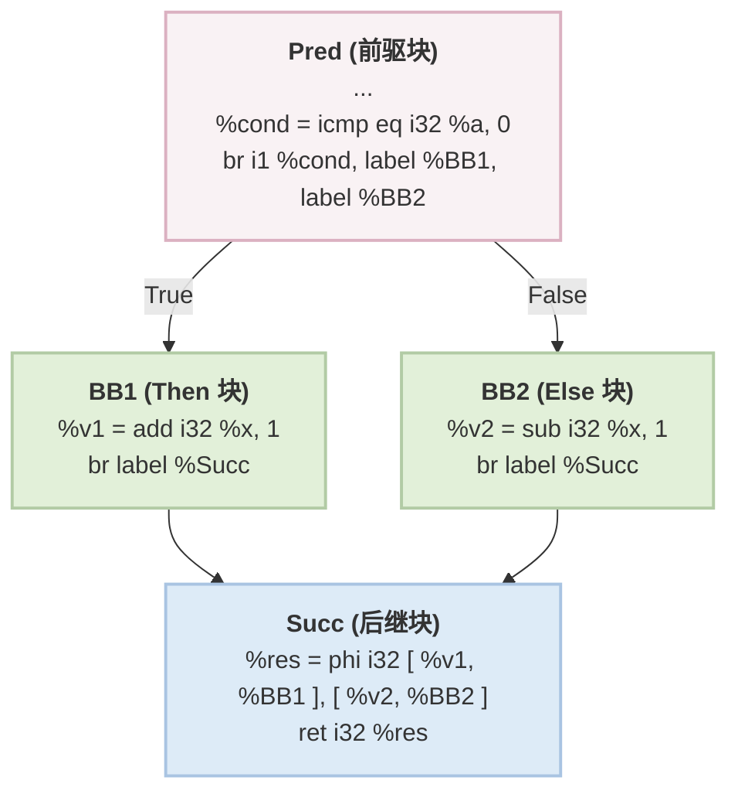

优化后

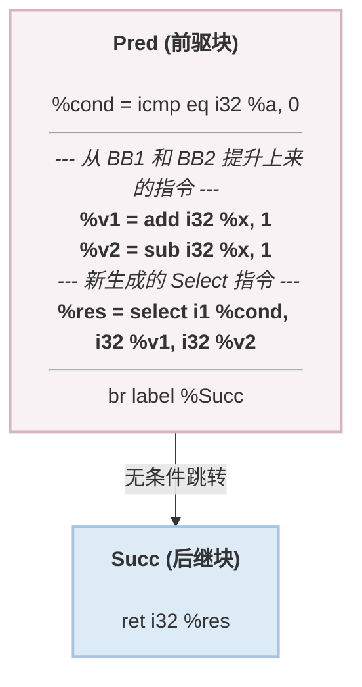


##### BreakCriticalEdges打破关键边

GVN-PRE前置Pass，放置在LoopSimplify之前

关键边：一条边 `A -> B` 被称为**关键边（Critical Edge）**，当且仅当它**同时满足**以下两个条件：

1. 源基本块 A 有多个后继（SysY编译器只支持条件分支指令，所以只能是2个
2. 目标基本块 B 有多个前驱

打破关键边：在关键边的位置插入新的块

- 算法流程：

  1. 找到关键边：源块A两个后继，目标基本块多个前驱

  2. 创建新基本块，插入到函数之中，并创建新的Br无条件分支指令，指向目标块，修改源基本块A中的分支指令，让其指向新基本块，修复目标块B中的PHI节点，将来源为A的全部换成来源为新基本块


##### UnifyFuncExits统一函数出口

用在中端转入后端前PassPipeline收尾阶段

- 算法流程：将该函数中所有含Ret的基本块中的Ret换成无条件跳转Br，无条件跳转到新插入的UnifiedExit基本块，根据返回值类型创建PHI以及新的Ret指令


##### LoopSimplify

依赖AnalysisPass：Dominant和LoopInfo

- 目的：确保Loop满足规范形式

  - 唯一的 PreHeader（入口块）
  - 唯一的 Back Edge
  - Dedicated Exits （ 所有的 Exit Block 只能被**循环内部**的基本块指向）

- Loop规范形式

  PreHeader是用来汇聚外部块的进入的

  Latch块是用来汇聚回边的

  Dedicated Exits 是用来汇聚所有从Loop中Exit并和外部跳转进行分割的

- 图解：

  转换前

  ```mermaid
  graph TD
      %% 外部区域
      O1[Outside 1]
      O2[Outside 2]
      O3[Outside 3]
  
      %% 循环内部
      subgraph LoopArea [Loop]
          direction TB
          H[Header]
          B1[Body 1]
          B2[Body 2]
  
          H --> B1
          H --> B2
          B1 -->|回边 1| H
          B2 -->|回边 2| H
      end
  
      %% 出口区域
      E[ExitBlock]
  
      %% 跨区域连线
      O1 --> H
      O2 --> H
      B1 --> E
      O3 --> E
  
      %% 样式调整匹配你的手绘布局
      classDef default fill:#f8f9fa,stroke:#333,stroke-width:2px;
      classDef loopBox fill:#ffffff,stroke:#000,stroke-width:2px;
      class LoopArea loopBox;
  ```

  转换后

  ```mermaid
  graph TD
      %% 外部区域
      O1[Outside 1]
      O2[Outside 2]
      O3[Outside 3]
      PH["新块: PreHeader"]
  
      %% 循环内部
      subgraph LoopArea [Loop]
          direction TB
          H["Header<br>(PHI 被极大简化)"]
          B1[Body 1]
          B2[Body 2]
          L["新块: Latch"]
  
          H --> B1
          H --> B2
          B1 --> L
          B2 --> L
          L -->|③ 唯一回边| H
      end
  
      %% 出口区域
      DE["新块: Dedicated Exit"]
      E[ExitBlock]
  
      %% 跨区域连线
      O1 --> PH
      O2 --> PH
      PH -->|① 唯一入口| H
  
      B1 -->|② 拦截内部跳出| DE
      DE --> E
      O3 -->|外部连线保持原样| E
  
      %% 样式标注
      classDef default fill:#f8f9fa,stroke:#333,stroke-width:2px;
      classDef loopBox fill:#ffffff,stroke:#000,stroke-width:2px;
      classDef newBlock fill:#d1e7dd,stroke:#198754,stroke-width:2px,color:#0f5132;
      class LoopArea loopBox;
      class PH,L,DE newBlock;
  ```

##### LCSSA循环封闭的SSA形式

循环定义的值只能在循环内部使用，外部只能使用其LCSSA形式的PHI函数

执行前：

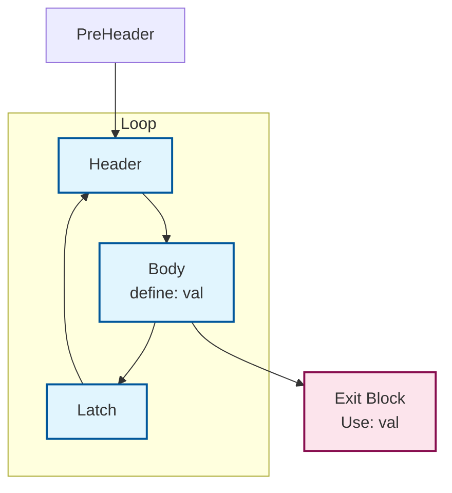

执行后

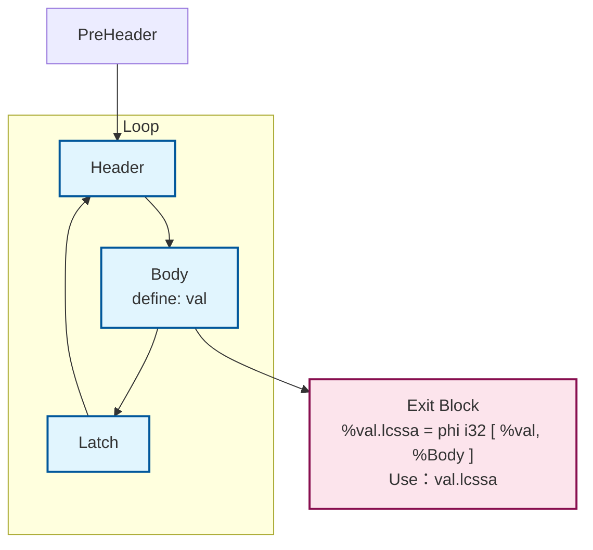

##### Mem2Reg

将入口块中标量alloca转换为Phi，删除相应的load/store/alloca

依赖AnalysisPass：Dominant

在运行之前先运行CFGSimplify清除不可达块，运行之后也需要

算法：使用LiveInBlock+IDF创建**PrunedPHI**，在Live裁剪之后的IDF处插入PHI


参考资料：
https://ustc-compiler-principles.github.io/2023/lab4/Mem2Reg%E4%BB%8B%E7%BB%8D.pdf

https://www.zhihu.com/question/41999500/answer/93243408

##### Global2Local

将全局变量Local到非递归Main函数的Alloca，从而在Mem2Reg可以将其提升为寄存器变量

阈值选取32字节：<=32字节的全局变量会被处理

- 算法流程：

  1. main可达的其他函数引用的全局变量拒绝转换

  2. main无法到达的其他函数可以保留全局变量，并在main中创建alloca（全局变量只能放在store/load操作数，地址不能逃逸到其他指令，值还是正常使用）

     在DFE删除死函数之后，需要使用DeadGlobalCleanup删除全局


##### Local2Global

将非递归main函数中局部Alloca分配的大数组提升为全局变量，防止栈溢出

阈值选取1024：大于1024字节的数组会被提升

##### GlobalInitializerFold

主要在Local2Global后使用，当Local2Global将大尺寸对象的alloca提升为global之后，GlobalInitializerFold将memcpy消除，从而将初始化时间从运行期改到静态装载期

目标对象：全局变量对应的**初始化memcpy（初始化长度覆盖整个对象）**

完整变换流程：

```
前端：前端会引入memcpy
@template = constant [300 x i32] [...]
define i32 @main() {
entry:
  %a = alloca [300 x i32]       ; 1200 字节
  call @memcpy(%a, @template, 1200, false)
}

Local2Global：
@template = constant [300 x i32] [...]
@.G.a = global [300 x i32] zeroinitializer
define i32 @main() {
entry:
  call @memcpy(@.G.a, @template, 1200, false)
}

GlobalInitializerFold：
@template = constant [300 x i32] [...]
@.G.a = global [300 x i32] [...]

define i32 @main() {
entry:
  ; memcpy 已删除
}
```

##### DeadGlobalCleanup死全局消除

只用在中端快结束的位置，用于轻量级优化，比StoreOnlyGlobalElimination更加轻量，功能更弱

功能：删除只存在store无其他Use的global和store，删除无Use的global，只处理标量，不处理数组

##### StoreOnlyGlobalElimination只写全局变量消除

依赖AnalysisPass：SideEffect

<p align="center">
  
</p>

- 算法流程：

  1. 对于每一个全局变量，分析读取他的load和call指令，建立RefInfo

     call指令读取规则：只读Builtin，普通Func的RefSet

     数组读取精度：只分析到第一维

     > 只要 `A[2]` 下任意元素被读取，所有写向 `A[2][...]` 的 store 都会保留

  2. store删除：

     该全局变量没被读取：删除所有store

     该全局变量读取：删除与RefInfo无关的store

     其他情况保留

  3. 对于没有任何写入的全局变量，将完整对象的 `load` 替换为全局初始化常量，删除load

  4. 删除没有任何Use的全局变量


##### ConstHoist大常量重写

依赖AnalysisPass：Dominant

减少i32大常量物化次数

```
entry:
    br label %preheader
preheader:
    br label %loop
loop:
    %a = add i32 %x, 100000
    %b = add i32 %y, 100008
    %c = sub i32 %z, 100008
    br i1 %cond, label %loop, label %exit
->
preheader:
    %base = add i32 0, 100008 -- 基准值被提升到preheader
    br label %loop
loop:
    %v100000 = add i32 %base, -8
    %a = add i32 %x, %v100000
    %b = add i32 %y, %base
    %c = sub i32 %z, %base
    br i1 %cond, label %loop, label %exit
```

目标常量：i32,>=2048

改写只能：User为ADD/SUB/STORE/DIV/REM/移位**这些位置**

算法规则：按照[组内最大值 - 组内最小值 < 2048]分组，每组选取使用次数最多的常量作为基准值，只有[每组大于3次使用或者在循环内>=2次使用]才可优化，在改写时，找支配这些基本块最近的公共支配块，在该块进行物化（如果在循环中就在preheader物化），每块中共用偏移加法

##### GepEvaluate折叠GEP

功能：折叠掉空索引的GEP替换为基址，拆分GEP

```
%ptr = getelementptr [16 x [16 x i32]], ptr @A,
            		 i32 0, i32 %i, i32 %j
->
%row = getelementptr [16 x [16 x i32]], ptr @A,
                     i32 0, i32 %i

%ptr = getelementptr [16 x i32], ptr %row,
                     i32 0, i32 %j
```

##### DCE死代码消除

依赖AnalysisPass：SideEffect

按照Use-Def链级联删除死指令

- 算法规则:

  1. ret,br,store不可删

  2. call条件删除：BuiltinFunc、直接/间接递归不可删，普通Callee函数NoModRef并且无store无Builtin内部调用

     无User

  3. 其他指令只需要判断无User，就直接可以删除

##### ADCE激进死代码消除

依赖AnalysisPass：PostDominant，SideEffect

先假定所有指令是死的，只把返回、存储、副作用调用等标活，再反向标活这些指令依赖的指令和控制条件，最后删除剩余其他的一切

- 算法流程：
  1. 一开始就活跃的根指令：Store，Ret，无条件Br，无法到达真实出口的条件Br，Call（纯函数/只读函数调用不活跃，其他标活）
  
  1. 迭代闭包：
  
     指令的操作数对应的指令也活跃
  
     标活必经块上的分支指令：从目标块到PostIDom沿着后支配树遍历，遇到的每个基本块的条件分支指令标活
  
     PHI指令（特殊）：不仅标活incoming value对应的指令，还标活incoming block的条件分支指令
  
  1. 执行清扫：
  
     收集所有未标活的条件分支指令，删除不是PostIDom的那一侧的分支边
  
     收集所有未标活的非终结指令进行删除

##### DAE死参数消除

注意要在Mem2Reg运行后运行

- 算法流程：

  1. 遍历所有函数

     跳过Runtime库函数，llvm intrinsic，main函数

     **形参常量特化**：遍历该函数每个形参，检查**调用该函数**的所有 `CallInst`。如果某个参数在所有调用点传入的都是**同一个常量/如果不是同一个常量，可以分组创建函数副本进行特化**，则在函数体内将该形参的所有 Use 替换为该常量（`RAUW`）

     ```
     define i32 @foo(i32 %x) {
     entry:
       %v = add i32 %x, 1
       ret i32 %v
     }
     call i32 @foo(i32 10)
     
     ->
     
     define i32 @foo(i32 %x) {
     entry:
       %v = add i32 10, 1
       ret i32 %v
     }
     ```

     **冗余参数合并**：检查调用该函数的所有 `CallInst`。如果某几个参数在所有调用点传入的**实参完全相同**（例如 arg2 永远等于 arg1），则在函数体内将 arg2 的所有 Use 替换为 arg1

     ```
     define i32 @foo(i32 %a, i32 %b) {
     entry:
       %x = add i32 %a, %b
       ret i32 %x
     }
     call i32 @foo(i32 %v1, i32 %v1)
     call i32 @foo(i32 %v2, i32 %v2)
     
     ->
     
     define i32 @foo(i32 %a, i32 %b) {
     entry:
       %x = add i32 %a, %a
       ret i32 %x
     }
     ```

  2. 遍历所有函数：找到死参数

     跳过sysylib，memcpy，main函数

     遍历该函数的参数列表，如果该参数Use=0,标注为Dead，如果Use!=0,遍历每个User，如果是CallInst就递归判断，在中途中还要记录已经判断过的函数，如有一个地方用到那么就是Live，否则Dead，其他情况标注为Live

  3. 遍历所有函数：清除死参数与函数重写

     跳过sysylib，memcpy，main函数

     删除掉函数中所有死参数，并进行更新基本块中的Use，找到调用旧函数的所有CallInst，创建新的CallInst，并根据新的形参列表决定传入的实参，删去旧的CallInst


##### DeadFunctionElimination死函数消除

目前在SysY2022之中，**函数只能通过Call指令进行调用**，没有其他调用方式，所以我们不需要考虑函数地址逃逸或者调用函数指针的情况

- 算法逻辑：main函数一定Live ，从main函数开始，收集函数中可达基本块中的Call指令，将被Call指令调用的函数标记为Live，然后删除剩下的死函数即可 -- **可达调用图遍历**

效果显著，把基本上全部死函数都消除掉了

##### DSE死存储消除


##### LatePhiCleanup晚期PHI函数清理

一个在中端后期轻量级的PHI函数清理

功能：清除无Use的PHI，把所有incoming value相同的PHI退化成value

退化：PHI的value必须都是同一个相同的value，并且PHI所在基本块只有一个前驱/value的定义支配该PHI

##### FuncInline函数内联

将Callee的函数体拼接到Caller的相应位置

- 收益模型：对于满足以下条件的Callee被调函数进行内联

  有函数体

  递归函数：调用函数频次×单次函数指令数<=100

  非递归函数：调用函数频次<3 || 调用函数频次(>=3)×单次函数指令数<=200

  注意：**下面这种情况进行FuncMemoization函数记忆化**

  没有其他函数调用，没有副作用，并且自递归调用点数大于等于2

  形如`fib(n) = fib(n - 1) + fib(n - 2)`

- 算法流程：

  形参->实参，指令clone，替换Use，上提alloca到外层函数入口，在Call指令后切分基本块并修改克隆的基本块返回值为无条件跳转，把Call指令改为无条件跳转


#### 循环优化

##### LoopRotate 循环旋转

目的：把一个传统的while结构转换成do-while结构

依赖 AnalysisPass：DominantAnalysis、LoopAnalysis

**前置形态**：要求 LoopSimplify + LCSSA；源码硬检查唯一 preheader/latch 和 exit，header 条件分支恰好一臂入环、一臂退出

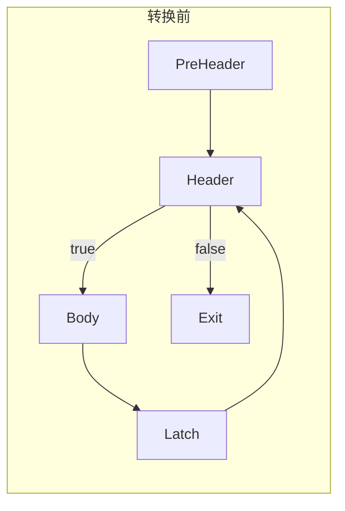

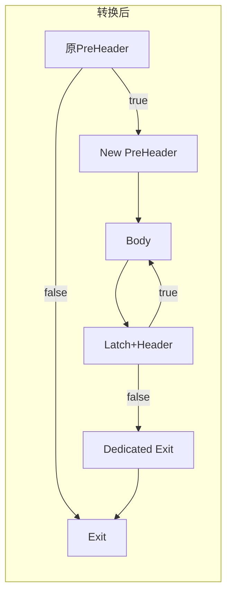


### 参考资料

##### LateStrengthReduce 晚期强度削减

在后端前把残留的 i32 常量二次幂除法/余数降成移位、掩码或保持向零舍入的带符号偏置序列。

- **依赖 AnalysisPass**：无；`run()` 不查询 `FAM`。
- **支持 5 种转换形式**：
  1. `udiv x, 2^k -> lshr x, k`；
  2. `urem x, 2^k -> and x, 2^k - 1`；
  3. 已证明 `x >= 0` 时，`sdiv x, 2^k -> ashr x, k`；
  4. 已证明 `x >= 0` 时，`srem x, 2^k -> and x, 2^k - 1`；
  5. 无法证明非负时，仅对 `sdiv x, 2` 生成符号偏置序列。

```llvm
%uq = udiv i32 %x, 8   ; -> lshr i32 %x, 3
%ur = urem i32 %x, 8   ; -> and  i32 %x, 7

; 可能为负的 sdiv x, 2，保持向零舍入
%sign   = ashr i32 %x, 31
%bias   = and  i32 %sign, 1
%biased = add  i32 %x, %bias
%q      = ashr i32 %biased, 1
```

非负证明采用深度 4 的有界递归，可识别非负常量、`zext`、两臂均非负的 `select`、清除符号位的 `and`、常量逻辑右移，以及满足条件的除余。其余可能为负的 signed 二次幂除法和余数保持不变。改写不改变 CFG，可保留支配、后支配与循环结构。


##### DAE（Dead Argument Elimination）死参数消除

跨直接调用图传播形参活性，并利用所有调用点的实参事实做参数特化、等价参数合并与函数签名收缩。

- **依赖 AnalysisPass**：无；这是模块 Pass，`run()` 不查询 `MAM/FAM`。
- **支持 4 个转换族**：
  1. **全调用点共同值特化**：某形参在全部有效直接调用点均为同一常量，或同一 global 根加相同常量 GEP/bitcast 配方时，在函数体内用该值替换形参；本函数自递归且原样转发该 formal 的边不参与共同值冲突判定；
  2. **全调用点冗余参数合并**：同类型参数在每个调用点都接收同一个非 `undef` SSA 值时，用前一个形参替换后一个；
  3. **传递闭包死参删除**：参数只被继续转发到另一个死参数时也判死，统一从函数签名和全部直接调用中倒序删除；
  4. **分组特化克隆**：按调用点局部常量、global 指针配方及实参等价类分组，建立 `f.spec.N`，从副本签名删除该组可特化/冗余的参数，只重定向该组外部调用。

```llvm
define i32 @f(i32 %a, i32 %b) {
entry:
  %x = add i32 %a, %b
  ret i32 %x
}

define i32 @caller(i32 %v1, i32 %v2) {
entry:
  %r1 = call i32 @f(i32 %v1, i32 %v1)
  %r2 = call i32 @f(i32 %v2, i32 %v2)
  %sum = add i32 %r1, %r2
  ret i32 %sum
}

; -> 函数体内 %b 的 use 改为 %a，随后签名收缩为 @f(i32 %a)
```

候选要求非保留签名且只有直接调用用途。global 指针配方仅允许常量索引 GEP/bitcast，最大深度 8。对分组特化：每函数最多生成 4 个特化副本，原函数最多 192 条指令，副本累计成本最多 384；单调用组只删除 1 个参数时，普通特化/含等价类特化的函数大小上限分别为 48/96。流程顺序为“共同值与等参特化 → DAE → 分组克隆 → 再 DAE”。

##### CFGSimplify 控制流图简化

把 CFG 与 PHI 的局部规则迭代到不动点，持续删除死边、传播已知条件、折叠 PHI 并合并或旁路基本块。

- **依赖 AnalysisPass**：无。
- **实际支持 8 个核心转换族**：
  1. 删除非入口且无前驱或只有自前驱的块；
  2. 折叠 `br cond, X, X` 和常量条件分支；
  3. 若所有直接前驱的条件都能推出当前块条件为同一真值，折叠当前分支；
  4. 合并 incoming 前驱与值映射完全一致的重复 PHI；
  5. 穿透“常量布尔 PHI + 可选 xor true + branch”跳板，把每个前驱直接重定向到确定后继；
  6. 规范布尔 PHI：全同值、两臂 0/1、多路 AND/OR/`select` 决策树，以及 i32 0/1 到 i1 再 `zext`；
  7. 合并“当前块唯一前驱且前驱唯一后继”的线性块；
  8. 旁路只含 PHI 和无条件分支的非入口跳板块，并把后继 PHI incoming 展开到跳板的全部前驱。

```llvm
; 两个互相独立的匹配片段
const_branch:
  br i1 true, label %T, label %F     ; -> br label %T
same_target:
  br i1 %c, label %T, label %T       ; -> br label %T

; 布尔 PHI 穿透
join:
  %c = phi i1 [ true, %A ], [ false, %B ]
  br i1 %c, label %T, label %F
; -> A 直接跳 T，B 直接跳 F，join 删除
```

每次改边都会同步修复 successor PHI。布尔决策树最大深度为 6、最多新增 10 条指令；向上/向下控制链搜索约 4 层。可投机克隆的条件表达式只包含 ADD/SUB/MUL/AND/OR/XOR 和六种整数比较。这里的死块规则不是完整可达性 DFS，因此多块不可达 SCC 仍需其他清理暴露。

##### FunctionMemoization 函数记忆化

为纯、直接多重自递归的 i32/f32 标量函数插入固定容量直接映射缓存，命中时立即返回，未命中时执行原函数体并在返回前发布结果。

> 源码正式名称是 `FunctionMemoization`；任务表中的 `FunctionMemorization` 是拼写错误，并不是仓库注册的别名。

- **依赖 AnalysisPass**：`SideEffectAnalysis`；候选必须没有 builtin，且整体为 `NoModRef`。
- **支持 1 种 CFG 变换**：

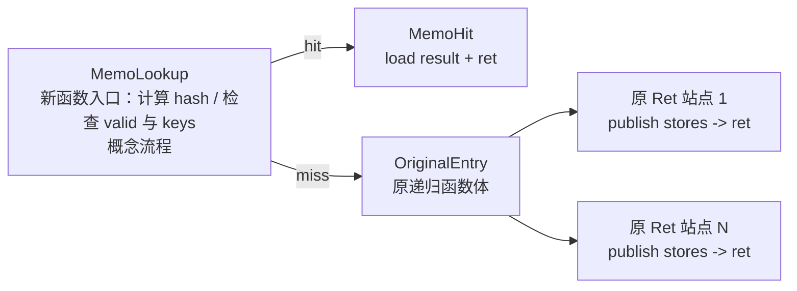

每个函数建立 `valid[entries]`、每个参数一张 `key[entries]` 和 `result[entries]`。i32 直接作为键，f32 先按位 bitcast 为 i32；哈希从 `2166136261u` 开始，对每个参数执行 `(hash XOR key) * 16777619`，槽号为 `hash & (entries - 1)`。命中必须同时满足 `valid == 1` 和全部键逐项相等，因此碰撞只导致 miss/覆盖，不会返回错误结果。发布顺序严格为 `valid=0 -> keys -> result -> valid=1`。

默认缓存 4096 槽，配置小于 16 或不是二次幂时回退到 4096；最多 4 个 i32/f32 参数，返回值也必须为 i32/f32，模块总缓存预算 256 KiB。函数至少有两个直接自递归点和一个外部调用点，且不能包含 alloca、load/store、GEP、指针值、非自调用、计时调用或不可达块；危险除余、非法移位、`fptosi`、`undef` 及未知操作也会拒绝候选。

##### Reassociate 表达式重结合

对整数 ADD/MUL/AND/OR/XOR/SUB 表达式进行确定性展平、排序、代数收缩和重建，迭代到不动点。

- **依赖 AnalysisPass**：主算法无直接依赖；扫描无 use 的 call 时会按需查询 `SideEffectAnalysis`。
- **支持 7 个核心转换族**：
  1. 将 `sub a, b` 拆成 `%neg = mul b, -1` 与 `%r = add a, %neg`；
  2. 展平单用户同 opcode 子树，按稳定 rank 排序并重建；
  3. 常量归并及 `x+0 / x*1 / x*0`；
  4. `x+x+... -> K*x`；
  5. `x + (-1*x) -> 0`；
  6. 提取覆盖项最多的公因式；
  7. 乘积至少 4 项且有重复因子时复用平方。

```llvm
%p0 = mul i32 %a, %b
%p1 = mul i32 %a, %c
%r  = add i32 %p0, %p1
; ->
%s = add i32 %b, %c
%r = mul i32 %a, %s

; x*x*x*x
%sq = mul i32 %x, %x
%r  = mul i32 %sq, %sq
```

只处理整数；共享子表达式不会复制，而是作为叶保留。rank 由常量、参数、RPO 块序和指令序稳定确定，DIV/REM 叶使用最高 rank 使高延迟结果靠近根。候选定义链的计时屏障搜索预算为 256 个值。`PreserveAddressArithmetic=true` 时，沿整数转换 use 链最终进入 GEP 的表达式整体跳过，交给 GEPCombine/LSR；旧表达式树由后续 DCE 删除。

##### SCEV 标量演化分析

把整数 SSA 值惰性归一成驻留共享的符号 DAG，并从循环 header PHI 与退出比较派生递推、归纳变量、迭代次数、余数分解和无回绕事实。

- **依赖 AnalysisPass**：`LoopAnalysis`、`DominantAnalysis`。
- **核心数据结构关系**：

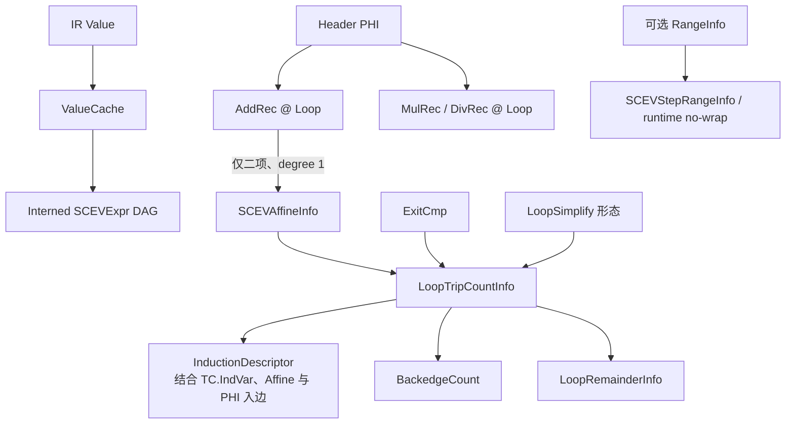

`SCEVExpr` 保存 `Kind、CastKind、Predicate、RawValue、RecLoop、ConstValue、Ty、Operands、Key`。22 种节点包括 Constant/Unknown，算术、移位、位运算、Binomial、Min/Max、Select、Cast、Compare，以及 AddRec/MulRec/DivRec；`Key` 用于 hash-cons，`ExprStorage` 保证节点指针稳定。

`SCEVResult` 持有函数、LoopInfo、DominatorTree，以及 `Interned、ValueCache、ActiveValues、TripCountCache、BackedgeCountCache、LoopInductions`。结果是惰性的：`run()` 只绑定基础分析，`getSCEV` 首次查询时递归建图，并用 `ActiveValues` 把 SSA 环降为 Unknown。

Header PHI 必须具有统一的循环外 Start 与循环内 Update。AddRec 递归抽取 ADD/SUB 中恰好一次出现的 self，其循环不变增量子表达式可包含 MUL/DIV 或合法 SHL；此外只把直接的 `phi * invariant`、`phi / invariant` 识别为 MulRec/DivRec，AddRec 阶数最高为 8。规范退出要求唯一 preheader/header/latch/exit，exiting 支配 latch，条件为当前循环 affine IV 与循环不变量 bound 的比较；仿射步长必须是非零常量且不能为 `INT64_MIN`。`<, <=, >, >=` 使用距离的向上取整计算次数，`!=` 只接受常量距离可被步长整除的情况。

```llvm
%i = phi i32 [ 0, %pre ], [ %next, %latch ]
%next = add i32 %i, 2
; -> SCEV: {0,+,2}<L>
; 若条件为 %i < %N，则 trip count 为 max(0, ceil(N / 2))
```

该符号次数表达式本身不等于“循环已证明有限或无回绕”；变换 Pass 仍须单独检查 `Valid`、finite 与 `ProvenNoWrap` 等标志。

递推、方向与安全查询递归深度上限为 64，穿 PHI/`select` 求精确常量的深度为 32。常量 i32 归纳的 `ProvenNoWrap` 要求宽整数计算出的末值仍在 i32；Range 增强的有限性证明可接受符号严格确定的循环不变步长，而专用运行时 preheader no-wrap 证明更保守，只接受直接 `+1/-1` 与严格 `</>`。

##### IndVarSimplify 归纳变量简化

用 SCEV 结构键发现重复整数递推，并以精确 SSA 形状再次把关，同时把退出比较统一成归纳变量位于左侧。

- **依赖 AnalysisPass**：`LoopAnalysis`、`SCEVAnalysis`。
- **支持 2 种转换形式**：
  1. **重复递推合并**：同一 header 中 PHI 的 SCEV `Key/RecLoop`、类型、incoming 前驱集合、循环外初值和回边更新 SSA 形状全部一致时，保留一个归纳 PHI；
  2. **退出比较定向**：先要求 `analyzeLoopTripCount(L)` 返回有效的 `LoopTripCountInfo/ExitCmp`；若该退出比较右侧是本循环 affine IV、左侧不是，再交换操作数并反转谓词。

```llvm
header:
  %i = phi i32 [ 0, %pre ], [ %i.next, %latch ]
  %j = phi i32 [ 0, %pre ], [ %j.next, %latch ]
  ; -> %j 的使用替换为 %i，删除 %j PHI
  %c = icmp sgt i32 %bound, %i
  ; -> %c = icmp slt i32 %i, %bound
  br i1 %c, label %exit, label %latch
latch:
  %i.next = add i32 %i, 1
  %j.next = add i32 %j, 1
  br label %header
```

数学上 SCEV 相同并不足够：回边 Binary 的指令类型、opcode、类型及对应操作数必须完全同形，仅交换律 opcode 允许交换两侧。该 Pass 不展开 trip count、不改变 CFG；每次 `run()` 只处理第一个发生变化的循环，然后返回让固定点重新构建 SCEV。

##### LoopDeletion 循环删除

删除已证明有限、没有可观察行为，且循环外 SSA 使用能够完整修复的规范循环。

- **依赖 AnalysisPass**：`LoopAnalysis`、`SCEVAnalysis`。
- **前置形态**：仅处理满足 `LoopSimplify + LCSSA` 的叶子循环；唯一 preheader/latch，所有离环边来自同一 exiting block 并到达同一 exit。
- **支持 2 种删除形式**：
  1. **零次迭代循环**：header 内指令必须可跳过；exit PHI 的循环内值能沿 header PHI 递归解析到 preheader incoming；
  2. **有限无效循环**：常量次数具有 `ProvenNoWrap`，或运行时次数满足受限的 header 退出、i32 规范归纳和严格关系；循环内只有无可观察效果的纯计算/控制，exit PHI 为空或所有 incoming 均为同一循环外值。

```llvm
preheader:
  br label %header
header:
  %i = phi i32 [ 0, %preheader ], [ %next, %latch ]
  %cmp = icmp slt i32 %i, 0
  br i1 %cmp, label %body, label %exit
body:
  br label %latch
latch:
  %next = add i32 %i, 1
  br label %header
exit:
  %r = phi i32 [ %i, %header ]

; ->
preheader:
  br label %exit
; %r 的使用替换为 0，整个循环 CFG 删除
```

提交前会验证所有循环内定义的外部 use 都是计划中的 exit PHI。删除时先把 preheader 改接 exit，集中替换 PHI，再用 `undef` 断开残余 use，分两轮清空并删除循环块。该 Pass 不直接依赖 Dominant、BasicAA 或 SideEffect；CFG 改变后所有函数分析失效。

运行时有限性后备证明只接受两种直接规范形态：步长 `+1` 配严格 `<`，或步长 `-1` 配严格 `>`；其余运行时循环即使直觉上会终止，也保持不变。

##### LoopStrengthReduction（LSR）循环强度削减

把循环内单一仿射变化维度的 GEP 地址计算，改写成 preheader 起始地址、header 指针 PHI 与 latch 递推 GEP。

- **依赖 AnalysisPass**：`LoopAnalysis`、`SCEVAnalysis`、`DominantAnalysis`。
- **前置形态**：满足 `LoopSimplify`，SCEV 证明完整迭代域无回绕，循环中不存在可到达的计时调用。
- **支持 2 种地址族改写**：
  1. **完全同形共享**：循环、基址、步长、前后缀、类型和 SCEV 起点相同的 GEP 共用一个指针 IV；
  2. **常量起点偏移共享**：形状相同但常量起点不同的地址，以最小起点为 anchor，其余地址由常量偏移 GEP 得到。

```llvm
; 转换前
pre:
  br label %loop
loop:
  %i = phi i32 [ 0, %pre ], [ %next, %latch ]
  %idx = mul i32 %i, 4
  %p = getelementptr i32, ptr %a, i32 %idx
  %v = load i32, ptr %p
  br label %latch
latch:
  %next = add i32 %i, 1
  br label %loop

; 转换后
pre:
  %p.start = getelementptr i32, ptr %a, i32 0
  br label %loop
loop:
  %i = phi i32 [ 0, %pre ], [ %next, %latch ]
  %p.iv = phi ptr [ %p.start, %pre ], [ %p.next, %latch ]
  %v = load i32, ptr %p.iv
  br label %latch
latch:
  %next = add i32 %i, 1
  %p.next = getelementptr i32, ptr %p.iv, i32 4
  br label %loop
```

候选 GEP 链展平后必须恰有一个随当前循环变化的维度，活跃下标是非零常量步长的 affine SCEV；基址必须直接在 preheader 可用，起点与循环不变量维度既可直接可用，也可由 `SCEVExpander` 物化，每个待物化 SCEV 表达式各有 32 条新指令预算。地址族只能被 load/store 地址或单常量下标的派生 GEP 使用。最内层/外层循环最多创建 8/4 个指针 IV。

常量次数下要求 `Iterations > SetupCost / PerIterationSaving`；未知次数必须证明至少执行一次，且每轮收益覆盖设置成本。CFG 不变，支配树、后支配树和循环树可保留。

##### LoopUnswitch 循环分支外提

在循环入口确定循环不变布尔条件，使循环内反复执行的 branch 或 `select` 变成常量控制。

- **依赖 AnalysisPass**：`DominantAnalysis`、`LoopAnalysis`、`SCEVAnalysis`；尝试 trivial 路径时额外查询 `MemorySSAAnalysis`。
- **前置形态**：`LoopSimplify + LCSSA`，循环及子循环都不能到达计时调用。
- **支持 3 种转换形式**：
  1. **Trivial Unswitch**：候选分支一侧直接退出循环、一侧继续；将分支移到旧 preheader，创建新的继续 preheader，并在需要时拆共享 exit 修复 LCSSA；
  2. **Entry-known Unswitch**：入口 guard 已证明条件恒真/恒假时，不克隆 CFG，直接替换循环内该条件的全部 use；
  3. **Non-trivial Unswitch**：两侧都留在循环内时，保留较大的专门化闭包、克隆较小闭包，由 preheader 条件分派到两个常量化循环版本。

```text
Trivial：
Before: pre -> header ... parent --cond--> exit / continue
After : pre --cond--> exit / new.pre -> header
                    loop 内 parent -> continue

Non-trivial：
Before: pre -> loop(parent 按 cond 选择 T/F)
After : pre --cond--> true.pre  -> true.version
                \---> false.pre -> false.version
        （较大闭包保留，较小闭包克隆；原版并不固定对应 true 或 false）
```

Entry-known 证明支持布尔取反链及“变量与 i32 常量比较”的区间蕴含；入口链/支配 guard 深度上限 32，布尔取反剥离深度 8。Non-trivial 路径中被克隆的闭包最多 32 个块、192 条指令且不能含 call，加权规模不得超过原函数的 30%；克隆权重为 `指令数 + 3 * 块数 + 4 * exit PHI 数`。收益估算中的未知 trip count 取 1，已知值封顶为 64；`trip * 必经条件使用数 - 1` 必须严格大于克隆权重。每个函数最多执行一次完整版本克隆。

##### BasicAliasAnalysis 基础别名分析

按需构建指针来源摘要，并结合对象身份、PHI/`select` 路径、GEP 字节线性式和 SCEV 距离返回 `NoAlias / MayAlias / MustAlias`。

- **依赖 AnalysisPass**：`SCEVAnalysis`；别名查询显式接收调用者的 `LoopInfo`。
- **核心数据结构关系**：

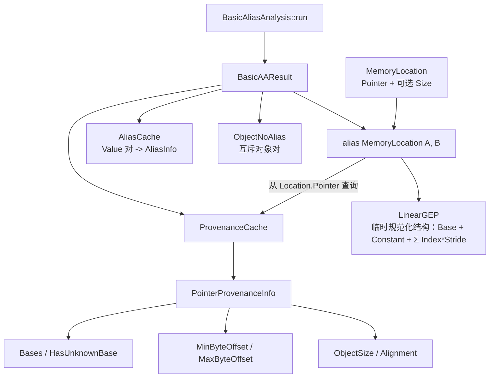

主流程先规范零偏移 GEP 和单输入 PHI；`undef` 来源返回 `MayAlias`，同一 SSA 指针直接返回 `MustAlias`。来源分析可穿过 GEP、bitcast、PHI 和 `select`；多来源指针只有在两个 base 集合笛卡尔积中的每一对都互斥时才给出 `NoAlias`。

不同 `alloca`、不同 global、parameter 与 `alloca`、`alloca` 与 global 天然互斥。相同条件的两个 `select` 逐臂比较，同块 PHI 按 predecessor 一一配对；结论不一致退化为 `MayAlias`。同一底层对象的 GEP 被线性化：变量项抵消且偏移为 0 时为 `MustAlias`，访问字节区间分离时为 `NoAlias`；还可借正步长、有限、无回绕 SCEV 递推证明跨迭代距离。若查询只证明两个指针指向不同对象，但传入的是显式内存访问范围，则只有两侧访问都能证明落在各自对象边界内才保留 `NoAlias`，否则降级为 `MayAlias`。

`PointerProvenanceInfo` 同时记录 bases、字节偏移区间、对象大小、已知对齐以及栈/全局/参数来源。来源和整数倍数查询各有 4096 个 SSA 节点预算，递归深度 64、单指针最多 64 个 base，PHI/`select` 的 MemoryLocation 展开深度为 32。函数只有直接调用用途时，还会从全部调用点为“形参对”及“形参—全局”播种对象互斥事实。

##### DSE 死存储消除

删除被后续完整覆盖、写入值本身冗余，或只影响未逃逸栈对象最终状态的 store。

- **依赖 AnalysisPass**：`BasicAliasAnalysis`、`LoopAnalysis`、`MemorySSAAnalysis`；ModRef 查询会间接消费 `SideEffectAnalysis`。
- **实现分为 4 层删除类别**：
  1. **MemorySSA 全路径覆盖**：候选之后的每条内存路径都在首次读取/修改前遇到 `MustAlias` 且覆盖宽度不小于候选的 store；
  2. **MemorySSA 同值冗余写**：所有反向路径都到达写入同一 SSA 值的完整覆盖 store；若在循环内，地址和值还须对每层循环不变；
  3. **块内逆向覆盖**：从块尾维护尚未被观察的后继 store，load/call 按 Alias/ModRef 清除不再安全的候选；
  4. **有界 CFG 后备**：把后继块分类为 `Kill / Clobber / Transparent`，每条可观察路径都必须先被覆盖；未逃逸 `alloca` 的最终写在返回路径上不可观察。

```llvm
; 以下是四个互相独立的节选
; 1. 全路径覆盖
entry.cover:
  store i32 1, ptr %p
  br i1 %c, label %L, label %R
L:
  store i32 2, ptr %p
  br label %join.cover
R:
  store i32 3, ptr %p
  br label %join.cover
join.cover:
  ret void
; -> 第一条 store 删除

; 2. 同值冗余写：第一次写在中间 load 处可观察，不能按覆盖删除
same.value:
  store i32 %v, ptr %p
  %x = load i32, ptr %p
  store i32 %v, ptr %p
  ret i32 %x
; -> 第二条由“已到达的同值写”证明为冗余并删除

; 3. 块内后写覆盖
local.overwrite:
  store i32 1, ptr %p
  store i32 2, ptr %p
  ret void
; -> 第一条 store 删除

; 4. 未逃逸栈对象最终写
dead.stack:
  %a = alloca i32
  store i32 7, ptr %a
  ret void
; -> store 删除
```

全路径覆盖/同值查询各最多处理 256 条 store，单次节点预算分别为 512/256；CFG 后备 BFS 最多访问 100 个块。第一层覆盖删除批次后会失效并重新获取 AA 与 MemorySSA；第二层同值删除后仍失效 MemorySSA，但后续阶段不再查询内存图，因而只重新获取 AA。CFG 不变，支配、后支配和循环结构可保留。

##### LoadElimination 加载消除

利用 MemorySSA、别名、支配和前驱数据流，把可证明未被修改的 load 转发成已有 SSA 值。

- **依赖 AnalysisPass**：`BasicAliasAnalysis`、`LoopAnalysis`、`DominantAnalysis`、`MemorySSAAnalysis`；ModRef 查询间接依赖 `SideEffectAnalysis`。
- **支持 5 类值转发**：
  1. MemorySSA 多路径 store-to-load：所有最近 clobber 都是完整覆盖、`MustAlias` 且写入同一支配值；
  2. MemorySSA load-to-load：两条 load 的 clobber 签名相同、地址 `MustAlias`，且候选支配目标并再次证明中间无写；
  3. 块内最近 store/load 转发；
  4. 循环内 load 复用循环外的支配 load，地址必须在目标循环外定义；
  5. 汇合前驱值：所有前驱值相同则直接替换，不同则在目标块建立 PHI。

转换前：

```llvm
entry:
  br i1 %c, label %L, label %R
L:
  store i32 %a, ptr %p
  br label %join
R:
  store i32 %b, ptr %p
  br label %join
join:
  %x = load i32, ptr %p
  ret i32 %x
```

转换后：

```llvm
entry:
  br i1 %c, label %L, label %R
L:
  store i32 %a, ptr %p
  br label %join
R:
  store i32 %b, ptr %p
  br label %join
join:
  %x.forward = phi i32 [ %a, %L ], [ %b, %R ]
  ret i32 %x.forward
```

查询结果使用 `KNOWN / PHI_NEEDED / CLOBBERED / UNKNOWN / NEED_PREDECESSORS` 五态，任一嵌套 PHI 需求、递归环或路径 clobber 都会停止转发。MemorySSA 快速层每次运行最多查询 512 条 load，之后的函数级后备流程仍会扫描其余 load；单次 MemorySSA walker 节点访问预算为 256，相同 clobber 候选最多 128 个，前驱递归深度 8、支配链 16，全路径扫描最多 64 个块/2048 条指令，每函数最多 64 次跨回边查询。

##### LICM 循环不变量代码移动

把安全的循环不变量提升到 preheader，把最终写下沉到全部 exit，或把非必执行的只读调用转换为首轮计算后缓存复用。

- **依赖 AnalysisPass**：`DominantAnalysis`、`LoopAnalysis`、`BasicAliasAnalysis`、`MemorySSAAnalysis`；只读调用检查按需查询 `SideEffectAnalysis`。
- **支持 3 类转换**：
  1. **Hoist**：提升 Binary、`select`、GEP、`trunc/zext/sext/fptosi/sitofp/bitcast`，以及经无故障、无 clobber 证明的 load/只读 call；
  2. **Sink store**：地址和值循环不变、写点支配 latch 和全部 exiting block，且循环内无其他相关 Mod/Ref 时，在每个 exit 克隆 store 并删除循环内原写；
  3. **非必执行不变调用缓存**：不能直接提升但支配 latch 的只读调用，在首轮执行一次，并通过 header 缓存 PHI 供后续迭代复用。

```llvm
; Hoist
loop:
  %k = add i32 %a, %b
  %x = mul i32 %k, %i
; ->
preheader:
  %k = add i32 %a, %b
loop:
  %x = mul i32 %k, %i

; Sink
loop:
  store i32 %v, ptr @g
; ->
exit:
  store i32 %v, ptr @g
```

除余提升要求常量非零除数，有符号除余还排除 `-1`；可能 poison 的移位和 `fptosi` 只在 header 安全前缀且支配全部退出/latch 时放行。Load 必须位于每轮必经安全前缀，或由 preheader 同址访问证明可解引用，并证明全循环无相关写。Sink 和调用缓存要求完整 `LoopSimplify + LCSSA`；调用缓存会修改 CFG 并使全部分析失效，普通 hoist/sink 不改 CFG。

Sink 的地址和值所依赖的指令定义必须都在循环外；根对象仅接受 global 或 `alloca`，GEP 必须全为常量索引、首个指针索引为 0 且访问不越界，写入宽度不能超过最终对象。若循环不具备完整 LoopSimplify 形态，LICM 只走保守后备路径，最多提升 Binary/`select`，不会提升 GEP、cast、load 或 call。

##### TailRecursionElimination（TRE）尾递归消除

为安全的普通尾调用添加 tail 标记，并把直接自尾递归或整数加/乘伪尾递归改写为共享循环头与参数 PHI。

- **依赖 AnalysisPass**：按需使用 `SideEffectAnalysis`；把只读调用跨 self-call 前移时还查询当前函数的 `BasicAliasAnalysis`、`LoopAnalysis`。函数可能到达计时调用时整体跳过。
- **支持 3 类转换**：
  1. **普通尾调用标记**：非自调用的 `call` 必须紧邻 `ret`，返回值/void 类型完全匹配，实参来源闭包不含 `alloca`；
  2. **直接自尾递归转循环**：支持直接 `ret`，也支持经唯一无条件边进入“仅 PHI + ret”的共享返回块；
  3. **ADD/MUL 累加器伪尾递归**：call 到 ret 之间只有一个整数 add 或 mul，恰有一个操作数是 self-call，分别以 0/1 初始化累加 PHI。

```llvm
; 转换前：直接自尾递归
define i32 @f(i32 %x) {
entry:
  %done = icmp eq i32 %x, 0
  br i1 %done, label %base, label %recurse
base:
  ret i32 0
recurse:
  %next = sub i32 %x, 1
  %r = call i32 @f(i32 %next)
  ret i32 %r
}

; 转换后（独立片段；函数名保持不变）
define i32 @f(i32 %x) {
entry.once:
  br label %loop.header
loop.header:
  %x.phi = phi i32 [ %x, %entry.once ], [ %next, %backedge ]
  %done = icmp eq i32 %x.phi, 0
  br i1 %done, label %base, label %backedge
base:
  ret i32 0
backedge:
  %next = sub i32 %x.phi, 1
  br label %loop.header
}
```

首次成功站点会创建新函数入口，将旧入口变成循环头，为每个形参创建 PHI，并把原入口块中的 `alloca` 搬到循环外。真正转换前，这些入口 `alloca` 地址必须不逃逸；void 自递归要求 call 与 ret 相邻，其他 call 与 ret 间的指令不能有必须保留的副作用、fault/poison、store 或对 self-call 结果的依赖。一次重写中成功转换的伪尾递归站点共享同一累加 opcode，不匹配的站点保留原状；累加器必须唯一，self-call 恰为一个操作数且结果唯一用户是 Ret。每轮只提交一个站点并立即失效分析，重新扫描后再处理下一站点。

##### SCCP 稀疏条件常量传播

在可执行 CFG 边与 SSA 值格上同步求解常量，并用 MemorySSA 的共同到达写进一步传播内存读取，最后一次性折叠值、分支和不可执行块。

- **依赖 AnalysisPass**：`MemorySSAAnalysis`、`BasicAliasAnalysis`、`LoopAnalysis`；MemorySSA 查询会通过 `FAM` 获取调用的内存效果。
- **核心数据结构**：

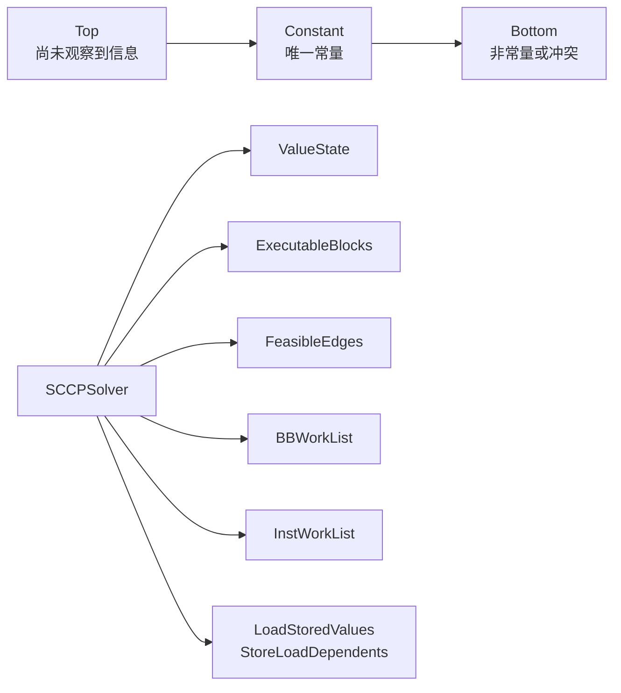

`LatticeValue` 的单调顺序为 `Top -> Constant -> Bottom`。PHI 只合并已标记可行的入边；条件分支会反向推动 CFG 边可行性。新的可执行块和格值分别进入两个工作队列：基本块由 `ExecutableBlocks` 保证只做首次激活，而相关指令可因操作数状态变化而重复入队重访，直到两个队列都为空。

- **支持 3 类提交转换**：
  1. 把格值为常量的可替换有结果指令（包括通过内存证明的 load）执行 RAUW 并删除原指令；
  2. 删除不可执行基本块，修复后继 PHI；PHI 的 0 个/1 个 incoming 分别退化为 `undef`/唯一值；
  3. 把常量条件分支改成无条件分支，并删除未选择边对应的 PHI incoming。

```llvm
%x = add i32 2, 3
%c = icmp eq i32 %x, 5
br i1 %c, label %T, label %F
; ->
br label %T
```

内存增强每次运行最多处理 512 个 load、每次 clobber 查询深度为 256；只有完整且非空的 clobber 集全部来自与 load `MustAlias`、完整覆盖、类型同形并写入同一个非 `undef` SSA 值的 store 时，该 load 才有资格传播这个共享 SSA 值；还必须等该值自身的格状态成为 `Constant`，load 才会折叠成常量。GEP、bitcast 和未知返回调用在值格上保守落到 `Bottom`。

##### LoopDependence（LoopDependenceAnalysis）循环依赖分析

惰性地把循环内的 load、store 和可映射调用表示成按循环轴分解的仿射地址，并生成保守依赖方向供循环交换、分布和调度查询。

- **依赖 AnalysisPass**：`LoopAnalysis`、`SCEVAnalysis`、`BasicAliasAnalysis`、`SideEffectAnalysis`。
- **核心数据结构关系**：

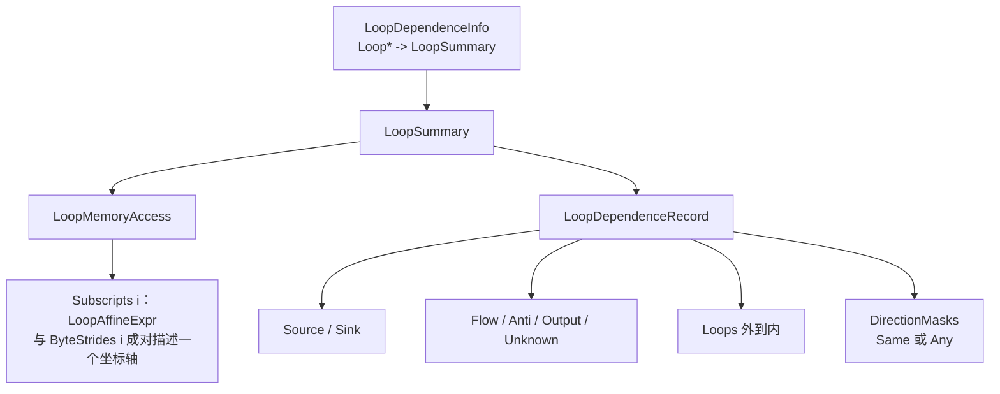

- `LoopAffineExpr` 保存 `Constant`、`LoopCoefficients` 与循环外 `InvariantTerms`，`Exact` 表示整个表达式可精确仿射化；
- `LoopMemoryAccess` 保存指令、指针、`MemoryLocation`、根对象、读写属性、按坐标分解的下标/字节步长及程序序；
- `LoopDependenceRecord` 把一对访问、依赖种类、循环轴和每轴方向掩码绑定在一起；
- `LoopSummary` 保存某循环作用域内的访问与依赖，并单独标记未知内存、可观察效果和顺序屏障。

仿射化支持常量、循环外 Unknown、加减、常量乘、非截断 cast 和常量步长 AddRec；非线性乘法、除余、移位、位运算、MinMax、Select、Compare、MulRec/DivRec 或循环内未知值都会使地址不精确。方向证明刻意保守：只有同根、同访问宽度/步长布局、有限无回绕规范归纳，且独立轴系数为相同的 `+1` 或 `-1` 时才可能给出 `Same`。此外，相应坐标的常量项必须一致，目标轴不能混入其他坐标 band，访问宽度不得大于最内层字节步长，多层 stride 还须严格递减并逐层整除；任一条件缺失都返回 `Any`。

每个摘要最多收集 512 个访存并检查 8192 对潜在写冲突候选，指针链深度最多 64、GEP 下标项最多 128。`isInterchangeLegal`、`isDistributionLegal`、`isConflictLocalToIteration`、`isInvariantAccessDisjointFromLoopWrite` 和 `getByteStride` 是结构 Pass 的主要消费接口。

##### LoopDistribution 循环分布

按 store 根的闭合反向切片寻找连续切点，把一个循环拆成两个串行、迭代域相同的循环，以分离局部性画像差异明显的访存组。

- **依赖 AnalysisPass**：`LoopAnalysis`、`SCEVAnalysis`、`LoopDependenceAnalysis`。
- **前置形态**：候选循环自身满足有限的 `LoopSimplify + LCSSA`，具有唯一 preheader/latch、唯一无 PHI exit 和唯一退出边；候选及其全部子循环都必须已证明有限，循环内值不能 live-out。
- **支持 1 种核心 CFG 变换**：

```text
转换前：
PreHeader -> Loop { SliceA; SliceB; } -> Exit

转换后：
PreHeader -> Loop.A { SliceA; }
          -> DistPreHeader
          -> Loop.B { SliceB; }
          -> Exit
```

算法为每条 store 建立循环内 SSA 反向切片，按原 store 程序序枚举所有连续切点；共享纯计算可保留在两侧，但共享切片不得含 store、call、br、ret 或 alloca，单次副作用必须恰好归属于一个分区。`LoopDependenceInfo::isDistributionLegal` 必须证明拆分不会把第二分区到第一分区的依赖次序反转。

收益模型把绝对字节步长分到 `0、<=8、<=64、<=512、>512` 五档，store 权重为 2、load 为 1；只统计分区专属访存，两个分区画像距离至少达到 100（完整一档）才提交，并选择距离最大的切点。

候选限制为最多 24 个块、160 条指令和 24 个 store 根，store 总数必须在 2～24 之间；拒绝调用、`alloca`、`ret`、未知二元操作以及依赖循环内 load/call 的控制条件。每函数累计最多分布 2 次，每次 `run()` 只提交一个候选，并为生成块添加 `.dist` 来源标记以避免与融合 Pass 振荡。

##### InstSimplify 指令简化

使用去重工作表反复应用局部代数、`select` 与 PHI 等价规则，并在内存分析证明安全时把分支两侧读取合成一个读取。

- **依赖 AnalysisPass**：`DominantAnalysis`、`BasicAliasAnalysis`、`LoopAnalysis`、`MemorySSAAnalysis`；内存回退扫描会按需查询调用副作用。
- **支持 6 大类转换**：
  1. 二元运算和比较，包括 Add/Sub/Mul/Div/Rem/And/Or/Xor/Cmp 九组规则；结构性代数规则主要针对整数，浮点只做语义安全的常量求值与单位元规则；
  2. `select` 常量、同臂和布尔吸收化简；
  3. 忽略 self/`undef` 后的退化 PHI；
  4. `PHI-of-Binary -> Binary-of-PHI`；
  5. `PHI-of-GEP -> GEP-of-PHI`；
  6. `PHI-of-Load -> Load-of-PHI`。

```llvm
add i32 %x, 0                         ; -> %x
mul i32 %x, 8                         ; -> shl i32 %x, 3
select i1 %c, i1 true, i1 %y          ; -> or i1 %c, %y
phi i32 [ %x, %A ], [ %x, %B ]       ; -> %x

; PHI-of-Binary：转换前
A:
  %a1 = add i32 %a, %k
B:
  %a2 = add i32 %b, %k
join:
  %r = phi i32 [ %a1, %A ], [ %a2, %B ]

; 转换后
join:
  %u = phi i32 [ %a, %A ], [ %b, %B ]
  %r = add i32 %u, %k
```

浮点规则严格保留 IEEE 语义：加法只把 `-0.0` 当单位元、减法只把 `+0.0` 当单位元，不做浮点 `x-x` 或零乘。名字带 `.lcssa` 的 PHI 不参与这些简化；跨臂 Binary/GEP/Load 合并要求无计时屏障。GEP 的唯一变化位置可以是 base，也可以是一个非常量索引；每个 incoming GEP 都必须确实包含动态索引，并拒绝 `alloca` 基址。Load 合并要求每个 incoming 是对应前驱中的单用户 load，并由 MemorySSA（深度 256）或逐指令 ModRef 扫描证明到块出口无 clobber。

##### LoopInterchange 循环交换

在依赖方向合法且局部性收益足够时，通过物理 CFG 换轴或只交换归纳变量角色来改变两层循环的执行顺序。

- **依赖 AnalysisPass**：`DominantAnalysis`、`PostDominantAnalysis`、`LoopAnalysis`、`SCEVAnalysis`、`LoopDependenceAnalysis`。
- **支持 2 种转换形式**：
  1. **物理 CFG 交换**：针对旋转后的受限非完美循环巢，新增首轮检查、两个 preheader 和 latch，真正交换外/内控制骨架；
  2. **归纳变量角色交换**：两轴迭代域完全相同时保持 CFG 不变，只交换非控制 use；必要时将不故障的外轴纯计算前缀克隆到内层 header。

```text
; 归纳变量角色交换路径：两轴具有相同的 start/step/trip/zero-trip 属性
for (i = 0; i < N; ++i)              for (j = 0; j < N; ++j)
  for (j = 0; j < N; ++j)    ->        for (i = 0; i < N; ++i)
    use A[j][i];                          use A[j][i];
```

公共合法性要求直接父子循环、有限且 LCSSA、规范归纳变量、无不支持的副作用，并由依赖分析证明每条依赖至少在待交换的一个轴上为 `Same`。局部性收益为内层每个访存的 `权重 * (旧内轴步长惩罚 - 新内轴步长惩罚)`，store/load 权重为 2/1，最低收益为 6。

物理路径使用固定的 outer 三块 + inner 两块骨架，Prefix 必须有 load、不能有 store，且 Prefix load 与内层写确定不相交；角色路径要求两轴 SCEV 起点、步长、trip count 和零次属性一致，外层直属块无访存。每函数最多交换 4 次，可下沉纯计算前缀最多 8 条。

##### GVNPRE 全局值编号与部分冗余消除

用支配值号消除全局冗余纯表达式和内存读取，再通过 PHI translation 在恰缺一条前驱的路径补算表达式，消除部分冗余。

- **依赖 AnalysisPass**：`DominantAnalysis`、`LoopAnalysis`、`BasicAliasAnalysis`、`MemorySSAAnalysis`；调用优化按需查询 `SideEffectAnalysis`。构造参数 `EnablePRE=false` 时只运行 GVN。
- **核心结构**：`ExprKey` 由 opcode/谓词、结果类型和操作数值号组成；交换律操作数会排序，交换比较操作数时同步反转谓词。`LeaderTable` 按 value number 保存全部候选，`findLeader` 再按支配关系、块内顺序和计时屏障筛选当前使用点可用的代表；PRE 另维护 `AvailOut` 和 `PhiTranslateTable`。
- **支持 6 类转换**：
  1. 纯表达式全局 CSE；
  2. store-to-load 转发；
  3. load-to-load CSE；
  4. `NoModRef` 或可证明无干扰的只读调用 CSE；
  5. 互递归等价 PHI 图合并；
  6. PRE 在缺失前驱插入表达式，并在汇合块建立结果 PHI。

```text
PredA: %x = add %a, %b ----\
                              Join: %r = add %a, %b
PredB: ---------------------/

                         |
                         v

PredA: %x = add %a, %b ----\
PredB: %y = add %a, %b -----+--> Join: %r = phi [ %x, PredA ], [ %y, PredB ]
```

PRE 只接受有结果、纯且可安全推测的标量表达式，排除内存、call、比较、控制、PHI 和可能 fault/poison 的操作；所有前驱必须存活且不是回边，并且必须“恰有一条缺失、至少一条已有”。函数超过 1500 条指令或单块超过 400 条时跳过；GVN/PRE 各最多 12 轮，单轮 MemorySSA 查询最多 512 次，唯一前驱回扫最多 64 条指令。

##### RangeAnalysis 数值范围分析

在可行 CFG 上联合求解 i1/i32 有符号区间、无符号区间、已知位和 f32 状态区间；整数结果再叠加边、支配路径与 SCEV 归纳事实形成程序点敏感查询，浮点最终查询则只可靠地使用全局结果。

- **依赖 AnalysisPass**：`SCEVAnalysis`、`DominantAnalysis`。
- **核心抽象域**：
  - `IntRange {min, max, knownTrailingZeros}`：有符号区间，`min > max` 表示 Bottom；
  - `UIntRange {min, max}`：无符号位模式区间；
  - `KnownBits {zero, one}`：确定为 0/1 的位集合，同一位冲突表示不可达事实；
  - `FloatRange {min, max, mayNaN, mayPositiveZero, mayNegativeZero}`：显式区分 NaN 和正负零；
  - `LoopInductionInfo`：归纳循环、初值、步长、上界和无回绕属性。

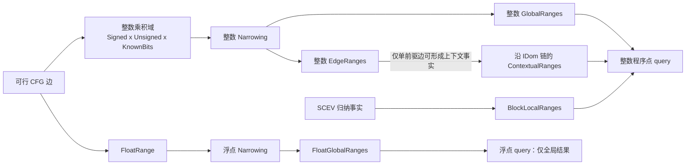

`RangeInfo` 的整数域中，全局、上下文和边结果各保存 `Signed/Unsigned/KnownBits` 三类映射；块局部结果只保存 `Signed/Unsigned`，不存在 `BlockLocalBits`。浮点结构虽有全局与上下文字段，但求解收尾会清空浮点上下文且不会建立浮点边映射，因此最终浮点查询只使用全局结果。整数查询则取全局基线、完整 IDom 链路径事实和当前块 SCEV local 事实的交，边查询再叠加指定边约束。

求解分五步：前向工作表只合并可行 PHI incoming；有符号区间、无符号区间或浮点区间的单值更新达到 32 次时 widen 到 Top 并锁定，KnownBits 不使用该计数式 widen；随后在 `可达指令数 * 4 + 64` 预算内 narrowing，并仅对已证无回绕的 add/sub 反推操作数；narrowing 未完成则清空强事实整体退化为 Top；成功后重建整数边/支配上下文事实并叠加有限、无回绕的 SCEV 归纳范围。整数乘积域最多交叉约化 3 轮。

整数只精确建模 i1/i32，支持加减乘、带/不带符号除余、合法常量移位、and/or 与 KnownBits xor；溢出、可能除零或非凸位模式退化为 Top。浮点前向建模四则并保留 NaN/±0/无穷信息；整数 `select` 支持真假臂敏感查询，浮点 `select` 仅在前向求解时按常量条件选臂或合并全局范围。

##### GepCombine GEP 组合

规范化链式 GEP，将指针 PHI 外提成索引 PHI + 公共 GEP，并把同块相邻地址重基址为前一地址的常量步进。

- **依赖 AnalysisPass**：`RangeAnalysis`、`DominantAnalysis`。
- **支持 3 大类、共 7 个实现分支**：
  1. **链式 GEP 合并（3 个分支）**：当前 GEP 首索引为 0、基 GEP 末索引为 0，或两端常量索引可安全相加且合并结果忽略首个零后最多只有一个非零索引；
  2. **GEP-of-PHI（2 个分支）**：incoming 完全相同，或只有一个索引位置不同；
  3. **同块相邻 GEP 重基址（2 个分支）**：末索引为 `previous + C`，或两个末索引为同基值加不同常量。

```llvm
; 链合并
%p = getelementptr [100 x [20 x i32]], ptr %A, i32 0, i32 %i, i32 0
%q = getelementptr i32, ptr %p, i32 %j
; ->
%q = getelementptr [100 x [20 x i32]], ptr %A, i32 0, i32 %i, i32 %j

; GEP-of-PHI：转换前
A:
  %gep.A.i = getelementptr [100 x i32], ptr %base, i32 0, i32 %i
  br label %join
B:
  %gep.A.j = getelementptr [100 x i32], ptr %base, i32 0, i32 %j
  br label %join
join:
  %p = phi ptr [ %gep.A.i, %A ], [ %gep.A.j, %B ]

; ->
A.after:
  br label %join.after
B.after:
  br label %join.after
join.after:
  %k = phi i32 [ %i, %A.after ], [ %j, %B.after ]
  %p.after = getelementptr [100 x i32], ptr %base, i32 0, i32 %k

; 相邻重基址（至少两个索引）
%p = getelementptr [100 x i32], ptr %A, i32 0, i32 %i
%i.plus.1 = add i32 %i, 1 ; RangeAnalysis 已证明该 ADD 不回绕
%q = getelementptr [100 x i32], ptr %A, i32 0, i32 %i.plus.1
; -> %q = getelementptr i32, ptr %p, i32 1
```

链合并要求基 GEP 单用户且无计时屏障，最多迭代 4 轮；PHI 形态要求单用户、至少两个 incoming、无 self/timer、同基址同形且最多一个变化索引；相邻重基址要求除最后索引外操作数完全一致，`RangeAnalysis` 负责证明源 ADD 不回绕，而常量索引合并与常量差另由 `IRMath::addI32` 做独立溢出检查。

##### ConstraintElimination 约束消除

沿支配树传播分支路径上的整数约束，并结合范围事实把能够证明恒真或恒假的后续分支条件替换成布尔常量。

- **依赖 AnalysisPass**：`DominantAnalysis`、`RangeAnalysis`。
- **核心状态**：
  - `ConstraintElimConstraint`：以 `val op (bound + boundOffset)` 统一表示路径约束，并单独缓存常量边界；
  - `ConstraintElimStackFrame`：记录支配树 DFS 节点及进入节点前的约束栈深度，使兄弟子树不会错误共享路径事实；
  - `ConstraintElimFoldCandidate`：延迟保存待折叠的分支、原比较和证明结果，遍历完成后统一提交。
- **支持 4 类证明形式**：
  1. 同一左值上的直接蕴含或矛盾，例如 `x < 10` 蕴含 `x < 20`；
  2. 交换比较两侧并反转谓词，例如 `a < b` 与 `b > a`；
  3. 经过一个中间值的传递关系，例如 `x < y`、`y <= 8` 蕴含 `x < 8`；
  4. 在 `RangeAnalysis` 证明无回绕后，将 `x + C`、`x - C`、`C - x` 规范为 `Base + Offset` 再比较。

转换前：

```llvm
entry:
  %c0 = icmp slt i32 %x, 10
  br i1 %c0, label %inside, label %exit
inside:
  %c1 = icmp slt i32 %x, 20
  br i1 %c1, label %always, label %unreachable
```

转换后：

```llvm
inside:
  br i1 true, label %always, label %unreachable
```

本 Pass 只替换条件值，不直接删除 CFG 边；紧随其后的 `CFGSimplify` 负责删除不可达分支。路径约束只从“当前块恰有一个前驱”的条件分支边提取；常量偏移分解默认最多递归 2 层，且每次搬移都要求 i32 区间能够证明加减不回绕，不能证明时保持原比较。

##### RangeAwareSimplify 范围感知化简

消费整数区间、浮点区间和已知位信息，在普通常量传播无法处理的情况下继续折叠表达式、比较与 `select`。

- **依赖 AnalysisPass**：`RangeAnalysis`、`DominantAnalysis`。
- **实际执行 7 类转换**：
  1. 将整数/浮点单值区间以及完全已知的整数位模式折叠为常量；
  2. 用不相交区间、单值区间或已知位冲突折叠整数比较，用排除 NaN 的浮点区间折叠浮点比较；
  3. 分别证明 `icmp(select cond, T, F), R` 的两臂结果，将其折叠为常量或原 `cond`；
  4. 条件区间恒真或恒假时直接选择 `select` 的一条臂；
  5. 识别 `select` 构成的绝对值，在已知符号下选择 `x` 或 `-x`；
  6. 识别 `min/max` 形式，在两侧区间顺序确定时直接选值；
  7. 被除数已证非负、除数为二次幂时，把有符号除法/余数改成右移/掩码。

```llvm
; 已知 %x 的范围为 [0, 31]
%q = sdiv i32 %x, 8      ; -> %q = ashr i32 %x, 3
%r = srem i32 %x, 8      ; -> %r = and  i32 %x, 7

; 已知 %a 为 [0, 3]，%b 为 [10, 20]
%c = icmp slt i32 %a, %b ; -> true

; 已知 %x >= 0
%isneg = icmp slt i32 %x, 0
%n = sub i32 0, %x
%v = select i1 %isneg, i32 %n, i32 %x ; -> %x
```

实现会在同一基本块内以深度 3 有界展开纯整数表达式，并把局部推导区间与全局程序点区间取交。`convertSignedToUnsigned` 阶段目前只扫描证据；由于 IR 没有可区别表达语义的独立替换形式，该阶段尚不产生转换。

##### LoopIdiomRecognize 循环惯用模式识别

把单位步长、连续访问且副作用封闭的内存循环替换成 `memset`、`memcpy` 或 `memmove`。

- **依赖 AnalysisPass**：`DominantAnalysis`、`LoopAnalysis`、`RangeAnalysis`、`SCEVAnalysis`。
- **前置形态**：最内层循环满足 `LoopSimplify`，存在常量起点、步长为 1 的规范归纳变量；元素仅支持 i32 或 float，单次访问大小为 4 字节。
- **支持 3 种惯用形式**：
  1. **连续填充**：循环中唯一 `store` 写入四个字节完全相同的整数/浮点常量，替换为 `memset`；
  2. **连续复制**：唯一 `load` 直接供给唯一 `store`，源和目标可证明属于不同对象，替换为 `memcpy`；
  3. **临时数组双复制**：相邻的 `source -> temporary` 与 `temporary -> destination` 两个循环合并为一次 `memmove`；常量次数版本删除无用临时 `alloca`，运行时版本保留原循环和临时数组作为慢路径。

```llvm
; 填充循环核心：转换前
%p = getelementptr i32, ptr %dst, i32 %i
store i32 0, ptr %p

; 转换后（位于 preheader）
call void @llvm.memset.p0.i32(
    ptr %dst.start, i8 0, i32 %bytes, i1 false)

; 复制循环核心：转换前
%s = getelementptr i32, ptr %src, i32 %i
%d = getelementptr i32, ptr %dst, i32 %i
%v = load i32, ptr %s
store i32 %v, ptr %d

; 转换后（位于 preheader）
call void @llvm.memcpy.p0.p0.i32(
    ptr %dst.start, ptr %src.start, i32 %bytes, i1 false)
```

常量迭代次数版本直接插入 intrinsic 并删除被替代的访存；运行时次数版本要求 `iv < bound`，并建立 `count >= 8` 且 `count <= INT32_MAX / 4` 的快速路径：

```mermaid
flowchart LR
    P[PreHeader] -->|guard 成立| Fast[memset / memcpy / memmove]
    P -->|guard 不成立| H[原循环慢路径]
    Fast --> E[Exit]
    H --> E
```

所有地址都必须是“唯一动态归纳维 + 其余常量维”的连续 GEP；把起始 IV 替成常量后，intrinsic 的源/目标首地址 GEP 必须通过已知 `alloca/global` 对象边界检查，但实现不会据此宣称整个 `tripCount * 4` 区间均已证明在界内。运行时版本还要求起点非负、bound 在 preheader 可用且目标 exit 不含 PHI；出现额外调用、额外访存、循环外用户或不安全重叠时保守放弃。

##### LoopAccessAnalysis 循环访存分析

把 `LoopDependence` 的仿射访问记录提升为完整迭代域上的地址足迹，并为循环独立性、融合和局部性优化提供统一查询接口。

- **依赖 AnalysisPass**：`LoopAnalysis`、`SCEVAnalysis`、`RangeAnalysis`、`DominantAnalysis`、`BasicAliasAnalysis`、`LoopDependenceAnalysis`。
- **核心数据结构关系**：

```mermaid
flowchart TD
    Info[LoopAccessInfo<br/>Loop* -> Summary 惰性缓存] --> Summary[LoopAccessSummary]
    Summary --> Access[LoopMemoryAccess 列表]
    Summary --> Footprint[LoopAccessFootprint 列表]
    Footprint --> Dim[LoopAccessDimension]
    Footprint --> Base[Base / StartOffset / ObjectSize]
    Footprint --> Extent[MinOffset / MaxOffsetExclusive]
    Dim --> Axis[Axis / TripCount / ByteStride]
    Info -->|classifyPair 返回| Pair[LoopAccessPairKind]
    Pair --> NC[NoConflict]
    Pair --> SI[SameIterationOnly]
    Pair --> UK[Unknown]
```

- `LoopAccessDimension` 描述一个循环轴的 SCEV 次数、常量次数、字节步长、有限性和单位步长；
- `LoopAccessFootprint` 描述底层对象、起始/最小/最大字节偏移、对象大小、元素大小、对齐以及 `Exact/IsConsecutive/IsFullAccess/IsEmpty`；
- `LoopAccessSummary` 将一个循环作用域的稳定访问记录与足迹一一对应，并标记未知内存和是否存在写入；
- `LoopFusionAccessResult` 记录融合是否合法、是否因证据不足而未知，以及同迭代真依赖/冲突对数量。

构建足迹时归一化稳定 base（必要时可退回 `Access.Root`），并证明各轴步长与次数、访问必执行和地址算术不回绕；只有对象大小已知时，才额外强制常量半开足迹位于对象边界内，未知对象大小本身不会阻止发布 `Exact`。访问对只产生三值结论：纯读对直接为 `NoConflict`；不同对象且 `NoAlias` 也为 `NoConflict`；地址相等强制循环坐标相同为 `SameIterationOnly`；其余均为 `Unknown`。单次变换最多检查 8192 对访问，地址无回绕查询最多访问 4096 个 SSA 节点且递归深度不超过 64。

核心查询包括 `isConsecutiveAccess`、`areIterationsIndependent`、`analyzeFusion`、`isRectangularNest`、`hasCrossAxisReuse` 和 `getByteStride`。

##### LoopFusion 循环融合

将两个严格相邻、迭代域完全相同且内存顺序安全的同级循环合成一个循环，使同次迭代的生产值能立即被消费。

- **依赖 AnalysisPass**：`DominantAnalysis`、`PostDominantAnalysis`、`LoopAnalysis`、`SCEVAnalysis`、`LoopAccessAnalysis`。
- **前置形态**：两个循环均为 `LoopSimplify + LCSSA`，由唯一桥接块串联；SCEV 的起点、步长、次数及零次执行属性完全一致，循环树有限，且循环内值没有 live-out。两循环的退出测试都必须位于 header，第二 body entry 与最终 exit 不能含 PHI。
- **支持 1 种核心 CFG 变换**：

```mermaid
flowchart LR
    subgraph 转换前
        H1[Header1] --> B1[Body1]
        B1 --> L1[Latch1]
        L1 --> H1
        H1 --> Bridge
        Bridge --> H2[Header2]
        H2 --> B2[Body2]
        B2 --> L2[Latch2]
        L2 --> H2
        H2 --> E2[Exit2]
    end
```

```mermaid
flowchart LR
    subgraph 转换后
        FH[Fused Header] --> FB1[Body1]
        FB1 --> FL1[Latch1]
        FL1 --> FB2[Body2]
        FB2 --> FL2[Latch2]
        FL2 --> FH
        FH --> FE[Exit2]
    end
```

提交时把桥中的安全纯计算外提到第一循环 preheader，将第二循环的非归纳 PHI 移入第一 header，用第一归纳变量替换第二归纳变量，重接三条 CFG 边，最后删除桥和第二 header。

`LoopAccessAnalysis` 必须证明所有跨循环写冲突均为无冲突或只发生在同一逻辑迭代，而且至少存在一个同迭代写后读真依赖才认为有收益；第一循环若本身是单 store 的 `memset/memcpy` 惯用候选也拒绝融合。实现还拒绝调用、`alloca`、`ret` 和带 `.dist` 来源标记的循环；load/store 的次序安全交给 LoopAccess 判断，其他可能 fault/poison 的指令拒绝重排，仅额外放行已证明常量除数安全的整数除余。同迭代真依赖候选最多 128 条指令，通用硬上限为 128 个块/512 条指令，桥最多 24 条指令、移动 PHI 最多 32 个；每次 `run()` 只融合一对，每函数累计最多融合 4 对。

##### UnrollAndJam 展开并合并

展开外层循环的多个迭代 lane，同时只保留一份共享内层循环控制，从而增加严格浮点归约的并行度并改善跨 lane 的访存局部性。

- **依赖 AnalysisPass**：`LoopAnalysis`、`SCEVAnalysis`、`LoopAccessAnalysis`、`DominantAnalysis`、`PostDominantAnalysis`；常量余数需要先 peeling 时额外查询 `BasicAliasAnalysis`。
- **前置形态**：直接父子循环构成有限矩形循环巢，满足 `LoopSimplify + LCSSA`；外层为正步长、无回绕、常量次数且至少执行 2 次，不同外层迭代由 `LoopAccessAnalysis` 证明独立，外循环完全不允许 live-out。外层必须恰有一个直接子循环且 header 只含规范 IV PHI；各层均为单退出、每次迭代必经 latch，除已识别的循环退出外不允许额外条件 CFG。
- **支持 1 种结构变换，因子可为 2/4/8**：

```text
转换前：                              转换后（Factor = 2）：
for (i = 0; i < N; ++i)              for (i = 0; i < N; i += 2)
  for (j = 0; j < M; ++j)              for (j = 0; j < M; ++j) {
    body(i, j);                           body(i,     j);   // lane 0
                                          body(i + 1, j);   // lane 1
                                        }
```

算法从外层归纳变量出发建立 lane 依赖闭包，克隆受外轴影响的非控制指令，并无条件把所有 store 纳入 lane 闭包；每条额外 lane 生成 `IV + lane * step`，重映射克隆操作数与相邻 GEP，最后把外层回边更新改成 `IV + Factor * step`。共享内循环树深度最多 3，候选最多 24 个块，所有额外 lane 合计最多克隆 96 条指令。

收益模型要求存在可跨 lane 共享的读取，并且满足“长距离相邻 lane 访存”或“严格浮点归约的缓存行滑动窗口”之一；默认 FPR/GPR 预算分别为 24/18，缓存行为 64 B，共享轴次数至少 64，长遍历跨度至少 256 KiB，浮点加法估算延迟为 3。常量次数不能整除因子时，可先剥离至多 7 次余数迭代；peeling 改 CFG 并使全部分析失效，普通 jam 只改 SSA 和块内指令，保留支配树、后支配树和循环树。每个函数默认最多成功 jam 2 次。

##### LocalAggregateSimplify 局部聚合化简

分阶段折叠只读常量表，并把小型、地址不逃逸的局部数组转换成标量值或直接删除。

- **依赖 AnalysisPass**：`DominantAnalysis`、`RangeAnalysis`；跨块只读数组阶段按需查询 `BasicAliasAnalysis`、`LoopAnalysis`、`MemorySSAAnalysis`。
- **关键数据结构**：
  - `LocalAggregatePointerPath`：根 `alloca`、常量聚合下标序列及路径是否全常量；
  - `LocalAggregateReadOnlyConstantArrayPlan`：常量源、初始化 `memcpy`、元素 GEP 与待替换 load；
  - `LocalAggregateSynthExpression`：由 Index、Constant、Binary 构成的低成本表达式树；
  - `LocalAggregateDeadUses`：可整体删除的写入与派生指针集合。
- **支持 5 类转换**：
  1. **只读全局 load 折叠**：常量下标直接读取初始化值；有界动态 i32 查表尝试综合为不超过 3 条二元指令的等价表达式；
  2. **同块常量转发**：顺序解释“完整常量 `memcpy` + 常量下标覆盖”，把后续 load 替换为初始化元素或最近 store；
  3. **跨块只读局部数组展开**：用支配关系与 MemorySSA 证明初始化到 load 之间无 clobber，再用常量、综合表达式或极小 `select` 链替换全部读取；
  4. **常量路径标量化**：把只经常量 GEP 访问的聚合拆成最多 32 个独立标量 `alloca`，并把实际登记为标量槽位的初始化拆成标量 store；
  5. **死聚合删除**：地址不逃逸且内容从未被读取时，删除所有 store/目标 `memcpy`、派生指针和根 `alloca`。

```llvm
; 常量表综合
@T = constant [4 x i32] [i32 1, i32 3, i32 5, i32 7]
; RangeAnalysis 已证明 0 <= %i < 4
%p = getelementptr [4 x i32], ptr @T, i32 0, i32 %i
%v = load i32, ptr %p
; ->
%twice = mul i32 %i, 2
%v = add i32 %twice, 1

; 常量路径标量化
%a = alloca [2 x i32]
%p0 = getelementptr [2 x i32], ptr %a, i32 0, i32 0
%p1 = getelementptr [2 x i32], ptr %a, i32 0, i32 1
; ->
%a.0 = alloca i32
%a.1 = alloca i32
```

综合搜索最多处理 32 个 i32 表元素和 12 个候选常量；每个成本层最多枚举 4096 个 pending 状态，再截断保留 128 个状态，且表达式成本必须严格低于普通 load 的估算成本 4。没有可用综合式时，“至多 2 个元素的 `select`”回退只用于跨块局部数组阶段，全局动态常量表没有该回退。跨块阶段最多查询 64 个数组，每个计划最多收集 256 个 load，每条 load 的 MemorySSA clobber walk 另有 256 个节点预算。

##### LoopUnroll 循环展开

依据 SCEV 次数证明和代码成本，在完全展开、部分展开、运行时展开与 peeling 中选择一种方式复制循环体并修复 CFG/PHI。

- **依赖 AnalysisPass**：`LoopAnalysis`、`DominantAnalysis`、`SCEVAnalysis`、`BasicAliasAnalysis`、`RangeAnalysis`。
- **前置形态**：循环满足规范 `LoopSimplify` CFG 与 LCSSA，具有可分析的唯一退出形态，全部指令可由克隆器支持；任何可能到达计时调用的循环都拒绝展开。
- **支持 5 种转换形式**：
  1. **Full**：已证无回绕的小常量次数、且退出测试位于 latch 的循环完全展开成直线 CFG，只保留最后一次退出值；
  2. **Partial**：常量次数能被 2/4 路因子整除时，在一个主循环迭代中串接多个 body 副本；
  3. **PartialWithRemainder**：常量次数不能整除时生成展开主循环和常量尾部副本；
  4. **Runtime**：在当前 preheader 或可证明安全的祖先循环入口物化运行时 trip count，生成分组主循环和动态尾部；二次幂因子用 `and/lshr` 求余数与组数；
  5. **Peeling**：在残余循环前克隆前 1～2 次迭代，使首轮条件常量化，或让循环不变的重复 store 能从残余循环删除。

```text
Partial（Factor = 4）：

Header -> Body(i) -> Body(i+1) -> Body(i+2) -> Body(i+3)
       -> Latch(i += 4) -> Header

Runtime：

安全的 PreHeader/祖先入口 -> 计算 TripCount / NumGroups / Remainder
                         -> 4 路展开主循环
                         -> 动态 Tail
                         -> Exit
```

默认收益阈值为：完全展开成本 192，部分展开 160，运行时展开 96；普通/极小循环完全展开次数上限分别为 16/32，部分展开最大因子 4，运行时默认及最大因子均为 4。Partial/Runtime 仅处理无普通 call 的最内层循环，默认原 body 成本上限分别为 72/48；普通 call 或嵌套循环仍可能 Full，但成本阈值减半且 trip count 不得超过 4。Runtime 的 SCEV 展开节点数与新增指令成本各不超过 8。

默认 peeling 最多 2 次；运行时或尚未证明 no-wrap、因而需要保留退出检查的 guarded peeling 最多 1 次，成本上限 64 且最多克隆 24 个块。决策优先级固定为 Full → Peeling → Partial（含余数）→ Runtime；一次 Pass 最多成功处理 4 个循环，每次 CFG/SSA 克隆后立即使函数分析失效并重建。
