# 参赛文档

### 代码声明

**一、第三方 IP 借鉴声明**

1. 本项目的 IR 结构设计整体借鉴自LLVM的设计理念和架构组织，但做了本项目特化
2. 一些AnalysisPass和TransformPass借鉴LLVM的算法思想，但做了本项目特化

**二、人工智能辅助工具使用声明**

在本项目开发中，使用了人工智能辅助编程工具，生成的代码范围及使用方式说明如下：

- 本项目的大部分代码使用**Codex**在编辑器中以“编码—提示-补全”模式辅助编写；
- Codex生成某些pass以及中端架构的初版架构，然后由人工原创设计pass算法及实现，然后人工进行审查
- 使用了AI大模型ChatGPT生成该文档中某些图，用来更好的说明一些优化流程
- 人工审阅与修改：所有 AI 生成的代码，均由团队成员逐行审阅，针对项目接口规范、性能要求、安全检查等进行必要的补充、重构与单元测试，确保最终代码质量与一致性。

### 分工合作

- 刘烨嘉一：负责前端以及中端
- 宋科宏：负责RISCV后端和ARM后端

### 总体框架

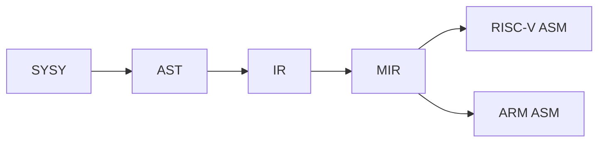

```
Compiler/
├── doc/                              # 竞赛文档
│
├── include/                          # .hpp文件
│   ├── yacc/                         # 词法、语法分析相关文件
│   ├── lib/                          # 编译器前端文件及中端基础结构文件
│   ├── ir/                           # 中端优化框架
│   │   ├── analysis/                 # 中端分析 Pass
│   │   └── opt/                	  # 中端变换与优化 Pass
│   ├── riscv/                        # RISC-V 后端
│   └── aarch64/                      # ARM 后端
│
├── src/                              # .cpp文件
│   ├── yacc/                         # 词法、语法分析相关文件
│   ├── lib/                          # 编译器前端文件及中端基础结构文件
│   ├── ir/                           # 中端优化框架
│   │   ├── analysis/                 # 中端分析 Pass
│   │   └── opt/                      # 中端变换与优化 Pass
│   ├── riscv/                        # RISC-V 后端
│   └── aarch64/                      # ARM 后端
│
├── runtime/                          # SysY 运行时库
├── main.cpp                          # 编译器入口
├── CMakeLists.txt                    # CMake 项目构建配置
└── README.md                         # 项目说明
```

### 前端

#### SysY2022及Runtime分析

> 这一部分是本人在阅读完相关文档的一些总结，目的为了便于后续开发前中端查阅需要

**Sysy2022**

- .sy文件结构：全局变量声明，全局常量声明，函数定义，唯一的main函数定义

- 注释：单行和多行（遇到第一个*/就结束）

- 数值类型：int/float类型和元素为int/float类型且按**行优先存储**的多维数组类型

  隐式类型转换：编译器在需要是可自动转换float/int，不支持程序员 `(int)`、`(float)` 主动指定转换

  > 混合运算时，int先转float，再进行计算
  >
  > float隐式转换成int时，小数部分直接丢弃，float超出int范围，进行转换为未定义行为
  >
  > int隐式转换成float时，转换后值保持不变

- 函数：

  参数为 int/float 时，按值传递

  参数为数组类型时，实际传递的是数组的起始地址，并且**形参第一维的长度必须空缺**。

  ```c
  //示例1：
  //在如下例子传入的就是a[0]，并且实际修改的就是main中的data[0]
  void process(int a[]) {
      a[0] = 100;
  }
  int main() {
      int data[3] = {1, 2, 3};
      process(data);
  }
  //示例2：
  void process(int a[][3]) {
  }
  
  //示例3：支持多维数组降维传递
  //下图传递了data[1]这个[3][4]的二维数组
  void process_matrix(int a[][4]) {
      a[0][0] = 100;
  }
  
  int main() {
      int data[2][3][4];
      process_matrix(data[1]);
      return 0;
  }
  ```

- 数值常量：**忽略所有后缀**

  - 整数常量：

    - 十进制
    - 八进制：以0开头
    - 十六进制：以0x或0X开头

  - 浮点常量：均存在整数+小数/省略整数/省略小数三种形式，**忽略所有后缀**

    - 十进制：

      普通形式：3.14 / .5 / 1.

      十进制指数：

      **注意指数的底数为10**

      ```
      1e3      = 1 × 10³    = 1000
      2.E2     = 2. × 10²  = 200
      .14e-2   = 0.14 × 10⁻² = 0.0014
      ```

    - 十六进制：

      0x 十六进制数字 '.' 十六进制数字 p 十进制指数：

      **注意指数的底数为2**

      ```
      0x1.2p3 = 1.125 × 8 = 9
      	0x1.2 = 1 + 2 × 16⁻¹
          = 1 + 2/16
          = 1.125
      	2³ = 8
      ```

- 一些规则：

  - 常量必须初始化且不能再次赋值
  - 数组每一维定义必须显式给出
  - 未初始化局部变量值不确定
  - 未初始化全局变量/数组初始值为0
  - 初始化全局变量/数组初始值为常量表达式
  - 数组只能逐维赋值，不能整个赋值

- sysy其他未提到的参考C语言即可

**Runtime**

> 由于putf在测试用例中并未出现，所以本人没有实现这一runtime函数在前中端的处理

读取函数：

- int getint()：从**标准输入**读取一个整数，并返回对应的 `int` 值

- float getfloat()：从**标准输入**读取一个浮点数，返回 32 位单精度浮点值

- int getch()：从**标准输入**中读取一个字符（将整数视为字符），并返回该字符的 ASCII 码值

  ```c
  12 34
  |
  |
  '1' → 49
  '2' → 50
  ' ' → 32
  '3' → 51
  '4' → 52
  '\n' → 10    
  ```

- int getarray(int[])：输入一串整数，第 1 个整数代表后续要输入的整数个数，该个数通过返回值返回；后续的整数通过传入的数组参数返回

  ```c
  4 10 20 30 40
  
  int main() {
      int a[10];
      int n = getarray(a);
  }
  
  /*
  n = 4
  a[0] = 10
  a[1] = 20
  a[2] = 30
  a[3] = 40
  */
  ```

- int getfarray(float[])：同上

输出函数：

- void putint(int)：向**标准输出**打印一个整数

- void putfloat(float)：向**标准输出**打印一个单精度浮点数

- void putch(int)：将整数参数解释成 ASCII 码，并输出对应字符

  ```c
  putch(65); -> A
  ```

- void putarray(int, int[])：第 1 个参数表示要输出的整数个数(假设为 N)，后面应该跟上要输出的 N个整数的数组。putarray 在输出时会在整数之间安插空格

  ```c
  示例：int n=2; inta[]={2,3}; putarray(n, a);
  输出：2:2 3
  ```

- void putfarray(int,float[])：同上

计时函数：

> 输出格式：
>
> Timer#编号@开启行号-停止行号: 时-分-秒-微秒
>
> TOTAL: 时-分-秒-微秒
>
> Timer#001@0010-0012: 0H-0M-3S-3860us

- void starttime()
- void stoptime()

**llvm intrinsic  **

在中端还引入了llvm.memcpy / llvm.memset / llvm.memmove，引入主要为了便于优化，在后端生成asm前已经替换掉

```
memcpy：从源地址 src 开始，复制 len 个字节到目标地址 dest。（不允许重叠）
@llvm.memcpy.p0.p0.i32(ptr %dest, ptr %src, i32 %len, i1 %isvolatile)

memmove：从源地址 src 开始，复制 len 个字节到目标地址 dest。（允许重叠）
@llvm.memmove.p0.p0.i32(ptr %dest, ptr %src, i32 %len, i1 %isvolatile)

memset：从目标地址 dest 开始，将连续 len 个字节全部设置为同一个字节值 value。
@llvm.memset.p0.i32(ptr %dest, i8 %value, i32 %len, i1 %isvolatile)
```

#### 词法分析+语法分析

采用业界主流的Flex+Bison工具进行构建，由人工写好.l和.y文件之后通过Flex+Bison自行构建出相关hpp/cpp文件

#### AST

整个 AST 体系以 `BaseAST` 为唯一多态根节点。具体节点直接继承`BaseAST`（表达式链节点经 `BaseExp<T>` 间接继承）

- 编译单元：`CompUnit`
- 声明与定义：`ConstDecl`,`VarDecl`,`ConstDefList`,`VarDefList`,`ConstDef`,`VarDef`
- 函数相关：`FuncDef`, `FuncParam`, `FuncParamList`
- 初始化相关：`InitValList`, `InitVal`
- 语句相关：`Block`, `BlockItemList`, `AssignStmt`, `ExpStmt`, `IfStmt`, `WhileStmt`, `BreakStmt`, `ContinueStmt`, `ReturnStmt`
-  表达式相关：`LVal`, `FuncCall`, `ArrayList`, `FuncRParamList`, `UnaryExp`, `MulExp`, `AddExp`, `RelExp`, `EqExp`, `LAndExp`, `LOrExp`, `ConValue`

##### 相关结构：

1. 编译单元及声明与定义结构：

   ```mermaid
   graph TD
   
   	N1[CompUnit] --> N3[FuncDef]
   	N1[CompUnit] --> N4[ConstDecl]
   	N1[CompUnit] --> N5[VarDecl]
   	N4[ConstDecl] --> N6[ConstDefList]
   	N5[VarDecl] --> N7[VarDefList]
   	N6[ConstDefList] --> N8[ConstDef]
   	N7[VarDefList] --> N9[VarDef]
   	N3[FuncDef] --> N10[FuncParamList]
   	N3[FuncDef] --> N11[Block]
   	N10[FuncParamList] --> N12[FuncParam]
   	N8[ConstDef] --> N13[ident]
   	N8[ConstDef] --> N14[ArrayList]
   	N8[ConstDef] --> N15[InitVal]
   	N9[VarDef] --> N13[ident]
   	N9[VarDef] --> N14[ArrayList]
   	N9[VarDef] --> N15[InitVal]
   	N3[FuncDef] --> N16[ident]
   	N3[FuncDef] --> N17[Type]
   
   	N12[FuncParam] --> N18[Type]
   	N12[FuncParam] --> N19[ident]
   	N12[FuncParam] --> N20[ArrayList]
   	N4[ConstDecl] --> N21[Type]
   	N5[VarDecl] --> N22[Type]
   ```


2. 语句相关结构：

   ```mermaid
   graph TD
   	N1[Block] --> N2[BlockItemList]
       N2[BlockItemList] --> N3[BlockItem（文法分类）]
       N3 --> N19[ConstDecl]
       N3 --> N20[VarDecl]
       N3 --> N4[AssignStmt]
   	N4[AssignStmt] --> N5[LVal]
   	N4[AssignStmt] --> N6[AddExp]
       N3 --> N7[ExpStmt]
   	N7[ExpStmt] --> N8[AddExp]
       N3 --> N9[IfStmt]
   	N9[IfStmt] --> N10[LOrExp]
       N9[IfStmt] --> N11[then/else 分支]
       N3 --> N12[WhileStmt]
   	N12[WhileStmt] --> N13[LOrExp]
       N12[WhileStmt] --> N14[循环体]
       N3 --> N15[BreakStmt]
       N3 --> N16[ContinueStmt]
       N3 --> N17[ReturnStmt]
   	N17[ReturnStmt] --> n18[AddExp]
   
   ```


3. 表达式相关结构：

   ```mermaid
   graph TD
       N1[LOrExp] --> N2[LAndExp]
       N2[LAndExp] --> N3[EqExp]
       N3[EqExp] --> N4[RelExp]
       N4[RelExp] --> N5[AddExp]
       N5[AddExp] --> N6[MulExp]
       N6[MulExp] --> N7[UnaryExp]
       N7[UnaryExp] --> N8[PrimaryExp（文法分类）]
   
       N8 --> N9[LVal]
       N8 --> N10[FuncCall]
       N8 --> N11[ConValue]
       N8 --> N5
   
       N9[LVal] --> N12[ArrayList]
       N10[FuncCall] --> N13[FuncRParamList]
   
       N12[ArrayList] --> N5[AddExp]
       N13[FuncRParamList] --> N5[AddExp]
   ```

#### IR生成

使用Visitor设计模式，将IR生成相关逻辑与AST结构，IR结构解耦，实现了将AST转化为无SSA形式的，兼容LLVM格式的中间代码IR

#### 符号表

基于《编译器设计》一书中对符号表的解析上修改，设计而来

- 功能：主要用于IR生成阶段，便于建立中端Value与前端AST Ident映射的桥梁
  - 变量遮蔽：允许在内层作用域声明与外层同名的变量。在进入新作用域的时候能够及时屏蔽外层同名变量

### 中端

#### IR

采用与LLVM IR兼容的IR，便于使用LLVM工具链LLI/LLC进行测试

##### 支持指令：为LLVM IR的子集，目前一共35条指令

```
终止与控制流指令：
Ret
Br
Call

内存操作指令：
Alloca(分配局部变量的内存，返回地址指针)
Store
Load
GetElementPtr (GEP)（根据类型和下标计算地址）

二元运算指令：
算术运算: Add, Fadd, Sub, Fsub, Mul, Fmul
Sdiv, Fdiv,Udiv -- Udiv目前仍未使用
Srem, Frem,Urem -- Frem目前仍未使用,Urem中端优化引入
逻辑运算: And, Or, Xor --中端优化时引入（这里是按位运算指令，前端逻辑判断IR生成为基本块级）
移位运算: Shl逻辑左移, Lshr逻辑右移, Ashr算术右移 -- 中端优化引入
比较运算: Icmp, Fcmp
/*
icmp eq    // 整数相等：lhs == rhs
icmp ne    // 整数不等：lhs != rhs
icmp sgt   // 有符号大于：signed(lhs) > signed(rhs)
icmp sge   // 有符号大于等于：signed(lhs) >= signed(rhs)
icmp slt   // 有符号小于：signed(lhs) < signed(rhs)
icmp sle   // 有符号小于等于：signed(lhs) <= signed(rhs)
fcmp oeq   // 有序相等：两者都不是 NaN，并且 lhs == rhs
fcmp une   // 无序不等：至少一个是 NaN，或者 lhs != rhs
fcmp ogt   // 有序大于：两者都不是 NaN，并且 lhs > rhs
fcmp oge   // 有序大于等于：两者都不是 NaN，并且 lhs >= rhs
fcmp olt   // 有序小于：两者都不是 NaN，并且 lhs < rhs
fcmp ole   // 有序小于等于：两者都不是 NaN，并且 lhs <= rhs
无序指的是NaN，只要NaN存在就无法进行比较（除了不等之外）
*/


类型转换指令：
FPTOSI
SITOFP //用于隐式类型转换
Zext零扩展
Sext符号扩展
Trunc整数截断
BitCast将指针解释成另一种类型指针 -- 中端优化引入


静态单赋值 (SSA) 与选择指令：
Phi    -- 中端优化引入
Select -- 中端优化引入

```

> IR格式：
>
> ret：`ret i32 %result` / `ret void`
>
> br：`br label %destination` / `br i1 %condition, label %true_block, label %false_block`
>
> call：`%result = call i32 @function(i32 %arg1, float %arg2)` / `call void @function(i32 %arg)` / `%result = tail call i32 @function(i32 %arg)`
>
> alloca：`%ptr = alloca i32` / `%array = alloca [10 x i32]`
>
> store：`store i32 %value, i32* %ptr` / `store float %value, float* %ptr`
>
> load：`%value = load i32, i32* %ptr` / `%value = load float, float* %ptr`
>
> getelementptr（GEP）：`%element_ptr = getelementptr inbounds [10 x i32], [10 x i32]* %array, i64 0, i64 3`（**跨过0个数组长度，访问数组中第3号（第四个）元素array[3]**）
>
> add：`%result = add i32 %lhs, %rhs`
>
> fadd：`%result = fadd float %lhs, %rhs`
>
> sub：`%result = sub i32 %lhs, %rhs`
>
> fsub：`%result = fsub float %lhs, %rhs`
>
> mul：`%result = mul i32 %lhs, %rhs`
>
> fmul：`%result = fmul float %lhs, %rhs`
>
> and：`%result = and i32 %lhs, %rhs` / `%result = and i1 %condition1, %condition2`
>
> or：`%result = or i32 %lhs, %rhs` / `%result = or i1 %condition1, %condition2`
>
> xor：`%result = xor i32 %lhs, %rhs` / `%not = xor i1 %condition, true`
>
> icmp：`%result = icmp slt i32 %lhs, %rhs` / `%result = icmp eq i32 %lhs, %rhs`
>
> fcmp：`%result = fcmp olt float %lhs, %rhs` / `%result = fcmp oeq float %lhs, %rhs`
>
> sdiv：`%result = sdiv i32 %lhs, %rhs`
>
> fdiv：`%result = fdiv float %lhs, %rhs`
>
> srem：`%result = srem i32 %lhs, %rhs`
>
> frem：`%result = frem float %lhs, %rhs`
>
> udiv：`%result = udiv i32 %lhs, %rhs`
>
> urem：`%result = urem i32 %lhs, %rhs`
>
> shl：`%result = shl i32 %value, %shift` / `%result = shl i32 %value, 3`
>
> lshr：`%result = lshr i32 %value, %shift` / `%result = lshr i32 %value, 3`
>
> ashr：`%result = ashr i32 %value, %shift` / `%result = ashr i32 %value, 3`
>
> fptosi：`%result = fptosi float %value to i32`
>
> sitofp：`%result = sitofp i32 %value to float`
>
> zext：`%result = zext i1 %value to i32` / `%result = zext i8 %value to i32`
>
> bitcast：`%result = bitcast i32* %ptr to float*`
>
> trunc：`%result = trunc i32 %value to i1` / `%result = trunc i32 %value to i8`
>
> sext：`%result = sext i8 %value to i32` / `%result = sext i1 %value to i32`
>
> phi：`%result = phi i32 [ %value1, %block1 ], [ %value2, %block2 ]`
>
> select：`%result = select i1 %condition, i32 %true_value, i32 %false_value`

##### Value/User/Use

仿照LLVM进行设计，但是做了精简与本项目的适配

Use--链表结点

设计特点：禁止被拷贝和移动，禁止被继承

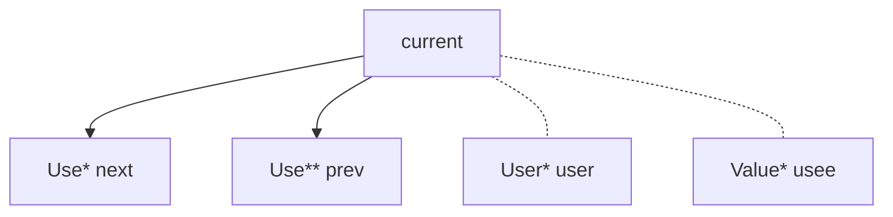


UseList --链表

设计特点：禁止被拷贝和移动，禁止被继承

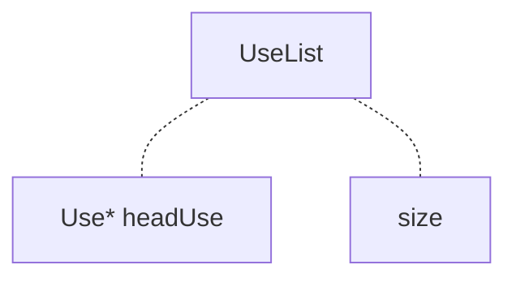

Value

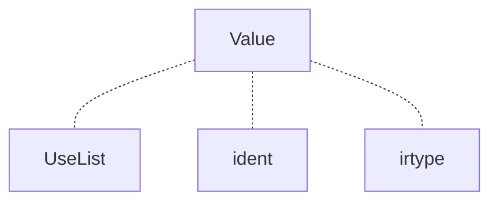

User

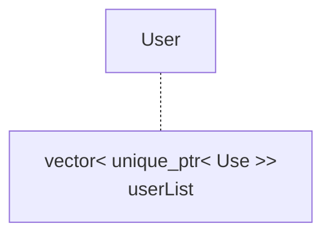

##### TypeSystem类型系统

设计模式：采用单例static设计模式，并且使用shared_ptr包装裸指针进行内存管理


- 目的：用来支持IR的强类型语言的特性

- 支持类型：

  ```c++
  enum TypeSystem{
      IR_INT,IR_FLOAT,IR_VOID,IR_POINTER,IR_ARRAY,IR_UNDEF
  };
  ```

  `IR_UNDEF` 仅用于表示前端源类型转换失败，不对应可实例化的 IR 类型

- 结构：

  ```mermaid
  graph TD
  	N1[IRType] -.- N2[TypeSystem Enum]
  	N1[IRType] -.- N3[size]
  	N1[IRType] --> N4[VOIDType]
  	N1[IRType] --> N6[INTType]
  	N1[IRType] --> N10[FLOATType]
  	N1[IRType] --> N14[POINTERType]
  	N14[POINTERType] --> N15[pointerType]
  	N1[IRType] --> N16[ARRAYType]
  	N16[ARRAYType] --> N17[elementType]
  ```

##### CFG

参考LLVM实现，但是对本项目做了精简与适配

采用侵入式链表进行组织

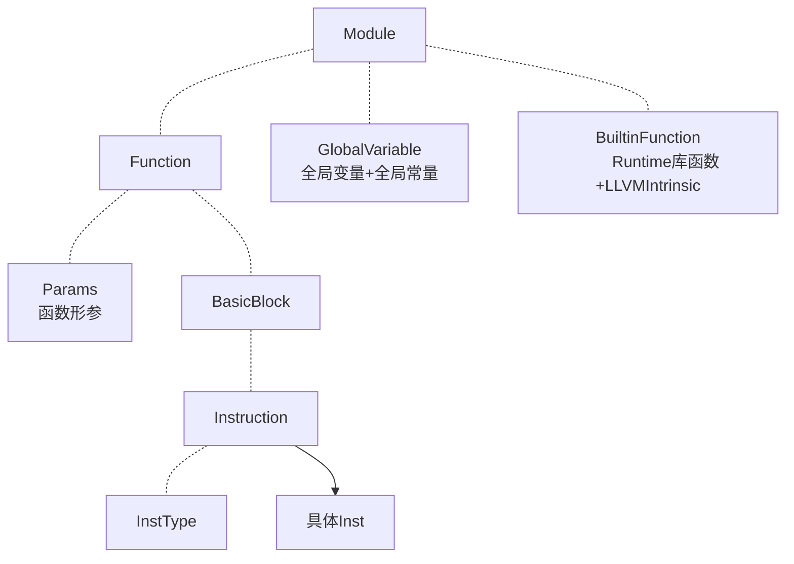

初始化相关

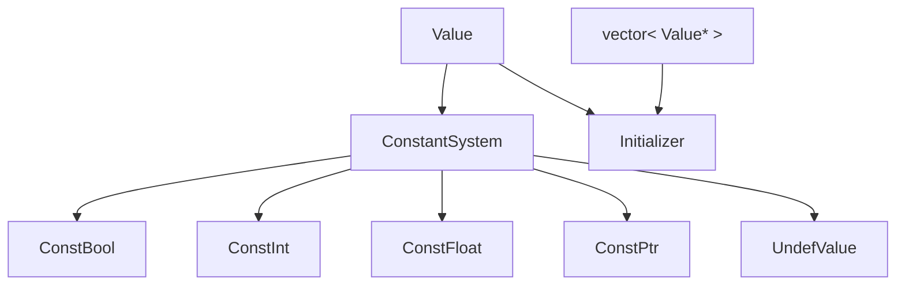

#### PassBuilder

参考LLVM实现，其中做了简化，仅保留AnalysisPass的宏展开注册功能，将Pipeline组织改为硬编码组织

因为Pass比较少，所以这种方式更适合我们的项目形式

- 作用:
  1. 注册AlalysisPass
  2. 组织不同优化层级的优化Pipeline

- Pass Pipeline：PassPipeline组织形式详情请看PassBuilder源码

- 注册AnalysisPass：以Function粒度为例

  ```c++
  void PassBuilder::registerFunctionAnalyses(FunctionAnalysisPassManager &FAM){
      // 1. 定义宏
      #define FUNCTION_ANALYSIS(NAME, CREATE_PASS)\
          FAM.registerPass([&] {return CREATE_PASS;});
      // 2. 引入数据源：将 .def 文件中的内容原封不动地贴在这里
      #include "./FunctionAnalysisPass.def"
      // 3. 销毁宏
      #undef FUNCTION_ANALYSIS
  }
  ```

  .def文件：

  ```c++
  //示例
  FUNCTION_ANALYSIS("DominatorTree", DominantAnalysis())
  FUNCTION_ANALYSIS("BasicAA", BasicAliasAnalysis())
  FUNCTION_ANALYSIS("LoopInfo", LoopAnalysis())
  ```

  在编译期早期阶段就进行了替换：替换后的函数如下：

  ```c++
  void PassBuilder::registerFunctionAnalyses(FunctionAnalysisPassManager &FAM){
      FAM.registerPass([&] {return DominatorTreeAnalysis();});
      FAM.registerPass([&] {return LoopInfoAnalysis();});
      FAM.registerPass([&] {return BasicAliasAnalysis();});
  }
  ```

  注册后，FAM内部大致形成

  ```c
  AnalysisPasses
  ├── DominantAnalysis::ID()     -> AnalysisPassWrapper<DominantAnalysis>
  └── PostDominantAnalysis::ID() -> AnalysisPassWrapper<PostDominantAnalysis>
  ```
  
  在TransformPass之中调用getResult时
  
  ```c
  getResult<DominantAnalysis>(F)
            │
            ├─ ResultCache 中已有结果
            │      └─ 直接返回 DominatorTree&
            │
            └─ 没有结果
                   ├─ 找到已注册的 DominantAnalysis
                   ├─ 调用 DominantAnalysis::run(F, FAM)
                   ├─ 得到 DominatorTree
                   ├─ 包装成 AnalysisResultWrapper
                   ├─ 放入 ResultCache
                   └─ 返回其中的 DominatorTree&
  ```

#### NewPassManager

该PassManager仅管理中端IR层级

参考LLVM实现，同样做了简化与适配

保留并简化CRTP设计模式，基于类型擦除(Type Erasure)的多态设计，AnalysisPass结果缓存

但对于失效机制的实现，摒弃了llvm源代码复杂的迭代器实现和自动失效的机制，采用手动失效的原理实现

参考博客：

[浅析 llvm::Analysis Pass and Manager](https://zhuanlan.zhihu.com/p/696028293)

执行流：

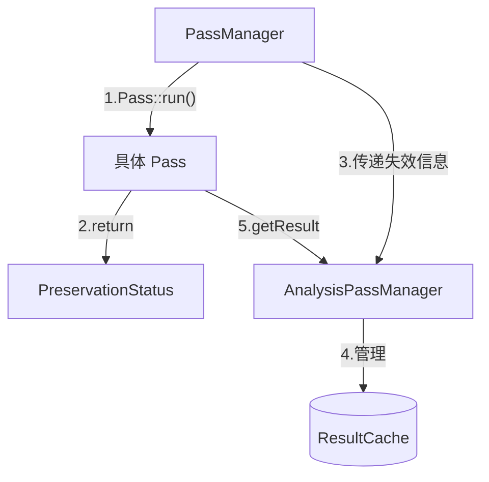

- CRTP解析：

  一个类继承一个以该类自身为模板参数的模板基类（一种将继承和静态多态结合的技术）--用来**高性能实现多态**

  参考博客：[CRTP解析](https://zhuanlan.zhihu.com/p/705630363)

  下图为llvm实现CRTP的相关模板：

  

  优势：

  传统实现多态是需要**继承和虚函数**实现，但是虚函数存在性能开销（会在运行时生成虚函数表），在性能敏感的地方（比如编译器中端优化部分），这么做就会造成性能损失，并且继承和虚函数**在运行期间起作用**，而上面CRTP模式**在编译期间起作用（由于模板的特性，模板类会在编译的时候确定模板参数并进行构建）**

  总结来说就是虚函数在编译的时候创建虚函数表，在运行的时候通过虚函数指针来**动态查找函数地址**->**造成性能损失**，而模板会在编译的时候就确定模板参数，从而在编译的时候就会创建相应的多态函数，在运行的时候**直接进行函数调用**

- TypeErasure类型擦除解析：

  目的：支持将任意类型的Pass类包装成标准Pass对象（而不是必须继承特定的基类），从而方便PassManager进行存储和管理

  具体实现方式：

  其中`Interface`类作为纯虚基类，设计意图为提供给`PassManager`一个统一的类型，方便存储在`vector`之中

  `Wrapper`作为模板类，通过`PassT`接收任意用户提供的具体`Pass`类，通过持有具体Pass的实例，负责该实例的生命周期管理

  `Wrapper`的`run`函数也是简单的调用具体Pass的`run`函数

  ```mermaid
  classDiagram
      %% 转换 Pass 架构
      class PassInterface~IRUnitT, AM_T~ {
          <<interface>>
          +run(IR, AM)* PreservationStatus
      }
      class PassWrapper~IRUnitT, PassT, AM_T~ {
          +PassT Pass
          +run(IR, AM) PreservationStatus
      }
      PassInterface <|-- PassWrapper

      %% 分析 Pass 架构
      class AnalysisPassInterface~IRUnitT~ {
          <<interface>>
          +run(IR, AM)* ResultInterfacePtr
      }
      class AnalysisPassWrapper~IRUnitT, PassT~ {
          +PassT Pass
          +run(IR, AM) ResultInterfacePtr
      }
      AnalysisPassInterface <|-- AnalysisPassWrapper

      %% 分析结果包装
      class AnalysisResultInterface~IRUnitT~ {
          <<interface>>
      }
      class AnalysisResultWrapper~IRUnitT, PassT, ResultT~ {
          +ResultT Result
      }
      AnalysisResultInterface <|-- AnalysisResultWrapper
  ```

  - 优势：

    非侵入性：编写的具体Pass只需要实现一个符合签名的run函数即可

    解耦：PassManager甚至不需要知道有哪些Pass，只需要实现run逻辑即可

    统一存储和管理

- 失效机制：

  在编写具体Pass的时候我们会利用下面所说的“黑白名单”的形式，手动编写是否保留某个AnalysisPass的分析结果

  形如下面这种，即显式分析哪个AnalysisPass的结果仍然有效，哪些已经失效需要重新计算

  ```c++
      PreservationStatus PA;
      PA.discard<DominantAnalysis>();
      PA.discard<LoopAnalysis>();
      return PA;
  ```

- AnalysisPassManager解析：

  - ResultCache缓存机制：采用`PassID（AnalysisPass地址）`和`IR层级（如Function）`作为Key进行存储

  - `getReult`：

    1. 当一个 Pass 请求分析结果时，它首先检查 `ResultCache`
    2. 如果命中，直接返回缓存对象
    3. 如果未命中，则即时运行对应的分析 Pass，并将结果存入缓存供后续使用

  - `invalidate`

    - 作用：`PassManager` 拿到上一步返回的 `PA` 状态后，立即调用此函数触发缓存清理。

    - 细节：
      a. 如果该 Pass 没有破坏任何东西，直接 `return`，终止清理流程，实现提速。
      b. 如果有破坏，则遍历底层的 `ResultCache`，针对每一个属于当前 IR 单元的缓存条目，提取其 `PassID`，并调用此函数询问该分析结果是否幸存

      - 细节：内部检查该 ID 是否在黑名单 `AbandonedIDs` 中，或者是否在白名单 `PreservedIDs` 中

      c.根据内部检查进行释放缓存，或者保留缓存

  - `registerPass`：PassBuilder宏展开函数内层核心实现

    通过`PassID`确定是否已经注册过，如果没有注册才会进行创建实例，换句话说，在main函数一开始就已经注册并创建，但是只有在`run`函数进行调用的时候才会延迟进行计算

- PassManager解析：

  - `run`：

    1. 从 `Passes` 向量中取出一个具体 Pass
    2. 执行 `Pass->run(IR, AM)`，并获取其返回的 `PreservationStatus`
    3. **关键动作**：立即调用 `AM.invalidate(IR, PassPA)` 。这保证了在下一个 Pass 开始之前，缓存中留下的都是完全正确的、未被破坏的分析结果
    4. 最后，将该 Pass 的失效信息合并到总状态中

  - `addPass`：PassBuilder编写pipeline的内层核心逻辑

    接收一个具体的TransformPass，将其类型擦除之后加入到`vector`之中，同理，在运行这个函数的时候具体TransformPass就已经创建实例了，但是只有在`run`的时候才开始进行计算，达到了延迟计算的效果


#### AnalysisPass

##### Dominant支配树

将从函数入口可达的CFG抽象成一棵直接支配树,使用**Semi-NCA算法**进行构建

支配：从函数入口到基本块B的每一条路径必须经过A，则A支配B

直接支配：除了B自身之外，离B最近的那个支配B的节点

半支配：从候选节点 `v` 到 `w` 存在一条路径；在到达 `w` 之前，这条路径不能先经过一个 DFS 编号比 `w` 更小的中间节点，那么**v就是w的一个半支配者**

- 支配树构建：

  1. 从入口基本块遍历CFG，只为可达块编号，从小到大分配DFS序号

  2. 求每个基本块的半支配者SDom和直接支配者IDom

     - 逆DFS序遍历当前节点所有CFG前驱：

       pre < i:前驱比当前节点更早被DFS访问,A(2) -> B(5),满足A是B的半支配者

       pre > i：前驱比当前节点更晚被DFS访问,A(2) -> ... -> X(7) -> B(3)

       由于逆DFS序，所以X先于B被处理，但是这里不能简单将X作为最佳SDom

       所以调用eval(pre)沿着并查集路径向上找到SDom最小的节点

     - 正DFS序：Semi-NCA

       > 正DFS序保证父结点的IDom先于子结点被计算，从而可以使后续子结点可以沿着IDom链向上跳

       从 `i` 的 DFS 父节点（IDom到i一定经过父结点）开始，沿着已经计算好的**真正IDom链**向上走，找到第一个 DFS 编号不大于 `sdom(i)` 的节点，这个节点是 `IDom(i)`

       > 之所以使用sdom作为上界，要理解sdom的含义，sdom代表我们找到的**最早一条**可以绕过DFS到达目标节点的路径，所以只要是当前节点还小于sdom就说明目前不能完全支配，**必须找到第一个在sdom上面的节点**

  3. 建树：使用FirstChild/NextSibling的形式组织多叉树

  4. 迭代支配边界构建(用于Mem2Reg，MemorySSA)：

     支配边界：X支配Y的某个前驱(可以是自己)，且X不严格支配Y，则说Y是X的支配边界

     > 下图中Merge是Then的支配边界，支配边界的含义就是Then块支配结束的位置，对应到下图就是支配结束在Then的最后一条指令
     >
     > 通俗理解支配边界就是**控制流汇聚的位置（直接看CFG图理解）**

     迭代支配边界：原始赋值会产生定义块，新插入的PHI指令也会产生定义块，所以需要不断处理新加入PHI的定义块，直到不再产生新PHI指令

     如果再加入LiveinBlocks就可以计算PrunedPHI版本的迭代支配边界（即去掉那些可以产生PHI指令但是PHI指令后续**不会被使用或在使用前会被重新定义**的基本块，这样的基本块不会创建PHI指令）

  5. 查询：不仅支持块级支配查询，还支持Value级/指令级支配查询


- 参考文献：
  1. [支配树构建算法及伪代码](https://zhuanlan.zhihu.com/p/365912693)
  2. [Semi-NCA论文](https://renatowerneck.wordpress.com/wp-content/uploads/2016/06/gtw06-dominators.pdf)
  3. https://oi-wiki.org/graph/dominator-tree/
  4. https://zhuanlan.zhihu.com/p/655369292
  5. https://zhuanlan.zhihu.com/p/365912693
  6. https://zhuanlan.zhihu.com/p/1955319335347290919

##### PostDominant后支配树

将入口可达CFG反向观察，并增加一个**无对应IR的VirtualExit**，构建单根的直接后支配树

> 把CFG的边反转，把出口当入口，然后计算普通支配

后支配：如果从B出发，到函数出口每条路径都经过A，则A后支配B

> 支配关注的是入口->当前块，后支配关注的是当前块->出口

- 后支配树构建：

  1. 获取真实可达出口块，以及反向CFG（边反转存储）
  2. 创建VirtualExit
  3. 对所有真实可达出口块反向DFS，编DFS序
  4. 无法到达真实出口的基本块（但是入口可达）**直接挂载**到虚拟根，为其分配编号（在刚才分配的DFS序号后面）
  5. 求每个基本块的半后支配者SDom和直接后支配者IDom -- **这一步和支配树算法（SemiNCA）和实现完全一样**
  6. 构建后支配树

  **和支配树的区别重点在于如何构建DFS序图**


##### LoopInfo/LoopAnalysis循环分析

建立循环森林


##### MemorySSA

将内存状态抽象成SSA风格定义链，标记每一处内存写入点和内存读取点，构建内存图

- 内存状态结点：

  - LiveOnEntry：函数入口时未知的初始内存状态，**无对应IR**，无任何对应，每个函数只创建一个

  - Phi：多个CFG前驱的内存状态汇合，**对应IR出现在迭代支配边界（没支持LiveInBlock，所以不是PrunedPHI）基本块入口**

    incoming:(PredBB1, PredBB1Status)记录每个前驱CFG的内存节点状态

  - Use：读取内存但不产生新内存版本,**对应IR：Load/只读Call**

  - Def：可能修改内存，产生新内存版本，**对应IR：Store/可能写内存的Call**

- 内存状态图：

  1. 每个函数入口对应一个LiveOnEntry
  2. 只在可达MemoryDef所在块的迭代支配边界MemoryPhi（和mem2reg算法差不多一样）
  3. 每个store/可能写内存的call产生一个新内存状态
  4. 每个load/只读call使用当前内存状态，**但不产生新状态,下一个节点还是挂载到当前内存状态（上一个节点产生的状态）**
  5. 纯调用（NoModRef）不创建MemoryAccess节点


参考资料：https://zhuanlan.zhihu.com/p/715818784

##### BasicAliasAnalysis

依赖AnalysisPass： SCEV、 LoopAnalysis、DominantAnalysis

1. 三值关系：NoAlias / MayAlias / MustAlias

2. 对 load/store 使用带字节宽度的 MemoryLocation

3. 同一底层对象的常量 GEP 区间不相交时返回 NoAlias

   ```
   %p0 = gep [4 x i32], ptr %a, 0, 0
   %p1 = gep [4 x i32], ptr %a, 0, 1
   NoAlias
   ```

4. PHI/Select 只有所有路径得到相同强结论时才保留，否则退化为 MayAlias

##### SideEffect--副作用分析

实现**跨函数副作用分析**，支持指令级，函数级副作用分析

- 算法规则：

  1. 基址与基址传播

     基址规则：

      * 指针形参、全局变量和alloca的基址都是自身
      * 一个指针可以具有多个已知基址

     指令传播规则：

      * GEP：继承base pointer的基址
      * BitCast：继承操作数的基址
      * PHI：合并所有incoming指针的基址
      * Select：合并true和false指针的基址
      * 局部指针槽Load：合并所有曾Store进该槽的指针值的基址

  2. 指令副作用收集规则：处理Load、Store和Call三类指令

     Load/Store：

      * Load：将指针的所有外部基址（全局变量或形参）加入RefSet
      * Store：将指针的所有外部基址（全局变量或形参）加入ModSet
      * 局部alloca基址不加入RefSet或ModSet

     Call：

     函数最初的ModSet和RefSet由里面的load/store决定，或者由BulitinFunc决定

      * 普通直接调用：不动点迭代，Caller合并Callee的ModSet和RefSet
      * 内置函数调用：
         1. timer：不加入ModSet或RefSet，只标记可观察效果和顺序屏障
         2. memcpy/memmove：目标指针加入ModSet，源指针加入RefSet
         3.  memset：目标指针加入ModSet
         4.  数组输入：指针实参加入ModSet
         5. 数组输出：指针实参加入RefSet
         6. 标量输入输出：不加入ModSet或RefSet，只标记可观察效果


##### SCEV

依赖 AnalysisPass：LoopAnalysis、DominantAnalysis

1. 为整数表达式构造共享的 SCEV DAG，包括常量、Unknown、算术、cast、select、比较和 GEP 字节偏移

2. 识别循环 Header PHI 的递推表达式：

   ```
   {Start,+,Step}<Loop>
   ```

   也支持最高 8 阶的多项式 AddRec，以及有限的 MulRec/DivRec

3. 分析规范循环的 trip count、backedge count、trip multiple、步长和 no-wrap。

4. 支持 `< <= > >=`；常量距离时还支持 `!=`。

5. 可以把 AddRec 在第 `n` 次迭代求值为二项式展开。

```
%i = phi i32 [0, %pre], [%next, %latch]
%next = add i32 %i, 2
%cmp = icmp slt i32 %i, 10
```

分析结果：

```
SCEV(%i) = {0,+,2}
TripCount = 5
BackedgeTakenCount = 4
```

##### LoopDependence

类型：AnalysisPass。依赖 Loop、SCEV、BasicAA、SideEffect

1. 收集循环 load/store 和可映射调用的内存访问，记录根对象、读写类型、仿射下标、字节步长和程序顺序。
2. 产生 Flow、Anti、Output、Unknown 依赖。
3. 为每个循环轴产生方向掩码；当前实现主要只有：SameIteration / AnyDirection

##### LoopAccess

依赖 AnalysisPass：Loop、SCEV、Range、Dominant、BasicAA、LoopDependence

1. 为循环访存建立 footprint：根对象、起始/最小/最大字节偏移、对象大小、对齐、元素宽度和每轴 stride

2. 记录访问是否有限、unit-stride、连续、完整覆盖和精确

3. 对访问对分类：

   ```
   NoConflict
   SameIterationOnly
   Unknown
   ```

4. 提供迭代独立性、fusion 合法性、矩形循环嵌套、跨轴复用及字节步长查询

```
store ..., ptr A[i]
load  ..., ptr A[i]
```

##### BranchProbability

分支概率预测

目前只有CodeMotion这个pass使用


#### TransformPass

##### CFGSimplify

- 算法流程：**该pass内部使用不动点循环，因为子优化之间会互相创造优化机会**

  1. 消除死块：排除入口块之后，检查前驱块：没有/唯一的前驱是自己，满足条件删除，先维护后继块的PHI，然后再进行删除

     

  2. 终结指令常量折叠：

     拿到终结指令，如果是条件跳转：

     1. 如果两个分支目标相同（平行边）：将该条件跳转改成无条件跳转，并在目标块的前驱列表中删除一个前驱边
     2. 如果条件分支的条件是常量，则根据常量值选择一条边，删除另一条边，改为无条件分支 -- **这种优化为上面消除子块创建优化机会**

     

  3. **折叠已知分支条件 -- 编写较麻烦**

     > 和上面第二步区别：第二步要求条件是常量，这一步主要针对条件是变量的情况

     要求当前基本块含多个前驱，并且条件值本身不是常量，不能是自环（条件值不能正确推导），前驱必须也是条件分支，处理时，判断所有前驱是否都能从其Cond条件值推导出该块的Cond条件值（相同或相反），然后根据该块推导出的条件值删除一条分支，并维护后继块PHI

     

  4. 消除重复的PHI节点：-- **这个其实属于纯PHI化简了**

     满足前驱块数量相同，数据流来源完全一致的两个PHI可以删除其中一个

     基准指针遍历基本块开头的每一个PHI节点，候选指针从基准指针的下一个开始遍历，比较重复，如果重复了就替换候选指针中的所有使用，然后加入到Removed集合之中，然后打断两个指针从头开始再次遍历

     最后将Removed集合中的PHI节点全部删除即可

     

  5. 穿透分支条件PHI：

     当前块必须只含分支指令，XOR指令（可选），PHI指令，并且PHI形式满足分支条件PHI形式

     ```
         %cond = phi i1 [ true, %P0 ], [ false, %P1 ]
         br i1 %cond, label %T, label %F
     
         %cond = phi i1 [ true, %P0 ], [ false, %P1 ]
         %not = xor i1 %cond, true
         br i1 %not, label %T, label %F
     ```

     必须让条件PHI的incoming数量对应前驱块的数量

     

  6. 规范化分支条件PHI

  7. 基本块合并：

     检查：该基本块的前驱只有一个，保证前驱也只有该基本块这一个后继

     合并：

     1. 处理该基本块中的PHI节点（一定来自前驱，并且只有一个incoming），直接删除PHI拿值替换
     2. 修改后继块PHI的incoming block
     3. 将该基本块中的指令，全部搬到前驱的终结指令之前，删去前驱的原终结指令
     4. 删除该基本块

     

  8. simplifyBranch：处理无条件跳转

     1. simplifyUncond:该基本块末尾是一条无条件跳转指令

        1. 如果该基本块PHI指令之后就是终结指令，并且不是入口块：检查后继不是自身，检查该基本块的前驱和该基本块的后继的前驱没有重合的，检查该基本块中的PHI节点没有被除了该基本块后继的PHI之外任何其他使用

           修改该基本块后继的PHI，将来源改成该基本块的前驱（考虑多个前驱的情况）

           修改基本块前驱末尾的跳转指令

           删除该基本块中的指令，删除该基本块

##### IfConversion

引入Select指令，避免小分支分支预测失败，暴露SCCP，GVNPRE等标量优化机会

不能上提到Pred的指令：load/store，call，alloca，ret，div，rem，非常量shl/lshr/ashr

收益模型：

- TrueBB 指令数 + ElseBB 指令数 <= 4

- Succ 中 PHI 数量不超过 3

- 总加权成本<=6

  其他指令成本1,MUL, FMUL, FADD, FSUB, FCMP成本2，SITOFP成本3

可以处理两种CFG形状

```
Triangle：
          ┌── TrueBB ──┐
Pred ─────┤             ├── Succ
          └─────────────┘
Diamond：
          ┌── TrueBB ──┐
Pred ─────┤             ├── Succ
          └── ElseBB ──┘
```

优化前：

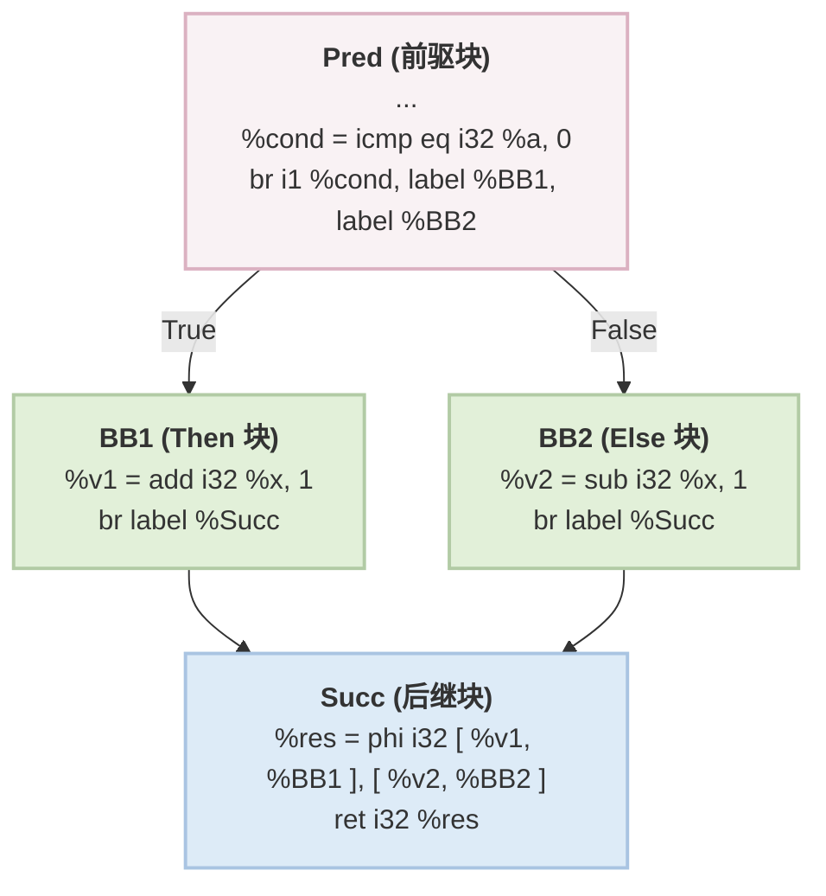

优化后

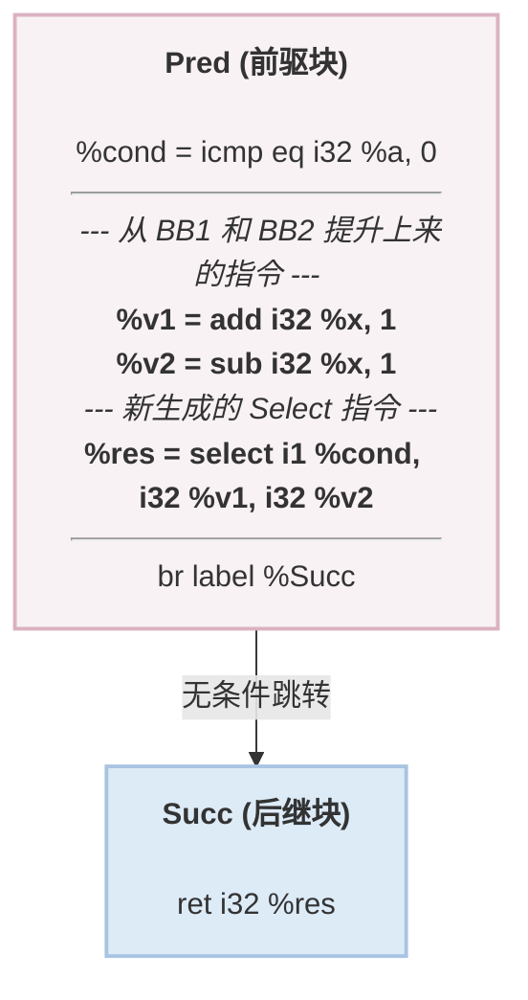

##### BreakCriticalEdges打破关键边

GVN-PRE前置Pass，放置在LoopSimplify之前

关键边：一条边 `A -> B` 被称为**关键边（Critical Edge）**，当且仅当它**同时满足**以下两个条件：

1. 源基本块 A 有多个后继（SysY编译器只支持条件分支指令，所以只能是2个
2. 目标基本块 B 有多个前驱

打破关键边：在关键边的位置插入新的块

- 算法流程：

  1. 找到关键边：源块A两个后继，目标基本块多个前驱

  2. 创建新基本块，插入到函数之中，并创建新的Br无条件分支指令，指向目标块，修改源基本块A中的分支指令，让其指向新基本块，修复目标块B中的PHI节点，将来源为A的全部换成来源为新基本块


##### UnifyFuncExits统一函数出口

用在中端转入后端前PassPipeline收尾阶段

- 算法流程：将该函数中所有含Ret的基本块中的Ret换成无条件跳转Br，无条件跳转到新插入的UnifiedExit基本块，根据返回值类型创建PHI以及新的Ret指令


##### LoopSimplify

依赖AnalysisPass：Dominant和LoopInfo

- 目的：确保Loop满足规范形式

  - 唯一的 PreHeader（入口块）
  - 唯一的 Back Edge
  - Dedicated Exits （ 所有的 Exit Block 只能被**循环内部**的基本块指向）

- Loop规范形式

  PreHeader是用来汇聚外部块的进入的

  Latch块是用来汇聚回边的

  Dedicated Exits 是用来汇聚所有从Loop中Exit并和外部跳转进行分割的

- 图解：

  转换前

  ```mermaid
  graph TD
      %% 外部区域
      O1[Outside 1]
      O2[Outside 2]
      O3[Outside 3]
  
      %% 循环内部
      subgraph LoopArea [Loop]
          direction TB
          H[Header]
          B1[Body 1]
          B2[Body 2]
  
          H --> B1
          H --> B2
          B1 -->|回边 1| H
          B2 -->|回边 2| H
      end
  
      %% 出口区域
      E[ExitBlock]
  
      %% 跨区域连线
      O1 --> H
      O2 --> H
      B1 --> E
      O3 --> E
  
      %% 样式调整匹配你的手绘布局
      classDef default fill:#f8f9fa,stroke:#333,stroke-width:2px;
      classDef loopBox fill:#ffffff,stroke:#000,stroke-width:2px;
      class LoopArea loopBox;
  ```

  转换后

  ```mermaid
  graph TD
      %% 外部区域
      O1[Outside 1]
      O2[Outside 2]
      O3[Outside 3]
      PH["新块: PreHeader"]
  
      %% 循环内部
      subgraph LoopArea [Loop]
          direction TB
          H["Header<br>(PHI 被极大简化)"]
          B1[Body 1]
          B2[Body 2]
          L["新块: Latch"]
  
          H --> B1
          H --> B2
          B1 --> L
          B2 --> L
          L -->|③ 唯一回边| H
      end
  
      %% 出口区域
      DE["新块: Dedicated Exit"]
      E[ExitBlock]
  
      %% 跨区域连线
      O1 --> PH
      O2 --> PH
      PH -->|① 唯一入口| H
  
      B1 -->|② 拦截内部跳出| DE
      DE --> E
      O3 -->|外部连线保持原样| E
  
      %% 样式标注
      classDef default fill:#f8f9fa,stroke:#333,stroke-width:2px;
      classDef loopBox fill:#ffffff,stroke:#000,stroke-width:2px;
      classDef newBlock fill:#d1e7dd,stroke:#198754,stroke-width:2px,color:#0f5132;
      class LoopArea loopBox;
      class PH,L,DE newBlock;
  ```

##### LCSSA循环封闭的SSA形式

循环定义的值只能在循环内部使用，外部只能使用其LCSSA形式的PHI函数

执行前：

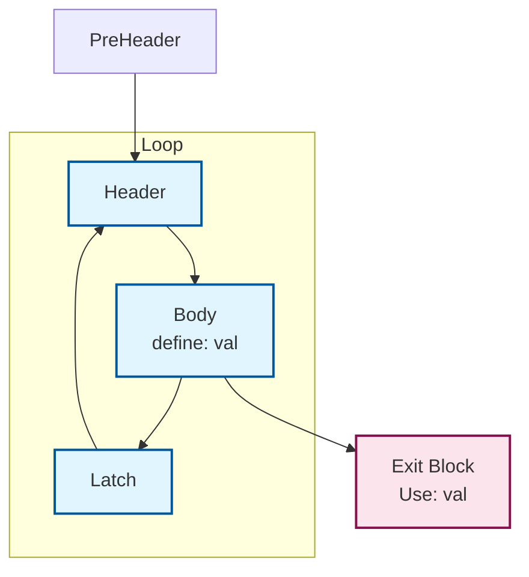

执行后

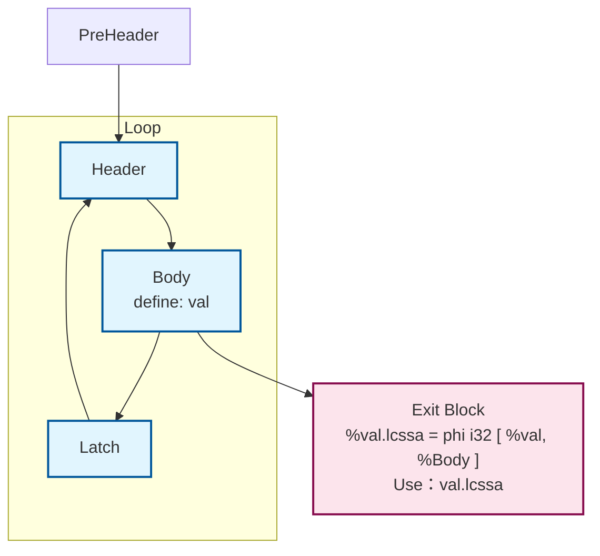

##### Mem2Reg

将入口块中标量alloca转换为Phi，删除相应的load/store/alloca

依赖AnalysisPass：Dominant

在运行之前先运行CFGSimplify清除不可达块，运行之后也需要

算法：使用LiveInBlock+IDF创建**PrunedPHI**，在Live裁剪之后的IDF处插入PHI


参考资料：
https://ustc-compiler-principles.github.io/2023/lab4/Mem2Reg%E4%BB%8B%E7%BB%8D.pdf

https://www.zhihu.com/question/41999500/answer/93243408

##### Global2Local

将全局变量Local到非递归Main函数的Alloca，从而在Mem2Reg可以将其提升为寄存器变量

阈值选取32字节：<=32字节的全局变量会被处理

- 算法流程：

  1. main可达的其他函数引用的全局变量拒绝转换

  2. main无法到达的其他函数可以保留全局变量，并在main中创建alloca（全局变量只能放在store/load操作数，地址不能逃逸到其他指令，值还是正常使用）

     在DFE删除死函数之后，需要使用DeadGlobalCleanup删除全局


##### Local2Global

将非递归main函数中局部Alloca分配的大数组提升为全局变量，防止栈溢出

阈值选取1024：大于1024字节的数组会被提升

##### GlobalInitializerFold

主要在Local2Global后使用，当Local2Global将大尺寸对象的alloca提升为global之后，GlobalInitializerFold将memcpy消除，从而将初始化时间从运行期改到静态装载期

目标对象：全局变量对应的**初始化memcpy（初始化长度覆盖整个对象）**

完整变换流程：

```
前端：前端会引入memcpy
@template = constant [300 x i32] [...]
define i32 @main() {
entry:
  %a = alloca [300 x i32]       ; 1200 字节
  call @memcpy(%a, @template, 1200, false)
}

Local2Global：
@template = constant [300 x i32] [...]
@.G.a = global [300 x i32] zeroinitializer
define i32 @main() {
entry:
  call @memcpy(@.G.a, @template, 1200, false)
}

GlobalInitializerFold：
@template = constant [300 x i32] [...]
@.G.a = global [300 x i32] [...]

define i32 @main() {
entry:
  ; memcpy 已删除
}
```

##### DeadGlobalCleanup死全局消除

只用在中端快结束的位置，用于轻量级优化，比StoreOnlyGlobalElimination更加轻量，功能更弱

功能：删除只存在store无其他Use的global和store，删除无Use的global，只处理标量，不处理数组

##### StoreOnlyGlobalElimination只写全局变量消除

依赖AnalysisPass：SideEffect

<p align="center">
  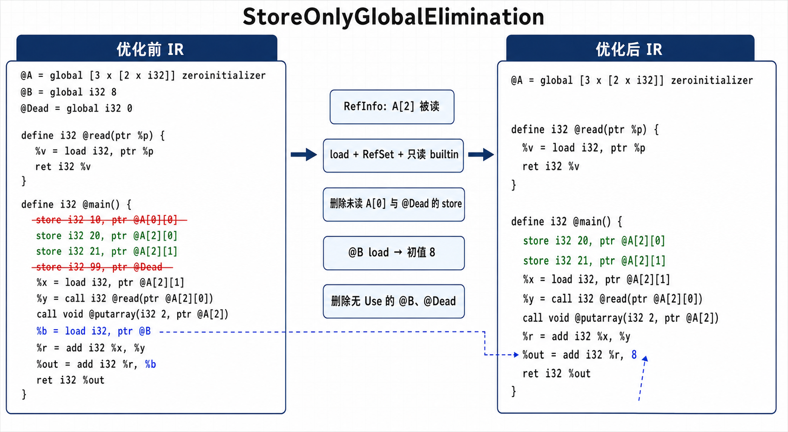
</p>

- 算法流程：

  1. 对于每一个全局变量，分析读取他的load和call指令，建立RefInfo

     call指令读取规则：只读Builtin，普通Func的RefSet

     数组读取精度：只分析到第一维

     > 只要 `A[2]` 下任意元素被读取，所有写向 `A[2][...]` 的 store 都会保留

  2. store删除：

     该全局变量没被读取：删除所有store

     该全局变量读取：删除与RefInfo无关的store

     其他情况保留

  3. 对于没有任何写入的全局变量，将完整对象的 `load` 替换为全局初始化常量，删除load

  4. 删除没有任何Use的全局变量


##### ConstHoist大常量重写

依赖AnalysisPass：Dominant

减少i32大常量物化次数

```
entry:
    br label %preheader
preheader:
    br label %loop
loop:
    %a = add i32 %x, 100000
    %b = add i32 %y, 100008
    %c = sub i32 %z, 100008
    br i1 %cond, label %loop, label %exit
->
preheader:
    %base = add i32 0, 100008 -- 基准值被提升到preheader
    br label %loop
loop:
    %v100000 = add i32 %base, -8
    %a = add i32 %x, %v100000
    %b = add i32 %y, %base
    %c = sub i32 %z, %base
    br i1 %cond, label %loop, label %exit
```

目标常量：i32,>=2048

改写只能：User为ADD/SUB/STORE/DIV/REM/移位**这些位置**

算法规则：按照[组内最大值 - 组内最小值 < 2048]分组，每组选取使用次数最多的常量作为基准值，只有[每组大于3次使用或者在循环内>=2次使用]才可优化，在改写时，找支配这些基本块最近的公共支配块，在该块进行物化（如果在循环中就在preheader物化），每块中共用偏移加法

##### GepEvaluate折叠GEP

功能：折叠掉空索引的GEP替换为基址，拆分GEP

```
%ptr = getelementptr [16 x [16 x i32]], ptr @A,
            		 i32 0, i32 %i, i32 %j
->
%row = getelementptr [16 x [16 x i32]], ptr @A,
                     i32 0, i32 %i

%ptr = getelementptr [16 x i32], ptr %row,
                     i32 0, i32 %j
```

##### GepCombine

依赖 AnalysisPass：Range、DominantAnalysis

1. 合并单用户链式 GEP：

   ```
   %row = gep ptr %a, 0, %i
   %elt = gep ptr %row, 0, %j
   ; =>
   %elt = gep ptr %a, 0, %i, %j
   ```

2. 对单用户指针 PHI，若 incoming GEP 同基址、同形且只有一个索引位置不同，改写为索引 PHI + 公共 GEP。

3. 在同一基本块内，将公共前缀相同的相邻 GEP 改为前一个 GEP + 常量差，Range 必须证明地址算术不回绕

##### DCE死代码消除

依赖AnalysisPass：SideEffect

按照Use-Def链级联删除死指令

- 算法规则:

  1. ret,br,store不可删

  2. call条件删除：BuiltinFunc、直接/间接递归不可删，普通Callee函数NoModRef并且无store无Builtin内部调用

     无User

  3. 其他指令只需要判断无User，就直接可以删除

##### ADCE激进死代码消除

依赖AnalysisPass：PostDominant，SideEffect

先假定所有指令是死的，只把返回、存储、副作用调用等标活，再反向标活这些指令依赖的指令和控制条件，最后删除剩余其他的一切

- 算法流程：
  1. 一开始就活跃的根指令：Store，Ret，无条件Br，无法到达真实出口的条件Br，Call（纯函数/只读函数调用不活跃，其他标活）
  
  1. 迭代闭包：
  
     指令的操作数对应的指令也活跃
  
     标活必经块上的分支指令：从目标块到PostIDom沿着后支配树遍历，遇到的每个基本块的条件分支指令标活
  
     PHI指令（特殊）：不仅标活incoming value对应的指令，还标活incoming block的条件分支指令
  
  1. 执行清扫：
  
     收集所有未标活的条件分支指令，删除不是PostIDom的那一侧的分支边
  
     收集所有未标活的非终结指令进行删除

##### DAE死参数消除

注意要在Mem2Reg运行后运行

- 算法流程：

  1. **形参特化**：如果某个形参在所有调用点收到的实参都相同，就直接用该值替换函数中的形参

     ```
     define i32 @foo(i32 %x) {
     entry:
       %v = add i32 %x, 1
       ret i32 %v
     }
     call i32 @foo(i32 10)
     
     ->
     
     define i32 @foo(i32 %x) {
     entry:
       %v = add i32 10, 1
       ret i32 %v
     }
     ```
  
     **冗余参数合并**：检查调用该函数的所有 `CallInst`。如果某几个参数在所有调用点传入的**实参完全相同**（例如 arg2 永远等于 arg1），则在函数体内将 arg2 的所有 Use 替换为 arg1
  
     ```
     define i32 @foo(i32 %a, i32 %b) {
     entry:
       %x = add i32 %a, %b
       ret i32 %x
     }
     call i32 @foo(i32 %v1, i32 %v1)
     call i32 @foo(i32 %v2, i32 %v2)
     
     ->
     
     define i32 @foo(i32 %a, i32 %b) {
     entry:
       %x = add i32 %a, %a
       ret i32 %x
     }
     ```
  
  2. 死参数消除：支持调用链传播
  
  3. **分组特化：**如果不是像**形参特化**一样所有调用都相同，而是一部分调用相同的情况，如下，就创建相关函数副本

     ```
     call @foo(1, %a)
     call @foo(1, %b)
     call @foo(2, %c)
     ```

  4. 死参数消除

##### DeadFunctionElimination死函数消除

目前在SysY2022之中，**函数只能通过Call指令进行调用**，没有其他调用方式，所以我们不需要考虑函数地址逃逸或者调用函数指针的情况

- 算法逻辑：main函数一定Live ，从main函数开始，收集函数中可达基本块中的Call指令，将被Call指令调用的函数标记为Live，然后删除剩下的死函数即可 -- **可达调用图遍历**

效果显著，把基本上全部死函数都消除掉了

##### DSE 死存储消除

依赖 AnalysisPass：BasicAliasAnalysis、LoopAnalysis、MemorySSA、SideEffectAnalysis

1. 消除**所有路径**都被覆盖的store：

   对store之后的每一条CFG路径，若遇到均MustAlias并且完整覆盖对象的新store，则这一条store可以删除

   ```
   store i32 1, ptr %p       ; 候选，可以删除
   br i1 %cond, label %L, label %R
   L:
       store i32 2, ptr %p   
       br label %exit
   R:
       store i32 3, ptr %p  
       br label %exit
   ```

2. 相同值冗余写store：

   从候选 store 对应的 **MemorySSA内存状态图**开始反向遍历。若所有反向路径都能到达一条向 MustAlias 地址完整写入同一个 Value 的旧 store，并且中间没有其他可能修改该地址的操作，则候选 store 不会改变内存状态，可以删除

   ```
   store i32 %v, ptr %p
   %x = load i32, ptr %p      ; MemoryUse，不影响
   store i32 %v, ptr %p       ; 候选，可以删除
   ret i32 %x
   ```

3. 消除**基本块内**被覆盖的store：

   在单个基本块内逆向扫描，删除被后续同地址、同覆盖范围的store

4. 如果alloca的地址没有逃逸出当前函数，并且某次store后没有读取，那么这条store可以删掉

   ```
   %a = alloca i32
   store i32 7, ptr %a  -- %a随着函数返回生命周期结束，所以可以删除store
   ret void
   ```

##### LoadElimination

依赖 AnalysisPass：BasicAliasAnalysis、LoopAnalysis、DominantAnalysis、MemorySSAAnalysis、SideEffectAnalysis

1. 消除所有路径上都能从同一个 store 值转发的 load：

   从候选 load 对应的 MemorySSA 内存状态开始反向遍历。若所有路径上的最近 MemoryDef 都是：向 MustAlias 地址写入,完整覆盖 load 读取的对象,写入同一个 SSA Value,该 Value 支配候选 load,则直接用该 Value 替换 load

   ```
   br i1 %cond, label %L, label %R
   L:
       store i32 %v, ptr %p
       br label %join
   R:
       store i32 %v, ptr %p
       br label %join
   join:
       %x = load i32, ptr %p   ; 可以替换为 %v
       ret i32 %x
   ```

2. 消除可以复用旧 load 结果的 load：

   若旧 load 支配候选 load，并且二者：地址 MustAlias,结果类型兼容,MemorySSA标识二者来自相同内存来源，从旧 load 到候选 load 的所有 CFG 路径上都没有可能修改该地址的操作，则候选 load 可以替换为旧 load 的结果

   ```
   %x = load i32, ptr %p
   %y = add i32 %a, %b         ; 不修改 %p
   %z = load i32, ptr %p       ; 可以替换为 %x
   ret i32 %z
   ```

3. 消除基本块内的冗余 load：

   在单个基本块内，从候选 load 向前逆向扫描：

   - 遇到 MustAlias、类型兼容的 store，直接转发 store 写入的值；
   - 遇到 MustAlias、类型兼容的旧 load，复用旧 load；
   - 遇到 MayAlias/MustAlias 的其他写入，则停止优化；
   - 纯读取操作可以安全穿越。

   ```
   store i32 %v, ptr %p
   %a = add i32 %x, %y
   %r = load i32, ptr %p       ; 可以替换为 %v
   ret i32 %r
   ```

4. 合并不同 CFG 前驱上的可用值：

   若候选 load 所在基本块内没有可用值，则递归查询所有前驱：

   - 所有前驱得到同一个 Value：直接用该 Value 替换 load；
   - 每个前驱都有确定值，但值不同：在汇合块创建 PHI，使用 PHI 替换 load；
   - 任一前驱存在相关写入、未知内存效果或无法完成查询：保留 load。

   ```
   br i1 %cond, label %L, label %R
   
   L:
       store i32 %a, ptr %p
       br label %join
   
   R:
       store i32 %b, ptr %p
       br label %join
   
   join:
       %x = load i32, ptr %p   ; 可以删除
       ret i32 %x
   ```

   转换为：

   ```
   join:
       %x.forward = phi i32 [ %a, %L ], [ %b, %R ]
       ret i32 %x.forward
   ```

5. 消除循环内可复用循环外值的 load：

   对循环内的候选 load，若：

   - 指针地址在目标循环外定义；
   - 循环外存在一个支配循环头的 MustAlias load；
   - 旧 load 支配候选 load；
   - 从旧 load 到候选 load 的所有 CFG 路径及循环回边上都没有相关写入；

   则循环内 load 可以复用循环外 load 的值

   ```
   entry:
       %init = load i32, ptr %p
       br label %loop
   
   loop:
       %i = phi i32 [ 0, %entry ], [ %next, %loop ]
       %x = load i32, ptr %p       ; 可以替换为 %init
       %next = add i32 %i, 1
       %cond = icmp slt i32 %next, %n
       br i1 %cond, label %loop, label %exit
   ```

##### SCCP

依赖 AnalysisPass：MemorySSA、BasicAA、LoopAnalysis

1. 联合求解可执行块、可行 CFG 边和值格：Top -> Constant -> Bottom

2. PHI 只合并来自可行边的 incoming

3. 折叠 binary、cast、select、整数/浮点安全恒等式和常量条件分支

4. 对 load，从 MemorySSA 内存状态反向遍历。只有所有路径的首个 clobber 都是：

   - MustAlias store；
   - 完整覆盖 load；
   - 类型 shape 相同；
   - 写入同一个 SSA Value；

   才把 load 的值格绑定到 stored value

5. 收敛后替换常量、删除不可达块、折叠 PHI 和分支

##### ConstraintElimination

依赖 AnalysisPass：DominantAnalysis、Range

1. 在 Range 证明无回绕时，将有限深度的 `x+C/x-C` 规范成 `Base+Offset`
2. 沿支配树 DFS 维护当前路径成立的条件约束
3. 使用直接蕴含、反向等价、一跳传递关系及 Range 上下界证明比较恒真或恒假
4. 只把 branch condition 替换成布尔常量，真正的 CFG 删除交给后续 CFGSimplify

##### RangeAwareSimplify

依赖 AnalysisPass：Range、DominantAnalysis

1. 将 Range/KnownBits 证明为单值的纯计算替换为常量

2. 利用整数区间、KnownBits 冲突或无 NaN 浮点包络折叠比较

3. 化简 `icmp(select)`、恒定 select、abs select 和 min/max select

4. 若被除数已证明非负、除数是正二次幂：

   ```
   %q = sdiv i32 %x, 8
   ; =>
   %q = ashr i32 %x, 3
   ```

   `srem` 则改为 `and 7`

##### LatePhiCleanup晚期PHI函数清理

一个在中端后期轻量级的PHI函数清理

功能：清除无Use的PHI，把所有incoming value相同的PHI退化成value

退化：PHI的value必须都是同一个相同的value，并且PHI所在基本块只有一个前驱/value的定义支配该PHI

##### FuncInline函数内联

将Callee的函数体拼接到Caller的相应位置

- 收益模型：对于满足以下条件的Callee被调函数进行内联

  有函数体

  递归函数：调用函数频次×单次函数指令数<=100

  非递归函数：调用函数频次<3 || 调用函数频次(>=3)×单次函数指令数<=200

  注意：**下面这种情况进行FuncMemoization函数记忆化**

  没有其他函数调用，没有副作用，并且自递归调用点数大于等于2

  形如`fib(n) = fib(n - 1) + fib(n - 2)`

- 算法流程：

  形参->实参，指令clone，替换Use，上提alloca到外层函数入口，在Call指令后切分基本块并修改克隆的基本块返回值为无条件跳转，把Call指令改为无条件跳转


##### FunctionMemoization

依赖 AnalysisPass：SideEffect

1. 选择纯递归函数：SideEffect 必须为 `NoModRef`，返回值及 1～4 个参数只能是 i32/f32

2. 只接受直接自递归，要求至少两处自递归调用、至少一个外部调用点和至少一个返回点。

3. 创建直接映射缓存：

   ```
   valid[slot]
   key0[slot] ... keyN[slot]
   result[slot]
   ```

4. 整数参数直接参与哈希；浮点参数按位转为 `i32`。命中时直接返回缓存结果

5. 每个原返回点按照 `valid=0 → keys → result → valid=1` 的顺序发布新缓存项

典型效果：

```
%r = call i32 @fib(i32 %n)
```

会先检查 `%n` 对应的缓存槽，命中时不再进入递归函数主体

默认缓存为 4096 槽，模块总预算 256 KiB

##### LateStrengthReduce

1. 无符号二次幂除法：

   ```
   %q = udiv i32 %x, 8
   ; =>
   %q = lshr i32 %x, 3
   ```

2. 无符号二次幂取余：

   ```
   %r = urem i32 %x, 8
   ; =>
   %r = and i32 %x, 7
   ```

3. 若能证明被除数非负，有符号除余也可分别改为 `ashr` 和 `and`。

4. 对无法证明符号的 `sdiv x, 2`，通过偏置保持“向零舍入”：

   ```
   %sign = ashr i32 %x, 31
   %bias = and i32 %sign, 1
   %adj  = add i32 %x, %bias
   %q    = ashr i32 %adj, 1
   ```

##### Reassociate

依赖 AnalysisPass：SideEffectAnalysis

1. 只处理整数 ADD/SUB/MUL/AND/OR/XOR

2. 将减法规范为加负数，展开单用途的同运算表达式树，再按稳定 rank 排序。

3. 合并常量，消除 `x+0`、`x*1`、`x*0`。

4. 合并重复项：

   ```
   %r = add i32 %x, %x
   ; =>
   %r = mul i32 2, %x
   ```

5. 消去 `x + (-x)`，并从多个乘积中提取公共因子。

6. 对包含重复因子的长乘法链，使用平方复用减少乘法数量。

不处理浮点；共享子表达式不会被展开

##### TailRecursionElimination

依赖 AnalysisPass： BasicAA、LoopAnalysis、SideEffectAnalysis

1. 对普通 `call` 紧邻 `ret` 的情况标记 tail call

2. 将直接自尾递归转换为入口循环，并为函数参数建立 Header PHI

3. 支持整数 ADD/MUL 伪尾递归：

   ```
   %r = call i32 @f(...)
   %v = add i32 %r, %x
   ret i32 %v
   ```

   通过额外 accumulator PHI 转换；ADD 单位元为 0，MUL 为 1。

4. 支持跳到共享返回块的尾递归站点

##### GVNPRE

依赖 AnalysisPass：Dominant、Loop、BasicAA、MemorySSA、SideEffect

1. 为 binary、GEP、select、cast 和合格纯调用建立带类型的规范值号，消除支配冗余

2. 递归比较循环 PHI 表达式图，合并同余 PHI

3. 使用 MemorySSA 的完整 clobber 集合和 MustAlias 做 store-to-load forwarding 与 load CSE；失败时退回有限的唯一前驱扫描

4. 对 Ref-only 调用，比较其读取位置的 MemorySSA 签名，消除未被写破坏的重复调用

5. PRE 只处理恰好一个前驱缺少表达式的情况：

   ```
   L: %a = add i32 %x, %y
   R: br label %M
   M: %b = add i32 %x, %y
   ```

   在 `R` 克隆表达式，并在 `M` 建 PHI

##### InstSimplify

依赖 AnalysisPass：Dominant、BasicAA、Loop、MemorySSA；调用 ModRef 查询会间接使用 SideEffect

1. 工作表固定点化简算术、位运算、比较、select、因式分解、平方差和二次幂乘法

2. 折叠退化 PHI

3. 将各 incoming 中同形的 binary/GEP 提到汇合块：

   ```
   %a = add i32 %x, 4
   %b = add i32 %y, 4
   %p = phi i32 [%a, %L], [%b, %R]
   
   ; =>
   %v = phi i32 [%x, %L], [%y, %R]
   %p = add i32 %v, 4
   ```

##### LocalAggregateSimplify

依赖 AnalysisPass： Dominant、Range、 BasicAA、Loop、MemorySSA

1. 折叠只读全局数组 load：常量索引直接读取 initializer；较小的动态 i32 表可尝试合成为低成本算术表达式

2. 对“完整 memcpy 初始化的局部数组”，在同一基本块解释后续常量索引 store/load，并转发精确值

3. 对跨块只读局部数组，要求初始化支配所有 load，MemorySSA 证明没有 clobber；随后替换为常量、统一值、算术表达式或小型 select 链

4. 对仅使用常量路径、无逃逸且最多访问 32 个元素的 aggregate，拆分为多个标量 alloca

5. 删除非逃逸的只写 aggregate：

   ```
   %a = alloca [4 x i32]
   store ..., ptr %a[0]
   ret void
   ```

   若不存在读取或逃逸，整个 aggregate 及其写入可删除

#### 循环优化

##### LoopRotate 循环旋转

目的：把一个传统的while结构转换成do-while结构

依赖 AnalysisPass：DominantAnalysis、LoopAnalysis

**前置形态**：要求 LoopSimplify + LCSSA；源码硬检查唯一 preheader/latch 和 exit，header 条件分支恰好一臂入环、一臂退出

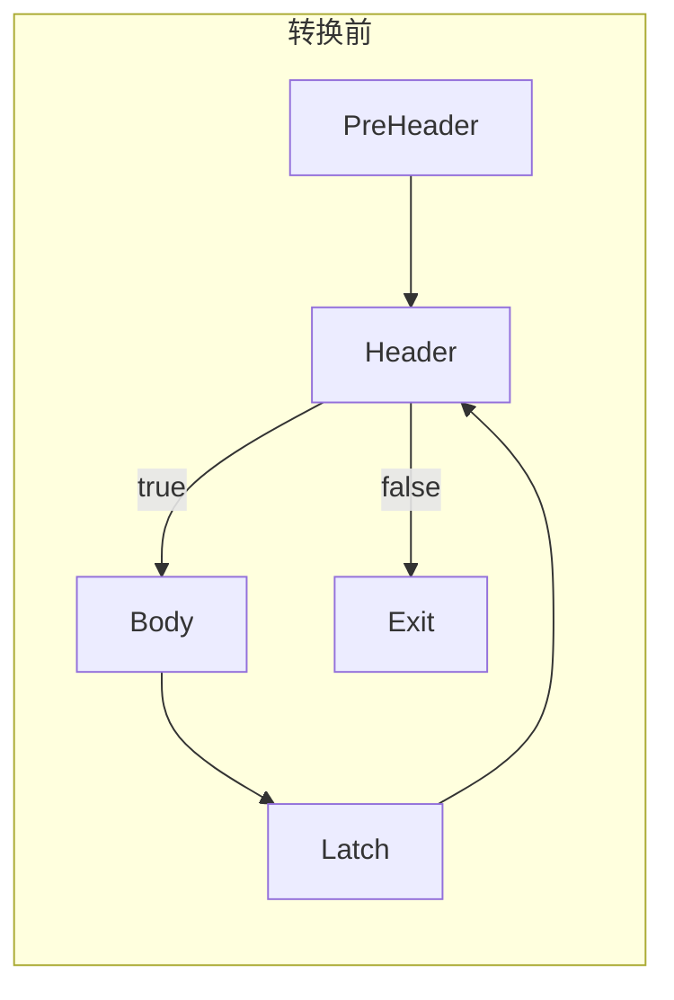

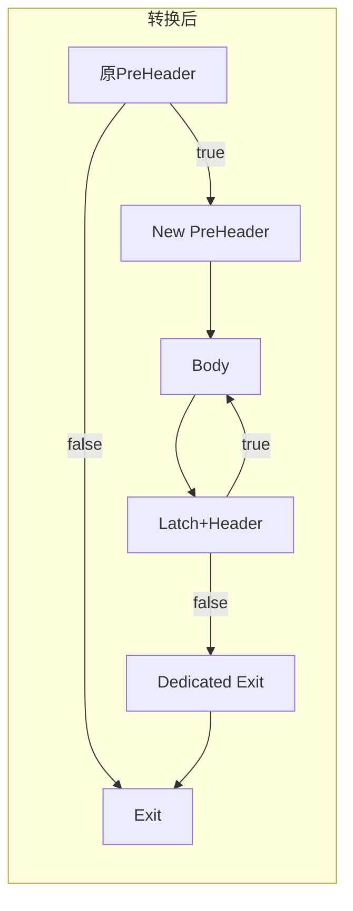

##### IndVarSimplify

依赖 AnalysisPass：LoopAnalysis、SCEV

1. 按 SCEV Key 对整数 Header PHI 分组

2. 对同 Key 的 PHI 再检查各前驱起点、更新 opcode 和 SSA 操作数形态；完全一致时合并重复递推

3. 将退出比较中的归纳变量规范到左侧：

   ```
   %c = icmp sgt i32 %n, %iv
   ; =>
   %c = icmp slt i32 %iv, %n
   ```

##### LoopDeletion

依赖 AnalysisPass：LoopAnalysis、SCEV

1. 只考虑最内层、LoopSimplify、LCSSA 循环。
2. 常量 trip count 必须非负，并在非零时证明 no-wrap；运行期仅支持规范 `i32 +1/-1` 严格比较循环。
3. 零次循环可直接沿 preheader incoming 解析 exit PHI。
4. 非零循环必须没有 load/store/call/alloca 等可观察操作，且所有 live-out 都能由 exit PHI 安全替代。
5. 成功后将 preheader 直接连到 exit，并删除整个循环块集合。

```
for (i = 0; i < 4; ++i)
    dead = i * 7;
; =>
; 整个循环删除
```

##### LoopStrengthReduction

依赖 AnalysisPass：LoopAnalysis、SCEV、DominantAnalysis

当前实现不是通用整数 LSR，只优化循环 load/store 使用的 GEP 地址族

1. 要求地址相对当前循环只有一个变化维度，且索引为常量步长 affine recurrence

2. 在 preheader/header/latch 建立指针归纳变量：

   ```
   %p.start = gep ptr %a, 0
   %p.iv    = phi ptr [%p.start, %pre], [%p.next, %latch]
   %p.next  = gep ptr %p.iv, 4
   ```

3. 起点和布局相同的地址共用一个 pointer IV；末维不同常量起点可以通过常量偏移共享

4. 只有每轮节省的指令足以偿还 preheader 设置成本时才变换

##### LoopUnswitch

依赖 AnalysisPass：Dominant、Loop、SCEV；trivial 模式额外使用 MemorySSA。Trivial unswitch：循环内不变量条件的一侧直接退出时，把条件移到 preheader。

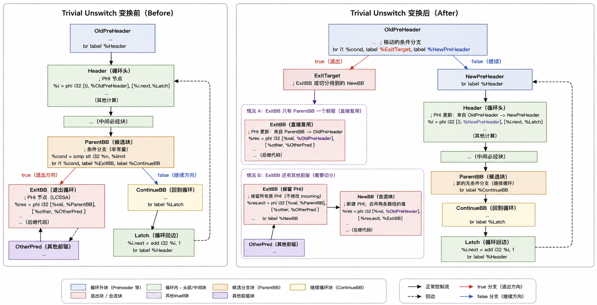

Non-trivial unswitch：两侧均在循环内时，保留较大的闭包，克隆较小闭包，生成两个特化循环版本

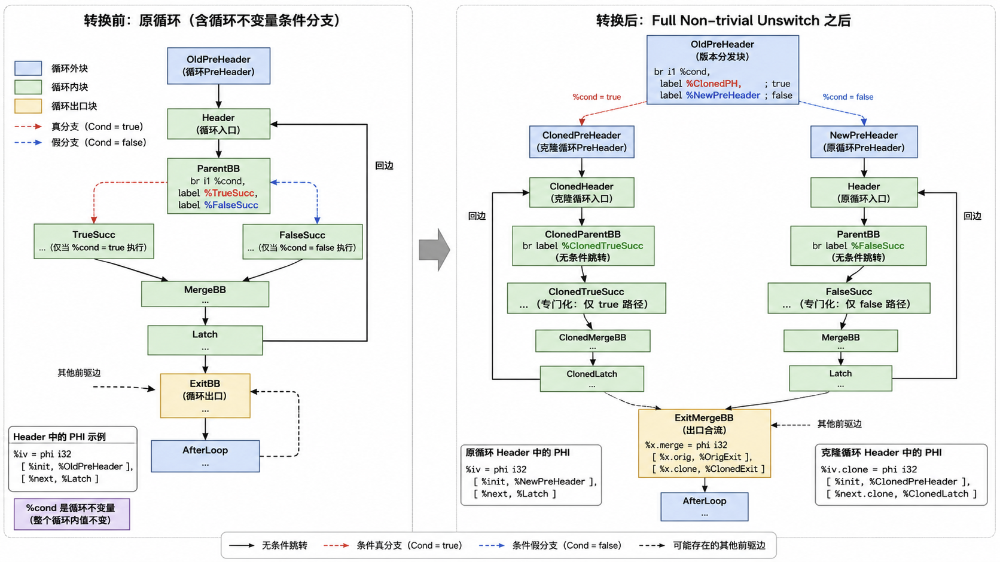

##### LICM

依赖 AnalysisPass：Dominant、Loop、BasicAA、MemorySSA、SideEffectAnalysis

1. 把循环不变的 binary/select/GEP/cast 移到 preheader
2. Load 提升要求地址循环不变，并由安全执行前缀或 preheader 的 MustAlias 访问证明可解引用；MemorySSA 必须证明循环内无写破坏
3. 不变 store 可以下沉到所有循环出口，但地址仅限 global/alloca 上的常量、在界 GEP，并要求 store 支配所有 latch/exiting block
4. 必执行的只读调用可以提升；非必执行但支配 latch 的只读调用

##### LoopDistribution

依赖 AnalysisPass：Loop、SCEV、LoopDependence

1. 要求 LCSSA、唯一 preheader/latch/exit/exiting edge，并且 exit 没有 PHI

2. 以 store 为 statement root，为每个 store 构建循环内 SSA 反向切片

3. 只枚举保持原 store 顺序的连续切点：

   ```
   stores[0..cut) | stores[cut..end)
   ```

4. LoopDependence 必须证明顺序合法；局部性模型要求两个分区的字节 stride 有明显差异

5. 克隆完整循环，原循环保留第一分区，克隆循环保留第二分区，两者串行执行。

```
for (i,j) {
    A[i][j] = ...;
    B[j][i] = ...;
}
```

可拆成两个循环，随后分别由 LoopInterchange 选择合适顺序

##### LoopInterchange

依赖 AnalysisPass：Dominant、PostDominant、Loop、SCEV、LoopDependence

1. 角色交换：当相邻两层循环起点、步长、trip count 和零次语义完全相同时，不改 CFG，只交换 payload 中两层 IV 的用途
2. 物理交换：识别旋转后的固定循环骨架，建立辅助块并真正重接 CFG/PHI

```
; before
%p = gep ptr %A, %j, %i

; after
%p = gep ptr %A, %i, %j
```

##### LoopIdiomRecognize

依赖 AnalysisPass：Dominant、Loop、Range、SCEV

1. 识别连续 i32/f32 写循环；若写入常量的四个字节相同，替换为 `memset`

2. 识别连续 load→store 循环；源和目标必须是不同的、已知 alloca/global 根，替换为 `memcpy`

3. 识别相邻的“源→临时数组”和“临时数组→目标”循环；临时 alloca 只能被这两个循环使用，替换为 `memmove`

4. 常量 trip count 时直接插入 intrinsic；运行期循环会生成快速路径 guard：

   ```
   count >= 8 && count <= INT_MAX / 4
   ```

   快路径执行 intrinsic，慢路径保留原循环。

```
for (i = 0; i < n; ++i)
    A[i] = 0;
```

可转为 `memset(A, 0, n * 4)`

##### LoopFusion

依赖 AnalysisPass：Dominant、PostDominant、Loop、SCEV、LoopAccess

1. 只处理严格相邻的同层循环
2. 两个循环必须具有完全相同的 SCEV 起点、非零常量步长、trip count 和零次执行语义
3. LoopAccess 必须证明所有跨循环冲突为 NoConflict 或 SameIterationOnly

##### UnrollAndJam

依赖 AnalysisPass：Loop、SCEV、LoopAccess、Dominant、PostDominant、 BasicAA

1. 处理直接父子矩形循环嵌套，将多个外层迭代的内层循环体合并到同一个内层循环中
2. 外层必须是正的常量 trip count、常量步长、no-wrap 规范循环；LoopAccess 必须证明外层迭代独立
3. 主要收益来自：多个 lane 共享一个沿外层不变、沿内层变化的 load，或者严格浮点递推的滑动窗口访问形态
4. 支持因子 2/4/8；实际自动选择受寄存器、代码规模和 cache-line 成本约束
5. 若 trip count 不能整除因子，先 peel 最多 7 次余数迭代，后续固定点再执行 jam

##### LoopUnroll

依赖 AnalysisPass：Loop、Dominant、SCEV、BasicAA、Range

决策优先级为：

1. Full unroll：常量 trip count 且 no-wrap。默认最多 16 次；极小循环可放宽到 32 次。
2. Peeling：识别首轮特殊条件，或可在剩余循环中删除的 invariant store；通常 peel 1～2 次。
3. Partial unroll：常量 trip count 可整除时优先选择因子 4，其次 2。
4. Partial with remainder：建立分组主循环，并在后面生成固定数量的 tail 副本。
5. Runtime unroll：运行期 trip count 需要廉价 SCEV 展开和 no-wrap 证明；生成主循环次数与动态 tail，二次幂因子用 `and/lshr` 计算

### 参考资料

1. https://llvm.org/docs/Passes.html
2. https://www.zhihu.com/people/bie-shuo-tai-duo-i
3. https://gbc.xq.gl/
4. https://evian-zhang.github.io/llvm-ir-tutorial/index.html
5. https://enna1.github.io/
6. https://llvm-study-notes.readthedocs.io/en/latest/index.html
7. https://understanding-llvm-transformation-passes.readthedocs.io/
8. 《Engineering A Compiler 2nd Edition / 编译器设计 第二版》
9. 《Static Single Assignment Book》
10. 《深入理解 LLVM：代码生成》
